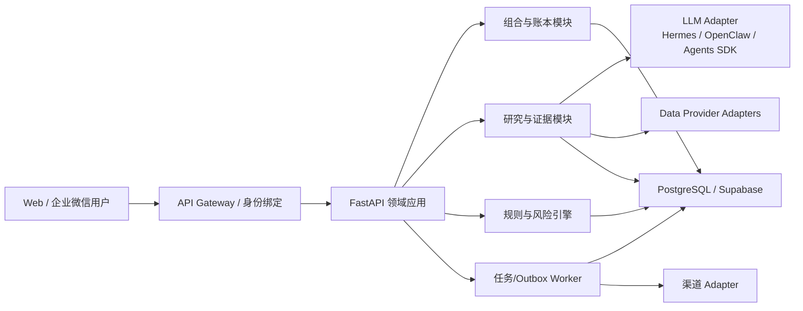

# WealthSail 需求、架构、数据与测试 Review 报告

> Review 日期：2026-08-23
>
> Review 范围：`docs/` 全部 5 份文档，以及 `reference/` 中与产品定位、架构、数据、测试、投资方法相关的参考材料
>
> 结论性质：产品、投资研究流程、软件架构、数据模型、测试与风险治理评审；不构成投资或法律意见

## 0. 结论摘要

WealthSail **有产品价值，但当前文档不具备直接进入“全量开发/验收”的条件**。它真正有机会形成差异化的部分，不是“比市场多一个会荐股的 AI”，而是把个人投资者分散在行情软件、聊天记录、Excel 和脑中的信息，沉淀成一个可追溯的 **投资决策系统（Decision System of Record）**：持仓账本、投资论点、证据、退出规则、提醒、执行和事后归因形成闭环。

当前方案的主要问题有四类：

1. **目标过宽、价值主线被功能堆叠稀释**：MVP 同时覆盖 A/H/美股、基金、黄金、债券、四核宏观、多 Agent、回测、NL2Strategy、自进化和多渠道，既无法快速验证收益，也会显著提高数据许可、准确性和运维成本。
2. **账务、租户隔离和数据真实性存在 P0 风险**：示例工具未按用户过滤，`service_role` 被建议交给 Agent，交易记录不更新现金/持仓，分红流程非事务且可重复入账，多处用硬编码“实时行情”兜底。
3. **文档与实现、测试相互矛盾**：仓库中没有测试代码及核心服务实现，两份测试规范却把 26/26、27/27 用例全部标为 `PASS`；部分用例的函数签名和断言与指南代码不匹配，事实上无法通过。
4. **“自进化”治理方向危险**：根据少量 T+3/T+5 结果把责任二分为 `AI_ERROR`/`USER_ERROR`，再自动改写 Skill，容易产生过拟合、错误归因和策略漂移。应改为离线评估、冠军/挑战者、人工审批和可回滚发布。

### 0.1 综合成熟度

| 维度 | 当前评分（5 分） | 判断 |
|---|---:|---|
| 用户价值与差异化 | 3.5 | 闭环决策和私人数据有价值，但 persona 与付费场景尚未聚焦 |
| 需求边界与优先级 | 1.5 | P0 范围远超 MVP，缺少明确的非目标和淘汰标准 |
| 投资方法与收益度量 | 2.0 | 策略概念丰富，但缺少基准、成本、风险预算和可证伪体系 |
| 技术选型 | 2.5 | 分层思路合理，结论与工作量估计过度乐观 |
| 软件与数据设计 | 1.5 | 账本、幂等、状态机、证据链、多租户边界不足 |
| 安全、合规与数据许可 | 1.0 | 尚未形成可上线的控制面 |
| 测试与验收 | 1.0 | 规范有框架，但状态失真、异常覆盖和追溯性严重不足 |
| 文档自洽与可执行性 | 1.5 | 多处命名、范围、函数和验收结果冲突 |

### 0.2 建议的决策

- **可以继续做，但应先重写 MVP 边界和数据底座，再编码。**
- 把“帮助用户提高收益”改写为：**在明确风险预算下，提高税费后、基准调整后的风险收益，并降低可避免的交易错误。** 系统不能承诺收益，也不能把交易频率当作价值。
- 第一阶段只验证 5 个能力：**可信账本、组合风险、证据化简报、论点/退出规则、决策复盘**。
- Hermes 或 OpenClaw 只作为个人自动化/消息入口；账户、权限、账务、订单、审批和审计必须由领域后端掌控。
- 在修复本报告 P0 问题前，所有测试状态应从 `PASS` 改为 `NOT_RUN` 或 `PLANNED`。

---

## 1. 评审范围与证据边界

已逐份检查：

- [01. WealthSail 投研平台需求文档](../docs/01.WealthSail投研平台需求文档.md)
- [02. 全栈技术选型与架构评估](../docs/02.WealthSail投研平台全栈技术选型与架构评估.md)
- [03. MVP 快速构建与实战指南](../docs/03.WealthSail-MVP快速构建与实战指南.md)
- [04. MVP 功能验收与自动化测试规范](../docs/04.WealthSail-MVP功能验收与自动化测试规范.md)
- [05. 全量系统功能验收与全栈测试规范](../docs/05.WealthSail-全量系统功能验收与全栈测试规范.md)
- `reference/` 中与项目背景、产品需求、技术方案、Agent、测试和投资方法有关的主要资料。

证据边界：

- 当前仓库有 `figma/v1-mobile` 原型，但不存在测试规范声称的 `tests/`、`frontend/`、`services/` 等全栈实现。因此本次不能把任何功能判为“已通过”。
- `reference/supabase和企业微信信息.rar` 可能包含凭据或连接信息，本次没有展开或引用，避免不必要的敏感信息暴露。
- 本次是文档与设计评审，不是基于产品运行截图的视觉/无障碍审计；UI 的像素、交互可用性和 WCAG 结论需另开一轮，使用实际页面和关键状态截图验证。
- 对外部产品、框架、法规和数据源的判断以 2026-08-23 可查到的官方资料为准。

---

## 2. P0：必须先解决的上线阻断问题

### P0-1：测试结果没有执行证据，却全部标为 PASS

`04`、`05` 文档把所有用例标为 `PASS`，但仓库不存在对应测试文件和核心实现。更严重的是：

- `UT-DB-01/02` 调用 `process_fund_dividend` 的参数顺序和数量与指南中函数定义不一致；
- `get_stock_kline` 只返回行情行，测试却断言其返回支撑位、压力位和最新收盘价；
- `record_trade_log` 只插入日志，场景及验收却声称会同步更新持仓、现金和退出规则；
- 很多“测试”只是字符串包含判断，无法证明金额、成本、来源、权限和金融语义正确。

处理建议：

1. 所有现有状态改为 `NOT_RUN`；增加 `planned / automated / executed / blocked / passed / failed` 状态模型。
2. 每次执行记录 commit、构建号、环境、数据集版本、模型版本、时间、日志和报告链接。
3. 没有可复现证据的测试不得进入发布门禁统计。

### P0-2：Agent 持有 `service_role`，且查询没有租户过滤

实战指南第 311 行建议复制 `anon/public` 或 `service_role` 给 Hermes；`get_user_portfolio()` 查询全部组合和持仓，`init_user_portfolio_chatops()` 用 `profiles.limit(1)` 取第一个用户，分红按 symbol 查询后取第一个持仓。

这是可直接导致跨用户资产泄露、错账和越权写入的组合风险。Supabase 官方明确说明 service role 绕过 RLS，应只保存在可信后端，不能放在客户端或通用 Agent 环境中：[Supabase 数据安全](https://supabase.com/docs/guides/database/secure-data)、[API keys](https://supabase.com/docs/guides/getting-started/api-keys)。

处理建议：

- Agent 只能调用带用户会话的窄接口，不得直接访问数据库；
- 后端从已验证 JWT/渠道绑定解析 `tenant_id/user_id`，忽略模型自行提供的用户 ID；
- service role 只存在于后端密钥管理系统；每个工具必须有最小权限、参数 schema、审计和速率限制；
- 所有租户表默认开启 RLS，CI 中自动检测“新增租户表未启 RLS/无 policy”。

### P0-3：没有可信账本，现金、持仓和日志会分叉

现在的 `portfolio.available_cash + positions.avg_cost + trade_logs` 是三个可独立修改的状态，没有原子交易、幂等键或可重放流水。`record_trade_log` 并不更新现金和持仓；分红操作由多次独立写构成，崩溃或重试会造成半完成或重复入账。

处理建议：使用不可变的 `ledger_events + ledger_legs` 作为唯一事实源；买卖、费用、税、分红、拆并股、入金、出金、转仓均落事件，现金和持仓是投影。至少保证：

- 同一事件以 `(tenant_id, provider, idempotency_key)` 唯一；
- 事件、腿、税费、批次在一个数据库事务中提交；
- 修改使用冲正事件，不直接覆盖历史；
- 每日对账可解释“系统余额—券商余额”的差异。

### P0-4：硬编码行情/宏观值伪装成实时数据

指南中出现固定 Brent、WTI、LME 铜、黄金、PMI 和阶段结论作为兜底。这种做法会把“数据不可用”伪装为真实市场状态，可能直接误导投资决策。

正确降级方式是：

- 返回 `UNAVAILABLE/STALE/CONFLICT`，标记来源、`as_of`、抓取时间、许可和质量分；
- 禁止静默使用陈旧或示例值；
- 关键建议缺少必要输入时应 `ABSTAIN`，而不是生成确定性买卖点；
- 展示“哪些数据缺失会影响结论”。

### P0-5：自建企业微信网关存在命令注入并已属重复建设

指南用 `subprocess.check_output(..., shell=True)` 拼接用户消息执行 Hermes 命令，没有签名校验、重放保护、用户/群路由和安全转义。当前 Hermes 官方已经提供企业微信适配器、用户白名单、重连和消息去重，可通过 `hermes gateway setup` 配置：[Hermes WeCom 官方文档](https://hermes-agent.nousresearch.com/docs/user-guide/messaging/wecom)。

处理建议：删除这段自建 shell 网关；若必须自建，使用 SDK/进程 API 的结构化参数，不启用 shell，并实现签名、时间戳、nonce、幂等、长度限制、超时、限流和审计。

### P0-6：证券建议、适当性、隐私和数据许可未进入产品约束

产品计划输出具体买卖点、仓位和收费/多用户服务时，业务模式可能触及证券投资咨询边界。证监会对提供证券及相关产品建议并直接或间接获取经济利益的活动有明确规范；付费“荐股软件”也涉及资质要求：[证券投资顾问业务暂行规定](https://neris.csrc.gov.cn/falvfagui/rdqsHeader/mainbody?navbarId=1&secFutrsLawId=3636153f028c44e9a00de8ed06494385)、[关于荐股软件的监管说明](https://www.csrc.gov.cn/csrc/c100028/c1002326/content.shtml)。

同时，AKShare 官方声明数据仅用于学术研究、不可商业使用，且接口可能被移除：[AKShare 特别说明](https://akshare.akfamily.xyz/special.html)。若项目未来商业化，现有数据源不能被视为有 SLA 和商业授权的底座。

产品应先明确模式：

- **个人自用**：仍需数据许可、安全、隐私和风险提示，但合规暴露较低；
- **朋友/封闭群体**：已经出现多主体、适当性和责任边界；
- **公开 SaaS/收费**：上线前必须完成法律意见、牌照/合作模式、适当性、留痕、投诉和利益冲突治理。

个人信息保护方面，应补充数据最小化、处理目的、自动化决策说明/拒绝、保存期限、删除、导出、影响评估和委托处理者清单，参考[《个人信息保护法》](https://www.miit.gov.cn/jgsj/zfs/fl/art/2022/art_515a4b20c12f430eab54bb4f56d89f56.html)。

---

## 3. 从经济分析和提高投资收益看：哪些应删减，哪些遗漏

### 3.1 先修正“收益”目标函数

“利润最大化”会鼓励模型频繁给信号，而信号数量不是投资价值。更合适的目标是：

> 在用户的期限、流动性、税务和最大回撤约束下，提高费后、税后、汇率调整后的风险收益和决策一致性。

最低度量集：

- 收益：TWR、MWR/XIRR、已实现/未实现收益、分红、费用、税、FX 贡献；
- 相对表现：相对用户自选基准的超额收益、跟踪误差、信息比率；
- 风险：波动、最大回撤、恢复期、Beta、行业/因子/币种/久期/流动性暴露、集中度；
- 行为：换手率、交易成本、追涨杀跌、过度交易、止损/论点执行率；
- 建议质量：覆盖率、弃权率、置信度校准、误报率、证据新鲜度、用户采纳率；
- 增量价值：与“无助手”“只看行情”“固定再平衡”相比，净收益、回撤和节省时间的变化。

频繁交易往往侵蚀个人投资者净收益，经典实证研究发现交易最频繁的个人账户净表现显著更差，因此系统默认动作应允许“保持不动”，并显式展示成本与机会成本：[Barber & Odean, Trading Is Hazardous to Your Wealth](https://faculty.haas.berkeley.edu/odean/papers%20current%20versions/individual_investor_performance_final.pdf)。近期对个人投资者研究行为的研究也显示，很多用户在交易前研究时间极短且很少查看风险统计，这恰好说明“快速、可信、风险优先的证据摘要”比制造更多交易提示更有价值：[NBER Working Paper 33625](https://www.nber.org/papers/w33625)。

### 3.2 当前 MVP 中多余或应后置的需求

这里的“多余”是指 **在验证第一阶段价值时边际收益低、成本或风险高**，不是永远没有价值。

| 需求 | 为什么当前多余/有害 | 建议 |
|---|---|---|
| A/H/美股、场内外基金、黄金、债券全品类 P0 | 每种资产的交易日历、估值、费用、税、公司行动、单位和许可不同 | MVP 先选一个主账户、A 股/ETF/基金 1–2 类；稳定后扩展 |
| 四核宏观与固定资产轮动结论 | 宏观数据低频、修订多、机制非平稳，固定“阶段→资产”容易伪精确 | 改成情景分析和风险提示，不做强制配置规则 |
| 多 Agent 红蓝辩论 | 同模型、同数据的 Agent 高度相关，只增加延迟、成本和“多数幻觉” | 先用证据表 + 单次反方检查；只有独立模型/数据时才启用 |
| NL2Strategy 自动生成策略代码 | 沙箱、回测偏差和可解释性成本极高，离核心闭环较远 | 延至研究工作台成熟后，只生成声明式策略 DSL |
| Skill 自动改写并上线 | 小样本、非平稳、投毒、回归和不可追溯风险 | 只生成候选版本，离线评估、人工批准、灰度和回滚 |
| Go 微服务 | 当前没有被测量的吞吐瓶颈，外部 API 才是主要延迟 | 先 Python 模块化单体/异步 Worker，基于 profiling 再拆 |
| Telegram、Server 酱、企业微信、Push 同为 P0 | 渠道不会提高分析质量，却扩大密钥、身份、去重和运维面 | 先 Web + 一个主渠道（企业微信或微信） |
| 精确买卖点和 14:30 基金申赎提示 | 数据延迟和净值估算误差会制造虚假精度，并诱导过度交易 | 输出区间、证据、置信度、截止时间和弃权；先做风险提醒 |
| PEAD、威科夫、情绪周期等全部做 P0 | 策略多会增加选择偏差和回测过拟合 | 先定义 1–2 个可证伪策略，做严格样本外验证 |

### 3.3 目前遗漏且更能提高投资结果的需求

1. **投资政策声明（IPS）**：目标、期限、最大回撤、现金需求、允许资产、单标的/行业/币种上限、再平衡规则和禁投清单。
2. **基准与机会成本**：每个账户/策略必须有明确基准；否则上涨后无法判断是能力还是 Beta。
3. **风险预算和仓位引擎**：按组合风险、相关性、波动和流动性确定仓位，而非只按单标的置信度。
4. **费税汇率模型**：A/H/美股、基金申赎、红利税、印花税、佣金、点差、汇兑和资金占用必须进入净收益。
5. **不可变账本和券商对账**：这是所有收益归因、风险和复盘的前提。
6. **论点—催化剂—证伪条件**：每个建议必须包含期限、基准、催化剂、反方证据、退出条件和“什么情况下不交易”。
7. **证据链与数据质量**：来源 URL/文档、发布时间、`as_of`、抓取时间、许可、修订版本、冲突与新鲜度。
8. **组合穿透与暴露**：基金持仓滞后应标注 `as_of`；识别股票/基金重复暴露、行业、国家、币种和利率风险。
9. **校准与弃权**：数据不足、冲突或超出能力范围时返回 `ABSTAIN`；按置信度分桶验证实际命中率。
10. **反事实评估**：建议 vs 不交易、固定再平衡、基准策略；避免只用建议后涨跌判断对错。
11. **行为干预**：冷静期、交易前检查清单、预演亏损、连续亏损降频、提醒预算和去重。
12. **容量和可交易性**：停牌、涨跌停、成交量、冲击成本、最小交易单位、申赎限制、锁定期。

### 3.4 T+N 归因应如何重做

不要把结果简单归为 `AI_ERROR` 或 `USER_ERROR`。建议的评估记录包含：

- 原建议、版本、证据和当时可得信息；
- 建议期限、基准、预期区间、风险预算、止损/失效条件；
- 实际执行时间、价格、数量、费用、滑点和偏离原因；
- 期间市场/行业/因子收益和重大外生事件；
- 反事实：不交易、按计划执行、延迟执行、基准策略的结果；
- 分类：`MODEL_THESIS_ERROR / DATA_ERROR / EXECUTION_DEVIATION / CONSTRAINT_CHANGE / EXOGENOUS_SHOCK / HORIZON_NOT_REACHED / INCONCLUSIVE`；
- 只有样本量、统计显著性和数据完整度达标后，才影响策略权重。

---

## 4. 方案选型：Hermes、OpenClaw 以及其他备选

### 4.1 原选型是否合理

**合理的部分**：

- 将 Agent Runtime、金融数据工具、关系数据库和 Web 客户端分层；
- 用关系数据库保存用户资产和审计数据，而不是把聊天记忆当账本；
- 使用 RLS、人工确认和本地/私有部署作为约束；
- Python 承担金融数据和量化生态。

**不合理或证据不足的部分**：

- 把 Hermes 评为与需求“100% 契合”，没有 PoC 指标和权重；
- 文档声称基于 DSPy/GEPA 原生自动重写 Skill，但 Hermes 官方资料能确认的是 Skill 管理、后台审查和写入审批，不足以支撑该具体实现承诺；
- 认为 Go 天然保证 5 秒推送、Python GIL 必然成为瓶颈，忽略这是 I/O 密集型且主要受上游 API 限制；
- Hosted Supabase 与“数据完全本地”冲突；自托管 Supabase 也不是零运维；
- “RLS 100% 物理隔离”“迁移成本几乎为零”“两天完成”均属于不可验证的营销式结论；
- 没有评估运行时崩溃恢复、长任务暂停、审批恢复、幂等、成本、可观测性和多租户信任模型。

### 4.2 候选方案比较

| 方案 | 优点 | 关键缺点 | 在 WealthSail 中的合适角色 |
|---|---|---|---|
| **纯 FastAPI + Pydantic + Worker + 显式状态机** | 最简单、类型清晰、容易测、可完全控制金融约束 | Agent 编排和长任务能力需自建 | **推荐作为 MVP 核心** |
| **Hermes Agent** | 个人 Agent、Skills、Cron、企业微信等渠道集成成熟；官方 Cron 支持模型固定与失败关闭 | 不是多租户账务/订单安全边界；版本变化快 | 个人自动化和渠道适配层 |
| **OpenClaw** | 网关、渠道、工具、沙箱和执行审批体系较完整 | 官方明确采用个人助手信任模型，不应作为敌对多租户边界 | 运维/消息边缘；每用户或隔离实例 |
| **LangGraph** | 显式状态、持久执行、暂停恢复、HITL，适合复杂研究流 | 图和状态设计有学习/维护成本 | 第二阶段复杂研究、审批和恢复流程 |
| **OpenAI Agents SDK** | 轻量，工具、handoff、session、HITL 组合直接 | 供应商依赖，领域耐久性仍需外部存储 | 快速 Agent PoC 或单模型编排 |
| **PydanticAI** | Python 类型、结构化输出、评估和可测试性友好 | 渠道和业务工作流仍需自建 | 结构化研究任务替代层 |
| **AutoGen / CrewAI** | 多 Agent 研究实验便利 | 成本、确定性、状态和生产治理较弱 | 研究实验，不做交易核心 |
| **DBOS / Restate / Temporal** | 长流程、重试、暂停、恢复、幂等和可观测性强 | 增加运行时和运维复杂度 | 交易审批、定时评估等成熟阶段的耐久流程 |

LangGraph 官方将其定位为长运行、有状态 Agent 的持久执行和 HITL 基础设施：[LangGraph Overview](https://docs.langchain.com/oss/python/langgraph/overview)。OpenAI Agents SDK 也支持敏感工具调用暂停、持久化并在审批后恢复：[Human-in-the-loop](https://openai.github.io/openai-agents-python/human_in_the_loop/)。AutoGen 官方建议先从单 Agent 开始，只有单 Agent 不足时才使用团队：[AutoGen Teams](https://microsoft.github.io/autogen/stable/user-guide/agentchat-user-guide/tutorial/teams.html)。DBOS 可在 Postgres 上提供可恢复工作流和事务只提交一次的保证，适合后续订单/通知流程：[DBOS Workflows](https://docs.dbos.dev/python/tutorials/workflow-tutorial)。

OpenClaw 的官方安全文档明确提醒其采用个人助手信任模型，不能把一个 Gateway 当作互不信任用户之间的安全边界；敌对用户应拆分 Gateway/OS 用户：[OpenClaw Security](https://docs.openclaw.ai/gateway/security)。这也是 Hermes/OpenClaw 都不应直接成为共享 SaaS 交易核心的根本原因。

### 4.3 推荐选型

**MVP 推荐：模块化单体 + 可替换 Agent/渠道适配器。**

关键边界：

- LLM 只生成研究候选和结构化解释，不直接修改账本或发单；
- 价格、费用、仓位、风控、状态迁移由确定性代码计算；
- 所有外部副作用走 Outbox，具备幂等、重试、死信和审计；
- Hermes/OpenClaw/Agents SDK 通过统一接口可替换，避免 Runtime 锁定；
- 只有出现明确的独立扩容、团队边界或性能证据后再拆微服务/Go。

### 4.4 一周 PoC 决策矩阵

不要继续用主观红绿灯选型。用同一组任务对 Hermes、OpenClaw、轻量 FastAPI/Agents SDK 做 bake-off：

| 指标 | 权重 | 合格线 |
|---|---:|---|
| 工具参数与结构化输出正确率 | 20% | Golden set ≥ 98%，禁止越权参数 |
| 崩溃后恢复和幂等 | 15% | 关键流程 kill/restart 不重复入账/推送 |
| 企业微信接入与身份绑定 | 10% | 私聊、群聊、重连、去重和撤销均通过 |
| 权限、沙箱、密钥隔离 | 20% | 无 DB 密钥暴露；跨租户测试全阻断 |
| 可观测与审计 | 10% | 每个建议可追到数据、模型、Prompt、工具调用 |
| 开发与运维复杂度 | 10% | 单机可复现，升级/回滚有文档 |
| 延迟与成本 | 10% | 给出 p50/p95、Token/任务和月成本 |
| 生态与可替换性 | 5% | Provider/Runtime 契约测试通过 |

---

## 5. 文档完整性、结构和自洽性

### 5.1 已发现的直接矛盾

| 问题 | 证据 | 影响 |
|---|---|---|
| 三核/四核/双核增强版并存 | 需求 L29、L33、L348；架构标题 L3、图 L26 | 领域边界、Roadmap 和测试范围无法统一 |
| P0 不是 MVP | 需求 L323 全品类、L342 多渠道均为 P0 | 团队无法围绕最小假设交付 |
| `pending_orders` 被要求但无表定义 | 需求 L572；23 个建表语句中不存在该表 | HITL 订单流程不可实现 |
| SQL 无法直接执行 | `watchlists.user_id REFERENCES...` 缺少数据类型（需求 L729） | 建库失败 |
| RLS 叙述与 DDL 不一致 | 附录仅 9 个表启用 RLS、8 条 policy；`exit_rules` 无 policy，多个敏感表未启用 | 安全结论失真 |
| `multi_agent_debates` 无 `user_id` | 需求 L895 | 无法做租户隔离/审计 |
| 指南场景与函数行为不一致 | `record_trade_log` L700 只写日志，场景 L927 声称更新完整状态 | 错账和虚假验收 |
| 分红测试与函数签名不一致 | 指南 L726 vs 测试 04 的 UT-DB-01/02 | 用例不可执行 |
| 场景数量错误 | 指南称 7 个，实际编号 0–8 | 文档维护质量预警 |
| “100% 满足需求”无证据 | 指南 L1128 | 掩盖未实现能力 |
| “物理隔离”表述错误 | RLS 是逻辑行级访问控制，且 service role 可绕过 | 错误安全预期 |

### 5.2 建议重构文档体系

建议从“一个超级 PRD + 大段 SQL/代码”拆成以下可维护结构：

1. `00-product-brief.md`：问题、目标 persona、JTBD、价值假设、商业模式、非目标；
2. `01-prd.md`：带稳定 ID 的功能/非功能需求、优先级、验收条件；
3. `02-domain-glossary.md`：账户、组合、仓位、批次、建议、决策、执行、收益、基准等统一术语；
4. `03-user-journeys.md`：端到端正常/异常流程和状态机；
5. `04-data-and-source-contracts.md`：数据字典、来源、时间语义、许可、质量、降级；
6. `05-architecture.md`：上下文边界、接口、部署、故障模型；
7. `adr/`：Agent Runtime、数据库、工作流、消息渠道、数据源等决策记录；
8. `06-security-privacy-compliance.md`：威胁模型、权限矩阵、密钥、留存、合规模式；
9. `07-test-strategy.md`：追溯矩阵、测试层次、数据集、发布门禁；
10. `runbooks/`：备份恢复、模型/数据源降级、密钥轮换、迁移回滚、事故响应。

每条需求使用唯一 ID，例如 `FR-LEDGER-001`、`SEC-TENANT-002`、`NFR-REL-003`。PRD 不嵌入完整 DDL 和大段实现代码；DDL 应通过版本化 migration 管理，文档只解释模型和约束。

### 5.3 当前遗漏的文档内容

- 主 persona、反 persona、核心 JTBD、付费意愿和使用频率；
- 范围外（Out of Scope）和删除/降级条件；
- 业务模式与合规边界；
- 数据来源目录、字段映射、许可、SLA、更新/修订语义和替代源；
- 账户/资产/市场/币种/时区/交易日历词典；
- 状态机：建议、提醒、订单、交易、复盘、Skill 发布；
- API/OpenAPI、事件 schema、错误码、幂等协议和版本兼容；
- 租户—角色—资源—动作权限矩阵；
- SLI/SLO、容量模型、RPO/RTO、成本预算；
- 模型卡、Prompt/Skill 版本、离线评测集、上线/回滚规则；
- 数据迁移和历史回填策略；
- 可观测、告警、备份恢复和事故响应；
- 需求—设计—测试—证据的追溯矩阵。

---

## 6. 软件设计优化

### 6.1 领域模块建议

建议先做模块化单体，明确 7 个边界：

1. **Identity & Tenancy**：用户、账户、渠道绑定、角色、同意与撤销；
2. **Portfolio Ledger**：不可变流水、批次、现金、持仓投影、对账；
3. **Market Data**：instrument master、价格/NAV/FX/公司行动、来源质量；
4. **Research**：论点、证据、建议、模型运行、引用；
5. **Risk & Policy**：IPS、限制、风险计算、退出规则、异常检测；
6. **Workflow & Notification**：任务、提醒事件、Outbox、去重和回执；
7. **Evaluation & Governance**：执行、反事实评估、模型/Skill 版本和审计。

模块间只能通过明确服务/事件交互；Agent 不可绕过领域服务直接操作表。

### 6.2 关键流程必须显式状态化

建议状态机：

- 建议：`DRAFT → VALIDATED → PUBLISHED → ACKNOWLEDGED → EXPIRED/RETRACTED`；
- 订单：`PROPOSED → RISK_CHECKED → PENDING_APPROVAL → APPROVED → SUBMITTED → PARTIALLY_FILLED → FILLED/CANCELLED/REJECTED/EXPIRED`；
- 数据快照：`FRESH / STALE / CONFLICT / UNAVAILABLE / REVISED`；
- Skill：`DRAFT → OFFLINE_EVALUATED → APPROVED → CANARY → ACTIVE → ROLLED_BACK/RETIRED`。

每次迁移记录 actor、时间、来源状态、版本和幂等键。无状态字段、只靠 LLM 文字判断，会导致重试后重复执行。

### 6.3 LLM 与确定性金融计算的边界

LLM 可以：总结、生成候选论点、提取事件、提出反方问题、解释风险。

LLM 不应：

- 自己计算现金、批次成本、费税、收益和仓位；
- 决定租户身份或访问范围；
- 在无审批情况下发单或修改账本；
- 静默选择陈旧数据；
- 自动发布修改后的 Skill；
- 执行不受限的自然语言生成代码。

所有 LLM 输出使用版本化 JSON Schema，并经过：字段验证、数值重算、引用检查、数据新鲜度检查、风险限制、敏感工具审批。

### 6.4 可靠性与运维

- 数据抓取、分析、推送全部带 correlation ID；
- Transactional Outbox 保证 DB 提交与消息投递之间可恢复；
- 明确 at-least-once 投递，消费者必须幂等；
- 外部 API 使用超时、指数退避、抖动、熔断、限流和供应商级配额；
- 定时任务需 leader election/唯一 job key，防止多实例重复运行；
- 建立失败队列和人工重放；
- 指标包括：数据新鲜度、冲突率、任务积压、重复率、推送到达、模型错误、弃权率、Token 成本；
- SLO 使用 p95/p99 和清晰负载，不使用脱离环境的“所有请求 < 5 秒/100% 到达”。

### 6.5 安全设计

- 后端是唯一信任边界，Agent/渠道/浏览器均视为不可信；
- 提示注入不仅来自用户，也来自新闻、公告、研报和网页，抓取内容不得获得工具指令权；
- 所有租户表强制 `tenant_id NOT NULL`，RLS + 应用鉴权双层防御；
- 渠道绑定码短期有效、一次性、限速、可撤销，并防止账户合并劫持；
- 密钥仅存 Vault/KMS 的引用，不存业务表 JSON；
- NL2Strategy 使用声明式 DSL；若必须执行 Python，使用无网络、只读文件系统、CPU/内存/时间限制和系统调用沙箱；
- 审计日志 append-only，并对高风险操作记录审批人和前后状态。

---

## 7. 数据表设计：问题、过度设计与简化方案

### 7.1 现有设计的主要问题

1. **租户不完整**：`multi_agent_debates` 无 `user_id`；`user_channel_bindings`、`post_mortem`、`daily_reports`、`user_push_configs` 等未纳入附录 RLS；`exit_rules` 开启 RLS 却没有 policy。
2. **DDL 错误**：`watchlists.user_id` 缺 UUID 类型；表编号重复；部分引用/枚举互相不一致。
3. **没有 instrument master**：同一 symbol 可跨市场，资产类型/币种/交易所/ISIN/基金代码无法统一；`CRYPTO` 出现在枚举却不在范围中。
4. **没有账户和币种模型**：一个用户可能有多个券商/基金账户；`portfolio` 未限制一用户一条，也无法处理基准币种。
5. **可变快照代替账本**：`available_cash`、`quantity`、`avg_cost` 可直接改，无法审计、重放、对账或准确处理批次。
6. **时间语义缺失**：很多行情/宏观/基金持仓没有 `observed_at/as_of/published_at/retrieved_at/revised_at` 和来源版本。
7. **宽宏观表过度设计**：每加指标都要改 schema；不同频率、地区和修订无法表达。
8. **基金穿透缺少有效期**：没有来源、披露日、报告期、版本和唯一约束，容易把陈旧持仓当实时。
9. **AI 表职责混杂**：`ai_suggestions` 同时表示报告、建议、动作，单 symbol/action 无法承载多资产组合建议。
10. **退出规则绑定 symbol 而非具体账户/批次/论点**：无法处理同标的不同策略持仓。
11. **向量维度硬编码**：`VECTOR(1536)` 没有 embedding model/version/有效期，升级困难。
12. **凭据字段风险**：渠道/API 配置不应直接保存 secret JSON。
13. **缺失关键表**：文档要求的 `pending_orders` 不存在；也没有 FX、公司行动、数据快照、模型运行、Outbox、任务运行和审计。

### 7.2 推荐的简化核心模型

不需要为每个功能建一张孤立表。按事实源、投影和证据分层：

| 组 | 表 | 说明 |
|---|---|---|
| 身份 | `profiles`, `accounts`, `channel_bindings`, `secret_refs` | 多账户、基准币种；secret 只存 Vault 引用 |
| 标的 | `instruments`, `instrument_aliases` | 全局 instrument ID，统一市场、币种、类型和别名 |
| 账本 | `ledger_events`, `ledger_legs` | 买卖、现金、费税、分红、拆并股、转仓、冲正的唯一事实源 |
| 投影 | `position_lots`, `position_snapshots`, `account_nav_snapshots` | 可重建；支持批次、对账和性能计算 |
| 市场数据 | `data_sources`, `source_snapshots`, `market_observations`, `corporate_actions` | 统一来源、时点、质量和修订；宏观也走 observations |
| 研究 | `theses`, `recommendations`, `evidence_refs`, `model_runs` | 论点、建议和证据分离；记录模型/Prompt/Skill 版本 |
| 风控 | `investment_policies`, `alert_rules`, `alert_events` | IPS、组合限制、触发/确认/过期/抑制 |
| 决策 | `decisions`, `order_intents`, `executions`, `evaluations` | 用户是否采纳、审批、真实执行和反事实归因 |
| 运维 | `jobs`, `job_runs`, `outbox`, `audit_log` | 调度、幂等副作用、可观测和审计 |
| 集合 | `collections`, `collection_items` | 统一自选、研究清单等，减少 watchlist 特例表 |

这里约 20 张核心表，看似与原 23 张数量接近，但职责更稳定，删除了重复报告/记忆/策略特例表，并补齐了真正的事实链。日报可由 recommendation/evidence 生成，不必先做独立事实表；向量是证据或记忆的派生索引，不应成为业务真相。

### 7.3 关键约束

- 所有 tenant 表：`tenant_id UUID NOT NULL`，FK、RLS、组合索引；
- 金额使用 `NUMERIC` + `currency`，禁止隐含“人民币”；数量、价格、汇率的精度分别定义；
- 全部外部事件：`source_id + external_id + idempotency_key` 唯一；
- 行情：`instrument_id + field + observed_at + source_id + revision` 唯一；
- 证据：必须有 `source_uri/document_id, published_at, as_of, retrieved_at, content_hash, license, quality_status`；
- 建议：必须有 `horizon, benchmark_id, confidence, abstention_reason, valid_until, thesis_id, model_run_id`；
- 订单状态机使用乐观锁/version，防止并发重复确认；
- 删除采用保留策略和 tombstone；审计与账本不可直接物理删除；
- 所有派生持仓和收益都能从账本 + 市场数据重建，并用 property test 验证守恒。

---

## 8. 需求场景与关键异常分支

现有文档对典型“成功路径”描述较多，但跨渠道、数据异常、交易生命周期、账务和恢复场景不足。建议用以下矩阵补齐，并为每个分支定义系统状态、用户提示、补偿动作和审计字段。

| 场景域 | 缺失的关键分支 |
|---|---|
| 注册/身份 | 重复邮箱、JWT 过期、渠道绑定码过期/复用/被盗、同渠道绑定多个账户、撤销绑定、账号合并、注销与数据删除 |
| 持仓导入 | 代码歧义/跨交易所同名、币种不明、总资产与明细不平、CSV/OCR 重复、负数/小数非法、用户纠错与撤销、部分导入失败 |
| 市场数据 | 超时、限流、字段变更、空值、停牌、退市、迟到/修订、主备源冲突、时区/DST/节假日、行情陈旧、许可失效 |
| 基金/债券 | 净值尚未发布、估值误差、份额确认延迟、申赎费/锁定期、基金合并/清盘、分红方式变更、债券应计利息/到期/回售 |
| 公司行动 | 拆股、合股、送转、配股、现金/股票分红、代码变更、退市现金补偿、事件重复或更正 |
| 研究生成 | 证据不足/冲突、无一致预期、引用丢失、模型超时、结构化输出失败、Prompt 注入、低置信度弃权、模型切换导致漂移 |
| 提醒 | 价格跳空跨过阈值、阈值附近震荡重复触发、规则已修改/仓位已平、消息延迟/失败/乱序/重复、用户未读、提醒过期 |
| 交易/确认 | 市场关闭、报价陈旧、资金不足、最小手数、涨跌停、部分成交、拒单、撤单、改单、重复确认、审批过期、手工外部交易 |
| 多币种 | FX 缺失/陈旧、换汇费、基准币种切换、汇率对收益贡献、现金负余额和跨账户转账 |
| 风险限制 | 多规则冲突、组合上限与单标的建议冲突、数据不足无法算风险、用户临时覆盖限制、覆盖审批和到期 |
| 复盘 | 尚未达到期限、基准缺失、外生冲击、用户部分执行、执行价偏差、策略规则在期间变化、结论不确定、用户申诉/修正 |
| 自进化 | 小样本、回测过拟合、Golden set 退化、记忆投毒、旧知识失效、灰度失败、版本回滚、不同用户记忆泄漏 |
| 调度/运维 | Cron 重叠、多实例重复、进程中途崩溃、重启恢复、时钟漂移、消息积压、数据库迁移失败、备份恢复、密钥轮换 |

端到端场景模板应至少包含：前置条件、触发、主流程、所有替代/异常流、状态变化、金融不变量、权限、数据新鲜度、幂等、通知、审计、恢复和验收证据。

---

## 9. 测试与验收完整性

### 9.1 当前覆盖结论

现有测试文档 **不完整，也不具备可信执行状态**。虽然覆盖了 UT/IT/ST/E2E/NFR 的名称，但存在：

- 无需求 ID 和追溯矩阵，无法证明“所有需求均有测试”；
- 高比例 happy path，缺少异常、恢复、幂等、并发和安全测试；
- 单元测试直接访问外部实时 API，结果不可重复；
- LLM 输出按固定文字验收，无法处理合法表达变化；
- 性能指标没有负载、样本、地域、供应商、p95/p99；
- “推送到达率 100%”“坐标 100% 对齐”“全栈通过率 100%”不是合理生产 SLO；
- RLS 测试假设越权一定返回 403，而 RLS 查询通常也可能返回空结果，需按接口行为分别断言；
- 用 Playwright 不能单独证明稳定 60 FPS；需要浏览器 trace/performance 指标和人工视觉验证；
- “T+N 归因准确率 95%”没有可操作的 ground truth 定义。

### 9.2 推荐测试体系

| 层级 | 测什么 | 原则 |
|---|---|---|
| 纯单元 | 费税、FX、批次、收益、分红、拆股、风险限制、状态迁移 | 无网络、固定时钟、表驱动 + property-based |
| Schema/Contract | LLM JSON、数据 Provider、渠道、API/OpenAPI | 录制 fixture；单独运行供应商 contract tests |
| 数据质量 | 新鲜度、完整性、修订、冲突、单位、交易日历、公司行动 | 以 Golden datasets 和跨源校验为主 |
| 数据库集成 | 事务、约束、RLS、并发、幂等、迁移与回滚 | 真 PostgreSQL；每次测试隔离租户 |
| 工作流故障注入 | kill/restart、超时、重试、重复/乱序消息、部分失败 | 验证账务守恒和 exactly-once effect |
| Agent 离线评估 | 工具选择、结构化输出、引用、弃权、注入、防越权 | 固定模型/版本/温度和 Golden set；允许语义评分 |
| 安全 | IDOR/RLS、service-role 泄露、渠道重放、Prompt 注入、沙箱逃逸 | 威胁模型驱动；CI + 定期人工测试 |
| E2E | 真实 persona 的主旅程和关键异常旅程 | 稳定测试账户/数据；保留录像、trace 和 DB 证据 |
| 性能/稳定 | p50/p95/p99、队列、成本、恢复、24/72h soak | 明确负载模型、环境和依赖降级 |
| 灾备 | 备份恢复、RPO/RTO、迁移回滚、供应商切换 | 定期演练，不只检查配置存在 |

### 9.3 必须增加的异常测试包

1. `tenant_isolation`: 任意两租户、任意资源、读写删、缓存/向量/日志/导出全隔离；
2. `ledger_invariants`: 交易/分红/费用/冲正后现金与证券腿守恒；重复事件只生效一次；
3. `market_data_fail_closed`: 超时、冲突、陈旧时不得输出伪实时买卖结论；
4. `corporate_actions`: 拆股、分红、配股、代码变更与更正；
5. `order_lifecycle`: 部分成交、拒单、撤单、过期、重复回报、乱序回报；
6. `time_and_calendar`: 中美节假日、跨时区、DST、午夜、交易日 T+N；
7. `prompt_injection`: 新闻网页和研报中的恶意指令不能触发工具/泄露数据；
8. `agent_abstention`: 缺证据/低置信度/模型故障必须弃权并解释；
9. `workflow_recovery`: 在每个副作用前后 kill 进程，恢复后无重复；
10. `skill_governance`: 候选 Skill 退化、投毒、灰度失败、回滚；
11. `backtest_bias`: 前视、幸存者、退市、复权、费税滑点、借券、数据窥探、样本外/走步验证；
12. `privacy_lifecycle`: 同意、导出、删除、留存到期、备份中的删除策略。

回测策略数量多时必须控制多重试验和选择偏差；“在许多候选中挑最好”会显著产生回测过拟合，参考 [The Probability of Backtest Overfitting](https://www.davidhbailey.com/dhbpapers/backtest-prob.pdf)。

### 9.4 需求—测试追溯矩阵示例

| 需求 ID | 风险 | 设计/表 | 正常用例 | 异常用例 | 自动化 | 当前状态 | 证据 |
|---|---|---|---|---|---|---|---|
| FR-LEDGER-001 买入入账 | P0 | ledger event/legs | 买入含费用 | 重复、崩溃、部分成交 | 是 | NOT_RUN | CI 链接 |
| SEC-TENANT-001 租户隔离 | P0 | JWT + RLS | 本人 CRUD | 跨租户/服务密钥/缓存 | 是 | NOT_RUN | 报告链接 |
| DATA-FRESH-001 数据新鲜度 | P0 | source snapshot | 新鲜主源 | stale/conflict/unavailable | 是 | NOT_RUN | fixture 版本 |
| AI-CITE-001 建议引用 | P1 | evidence refs/model run | 完整引用 | 丢失/注入/冲突 | 是 | NOT_RUN | eval run ID |
| NFR-REC-001 恢复 | P0 | outbox/workflow | 正常推送 | kill/restart/重复回执 | 是 | NOT_RUN | trace |

发布门禁不要求所有低风险用例绝对 100%，而应使用：**P0/P1 无未解释失败；关键不变量全部通过；安全基线通过；flake 低于阈值；所有豁免有 owner、原因和到期日。**

---

## 10. 是否过度设计，以及更简单但更好的方案

### 10.1 过度设计项

- 同时建设 Next.js、Go、Python Agent、多 Agent、Supabase、NAS、四核、回测、NL2Strategy 和多渠道；
- 把每种分析输出建成独立表，而底层事实账本和来源模型缺失；
- 在没有稳定 Golden set 前建设自动自进化；
- 把宏观模型固定为确定性资产推荐规则；
- 未验证单 Agent 的上限就建设 Agent 团队；
- 未证明吞吐问题就引入 Go 微服务；
- 为全品类做大量 UI/字段，却没有账户、FX、费税和公司行动。

### 10.2 推荐的最小但完整 MVP

**目标用户**：有 1–3 个证券/基金账户、愿意记录投资逻辑、每周复盘的中高参与度个人投资者。先不要同时服务短线打板、长期价值、全自动量化和资产配置四类人群。

**MVP 只包含：**

1. 一个账户的 CSV/手工导入 + 对账；
2. 可信账本与组合净值/基准/费用/回撤；
3. 每日一次证据化持仓简报，只报告重大变化和异常；
4. 每个持仓的论点、催化剂、证伪条件和退出规则；
5. 组合集中度、行业/基金重叠和风险预算；
6. 用户确认的决策日志与到期复盘；
7. Web + 一个消息渠道；
8. 明确的 `ABSTAIN`、数据新鲜度和引用。

**明确不做：**自动发单、自动改 Skill、NL2Strategy、公开 SaaS、多 Agent 常态辩论、Go 微服务、全品类、分钟级高频提醒。

这个 MVP 更“完整”，因为它把一条价值链做闭环，而不是把许多功能各做 20%。

---

## 11. 产品价值、竞品与突破方向

### 11.1 与市场工具的真实对比

| 产品/类型 | 强项 | WealthSail 不应硬碰的部分 | 可形成差异的空位 |
|---|---|---|---|
| Koyfin | 全球数据、图表、组合、多账户/批次、基准、风险、穿透和压力测试 | 数据广度、专业组合分析、供应商集成 | 中国本地渠道、私人决策日志和个性化闭环 |
| Seeking Alpha | 文章/电话会、Quant/作者/卖方评级、筛选、组合连接和提醒 | 内容生态、评级历史、用户规模 | 用户自有论点、执行和行为归因 |
| Fiscal.ai | 结构化财务、估值、研究 Skills，数字可链接到原始披露 | 公司数据结构化和审计链接 | 跨 A 股/基金持仓的个人工作流 |
| 理杏仁 | A 股公司/基金/指数数据、图表、自定义和订阅 | 数据清洗、估值数据和专业工具成熟度 | 其明确不做推荐；可做证据到决策的可控闭环 |
| 问财/东方财富 AI | 中文自然语言选股、行情、资讯、诊断和庞大用户入口 | 实时行情、生态、覆盖和分发 | 私有化、跨平台个人账本、透明可追溯记忆 |
| 通用 Agent | 对话、工具调用、自动化和渠道 | 通用能力迭代速度 | 金融账务不变量、投资政策、数据治理与复盘资产 |

Koyfin 官方资料显示其已覆盖多账户、lot-level 盈亏、FX、风险、重叠、压力测试、基准和券商同步，因此 WealthSail 不能把“持仓可视化 + 通用分析”当护城河：[Koyfin 产品资料](https://www.koyfin.com/llm-info/)、[My Portfolios](https://www.koyfin.com/help/my-portfolios/)。Seeking Alpha 已提供 Quant/作者/卖方评级、财务、筛选、券商连接和提醒：[Premium 功能](https://help.seekingalpha.com/premium/seeking-alpha-premium-feature-list)。Fiscal.ai 的研究 Skills 强调每个数字可回链到申报文件，这为 WealthSail 的“证据链”给出了更高的行业基准：[Fiscal Skills](https://docs.fiscal.ai/docs/guides/mcp-skills)。理杏仁官方强调数据、图表和订阅，同时明确“不做推荐、不做技术分析、不做预测”，表明“可信数据工具”本身已有成熟供给，也提示荐股并不是唯一价值方向：[理杏仁](https://www.lixinger.com/)。

### 11.2 WealthSail 的核心价值

按价值从高到低排序：

1. **个人投资决策的系统记录**：不仅知道持有什么，还知道为什么持有、何时失效、做了什么；
2. **组合而非单票视角**：重复暴露、风险预算、现金需求、币种和相关性；
3. **降低信息成本**：只推与当前论点/风险相关的变化，并给出处和时间；
4. **降低行为错误**：交易前检查、冷静期、规则偏离和提醒降噪；
5. **可检验的个性化**：从长期决策记录中识别用户真实优势和错误模式，而不是根据几次涨跌改 Prompt；
6. **私有与本地工作流**：对重视数据控制的投资者有吸引力。

### 11.3 有潜力的突破点

1. **Thesis OS（论点操作系统）**：每个持仓一张“论点卡”，把证据、催化剂、反方、估值区间、退出条件和时间线自动更新。
2. **Portfolio X-Ray for China**：股票 + 场内/场外基金穿透，标注披露滞后，识别隐含行业、风格和单一公司重复暴露。
3. **Evidence Delta**：不重复生成日报，只报告“自上次决策以来哪些证据真正改变了论点”。
4. **Decision Replay**：在当时可得数据下重放决策，避免事后诸葛；区分模型、数据、执行和外生因素。
5. **Behavioral Risk Budget**：不仅限制资金风险，也限制提醒/交易次数；连续冲动交易时增加摩擦而非继续推买点。
6. **Transparent Personalization**：用户可看到系统学到了什么、样本多少、置信区间、如何撤销；所有学习先审批。
7. **Provider-neutral Research Graph**：把来源、事件、公司、持仓、论点和决策连接起来，底层数据供应商可替换。

### 11.4 商业与产品风险

- 冷启动：没有历史决策和执行，个性化优势不成立；
- 数据授权：免费抓取源不能支撑商业 SLA；
- 信任：一次假数据、错账或越权足以摧毁产品；
- 责任：越具体的买卖/仓位建议，合规和用户追责风险越高；
- 结果归因：市场噪声大，短期难证明助手创造 alpha；
- 通用模型追平：通用对话和摘要会快速商品化，必须把价值落在可信账本、证据、治理和长期用户数据上。

建议商业验证不要先问“用户喜欢 AI 报告吗”，而要做 8–12 周对照：是否减少研究时间、减少无计划交易、提高退出规则执行、降低组合集中度、改善费后相对基准表现。收益结果要同时报告置信区间和样本限制。

---

## 12. 推荐的改造路线图与验收门槛

### 阶段 0：文档和风险收敛（1–2 周）

- 明确个人自用/封闭测试/公开 SaaS 模式；
- 选择一个 persona、一个账户类型、1–2 类资产、一个渠道；
- 重写产品目标、MVP、非目标、需求 ID 和追溯矩阵；
- 冻结硬编码“实时”值和 Agent 直连数据库；
- 完成数据源许可表、威胁模型、权限矩阵和基础 ADR；
- 将全部测试状态重置为 `NOT_RUN`。

**Gate 0**：P0 风险有 owner/截止日；没有“100% 已满足/已通过”的无证据表述。

### 阶段 1：可信底座（2–6 周）

- instrument master、账户/币种、不可变账本、对账；
- 数据快照、来源、新鲜度、冲突和弃权；
- JWT/RLS/Agent 后端代理、密钥管理、审计；
- 纯函数金融计算与 property tests；
- Outbox、幂等、重试和故障注入；
- 一个导入渠道 + 一个消息渠道。

**Gate 1**：跨租户、重复事件、kill/restart、费税/FX/公司行动 Golden tests 全通过；任何数据缺失不会生成伪实时结论。

### 阶段 2：决策闭环（4–8 周）

- IPS、基准、风险预算和组合穿透；
- 论点、证据、建议、提醒、执行和评估；
- 引用验证、低置信度弃权、反方检查；
- 8–12 周用户试验和基线对照。

**Gate 2**：能回答每条建议“基于什么时点的什么数据、哪个模型/Skill、为何适合该账户、何时失效、实际是否创造增量价值”。

### 阶段 3：选择性扩展

- 根据真实使用扩展资产和数据源；
- 复杂长流程再评估 LangGraph/DBOS/Restate/Temporal；
- 单 Agent 失败模式明确后再试多 Agent；
- Skill 只走候选—离线评估—审批—灰度—回滚；
- 有 profiling 证据后再拆服务或引入 Go；
- 有资质、适当性和控制体系后才考虑交易适配器。

---

## 13. 建议优先级清单

### P0（立即）

1. 删除/禁用 Agent 中的 `service_role`，所有工具经鉴权后端并强制租户范围；
2. 删除 `shell=True` 企业微信网关，改用 Hermes 官方适配器或安全 SDK；
3. 禁止硬编码行情/宏观值作为生产兜底；
4. 以不可变账本替代直接更新现金/持仓；
5. 重置虚假 PASS，修复函数/测试/场景矛盾；
6. 完成数据许可、合规模式、隐私和风险披露决策；
7. 修复 DDL、补齐所有租户表 RLS/policy 和自动检查；
8. 将自动发单、自动 Skill 上线和自然语言代码执行保持关闭。

### P1（MVP 必须）

1. 单 persona、单渠道、1–2 类资产；
2. 基准、费税、FX、风险预算、组合暴露；
3. 数据来源、时点、质量、冲突、弃权；
4. 论点/催化剂/证伪条件/期限/证据链；
5. 幂等、Outbox、任务状态、故障恢复、审计；
6. 需求 ID、状态机、API/事件契约和追溯矩阵；
7. 异常测试包、Golden datasets 和发布门禁。

### P2（验证价值后）

1. 基金穿透、更多账户/币种/资产；
2. LangGraph/耐久工作流；
3. 多 Agent、回测工作台、声明式策略 DSL；
4. Skill 冠军/挑战者和灰度；
5. Go 微服务、NAS 私有化、更多渠道和券商适配。

---

## 14. 最终判断

1. **经济和收益角度**：当前最该删的是功能广度、交易噪声和未经验证的“智能复杂度”；最该补的是基准、费税、风险预算、账本、证据和反事实。
2. **选型角度**：Hermes 和 OpenClaw 都有价值，但适合消息/个人自动化边缘，不适合承担共享账务和多租户安全核心。最优 MVP 是模块化单体 + 确定性金融引擎 + 可替换 Agent 适配器。
3. **文档角度**：结构需要按产品、领域、数据、架构、安全、测试和运维拆分；当前三核/四核、实现/验收、SQL/RLS 多处不自洽。
4. **设计角度**：先补事实源、时间语义、状态机、幂等、证据链和治理，后谈微服务、自进化和自动交易。
5. **场景角度**：成功路径较多，但身份、数据质量、公司行动、订单生命周期、多币种、恢复和自进化异常分支不足。
6. **测试角度**：当前不能视为已验收；应从“功能列表式 PASS”改成风险驱动、可复现、有证据的追溯体系。
7. **过度设计角度**：有明显过度设计。用一条完整闭环替代多个半成品模块，会更简单也更可靠。
8. **产品价值角度**：有价值，但护城河不是通用荐股或多 Agent，而是可信的个人决策数据、组合风险、证据化变化、行为干预和长期可检验个性化。

若按上述路线收敛，WealthSail 有机会从“功能很多的 AI 投研 Demo”变成一个真正帮助投资者减少错误、提高决策质量并可长期验证价值的私人投研系统。

---

## 15. 外部资料

### Agent / 工作流

- [Hermes Agent — WeCom](https://hermes-agent.nousresearch.com/docs/user-guide/messaging/wecom)
- [Hermes Agent — Scheduled Tasks](https://hermes-agent.nousresearch.com/docs/user-guide/features/cron)
- [Hermes Agent — Skills](https://hermes-agent.nousresearch.com/docs/user-guide/features/skills/)
- [OpenClaw — Security](https://docs.openclaw.ai/gateway/security)
- [OpenClaw — Sandboxing](https://docs.openclaw.ai/sandboxing)
- [LangGraph — Overview](https://docs.langchain.com/oss/python/langgraph/overview)
- [OpenAI Agents SDK — Human-in-the-loop](https://openai.github.io/openai-agents-python/human_in_the_loop/)
- [AutoGen — Teams](https://microsoft.github.io/autogen/stable/user-guide/agentchat-user-guide/tutorial/teams.html)
- [DBOS — Workflows](https://docs.dbos.dev/python/tutorials/workflow-tutorial)

### 数据、安全与合规

- [Supabase — Secure your data](https://supabase.com/docs/guides/database/secure-data)
- [Supabase — Row Level Security](https://supabase.com/docs/guides/database/postgres/row-level-security)
- [AKShare — 特别说明](https://akshare.akfamily.xyz/special.html)
- [证监会 — 证券投资顾问业务暂行规定](https://neris.csrc.gov.cn/falvfagui/rdqsHeader/mainbody?navbarId=1&secFutrsLawId=3636153f028c44e9a00de8ed06494385)
- [证监会 — “荐股软件”相关说明](https://www.csrc.gov.cn/csrc/c100028/c1002326/content.shtml)
- [个人信息保护法](https://www.miit.gov.cn/jgsj/zfs/fl/art/2022/art_515a4b20c12f430eab54bb4f56d89f56.html)
- [生成式人工智能服务管理暂行办法](https://www.cac.gov.cn/2023-07/13/c_1690898327029107.htm)

### 投资研究与竞品

- [Barber & Odean — Trading Is Hazardous to Your Wealth](https://faculty.haas.berkeley.edu/odean/papers%20current%20versions/individual_investor_performance_final.pdf)
- [NBER — How Do Individual Investors Research Stocks?](https://www.nber.org/papers/w33625)
- [Bailey et al. — The Probability of Backtest Overfitting](https://www.davidhbailey.com/dhbpapers/backtest-prob.pdf)
- [Koyfin — Product and Data Overview](https://www.koyfin.com/llm-info/)
- [Seeking Alpha — Premium Features](https://help.seekingalpha.com/premium/seeking-alpha-premium-feature-list)
- [Fiscal.ai — MCP Skills](https://docs.fiscal.ai/docs/guides/mcp-skills)
- [理杏仁](https://www.lixinger.com/)
- [同花顺问财](https://download.10jqka.com.cn/free/wcjqr/)
