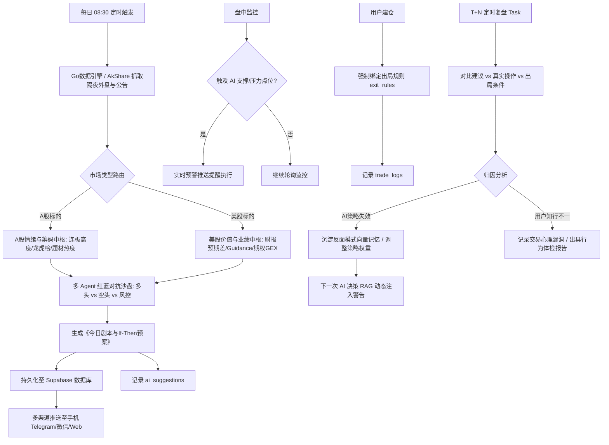
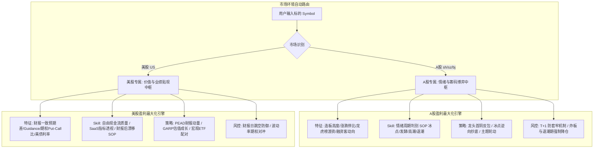
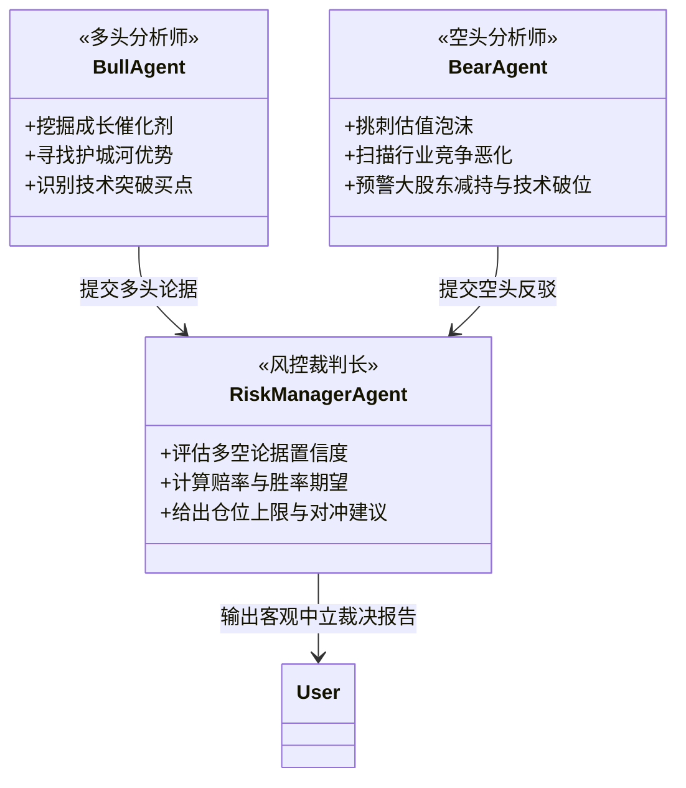
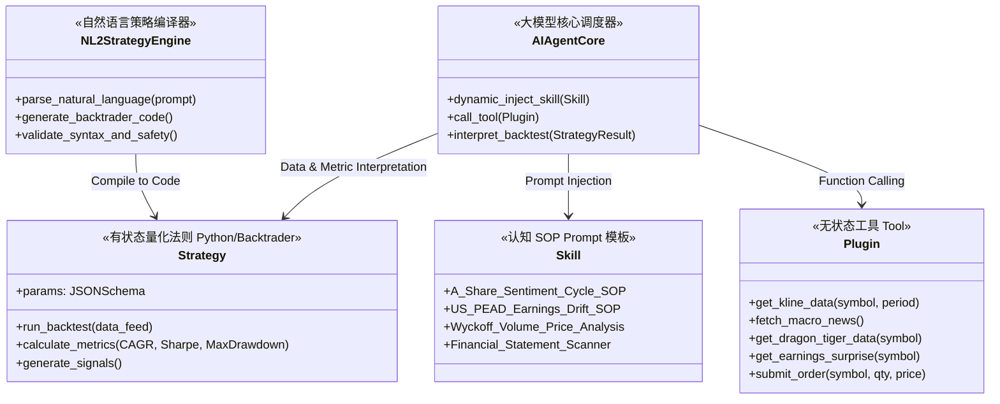
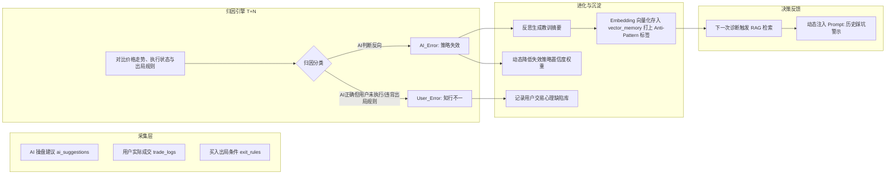
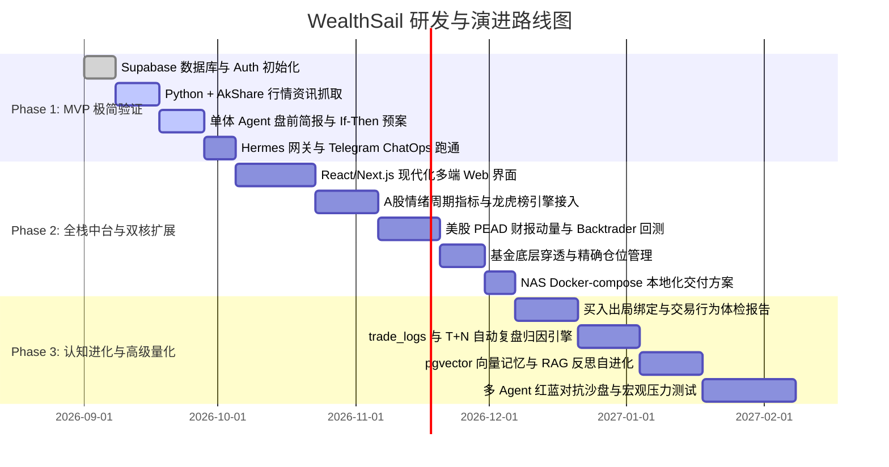

# WealthSail 智能量化投研平台 需求规范文档 (PRD)

> **文档版本**：v1.2.0 (市场自适应双核增强版)  
> **编写日期**：2026-08-21  
> **文档状态**：正式发布 (Approved)  
> **适用范围**：WealthSail 投研平台整体架构设计、MVP 研发、功能扩展与版本迭代

---

## 1. 项目背景与产品愿景

### 1.1 行业痛点与背景
在现代跨市场证券投资（A股、港股、美股）中，个人与中小投资者面临着多重核心痛点：
1. **跨市场定价机制迥异，缺乏“因市制宜”的投研体系**：
   - **A 股等新兴市场**：散户与游资定价权高，受政策催化、板块轮动与情绪周期主导，股价常脱离基本面进行短期剧烈博弈；
   - **美股等成熟市场**：机构与量化主导，股价核心围绕 DCF 自由现金流、财报预期差（Guidance）与宏观利率贴现波动；
   - *传统工具往往用同一套指标生搬硬套，在 A 股死板看估值容易踏空主升浪，在美股盲目看图容易遭遇财报暴雷。*
2. **信息过载与碎片化**：宏观新闻、隔夜外盘、上市公司公告与海量研报充斥市场，投资者难以在开盘前快速提炼出高价值信息与确定性主线。
3. **确认偏误与情绪化交易**：持仓后容易只看利好、忽视利空（确认偏误），缺乏严格的量化纪律，极易陷入追涨杀跌、套牢死扛、利润大幅回撤等人性弱点。
4. **组合表面分散而实际过度集中**：购买多只基金看似分散风险，实则底层重仓股高度重合（伪分散），缺乏穿透分析与极端情景压力测试能力。
5. **缺乏客观量化工具**：大模型往往存在“自然语言脑补”倾向，缺少严谨的代码级回测引擎和数学模型验证，且策略编写门槛高。
6. **决策链路断裂且无复盘闭环**：传统投资辅助工具仅停留在“单向推送建议”，没有追踪用户实际执行情况，无法形成“建议-执行-归因-记忆沉淀-自我进化”的闭环。
7. **多端协同与私有化诉求**：投资者需要随时随地通过手机/PC访问系统，同时注重个人财务数据与 API Key 的隐私安全。

### 1.2 产品定位与愿景
**WealthSail（扬帆财富）** 是一款融合 **“市场自适应双核投研”**、**“多端跨设备协同”**、**“大模型深度推理”**、**“量化策略回测”** 与 **“认知闭环自进化”** 的新一代全栈智能量化投研中台与决策助手。

- **阶段一 (MVP)**：极简轻量化盯盘与盘前预案助手，验证大模型在行情总结、技术面诊断与 If-Then 操盘剧本生成上的有效性。
- **阶段二 (扩展演进)**：构建模块化解耦的投研中台，引入量化回测引擎、自然语言策略生成 (NL2Strategy)、底层基金穿透、精确仓位控制、双向复盘归因、向量记忆 RAG 与私有化部署。
- **阶段三 (成熟生态)**：打造具备自进化能力的虚拟投研团队，引入 **“A 股情绪与筹码博弈中枢 vs 美股价值与财报驱动中枢”** 双核引擎、“多 Agent 红蓝对抗辩论”沙盘、极端宏观压力测试、行为金融学交易体检与自动化交易适配器。

---

## 2. 用户画像与典型业务场景

### 2.1 目标用户画像
- **A 股主题与动量投资者**：专注于 A 股题材轮动、游资席位博弈、连板高度与情绪周期拐点捕捉。
- **美股与全球价值/成长投资者**：专注于美股财报季预期差（PEAD）、SaaS 指标、自由现金流质量与宏观利率敏感度。
- **组合与基金配置型投资者**：持有股票与多只公募/私募基金，需要穿透底层资产集中度并评估极端市场冲击下的回撤风险。
- **量化与技术派投资者**：希望通过自然语言或参数快速验证策略回测表现，并借助大模型进行综合解读与多维度过滤。
- **成长反思型投资者**：渴望记录自身交易心理漏洞，沉淀亏损教训，打破确认偏误，建立知行合一的严谨投资纪律。

### 2.2 核心业务流程与典型场景



#### 场景 1：晨间盘前 10 分钟操盘剧本
- **时间**：每个交易日早上 08:30 - 09:00（开盘前）。
- **动作**：系统自动采集昨夜美股大盘、中概金龙指数、富时 A50 期指、昨夜重大上市公司公告及昨日量价支撑/阻力位。
- **输出**：生成结构化《今日盘前简报与操作预案》，列出清晰的“支撑位、压力位、买入/卖出条件单触发阈值”，推送到用户手机。用户据此在券商端预埋条件单。

#### 场景 2：A 股市场情绪周期与题材龙虎榜博弈
- **动作**：用户查看 A 股大盘与题材库。
- **流程**：系统自动计算全市场涨跌停家数比、炸板率、连板梯队（首板/2板/3板晋级率），判定当前处于“冰点试错期”、“主线发酵期”、“高潮加速期”还是“退潮防守期”，并结合龙虎榜顶级游资席位动向输出次日接力或低吸预案。

#### 场景 3：美股财报预期差与 PEAD 动量跟踪
- **动作**：美股财报季期间，用户关注标的发布财报。
- **流程**：系统自动比对彭博/卖方一致预期（Revenue & EPS），解析管理层下季度 Guidance，结合期权隐含波动率与 Put/Call Ratio，生成财报后价格漂移 (PEAD) 的中长期建仓建议。

#### 场景 4：个股深度透视与“红蓝对抗”决策沙盘
- **动作**：用户在 Web 或移动端输入股票代码，开启“深度诊股沙盘”。
- **流程**：触发 **多头分析师 Agent**（找买点与成长逻辑）与 **空头分析师 Agent**（挑刺排雷与破位风险）；**风控裁判 Agent** 消除确认偏误，综合博弈双方论据，评估胜率与赔率，给出买入仓位上限。

#### 场景 5：自然语言策略生成与无代码回测 (NL2Strategy)
- **动作**：用户在聊天框输入自然语言描述（如：*“当沪深300市盈率处于历史前10%低位且周线MACD金叉时，每月定投1000元，跌破20周均线暂停”*）。
- **流程**：后端大模型将其编译为标准 Backtrader Python 策略脚本，在历史 5~10 年数据上运行回测，可视化展示年化、夏普与回撤。

#### 场景 6：基金底层穿透与宏观情景压力测试
- **动作**：用户一键导入或录入持有的公募/私募基金组合。
- **流程**：系统穿透解析各基金前十大重仓股与行业分布，计算真实资产集中度；支持选择“人民币快速贬值 5%”、“油价暴涨 30%”等极端宏观情景，生成组合预期最大回撤预测报告。

#### 场景 7：买入即绑定出局规则与行为金融学体检
- **动作**：用户录入买入成交记录时，系统强制引导选择/录入“出局逻辑”（如逻辑破坏、均线破位、估值历史分位）。
- **流程**：持仓期间自动监控出局条件；复盘时系统分析用户是否存在“过早卖飞”、“深度套牢死扛”等心理漏洞，定期出具《交易行为体检报告》。

---

## 3. 功能需求详细规格

### 3.1 模块一：资产中枢、底层穿透与组合风控 (Portfolio & Risk Control)

| 功能项 | 需求描述 | 优先级 |
| :--- | :--- | :--- |
| **多市场标的支持** | 支持 A 股、港股、美股以及场内外基金代码检索、行情适配与持仓录入。 | P0 (MVP) |
| **持仓记录与管理** | 记录用户的持仓标的、买入成本价、持仓数量、目标止损/止盈点位，支持增删改查。 | P0 (MVP) |
| **资产大盘与走势** | 记录用户总可用资金、证券总市值、浮动盈亏总额及当日收益率，生成资金走势折线图。 | P1 (扩展) |
| **基金底层穿透分析** | 自动解析用户持有的多只公募/私募基金前十大重仓股与行业配置，计算真实集中度，提示“伪分散”风险。 | P1 (扩展) |
| **宏观情景压力测试** | 支持模拟“极端宏观冲击”（如汇率波动、加息加码、大宗商品暴涨），一键预测当前组合的预期最大回撤与脆弱标的。 | P2 (高级) |
| **动态再平衡引擎** | 结合波动率（ATR/VIX）与偏离度阈值，计算金字塔式分批建仓节奏与组合再平衡调整指令。 | P2 (高级) |
| **多端实时同步** | 基于 Supabase 实时数据库（Realtime），保证 Web 端、移动端数据即时双向同步。 | P0 (MVP) |

### 3.2 模块二：AI 深度诊股与盘前简报引擎 (AI Diagnosis & Briefing)

| 功能项 | 需求描述 | 优先级 |
| :--- | :--- | :--- |
| **隔夜多源数据清洗** | 盘前自动聚合：美股三大指数、中概金龙指数、富时 A50 夜盘、外汇离岸人民币、隔夜公司公告。 | P0 (MVP) |
| **一键 AI 基础诊股** | 支持单股即时诊断，抓取 20 日 K 线数据及近期新闻，生成技术面支撑/压力位及操作方向。 | P0 (MVP) |
| **If-Then 操盘预案** | 盘前报告必须结构化输出 If-Then 剧本（例：*“冲高至 385 承压减仓 30%，回调至 368 企稳加仓 20%”*）。 | P0 (MVP) |
| **多渠道自动推送** | 支持配置 Telegram Bot、Server酱 (微信通知)、企业微信 Webhook、移动端 Push 推送盘前简报。 | P0 (MVP) |
| **财报“找茬”排雷** | 自动校验应收账款与营收匹配度、存货周转异常、自由现金流与净利润背离等财务粉饰风险。 | P1 (扩展) |
| **业绩会情绪分析** | 解析上市公司业绩会纪要/问答，提取管理层答疑时的确定性、回避与犹豫倾向打分。 | P1 (扩展) |
| **产业链传导推演** | 宏观/大宗异动时（如碳酸锂价格跳水），基于产业链图谱自动向上/下游推演潜在受损与受益标的池。 | P2 (高级) |
| **盘中触点异动预警** | 盘中定时轮询市价，当价格触及盘前设定的关键支撑/压力位时触发即时推送。 | P1 (扩展) |

### 3.3 模块三：“因市制宜”双核投研与策略引擎 (Market-Adaptive Engine)

针对 A 股（情绪/筹码/政策驱动）与美股（价值/业绩/贴现驱动）的底层机制差异，系统设计双核投研中枢：



#### 1. A 股专属投研与策略规格
- **特征工程**：
  - 全市场情绪周期指标：涨跌停家数比、炸板率、最高连板高度梯队（首板 $\rightarrow$ 2板 $\rightarrow$ 3板晋级率）、赚钱/亏钱效应指数。
  - 筹码与博弈指标：龙虎榜（顶级游资席位买卖净额 vs 机构席位动向）、融资融券余额异动、个股与板块换手率历史分位数。
  - 政策题材热度：部委政策与官方发文的实时 NLP 关键词聚类及行业映射。
- **认知 Skill SOP**：
  - *《A股情绪周期诊断 SOP》*：识别冰点试错期、主线发酵期、高潮加速期与退潮防守期。退潮期强制空仓防守，冰点期寻找共振首板。
  - *《游资席位与龙虎榜博弈 SOP》*：分析知名游资买入后的次日溢价习惯与砸盘规律。
- **盈利策略库**：
  - *情绪冰点逆向反弹策略*：全市场普跌极值 + 连板高度压缩至极点时逆向买入指数 ETF 或领涨先锋。
  - *题材龙头首阴反包与分歧转一致策略*：核心主线龙头首次分歧日低吸。
- **风控机制**：
  - 针对 **T+1 机制**，盘中严禁追高日内急拉（防冲高回落套牢）；全市场进入退潮期时，强制将仓位上限压缩至 $30\%$ 以下。

#### 2. 美股专属投研与策略规格
- **特征工程**：
  - 财报一致预期差 (Earnings Surprise)：彭博/卖方一致预期 EPS/Revenue 偏差、下季度业绩指引 (Guidance) 上修幅度。
  - 期权情绪与做市商流动性：Put/Call Ratio、Gamma 暴露度 (GEX)、暗池交易 (Dark Pool) 大单。
  - 宏观利率敏感度：对 10 年期美债收益率与美联储降息/加息预期的 Beta 敏感度。
- **认知 Skill SOP**：
  - *《美股财报后价格漂移 (PEAD) SOP》*：深度解析业绩说明会（Earnings Call）问答，判断业绩超预期是否具备 1-3 个季度的中长期持续性。
  - *《自由现金流与估值中枢回归 SOP》*：基于 EV/EBITDA、FCF Yield 与历史分位进行内在价值评估。
- **盈利策略库**：
  - *PEAD 财报动量策略*：在财报大幅超预期（Earnings & Revenue Double Beat + Guidance 上修）当日收盘介入，享受机构长线建仓带来的价格漂移收益。
  - *GARP 高质量成长策略*：筛选 ROE > 15%、自由现金流为正、PEG < 1.2 的优质标的稳健配置。
  - *宏观行业 ETF 配对交易策略*：降息周期多科技/公用事业、空能源/高杠杆行业（对冲大盘风险）。
- **风控机制**：
  - 针对财报日动辄 $\pm20\%$ 的跳空风险，在财报日前强制提示降低单股仓位至 $5\%$ 以下或配置期权对冲保护。

---

### 3.4 模块四：“多 Agent 红蓝对抗”决策沙盘 (Multi-Agent Debate)

为了打破投资者“确认偏误”信息茧房，引入三方对抗式博弈架构：



| Agent 角色 | 职责与运行逻辑 | 输出核心价值 |
| :--- | :--- | :--- |
| **多头分析师 (Bull Agent)** | 挖掘标的成长空间、催化剂事件、护城河与量价突破形态。 | 确认核心上涨逻辑与向上弹性空间。 |
| **空头分析师 (Bear Agent)** | 专门挑刺：估值泡沫、财务瑕疵、行业内卷加剧、减持风险与技术破位。 | 充分暴露下行风险与投资盲区。 |
| **风控裁判 (Risk Manager)** | 综合双方对抗论据，消除情绪偏见，计算胜率与盈亏比，给出建仓上限。 | 提供客观中立决策依据，严格控制下行风险。 |

---

### 3.5 模块五：量化策略、Skill、Plugin 与 NL2Strategy 解耦体系

系统明确划分四大层次，杜绝大模型“自然语言脑补”，保证量化严谨性：



#### 1. Plugin (工具插件层 - 无状态“手眼”)
- **职责**：封装所有外部数据拉取与外部系统对接能力。
- **能力集**：`akshare_kline_fetcher`、`dragon_tiger_fetcher`、`earnings_surprise_fetcher`、`macro_data_fetcher`、`broker_adapter`。

#### 2. Skill (认知 SOP 层 - 结构化 Prompt 模板)
- **职责**：定义 AI 在特定领域的思考逻辑框架与分析步骤（思维链 CoT）。
- **能力集**：*A股情绪周期诊断 SOP*、*美股 PEAD 漂移 SOP*、*威科夫量价分析 SOP*、*财报穿透排雷 SOP*、*产业链传导 SOP*。

#### 3. Strategy (量化策略层 - 严谨数学与代码逻辑)
- **职责**：通过 Python 代码（Backtrader / Qlib 引擎）执行真实历史数据回测，杜绝自然语言幻觉。
- **输出指标**：年化收益率 (CAGR)、最大回撤 (Max Drawdown)、夏普比率 (Sharpe Ratio)、胜率与盈亏比。
- **协同机制**：后端执行真实回测后，将结构化回测指标作为输入数据传递给大模型，由大模型为用户提供易读的优劣势洞察。

#### 4. NL2Strategy (自然语言转量化策略引擎)
- **职责**：支持用户以自然语言对话描述交易逻辑，自动解析并生成符合安全沙箱规范的 Backtrader 策略代码并执行回测。

---

### 3.6 模块六：交易执行、出局跟踪与行为金融学体检

| 功能项 | 需求描述 | 优先级 |
| :--- | :--- | :--- |
| **精确买入股数计算** | AI 输出建议时，根据用户可用现金与风险偏好计算具体买入股数：$$\text{目标股数} = \lfloor \frac{\text{可用资金} \times \text{建议比例}}{\text{当前市价}} \rfloor$$ | P1 (扩展) |
| **出局逻辑强制绑定** | 买入建仓时强制录入/生成出局条件（逻辑破坏/均线跌破/估值高位）；标的触及条件时主动提示“核心逻辑是否改变”。 | P1 (扩展) |
| **交易心理漏洞诊断** | 自动统计分析用户的历史交易记录，识别“过早卖飞”、“死扛不止损”、“频繁追涨杀跌”等模式，定期生成《交易行为体检报告》。 | P2 (高级) |
| **交易适配器抽象 (BrokerInterface)** | 统一抽象交易接口：`get_balance()`、`get_positions()`、`submit_order()`。前期实现为模拟盘 `PaperTradingBroker`，未来平滑切换至 QMT/富途等实盘。 | P1 (扩展) |
| **风控拦截与人工确认 (HITL)** | AI 生成的交易指令必须进入 `pending_orders` 表，必须由用户在 Web/手机端确认授权后才放行至交易接口，严禁全自动直接发单。 | P1 (扩展) |

---

### 3.7 模块七：AI 建议与人类真实操作的“复盘自进化”机制



#### 1. 双向数据记录
- 系统持久化每一笔 `ai_suggestions`（包含建议买卖点、推荐逻辑与建议日期）。
- 系统记录用户真实发生的 `trade_logs`（包含实际买卖时间、成交均价、成交股数及出局规则绑定）。

#### 2. T+N 自动归因引擎
后台定时任务（如 T+3/T+5）自动对比历史建议、真实成交与后续实际行情走势：
- **AI_Error（AI 策略失效）**：AI 给出买入信号，但后市出现破位大跌；或 AI 提示卖出，但后市主升浪突破。
- **User_Error（用户知行不一）**：AI 给出精准止损建议，但用户因侥幸心理扛单导致大幅回撤；或违背当初设定的出局逻辑。

#### 3. 三维自修正与经验沉淀
1. **反面模式向量记忆 (Negative RAG Memory)**：
   - 将 AI 失败教训生成结构化反思文本并打上 `[Anti-Pattern]` 标签（例：*“2026年8月在流动性收紧宏观背景下，科技股日线金叉容易形成诱多陷阱”*）。
   - 将文本向量化存入 Supabase `vector_memory`。
   - 下次执行类似市场环境分析时，通过向量相似度检索出该教训，作为 System Prompt 注入：“*警示：历史记忆显示此类形态存在重大诱多风险，请上调止损阈值。*”
2. **量化策略动态权重调整**：
   - 追踪不同量化策略在当期市场环境下的胜率，动态微调其在多策略投票中的权重系数（Weight）。
3. **Skill SOP 迭代优化**：
   - 累积多起同类误判后，主控 Agent 自动重写并优化对应的 Skill Prompt 规则。

---

### 3.8 模块八：模型配置与系统偏好管理

| 功能项 | 需求描述 | 优先级 |
| :--- | :--- | :--- |
| **大模型多端切换** | 支持用户在后台配置并切换底层 LLM（如 OpenAI GPT-4o、DeepSeek-R1/V3、Claude 等）。 | P1 (扩展) |
| **模型推理参数可视化** | 支持自定义 `Temperature`（逻辑回测设为 0，宏观新闻研读设为 0.5）、`Max Tokens` 等参数。 | P1 (扩展) |
| **安全存储与环境变量** | 严格采用环境变量与 Supabase 用户级加密存储 API Key，严禁前端明文暴露。 | P0 (MVP) |
| **定时任务自定义** | 用户可自定义盘前简报触发时间（默认 08:30）、盘后复盘时间及推送渠道开关。 | P0 (MVP) |

---

## 4. 非功能性需求 (NFR)

### 4.1 性能与响应要求
- **盘前简报批处理**：单个用户 10 只持仓/自选股的完整多源数据采集与 AI 简报生成控制在 60 秒内完成。
- **Web 界面加载与交互**：首屏加载时间（FCP）小于 1.5 秒，数据切换与图表渲染流畅（60 FPS）。
- **实时通知延迟**：盘中触点监控预警消息从触发到推送到达用户终端延迟不超过 5 秒。

### 4.2 跨端兼容性与体验
- **自适应响应式布局**：基于现代 Web 体系，无缝适配 PC 宽屏、平板以及移动端手机浏览器。
- **现代化设计质感**：采用现代化金融暗黑/明亮主题，配备清晰的 K 线图表、卡片式 If-Then 剧本展示、直观的盈亏色标与流畅交互动效。

### 4.3 安全性与数据合规
- **身份鉴权与隔离**：基于 Supabase Auth 实行严格的行级安全策略（Row Level Security, RLS），确保任何用户仅能读取和修改自身的持仓、配置及记忆数据。
- **敏感信息防护**：券商接口凭证与大模型 API Key 采用非对称加密存储或本地环境变量管理。

### 4.4 可靠性与私有化部署
- **7x24 小时无人值守运行**：支持通过 `docker-compose` 部署于家庭/办公室 NAS（如极空间、群晖）或轻量云服务器，具备容器崩溃自动重启与定时任务异常告警机制。

---

## 5. 系统逻辑架构与物理拓扑

> **说明**：关于智能体框架（Hermes Agent vs LangGraph vs 自研）、数据存储、高并发抓取与前端栈的深度评估、技术选型对比及选型决策依据，详见专门架构文档：[02.WealthSail投研平台全栈技术选型与架构评估.md](file:///d:/develop/gitee/WealthSail/docs/02.WealthSail投研平台全栈技术选型与架构评估.md)。

### 5.1 系统分层逻辑架构

系统采用“以智能体中枢驱动业务流、分层解耦各司其职”的现代化分层架构：

```
+-----------------------------------------------------------------------------------------+
|                        【双端交互层 (Presentation)】                                     |
|  1. 极速 ChatOps 移动端: Telegram / 微信 Bot (盘前预案接收、盘中触点提醒、人机确认发单)   |
|  2. 专业投研 Web 看板: Next.js + TypeScript + TradingView (多周期K线、回测曲线、穿透矩阵)  |
+-----------------------------------------------------------------------------------------+
                                             │
+-----------------------------------------------------------------------------------------+
|                        【智能体调度与自进化中枢 (Agent Core)】                           |
|  底座引擎: Hermes Agent (Python 3.12+)                                                  |
|  - Tools 工具集: AkShare 抓取、Backtrader 回测、龙虎榜数据、券商接口抽象 (纯 Python)      |
|  - Skills 认知 SOP: agentskills.io 格式规范 (A股情绪周期、美股PEAD、财报透视、量价分析)  |
|  - 技能自进化: DSPy/GEPA 驱动的 Skill 动态优化 + 历史踩坑反面模式记忆                   |
|  - 定时调度与网关: 内置 Cron 调度引擎 (早盘自动触发) + 多平台主动通知网关                |
+-----------------------------------------------------------------------------------------+
                                             │
+-----------------------------------------------------------------------------------------+
|                        【业务服务、量化与数据同步中枢】                                   |
|  1. 高并发数据同步引擎 (Go): 常驻协程高频轮询市场异动与行情，毫秒级响应                 |
|  2. 严谨量化回测引擎 (Python): Backtrader / Qlib 负责真实历史回测与 NL2Strategy 代码执行 |
|  3. 存储与向量中枢: Supabase (PostgreSQL 16 + pgvector + Auth + Realtime 实时推送)      |
+-----------------------------------------------------------------------------------------+
                                             │
+-----------------------------------------------------------------------------------------+
|                        【私有化部署底座 (Infrastructure)】                               |
|  本地 NAS (极空间/群晖) 或云服务器 Docker-compose 一键容器化交付，7x24 小时无人值守运行  |
+-----------------------------------------------------------------------------------------+
```

### 5.2 核心模块职责分工

| 架构层级 | 核心组件 | 核心职责 | 详细决策文档 |
| :--- | :--- | :--- | :--- |
| **交互端** | **Telegram / 微信 Bot + Next.js Web** | 移动端即时交互决策 (HITL) + Web 端多周期专业图表呈现 | 参见 [docs/02](file:///d:/develop/gitee/WealthSail/docs/02.WealthSail投研平台全栈技术选型与架构评估.md#4-深度剖析为什么推荐hermes-agent--supabase--go--nextjs) |
| **Agent 中枢** | **Hermes Agent (Python)** | 统一调度 Tools、加载 Skill 认知 SOP、执行自进化与定时触发 | 参见 [docs/02](file:///d:/develop/gitee/WealthSail/docs/02.WealthSail投研平台全栈技术选型与架构评估.md#41-为什么-hermes-agent-是-agent-调度的绝佳底座) |
| **量化引擎** | **Backtrader / Qlib** | 运行严谨历史回测，输出年化、夏普、回撤等客观量化指标 | 参见 [docs/02](file:///d:/develop/gitee/WealthSail/docs/02.WealthSail投研平台全栈技术选型与架构评估.md#8-总结最终选型决策表) |
| **数据同步引擎** | **Go 微服务** | 高并发采集全市场行情、异动与大宗数据，触发 Realtime 预警 | 参见 [docs/02](file:///d:/develop/gitee/WealthSail/docs/02.WealthSail投研平台全栈技术选型与架构评估.md#42-为什么必须搭配-supabasego-与-nextjs-形成混合架构) |
| **存储中枢** | **Supabase (PostgreSQL + pgvector)** | 用户资产、决策闭环、向量反思记忆及多端状态持久化 | 参见 [docs/02](file:///d:/develop/gitee/WealthSail/docs/02.WealthSail投研平台全栈技术选型与架构评估.md#42-为什么必须搭配-supabasego-与-nextjs-形成混合架构) |
| **基础设施** | **Docker-compose** | 本地 NAS 私有化交付与 24/7 无人值守监控 | 参见 [docs/02](file:///d:/develop/gitee/WealthSail/docs/02.WealthSail投研平台全栈技术选型与架构评估.md#6-研发演进路线与落地节奏-phased-implementation) |

---

## 6. 核心数据模型设计 (Database Schema)

基于 Supabase (PostgreSQL) 设计的 5 大核心数据模块与扩展表：

### 6.1 用户与资产中枢 (User & Portfolio Core)

```sql
-- 1. 用户扩展信息表
CREATE TABLE profiles (
    id UUID PRIMARY KEY REFERENCES auth.users(id) ON DELETE CASCADE,
    nickname VARCHAR(64),
    risk_level VARCHAR(16) DEFAULT 'balanced' CHECK (risk_level IN ('conservative', 'balanced', 'aggressive')),
    model_configs JSONB DEFAULT '{"provider": "deepseek", "temperature": 0.2}',
    created_at TIMESTAMPTZ DEFAULT NOW(),
    updated_at TIMESTAMPTZ DEFAULT NOW()
);

-- 2. 资金账户大盘表
CREATE TABLE portfolio (
    id UUID PRIMARY KEY DEFAULT gen_random_uuid(),
    user_id UUID REFERENCES profiles(id) ON DELETE CASCADE,
    total_capital NUMERIC(15, 2) NOT NULL DEFAULT 0.00,
    available_cash NUMERIC(15, 2) NOT NULL DEFAULT 0.00,
    updated_at TIMESTAMPTZ DEFAULT NOW()
);

-- 3. 持仓明细表
CREATE TABLE positions (
    id UUID PRIMARY KEY DEFAULT gen_random_uuid(),
    user_id UUID REFERENCES profiles(id) ON DELETE CASCADE,
    symbol VARCHAR(32) NOT NULL,
    stock_name VARCHAR(64),
    market VARCHAR(16) NOT NULL CHECK (market IN ('A', 'HK', 'US')),
    avg_cost NUMERIC(15, 4) NOT NULL,
    quantity INT NOT NULL CHECK (quantity > 0),
    ai_stop_loss NUMERIC(15, 4),
    ai_take_profit NUMERIC(15, 4),
    updated_at TIMESTAMPTZ DEFAULT NOW()
);

-- 4. 自选股列表
CREATE TABLE watchlists (
    id UUID PRIMARY KEY DEFAULT gen_random_uuid(),
    user_id UUID REFERENCES profiles(id) ON DELETE CASCADE,
    symbol VARCHAR(32) NOT NULL,
    stock_name VARCHAR(64),
    market VARCHAR(16) NOT NULL,
    notes TEXT,
    latest_ai_sentiment VARCHAR(16) CHECK (latest_ai_sentiment IN ('bullish', 'bearish', 'neutral')),
    created_at TIMESTAMPTZ DEFAULT NOW()
);

-- 5. 基金穿透重仓表
CREATE TABLE fund_lookthrough (
    id UUID PRIMARY KEY DEFAULT gen_random_uuid(),
    fund_code VARCHAR(32) NOT NULL,
    holding_symbol VARCHAR(32) NOT NULL,
    holding_name VARCHAR(64),
    weight_percentage NUMERIC(5, 2) NOT NULL,
    report_period VARCHAR(16),
    updated_at TIMESTAMPTZ DEFAULT NOW()
);
```

### 6.2 市场特征与双核投研中枢 (Market-Adaptive Features)

```sql
-- 6. A 股全市场情绪周期表
CREATE TABLE market_sentiment_cycles (
    id UUID PRIMARY KEY DEFAULT gen_random_uuid(),
    trade_date DATE UNIQUE NOT NULL,
    up_count INT NOT NULL,
    down_count INT NOT NULL,
    limit_up_count INT NOT NULL,
    limit_down_count INT NOT NULL,
    broken_limit_rate NUMERIC(5, 2), -- 炸板率
    max_continuous_limit_height INT, -- 最高连板高度
    sentiment_stage VARCHAR(32) CHECK (sentiment_stage IN ('ICE_POINT', 'FERMENTATION', 'CLIMAX', 'EBB_TIDE')), -- 冰点/发酵/高潮/退潮
    created_at TIMESTAMPTZ DEFAULT NOW()
);

-- 7. A 股龙虎榜与游资席位跟踪表
CREATE TABLE dragon_tiger_seats (
    id UUID PRIMARY KEY DEFAULT gen_random_uuid(),
    trade_date DATE NOT NULL,
    symbol VARCHAR(32) NOT NULL,
    stock_name VARCHAR(64),
    seat_name VARCHAR(128) NOT NULL, -- 游资席位名称
    buy_amount NUMERIC(15, 2) DEFAULT 0,
    sell_amount NUMERIC(15, 2) DEFAULT 0,
    net_amount NUMERIC(15, 2) DEFAULT 0,
    seat_tag VARCHAR(32), -- 游资标签: 顶级游资/机构专用/量化席位
    created_at TIMESTAMPTZ DEFAULT NOW()
);

-- 8. 美股财报预期差与指引表 (Earnings Surprise)
CREATE TABLE earnings_surprises (
    id UUID PRIMARY KEY DEFAULT gen_random_uuid(),
    symbol VARCHAR(32) NOT NULL,
    fiscal_period VARCHAR(16) NOT NULL, -- 如 2026Q2
    report_date DATE NOT NULL,
    eps_estimated NUMERIC(10, 4),
    eps_actual NUMERIC(10, 4),
    eps_surprise_pct NUMERIC(6, 2),
    revenue_estimated NUMERIC(15, 2),
    revenue_actual NUMERIC(15, 2),
    guidance_revision VARCHAR(16) CHECK (guidance_revision IN ('UP', 'DOWN', 'FLAT')),
    pead_drift_score NUMERIC(5, 2), -- 财报漂移预期评分
    created_at TIMESTAMPTZ DEFAULT NOW()
);
```

### 6.3 决策、出局规则与复盘闭环 (Decision & Feedback Loop)

```sql
-- 9. AI 操盘建议与预案表
CREATE TABLE ai_suggestions (
    id UUID PRIMARY KEY DEFAULT gen_random_uuid(),
    user_id UUID REFERENCES profiles(id) ON DELETE CASCADE,
    symbol VARCHAR(32),
    market VARCHAR(16) NOT NULL,
    report_type VARCHAR(32) NOT NULL CHECK (report_type IN ('daily_briefing', 'diagnosis', 'intraday_alert', 'multi_agent_debate')),
    suggested_action VARCHAR(16) CHECK (suggested_action IN ('BUY', 'SELL', 'HOLD', 'WAIT')),
    target_price NUMERIC(15, 4),
    suggested_qty INT,
    support_price NUMERIC(15, 4),
    resistance_price NUMERIC(15, 4),
    if_then_plan JSONB,
    logic_summary TEXT,
    status VARCHAR(16) DEFAULT 'pending' CHECK (status IN ('pending', 'executed', 'ignored', 'expired')),
    created_at TIMESTAMPTZ DEFAULT NOW()
);

-- 10. 买入出局规则绑定表
CREATE TABLE exit_rules (
    id UUID PRIMARY KEY DEFAULT gen_random_uuid(),
    user_id UUID REFERENCES profiles(id) ON DELETE CASCADE,
    symbol VARCHAR(32) NOT NULL,
    rule_type VARCHAR(32) NOT NULL CHECK (rule_type IN ('LOGIC_BROKEN', 'MA_BREAK', 'VALUATION_HIGH', 'TRAILING_STOP', 'EBB_TIDE_EXIT')),
    rule_params JSONB NOT NULL,
    is_triggered BOOLEAN DEFAULT FALSE,
    created_at TIMESTAMPTZ DEFAULT NOW()
);

-- 11. 用户真实交易执行记录表
CREATE TABLE trade_logs (
    id UUID PRIMARY KEY DEFAULT gen_random_uuid(),
    user_id UUID REFERENCES profiles(id) ON DELETE CASCADE,
    suggestion_id UUID REFERENCES ai_suggestions(id) ON DELETE SET NULL,
    exit_rule_id UUID REFERENCES exit_rules(id) ON DELETE SET NULL,
    symbol VARCHAR(32) NOT NULL,
    actual_action VARCHAR(16) NOT NULL CHECK (actual_action IN ('BUY', 'SELL')),
    executed_price NUMERIC(15, 4) NOT NULL,
    executed_qty INT NOT NULL,
    executed_at TIMESTAMPTZ DEFAULT NOW(),
    execution_notes TEXT
);

-- 12. T+N 复盘归因与反思表
CREATE TABLE post_mortem (
    id UUID PRIMARY KEY DEFAULT gen_random_uuid(),
    user_id UUID REFERENCES profiles(id) ON DELETE CASCADE,
    suggestion_id UUID REFERENCES ai_suggestions(id) ON DELETE CASCADE,
    trade_log_id UUID REFERENCES trade_logs(id) ON DELETE SET NULL,
    error_type VARCHAR(32) NOT NULL CHECK (error_type IN ('AI_ERROR', 'USER_ERROR', 'CORRECT_EXECUTION', 'MARKET_NOISE')),
    pnl_impact NUMERIC(15, 2),
    lesson_summary TEXT NOT NULL,
    is_vectorized BOOLEAN DEFAULT FALSE,
    created_at TIMESTAMPTZ DEFAULT NOW()
);

-- 13. 多 Agent 红蓝对抗辩论记录表
CREATE TABLE multi_agent_debates (
    id UUID PRIMARY KEY DEFAULT gen_random_uuid(),
    symbol VARCHAR(32) NOT NULL,
    bull_arguments TEXT NOT NULL,
    bear_arguments TEXT NOT NULL,
    risk_manager_verdict TEXT NOT NULL,
    suggested_cap_percentage NUMERIC(5, 2),
    created_at TIMESTAMPTZ DEFAULT NOW()
);
```

### 6.4 引擎配置与向量记忆 (Engine & Vector Memory)

```sql
-- 启用 pgvector 插件
CREATE EXTENSION IF NOT EXISTS vector;

-- 14. 向量记忆表 (沉淀 AI 反思与反面模式)
CREATE TABLE vector_memory (
    id UUID PRIMARY KEY DEFAULT gen_random_uuid(),
    user_id UUID REFERENCES profiles(id) ON DELETE CASCADE,
    content TEXT NOT NULL,
    embedding VECTOR(1536), -- 适配 text-embedding-3-small
    tags TEXT[],
    metadata JSONB,
    created_at TIMESTAMPTZ DEFAULT NOW()
);

-- 15. AI 认知 SOP / Skill 表
CREATE TABLE agent_skills (
    id UUID PRIMARY KEY DEFAULT gen_random_uuid(),
    name VARCHAR(64) UNIQUE NOT NULL,
    market VARCHAR(16) DEFAULT 'ALL', -- A / US / ALL
    description TEXT,
    prompt_template TEXT NOT NULL,
    is_active BOOLEAN DEFAULT TRUE,
    version INT DEFAULT 1,
    updated_at TIMESTAMPTZ DEFAULT NOW()
);

-- 16. 量化策略注册表
CREATE TABLE strategies (
    id UUID PRIMARY KEY DEFAULT gen_random_uuid(),
    name VARCHAR(64) UNIQUE NOT NULL,
    market VARCHAR(16) DEFAULT 'ALL',
    code_path VARCHAR(255),
    params_schema JSONB,
    current_weight NUMERIC(3, 2) DEFAULT 1.00,
    win_rate NUMERIC(5, 2),
    updated_at TIMESTAMPTZ DEFAULT NOW()
);
```

### 6.5 任务调度与推送通知 (Tasks & Notifications)

```sql
-- 17. 推送配置表
CREATE TABLE user_push_configs (
    id UUID PRIMARY KEY DEFAULT gen_random_uuid(),
    user_id UUID REFERENCES profiles(id) ON DELETE CASCADE,
    channel VARCHAR(32) NOT NULL CHECK (channel IN ('telegram', 'serverchan', 'wechat_work', 'webpush')),
    config_json JSONB NOT NULL,
    is_enabled BOOLEAN DEFAULT TRUE,
    notify_time TIME DEFAULT '08:30:00',
    created_at TIMESTAMPTZ DEFAULT NOW()
);

-- 18. 历史报告长文本归档表
CREATE TABLE daily_reports (
    id UUID PRIMARY KEY DEFAULT gen_random_uuid(),
    user_id UUID REFERENCES profiles(id) ON DELETE CASCADE,
    report_date DATE NOT NULL,
    report_type VARCHAR(32) NOT NULL,
    markdown_content TEXT NOT NULL,
    created_at TIMESTAMPTZ DEFAULT NOW()
);
```

---

## 7. 演进路线与阶段划分 (Roadmap)



### 阶段一：MVP 极简验证期（目标：2-3 周跑通核心价值）
- **核心目标**：以极低开发成本跑通“持仓管理 -> 隔夜数据采集 -> LLM 盘前简报 -> 手机推送”的主干链路。
- **交付产物**：Hermes Agent 核心调度服务、Supabase 云数据库、Telegram Bot 盘前预案推送与人机交互通道 (ChatOps)。

### 阶段二：全栈中台与双核扩展期（目标：4-6 周搭建完整系统）
- **核心目标**：提供高颜值自适应 Web 客户端，接入 A 股全市场情绪周期指标与美股 PEAD 财报预期差引擎，集成 Backtrader 与 NL2Strategy，支持基金底层穿透与 NAS 私有化部署。
- **交付产物**：Next.js Web 端控制台、Backtrader 回测引擎与 NL2Strategy 编译器、A股情绪周期/龙虎榜分析器、美股财报预期分析器、Docker-compose 一键部署包。

### 阶段三：认知闭环自进化与高级量化期（目标：持续迭代）
- **核心目标**：打通出局规则绑定与交易行为体检、操作日志与 AI 建议的 T+N 归因，建立向量反思记忆库，引入“多 Agent 红蓝对抗沙盘”与宏观压力测试。
- **交付产物**：多 Agent 对抗沙盘、双向复盘归因系统、pgvector 经验沉淀模块、宏观情景压力测试工具、实盘交易适配层。
