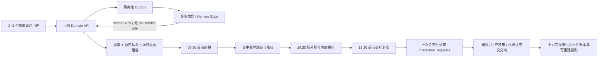
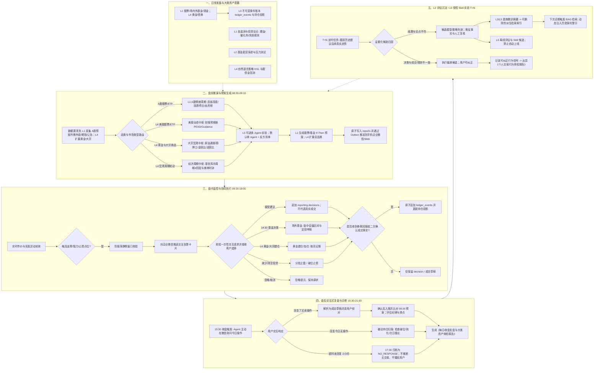
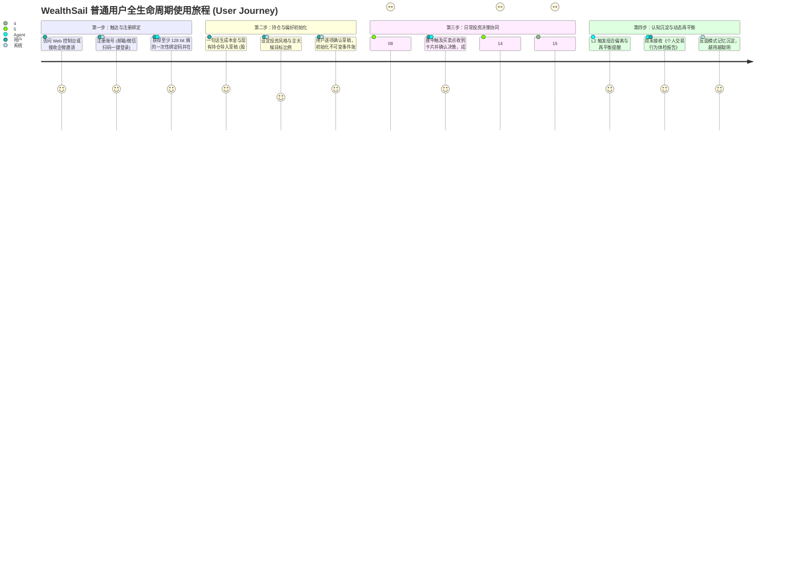
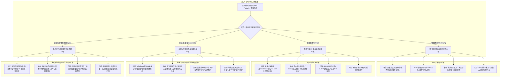
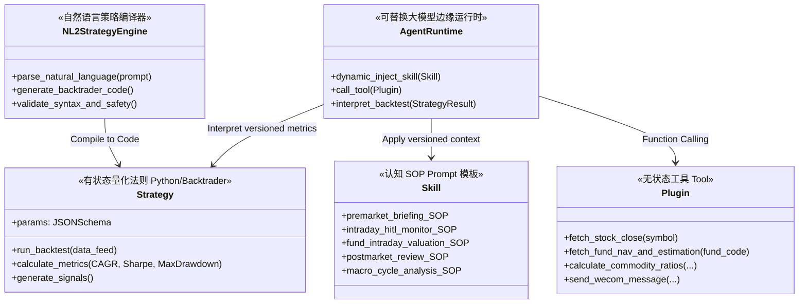
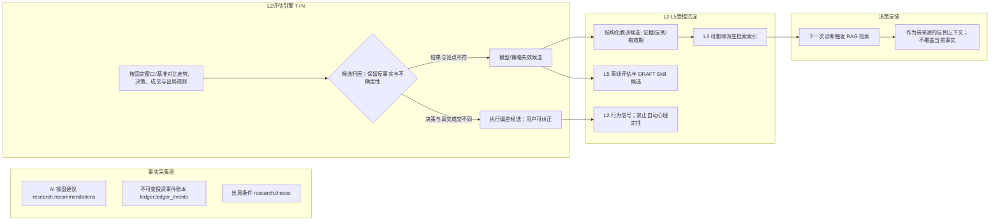

# WealthSail 智能量化投研平台 需求规范文档 (PRD v2.0)

> **文档版本**：v2.1.0-draft (全景业务场景与分阶段演进修订版)
> **编写日期**：2026-08-23  
> **文档状态**：评审修订中 (Review Required)
> **适用范围**：WealthSail 投研平台整体产品规划、L0 可信底座、L1 核心 MVP 研发及 L2–L5 全栈演进
> **相关设计**：[架构设计](./02.WealthSail投研平台全栈技术选型与架构评估.md) · [实战指南](./03.WealthSail-MVP快速构建与实战指南.md) · [Web工作台规范](./09.WealthSail-MVP-Web投研工作台设计与实现规范.md) · [数据设计](./06.WealthSail数据模型与数据源治理设计.md) · [安全设计](./07.WealthSail安全隐私与合规设计.md) · [追溯矩阵](./08.WealthSail需求设计测试追溯矩阵.md)

---

## 1. 项目背景与产品愿景

### 1.1 行业痛点与背景
在现代多市场、多品类投资（A股股票、场内ETF、场外公募基金、黄金及大类资产）中，个人与中小投资者面临着多重核心痛点：
1. **跨市场定价机制迥异，缺乏“因市制宜”的投研体系**：
   - **A 股等新兴市场**：散户与游资定价权高，受政策催化、板块轮动与情绪周期主导，股价常脱离基本面进行短期剧烈博弈；
   - **成熟与海外市场**：机构与量化主导，股价核心围绕 DCF 自由现金流、财报预期差（Guidance/PEAD）与宏观利率贴现波动；
   - *传统工具往往用同一套指标生搬硬套，在 A 股死板看估值容易踏空主升浪，在成熟市场盲目看图容易遭遇财报暴雷。*
2. **大类资产管理割裂与单一资产过度暴露**：
   - 股票、公募基金、黄金实物/ETF、债券等资产分散在不同的券商、银行与理财 App，缺乏统一的“全天候（All Weather）”大类资产全景透视；
   - 缺乏跨资产宏观避险与对冲意识，在权益市场单边下跌时无法通过黄金、债券实现资产净值保值。
3. **信息过载与碎片化**：宏观新闻、隔夜外盘、现货行情、上市公司公告与海量研报充斥市场，投资者难以在开盘前快速提炼出高价值信息与确定性主线。
4. **确认偏误与情绪化交易**：持仓后容易只看利好、忽视利空（确认偏误），缺乏严格的量化纪律，极易陷入追涨杀跌、套牢死扛、利润大幅回撤等人性弱点。
5. **组合表面分散而实际过度集中**：购买多只基金看似分散风险，实则底层重仓股高度重合（伪分散），缺乏穿透分析与极端情景压力测试能力。
6. **缺乏客观量化工具**：大模型往往存在“自然语言脑补”倾向，缺少严谨的代码级回测引擎和数学模型验证，且策略编写门槛高。
7. **决策链路断裂且无复盘闭环**：传统投资辅助工具仅停留在“单向推送建议”，没有追踪用户实际执行情况，无法形成“建议-执行-归因-记忆沉淀-自我进化”的闭环。
8. **多端协同与私有化诉求**：投资者需要随时随地通过手机/PC访问系统，同时注重个人财务数据与 API Key 的隐私安全。

### 1.2 产品定位与愿景
**WealthSail（扬帆财富）** 的长期方向，是融合 **“全品类大类资产配置（股票+基金+黄金+债券）”**、**“因市制宜四核投研（A股情绪 + 美股PEAD + 大宗商品晴雨表 + 宏观库存周期）”**、**“不可变投资事件账本”**、**“大模型证据提炼与解释”** 与 **“认知闭环评估”** 的全栈智能投研与决策记录系统（Decision System of Record）。长期愿景不等于 MVP 承诺；各能力以 L0–L5 标签为唯一交付边界。

- **阶段一 (L0 可信底座 + L1 核心 MVP)**：极简轻量化盯盘与盘前预案助手，支持 A 股股票、场内 ETF/LOF 与场外公募基金，基于不可变投资事件账本与 RLS 逻辑隔离，打通 08:30 盘前 If-Then 预案、盘中 HITL 告警、14:30 基金估值与 15:30 盘后交互复盘四时段闭环。MVP 账本支持多分录扩展，但在形成会计科目、借贷方向和平衡校验前，不宣称为会计级复式账本。
- **阶段二 (L2 组合与行为增强)**：多账户与转仓、基金底层穿透重合度热力图、费税与基准归因、交易行为体检报告与提醒预算治理；可设计多资产目标模型，但不在 L2 接入黄金/债券真实行情或交易。
- **阶段三 (L3 多媒体研究知识)**：对已注册、权利清晰的研报、视频与创作者观点进行转写、事实/观点/预测拆分、时间戳引用与交叉证据链核验。
- **阶段四 (L4 高级研究与市场扩展)**：港美股、债券、黄金/大宗、严格偏差控制的 Backtrader 量化回测、声明式策略 DSL、耐久订单意图与券商适配层。
- **阶段五 (L5 实验性自治，最后优先级)**：在单 Agent 基线经过长期评估后，才试验多 Agent 红蓝对抗、Skill 冠军/挑战者治理和有限自进化；不能承担金融事实、风险计算、账本或自动交易。

> **阶段解释规则**：下文保留全量产品“血肉”和长期场景，但所有非 L1 能力必须标注 Level。当前开发与验收只以 L0/L1 范围为准；“出现在全景图中”不等于“进入 MVP”。

---

## 2. 用户画像与典型业务场景

### 2.1 目标用户画像
- **A 股主题与动量投资者**：专注于 A 股题材轮动、游资席位博弈、连板高度与情绪周期拐点捕捉。
- **美股与全球价值/成长投资者**：专注于美股财报季预期差（PEAD）、SaaS 指标、自由现金流质量与宏观利率敏感度。
- **组合与基金配置型投资者**：持有股票与多只公募/私募基金，需要穿透底层资产集中度并评估极端市场冲击下的回撤风险。
- **大类资产配置与全天候对冲投资者**：持有股票、债券、黄金与现货资产，追求股债金平衡与抗通胀、防下行风险的稳健复合回报。
- **量化与技术派投资者**：希望通过自然语言或参数快速验证策略回测表现，并借助大模型进行综合解读与多维度过滤。
- **成长反思型投资者**：渴望记录自身交易心理漏洞，沉淀亏损教训，打破确认偏误，建立知行合一的严谨投资纪律。

### 2.2 反 Persona (明确不服务对象)
- 追求毫秒级/高频全自动交易的量化套利团队；
- 要求系统承诺稳赢保本、代客理财或无确认自动下单的用户；
- 不愿提供真实持仓、不愿维护论点却要求精准个性化建议的用户。

---

### 2.3 L0/L1 当前 MVP 闭环



当前 MVP 不包含黄金、债券、港美股、大宗、回测、策略 DSL、多 Agent、Skill 自进化或券商自动下单。扩展点和详细长期场景继续保留在后续全景图与 L2–L5 章节。

### 2.4 核心业务流程全景图（保留长期场景并标注 Level）

系统将投资全流程严格解耦为 **“投前准备 -> 盘前推演 -> 盘中协同 -> 盘后交互复盘 -> 周期自进化”** 五大阶段：



---

### 2.5 分类与时序业务场景矩阵（全量，逐项标 Level）

#### 类别一：日常基础管理与资产配置场景 (Pre-Trading Setup)
- **场景 1.1 [L0–L1]：不可变事件账本、资金流水与多端收益率跟踪**
  - **动作**：用户录入总本金、可用现金、转入/转出流水。
  - **流程**：系统通过 `ledger_events` + `ledger_legs` 严格记账，自动计算持仓总市值、当日盈亏、累计盈亏及动态资金收益率曲线（Equity Curve）。
  - **价值**：清晰掌控资金与持仓水位，通过幂等事件、不可变分录和确定性投影避免数据分叉与重复计算；会计级借贷平衡属于后续可选扩展。
- **场景 1.2 [L1]：自选标的池分类、关注理由与 AI 情绪打标**
  - **动作**：关注股票/基金，添加自定义分组（如“核心白马”、“AI题材龙头”、“高股息防守”）并备注“投资论点”（如“等待回调到20日均线”）。
  - **流程**：系统自动打上最新 AI 诊断的多空情绪标签与估值分位。
- **场景 1.3 [L2]：基金底层穿透与极端宏观压力测试 (Stress Testing)**
  - **动作**：录入持有的公募/私募基金组合。
  - **流程**：系统穿透解析各基金前十大重仓股与行业分布，计算真实资产集中度；支持一键模拟“人民币贬值 5%”、“美联储突发加息 50bp”等极端情景，输出预期最大回撤与脆弱标的。
- **场景 1.4 [L4]：自然语言策略生成与无代码回测 (NL2Strategy)**
  - **动作**：在对话框输入自然语言逻辑（如：*“当沪深300市盈率处于历史前10%低位且周线MACD金叉时定投”*）。
  - **流程**：系统自动编译为标准 Backtrader Python 策略，在历史 5~10 年数据上运行回测，可视化展示年化收益、最大回撤与夏普比率。
- **场景 1.5 [L4]：全天候股债金大类资产配置与动态再平衡 (All-Weather Asset Allocation)**
  - **动作**：设定大类资产目标配置比例（如：权益 50% + 固收 25% + 黄金 15% + 现金 10%）。
  - **流程**：系统每日自动计算各类资产实际权重偏离度；当某类资产偏离超过用户政策阈值（示例 $\pm5\%$，非统一默认值）时，生成可复核的动态再平衡候选与提醒，不生成或提交订单。

#### 类别二：盘前推演与预案生成场景 (Pre-Market: 08:30 - 09:15)
- **场景 2.1 [L1 A 股 / L4 美股]：隔夜多源数据采集与 A 股情绪周期 / 美股 PEAD 双核扫描**
  - **动作**：每日 08:30 定时触发。
  - **流程**：采集昨夜美股、中概金龙指数、A50 期指夜盘、大宗商品与最新公司公告；A 股标的执行情绪周期计算（涨跌停比、连板梯队、龙虎榜游资）；美股标的执行财报一致预期差（PEAD）扫描。
- **场景 2.2 [L5，最后优先级]：多 Agent 红蓝对抗辩论沙盘**
  - **流程**：受限的多头/空头 Agent 只提交带证据的支持、反例与分歧；“裁判”只汇总，不能保证消除确认偏误，也不能计算仓位或形成事实。若需数量候选，仍由确定性风控引擎依据用户投资政策计算，并由用户决定。
- **场景 2.3 [L1 预案 / L4 订单意图]：盘前 10 分钟《今日剧本与 If-Then 预案》推送**
  - **输出**：L1 生成结构化盘前预案（支撑位、阻力位、观察触发价和经确定性风控约束的数量候选），推送到企业微信；用户可自行在券商端操作。系统内耐久订单意图属于 L4，L1 不预埋或提交券商条件单。
- **场景 2.4 [L4]：全球大宗商品晴雨表与宏观周期研判 (Commodity & Macro Cycles)**
  - **流程**：抓取并统一单位后的 Brent 原油、铜和黄金价格，计算注明口径的比价；结合制造业 PMI 输出多情景周期证据与不确定性，作为确定性配置引擎的输入，不由模型临时给出精确配置比例。

#### 类别三：盘中盯盘与交易生命周期闭环场景 (Intraday: 09:30 - 15:00)
- **场景 3.1 [L1]：盘中点位触达预警与人机协同 (HITL) 极速确认**
  - **动作**：盘中价格触及盘前设定的支撑位/压力位或突发重大利好/利空。
  - **流程**：系统通过企业微信发送交互式告警卡片（示例：*“【贵州茅台】触及预设观察位；建议候选 100 股，是否采纳该建议？”*）。“采纳”只记录决策；成交仍需券商回报、对账导入或用户二次确认。
- **场景 3.2 [L1]：首次建仓与出局规则 (`invalidation_conditions`) 强制绑定**
  - **动作**：用户采纳首次建仓建议并在券商端操作；成交事实经回报、导入或二次确认后记为 `BUY`。
  - **规则绑定**：首次建仓建议必须带“出局逻辑”（如跌破用户设定阈值、估值分位或核心催化剂证伪）；真实成交确认后才激活持仓监控。
- **场景 3.3 [L1]：持仓全生命周期管理（追加投资 / 分批减仓 / 清仓出局）**
  - **追加投资 (`BUY_ADD`)**：标的符合加仓条件时，确定性风控服务依据现金、最小交易单位与风险上限计算候选数量，AI 只解释；
  - **减少投资 (`SELL_REDUCE`)**：标的达到阶段阻力位，AI 提示部分止盈；
  - **清空投资 (`SELL_CLEAR`)**：触发失效规则时提示复核；只有券商回报、导入或用户二次确认的真实成交才追加到账本并解除相应监控。
- **场景 3.4 [L1 股票/基金；L4 黄金]：多度量衡交易记录与基金分红全流程结算**
  - **动作**：L1 原生支持股票“股数”和基金“份额”；黄金“克数 (g)”是 L4 扩展，不进入 MVP 真实数据或验收。
  - **分红结算**：系统发现权威公司行动或对账记录后生成待确认事件；在到账日/份额确认日核对后，现金分红转入可用现金，红利再投资折算新增份额并摊薄成本。除息日提醒本身不能直接改账。

#### 类别四：盘后交互式复盘与诊断场景 (Post-Market: 15:30 - 21:00)
- **场景 4.1 [L1]：盘后主动交互问答（带超时自动归档机制）**
  - **动作**：每日 15:30（收盘后），Agent 主动向用户发送消息：*“今日市场已收盘，请问您今天是否有执行买卖操作？”*
  - **交互分支**：
    1. **用户回复了操作详情**（如：*“今天在 1385 元买入了 100 股茅台”*） $\rightarrow$ 触发场景 4.2；
    2. **用户回复“今日无操作”** $\rightarrow$ 触发场景 4.3；
    3. **用户超时未回复**（如超过 2 小时无应答） $\rightarrow$ 系统在 17:30 归档为 `NO_RESPONSE`，不推断“无交易”，也不反复发送消息。
- **场景 4.2 [L1]：有操作场景 —— 即日买卖归因与知行合一评估**
  - **流程**：系统先把回复解析为成交草稿并要求用户校对；确认后才将真实成交与盘前 AI 预案进行比对，评估执行纪律并计算有明确基准和时间戳的滑点。行为标签是可纠正的评估，不把单次偏离直接定性为心理缺陷。
- **场景 4.3 [L1]：明确无操作场景 —— 被动持仓机会扫描与出局逻辑质询**
  - **流程**：系统自动扫描现有持仓与自选池：检查自选池是否有标的回调到位出现建仓良机，检查持仓是否破位或当初买入逻辑是否改变。

#### 类别五：周末与 T+N 认知自进化沉淀场景 (Periodic / Weekend / T+N)
- **场景 5.1 [L2]：T+N 归因评估与策略质量校准**
  - **流程**：在给出建议后的第 3/5 天，后台按预先固定的收益窗口、基准和失效规则核对结果。建议后下跌只能成为“模型/策略失效候选”，还需区分市场共同波动、数据修订、执行偏差和反事实；不由一次结果自动判定因果或在线调权。
- **场景 5.2 [L3/L5]：反面模式提炼与可删除派生检索索引 (Negative RAG Memory)**
  - **流程**：将 AI 误判教训生成结构化反思文本打上 `[Anti-Pattern]` 标签（例：*“流动性收紧背景下科技股日线金叉容易诱多”*），向量化存入 `vector_memory`。下次遇到类似形态时，RAG 自动召回该教训并作为 System Prompt 强力警示。
- **场景 5.3 [L2]：行为金融学体检报告出具**
  - **流程**：周末后台汇总用户历史操作，统计是否存在“过早卖飞大牛股”、“深度套牢死扛不止损”、“频繁追涨杀跌”等模式，定期出具《个人交易行为体检报告》。
- **场景 5.4 [L5，最后优先级]：认知 Skill 离线评估与人工治理**
  - **流程**：当某类错误累计达到阈值，只生成 `DRAFT` Skill 候选和差异；在独立留出集、Golden set、安全与成本 Gate 通过并经人工审批后才灰度发布，任何退化均回滚，禁止在线自动改写生产规则。

---

### 2.6 普通用户端到端使用旅程与多用户架构 (User Journey & Multi-Tenancy)

#### 1. 多租户架构与逻辑行隔离机制 (Multi-Tenant Isolation)
WealthSail 原生支持**多用户并发访问与完全隔离私有化数据**：
- **认证与鉴权 (Supabase Auth)**：支持 Email+密码、Magic Link、企业微信扫码 OAuth2 登录，基于标准 JWT Token 通信。
- **行级安全逻辑隔离 (PostgreSQL RLS - Row Level Security)**：
  数据库中所有业务表均绑定 `tenant_id UUID REFERENCES identity.tenants(id)`，并开启 RLS 强制策略：
  ```sql
  ALTER TABLE ledger.ledger_events ENABLE ROW LEVEL SECURITY;
  ALTER TABLE ledger.ledger_events FORCE ROW LEVEL SECURITY;
  CREATE POLICY ledger_member_read ON ledger.ledger_events
      FOR SELECT TO authenticated
      USING (identity.is_tenant_member(tenant_id));
  ```
  普通成员对账本只有租户内读取资格，写入仅允许可信 Domain API/Worker 角色；角色权限、组合外键、缓存/搜索 namespace 和隔离测试共同构成边界。RLS 是逻辑行隔离和纵深防御，不承诺高权限角色或外部存储也被它“绝对隔离”。
- **ChatOps 移动端身份绑定 (Channel Identity Mapping)**：
  在 `identity.channel_bindings` 表中维护企业微信用户标识的带密钥摘要及显式 `tenant_id + user_id` 绑定。网关先校验签名与绑定关系，再把最小权限身份传给领域 API；Agent 运行时既不自行推断租户，也不能持有绕过 RLS 的数据库凭据。

---

#### 2. 普通用户全生命周期旅程 (End-to-End User Journey)



##### 阶段一：新用户注册与多端登录绑定 (Onboarding & Binding)
1. **访问入口**：部署在本地 NAS（如极空间/群晖）或云服务器 VPS 后，用户通过 Web 页面访问控制台。
2. **注册与登录**：点击“注册新账户”，输入邮箱与密码，系统自动创建专属 `tenant_id` 并派发初始账本。
3. **绑定企业微信 (0 前端门槛 ChatOps)**：
   - Web 个人中心显示至少具有 128 bit 随机熵的一次性临时绑定码（示例 `WS-7J4MK9Q2X8NP5R6TC3VDH5YA6B`），15 分钟有效；服务端只保存带服务端密钥的摘要；
   - 用户在企业微信私聊中发送：`/bind <token>`；系统限制尝试次数、绑定后原子写入 `consumed_at`，支持立即撤销；
   - 系统把企业微信身份绑定到已登录的 `user_id + tenant_id`。群聊广播、`@all` 和无法解析身份的消息默认拒绝；L1 不承诺个人微信、Telegram 等其他渠道。

##### 阶段二：持仓资产与风控偏好初始化 (Portfolio & Risk Setup)
- **自然语言一句话生成导入草稿 (ChatOps 推荐)**：
  - 用户在微信发送：*“扬帆财富你好，我有 50 万元总资金，目前可用现金 8 万元。持仓有：300 股贵州茅台成本 1400 元，5000 份易方达基金成本 5.80 元。自选关注沪深300ETF。”*
  - **Agent 执行逻辑**：只解析为带来源文本的导入草稿；用户逐项确认标的、数量、价格、日期和费用后，确定性领域服务才原子写入 `ledger.ledger_events (CASH_IN / BUY)`，并重建 `position_snapshots`。解析失败或关键字段缺失时弃权，不能猜测后直接入账。

##### 阶段三：开始日常投资旅程 (Daily Trading & Investment Routine)
- **08:30 盘前推演**：微信自动推送《今日操盘剧本与关键点位》，查看持仓股支撑/阻力位与 If-Then 预案，提前在券商 App 挂好条件单；
- **盘中触点告警**：触及关键点位时企业微信弹出告警卡片；卡片由 `workflow.interaction_requests` 保存允许动作、短期一次性令牌和有效期。可信回调消费请求后才追加 `reporting.decisions`，且“采纳建议”不会被解释为成交。用户随后导入券商成交回报或二次确认成交草稿，系统才写入账本并激活出局条件；
- **14:30 基金估值决策**：微信推送场外公募基金估算净值区间，并展示该产品经规则/交易日历确认的申赎截止时间；14:30 不是所有基金统一有效的截止前窗口，已过截止或数据不足时弃权；
- **15:30 盘后交互复盘**：微信主动质询操作，用户回复后形成可纠正的归因草稿；超时 2 小时归档为 `NO_RESPONSE`，不推断无交易；
- **分红事件核对**：发现基金/股票公司行动后生成待确认事件，在到账或份额确认后写入现金分红/红利再投资事实。

##### 阶段四：周期自进化与知行合一成长 (Continuous Evolution)
- 每周末接收系统出具的《全天候组合收益归因与交易行为体检报告》；
- 误判教训沉淀为反面模式向量记忆，下次分析同类标的时自动警示。

---

## 3. 核心功能模块详细规格

### 3.1 模块一：资产中枢、不可变事件账本与组合风控 (Portfolio & Risk Control)

| 功能项 | 需求描述 | 优先级 |
| :--- | :--- | :--- |
| **MVP 标的支持 (股/场内基/场外基)** | L1 支持 A 股股票、场内 ETF/LOF 与场外公募基金的代码检索、行情/净值适配和持仓录入；黄金、债券、港美股与大宗真实数据接入为 L4。 | P0 (MVP) |
| **不可变投资事件账本** | 采用 `ledger_events` + `ledger_legs` 记录买卖、分红、费税与出入金，以幂等键、追加/冲正和确定性投影支持重建；当前是投资事件账本而非会计级复式总账。 | P0 (MVP) |
| **MVP 多度量衡持仓** | 原生记录股票“股数/成本价”和基金“份额/成本净值”；黄金“克数/每克成本价”作为 L4 数据模型扩展点预留。用户不能直接修改已确认账本，只能追加更正/冲正事件。 | P0 (MVP) |
| **基金盘中估值与申赎提醒** | 每个交易日 14:30 以披露持仓、成分行情和剩余资产基准计算场外基金估值区间并展示覆盖率；每只产品的截止时间由规则/交易日历确认，已过截止、覆盖不足或数据陈旧时弃权，不假设统一为 15:00。 | P0 (MVP) |
| **基金分红与再投资管理** | 追踪基金/股票分红事件并形成待核对事实；到账/份额确认后支持现金分红与红利再投资入账，除息日通知本身不能直接修改账本。 | P0 (MVP) |
| **大类资产配置大盘 (All Weather)** | L2 先基于股票、基金与现金输出组合暴露；债券、黄金与大宗的真实行情及跨资产配置在 L4 接入。 | P1 (L2/L4 演进) |
| **基金底层穿透与伪分散透视** | 自动穿透解析用户持有的多只基金前十大重仓股与所属行业，计算全组合真实个股/行业集中度，生成重合度热力图，提示“伪分散”风险。 | P1 (扩展) |
| **黄金宏观避险与大类动态再平衡** | L4 跟踪实际利率与大类偏离度阈值，输出可复核的再平衡候选方案；不直接生成或提交订单。 | P3 (L4) |
| **多端实时同步** | 基于 Supabase Realtime 与 RLS 逻辑行隔离，使 Web 与企业微信入口看到同一事实源；高权限后台凭据不得进入 Agent/客户端。 | P0 (MVP) |

### 3.2 模块二：AI 深度诊股与盘前简报引擎 (AI Diagnosis & Briefing)

| 功能项 | 需求描述 | 优先级 |
| :--- | :--- | :--- |
| **隔夜多源数据清洗** | 盘前自动聚合：美股三大指数、中概金龙指数、富时 A50 夜盘、外汇离岸人民币、隔夜公司公告并打标 `FRESH/STALE`。 | P0 (MVP) |
| **一键 AI 基础诊股** | 支持单股即时诊断，抓取 20 日 K 线数据及近期新闻，生成技术面支撑/压力位及操作方向。 | P0 (MVP) |
| **If-Then 操盘预案** | 盘前报告必须结构化输出 If-Then 剧本（支撑位、阻力位、低吸点位、防守出局线）。 | P0 (MVP) |
| **分阶段渠道推送** | L1 仅承诺企业微信自建应用；通道适配器保留扩展接口，飞书/钉钉/Telegram/Slack 等在验证用户价值后按需进入 L2+。 | P0 (企微) / P2 (其他) |
| **财报“找茬”排雷** | 自动校验应收账款与营收匹配度、存货周转异常、自由现金流与净利润背离等财务粉饰风险。 | P1 (扩展) |
| **业绩会情绪分析** | 解析上市公司业绩会纪要/问答，提取管理层答疑时的确定性、回避与犹豫倾向打分。 | P1 (扩展) |
| **产业链传导推演** | 宏观/大宗异动时（如碳酸锂价格跳水），基于产业链图谱自动向上/下游推演潜在受损与受益标的池。 | P2 (高级) |
| **盘中触点异动预警** | 盘中定时轮询市价，当价格触及关键支撑/压力位时触发即时推送，带防振荡静默窗口。 | P0 (MVP) |

---

### 3.3 模块三 [L1 A 股最小核；L4 四核完整体]：“因市制宜与宏观周期”投研与策略引擎

针对 A 股（情绪/筹码/政策驱动）、成熟市场（价值/业绩/贴现驱动）、全球大宗（原油/铜/宏观晴雨表/避险驱动）以及多尺度经济与行业周期（库存周期/美林时钟）的底层机制差异，系统设计四核投研与配置中枢：



#### 1. A 股专属投研与策略规格
- **特征工程**：
  - 全市场情绪周期指标：涨跌停家数比、炸板率、最高连板高度梯队（首板 $\rightarrow$ 2板 $\rightarrow$ 3板晋级率）、赚钱/亏钱效应指数。
  - 筹码与博弈指标：龙虎榜（顶级游资席位买卖净额 vs 机构席位动向）、融资融券余额异动、个股与板块换手率历史分位数。
  - 政策题材热度：部委政策与官方发文的实时 NLP 关键词聚类及行业映射。
- **认知 Skill SOP**：[skills/premarket_briefing/SKILL.md](../skills/premarket_briefing/SKILL.md) 识别冰点试错期、主线发酵期、高潮加速期与退潮防守期。退潮期强制空仓防守，冰点期寻找共振首板。
- **盈利策略库**：主线龙头首阴战法、情绪冰点逆向低吸、题材轮动跟踪。
- **风控机制**：T+1 止损熔断机制，退潮期仓位上限强制压缩至 $30\%$ 以下。

#### 2. 美股专属投研与策略规格 (L4 演进)
- **特征工程**：机构一致预期差 (Earnings Surprise & Guidance 上修)、期权 Gamma 暴露度 (GEX)、10年期美债收益率敏感度。
- **策略库**：PEAD 财报动量策略、GARP 高质量成长策略、行业 ETF 配对交易。
- **风控机制**：财报日前强制提示降低单股仓位至 $5\%$ 以下或配置期权对冲保护。

#### 3. 全球大宗商品晴雨表与地缘大事件推演中枢
- **原油（工业血液）与宏观通胀联动**：
  - **核心指标**：WTI / Brent 国际原油期货价格、国内 SC 原油、美国战略石油储备 (SPR) 变动、OPEC+ 产能利用率与减产履约率。
  - **投研逻辑**：原油价格直接决定全球 CPI/PPI 通胀预期与美联储货币政策转向节点；油价异动直接驱动化工/航空/航运/新能源汽车产业链的成本收益重构。
- **铜博士（经济晴雨表）与需求景气度**：
  - **核心指标**：LME 铜现货/期货结算价、上期所沪铜 CU 活跃合约、全球主要交易所铜库存变动、铜精矿加工费 (TC/RC)。
  - **投研逻辑**：“铜博士”广泛应用于电网、建筑、新能源车、家电与电子制造，铜价量价突破是全球经济扩张与制造业真实复苏的最敏感领先指标。
- **宏观比价衍生指标（金铜比 & 油铜比）**：
  - **金铜比 (Gold/Copper Ratio)**：避险资产（黄金）与经济景气资产（铜）的比值。金铜比持续上升代表全球避险情绪升温、经济步入下行或滞胀；金铜比回落代表经济走向复苏繁荣。
  - **油铜比 (Oil/Copper Ratio)**：滞胀压力 vs 真实需求的度量衡。油价高企而铜价低迷时，表明输入型通胀加剧且真实需求疲软，提示警惕滞胀风险。
- **全球政治、经济与军事大事件冲击推演 (Geopolitical Shocks)**：
  - **事件捕获范围**：中东/台海/俄乌等地缘军事冲突、OPEC+ 突发增减产、大国关税制裁与出口管制、美联储紧急降息/加息。
  - **LLM 产业链与资产传导推演 SOP**：
    - 事件发生 15 分钟内，LLM 自动解析事件性质，沿传导链条推演：
      $$\text{地缘/军事冲突} \longrightarrow \text{原油/运价暴涨 + 黄金美债避险} \longrightarrow \text{输入型通胀预期} \longrightarrow \text{高Beta科技承压 / 顺周期能源与军工受益}$$
    - L4 可触发用户持仓的**“宏观脆弱性排查”**，通过当时已启用的渠道推送《突发大事件影响评估与情景清单》；L1 渠道仅为企业微信。

#### 4. 多尺度经济周期与行业周期研判中枢 (Cycle Analysis)
- **多尺度经济周期理论与量化指标体系**：
  1. **基钦库存周期 (Kitchin Cycle, 3-4年)**：
     - 基于 **工业企业产成品存货 YoY** 与 **营业收入/PMI 新订单 YoY**，精准量化经济所处四阶段：
       - ① **被动去库存（复苏早段，股票黄金最佳）**：需求回暖、库存仍在下降 $\rightarrow$ 大幅加仓股票与弹性成长标的；
       - ② **主动补库存（繁荣过热，大宗商品最佳）**：企业对后市乐观主动扩产备货 $\rightarrow$ 超配顺周期大宗商品、工业金属与煤炭原油；
       - ③ **被动补库存（滞胀晚期，现金与黄金为王）**：需求开始下滑但前期产能释放导致库存积压 $\rightarrow$ 减配股票商品，现金与黄金防守；
       - ④ **主动去库存（衰退低谷，长端国债之王）**：企业打折降价抛售库存 $\rightarrow$ 超配中长端纯债与防守资产，左侧潜伏高股息。
  2. **美林投资时钟 (Merrill Lynch Investment Clock)**：
     - 以 GDP 产出缺口与 CPI/PPI 通胀率为坐标轴，将资产配置映射至四象限（衰退 $\rightarrow$ 债券；复苏 $\rightarrow$ 股票；过热 $\rightarrow$ 大宗商品；滞胀 $\rightarrow$ 现金/黄金）。
  3. **朱格拉设备投资周期 (7-10年) 与康波长波 (50-60年)**：
     - 跟踪制造业资本开支 (CapEx)、设备更新政策与底层颠覆性技术创新（如 AI 算力与人形机器人基础设施浪潮），定位长期技术投资主线。
- **中观行业周期定位**：
  - **科技半导体周期 (Silicon Cycle, 2-3年)**：跟踪全球半导体销售额 YoY (SIA)、DRAM/NAND 现货价格与晶圆代工厂产能利用率，判断芯片库存周期底部右侧拐点。
  - **生猪与养殖周期 (3-4年)**：跟踪能繁母猪存栏量、仔猪价格与猪粮比，指导农业养殖板块逆向与顺周期交易。
  - **造船与航运周期**：跟踪新造船价格指数 (Clarkson)、BDI 散货与 BDTI 原油轮运价指数。
- **周期研判在投资决策中的指导应用**：
  - 在 L4 作为 **Top-Down（自上而下）情景输入**：输出周期证据、备选情景和不确定性，由确定性配置引擎结合用户约束生成可复核的比例区间。周期标签不能直接映射为通用资产配比，更不能绕过风险承受能力与人工确认。


---

### 3.4 模块四 [L5，最后优先级]：“多 Agent 红蓝对抗”实验沙盘 (Multi-Agent Debate)

该能力只作为打破“确认偏误”的待验证实验，不是 MVP/L2/L3/L4 的依赖。默认实现始终是“单 Agent + 固定反方问题清单 + 确定性风控”，只有在 Golden set 上证明相对基线的净增益后，才启用三方对抗实验：


| Agent 角色 | 职责与运行逻辑 | 输出核心价值 |
| :--- | :--- | :--- |
| **多头分析师 (Bull Agent)** | 挖掘标的成长空间、催化剂事件、护城河与量价突破形态。 | 确认核心上涨逻辑与向上弹性空间。 |
| **空头分析师 (Bear Agent)** | 专门挑刺：估值泡沫、财务瑕疵、行业内卷加剧、减持风险与技术破位。 | 充分暴露下行风险与投资盲区。 |
| **风控裁判 (Risk Manager)** | 汇总双方证据与分歧，引用由确定性引擎提供的赔率、盈亏比和仓位约束；无权自行计算风险预算或写入账本。 | 提供可追溯的分歧摘要，不宣称“客观终审”。 |

**已知局限与上线门槛**：多个 Agent 往往共享模型、提示上下文和同一批数据，因此错误可能高度相关；角色扮演会制造“看似有争论”的虚假确定感；串行/并行辩论增加延迟、Token 与运维成本；非确定输出使复现、审计和回归更困难；每增加一个工具调用主体都会扩大 Prompt 注入、越权和数据泄露面。多 Agent 不能成为行情事实源、估值/仓位计算器、账本写入者或下单授权者。上线前必须同时满足：相对单 Agent 基线的关键错误率显著下降、人工盲评增益达到预设阈值、成本和 p95 延迟不突破预算、安全测试通过；任一指标回退即降级为单 Agent。

---

### 3.5 模块五 [L1 Tool/Skill 契约；L4 Strategy/NL2Strategy]：量化能力解耦体系

系统明确划分四大层次，杜绝大模型“自然语言脑补”，保证量化严谨性：



1. **Plugin (工具插件层 - 无状态“手眼”)**：封装外部数据拉取与微信推送（详见 [modules/market_data/providers.py](../modules/market_data/providers.py) 与 [adapters/messaging/wecom_adapter.py](../adapters/messaging/wecom_adapter.py)）。
2. **Skill (认知 SOP 层 - 结构化处理契约)**：定义输入证据、处理约束、弃权条件和面向用户的输出规范；不要求或展示模型私有思维链（详见 `skills/` 目录）。
3. **Strategy [L4] (量化策略层 - 数学与代码逻辑)**：通过 Python Backtrader 按明确的数据版本、费用、滑点和复权假设运行历史回测，输出可复算的样本内/样本外 CAGR、最大回撤与夏普比率；回测数值不是未来收益承诺。
4. **NL2Strategy [L4] (自然语言编译器)**：将自然语言对话编译为受限策略 DSL/代码候选，经静态检查、资源限制、沙箱与偏差测试后才能回测；模型生成代码不默认执行。

---

### 3.6 模块六 [L1 决策/成交闭环；L2 行为；L4 券商]：执行事实、出局跟踪与行为体检

| 功能项 | 需求描述 | 优先级 |
| :--- | :--- | :--- |
| **可复核的股数/份额计算** | AI 只解释用户既有风险预算和策略规则；确定性风险引擎根据可用现金、手数/申赎规则、费率、最大损失与价格时间戳计算数量，并输出公式、取整和数据质量。数据不足时不计算。 | P0 (MVP) |
| **出局逻辑强制绑定** | 买入建仓时强制录入/生成出局条件（`invalidation_conditions`）；标的触及条件时主动提示“核心逻辑是否改变”。 | P0 (MVP) |
| **决策与成交双阶段确认 (HITL)** | 用户采纳建议只形成不可变决策记录；只有券商成交回报、对账导入或用户二次确认的成交草稿才能入账。L1 严禁自动下单，也严禁以“已采纳”推断“已成交”。 | P0 (MVP) |
| **交易行为模式诊断** | L2 按预先定义指标统计历史决策与成交，输出“过早卖出”“未按失效规则复核”“高频追涨”等候选模式；用户可纠正标签，不能把相关性自动定性为心理缺陷。 | P1 (L2) |
| **交易适配器抽象 (BrokerInterface)** | L4 抽象余额/持仓/回报读取与耐久订单意图；`submit_order()` 必须经过适当性、双重审批、幂等状态机和紧急停止，不能从 L1 的消息确认直接调用。 | P3 (L4) |

---

### 3.7 模块七 [L2 评估；L3 派生记忆；L5 Skill 候选]：决策闭环与受控改进



1. **反面模式派生记忆 [L3]**：将经复核的失败候选连同来源、反例、适用范围与失效时间写入可删除派生索引；召回结果只是反例上下文，不能覆盖当前证据或成为事实源。
2. **量化策略权重候选 [L4]**：历史胜率只用于离线生成候选权重；必须控制幸存者偏差、前视偏差、数据窥探和换手成本，并在独立留出期验证后人工发布，禁止在线自动调权。
3. **Skill SOP 候选 [L5]**：基于 Golden set 与独立留出集生成版本化 `DRAFT`，通过人工审批、灰度、监控和回滚后才可能替换冠军版本。

---

### 3.8 模块八 [L0/L1 安全配置；L2 模型偏好]：模型配置与系统偏好管理

| 功能项 | 需求描述 | 优先级 |
| :--- | :--- | :--- |
| **大模型多端切换** | 支持用户在后台配置并切换底层 LLM（如 OpenAI GPT-4o、DeepSeek-V3/R1、Claude 等）。 | P1 (扩展) |
| **模型推理参数可视化** | 支持自定义 `Temperature`、`Max Tokens` 等参数。 | P1 (扩展) |
| **安全存储与环境变量** | 严格采用环境变量与 Vault/KMS 引用存储 API Key，严禁前端明文暴露。 | P0 (MVP) |
| **定时任务自定义** | 用户可自定义盘前简报触发时间（默认 08:30）、盘后复盘时间及推送渠道开关。 | P0 (MVP) |

---

### 3.9 模块九 [L1 企业微信；L2+ 其他渠道]：ChatOps 交互适配中枢

| 功能项 | 需求描述 | 优先级 |
| :--- | :--- | :--- |
| **分阶段通道接入** | 原生抽象通道适配器规范；L1 只交付企业微信自建应用，其他平台通过相同接口按真实需求逐个验证。 | P0 (企微) / P2 (其他) |
| **多通道统一路由与映射** | 通过 `identity.channel_bindings` 表将第三方平台的唯一用户标识映射至统一租户。 | P0 (MVP) |
| **一次性绑定码安全机制** | Web 端派发至少具有 128 bit 随机熵的临时绑定码（示例 `WS-7J4MK9Q2X8NP5R6TC3VDH5YA6B`），服务端用带密钥摘要校验，15 分钟失效、限速、原子单次消费并支持撤销。 | P0 (MVP) |

---

## 4. L0–L5 需求清单与追溯索引 (Requirement Specifications)

### 4.1 L0：可信底座需求 (Trusted Foundation)

| ID | Level | Priority | V/E/R/C | 需求与验收摘要 |
|---|---|---|---|---|
| SEC-TEN-001 | L0 | Must | 5/3/5/1.0 | 所有租户资源按 `tenant_id` 隔离；任意两用户对资产、报告、研究、提醒、向量、日志和导出均不可互访 |
| FR-IDN-001 | L0 | Must | 5/2/4/1.0 | 支持邮箱/Web 会话与企业微信身份绑定、撤销、过期和审计；后端从可信会话解析租户 |
| DATA-INS-001 | L0 | Must | 5/2/3/1.0 | 使用稳定 `instrument_id` 表达股票、场内基金、场外基金及其市场、币种、别名和生命周期 |
| DATA-LED-001 | L0 | Must | 5/4/5/1.0 | 买卖、费税、现金、分红、拆并、转仓和冲正进入不可变 `ledger_events/ledger_legs`，持仓和净值可重建 |
| DATA-SRC-001 | L0 | Must | 5/3/5/1.0 | 所有外部数据记录来源、许可、发布时间、`as_of`、抓取时间、修订和质量状态 |
| NFR-IDM-001 | L0 | Must | 5/3/5/1.0 | 数据事件、报告任务、Outbox 和渠道消费均有唯一幂等键；重试不重复入账或推送 |
| NFR-AUD-001 | L0 | Must | 5/3/4/1.0 | 高风险读写、绑定、规则、建议、确认、模型和工具调用写入追加式审计日志 |
| NFR-OBS-001 | L0 | Must | 4/3/3/0.9 | 任务、数据、模型和推送具有关联 ID、指标、日志、失败队列和可重放入口 |
| SEC-KEY-001 | L0 | Must | 5/2/5/1.0 | secret 只存 Vault/KMS 引用；service role 仅可信后端可用，Agent/浏览器/日志不得获得 |
| DATA-MIG-001 | L0 | Must | 4/3/4/0.9 | 数据库使用版本 migration 与 expand–migrate–contract；核心稳定 ID 在 L2–L5 不重建 |

### 4.2 L1：核心 MVP 功能需求 (Core MVP)

| ID | Level | Priority | V/E/R/C | 需求与验收摘要 |
|---|---|---|---|---|
| FR-POR-001 | L1 | Must | 5/3/4/1.0 | 同一组合展示 A 股股票、场内 ETF/LOF、场外公募基金，区分行情、估值与最新净值时点 |
| FR-RPT-001 | L1 | Must | 5/3/3/0.9 | 每个交易日盘前生成市场日历、持仓相关隔夜变化、风险和待办简报 |
| FR-RPT-002 | L1 | Must | 5/4/4/0.8 | 盘中只对持仓/自选/论点的重大偏离事件触发跟踪，支持抑制、合并、过期和弃权 |
| FR-RPT-003 | L1 | Must | 5/4/5/0.8 | 14:30 场外基金报告展示估值区间、误差、底层披露时点和用户计划，不称实时净值 |
| FR-RPT-004 | L1 | Must | 5/3/3/0.9 | 盘后生成组合变化、触发规则、用户决策和次日待办；回复先形成可纠正草稿，`NO_RESPONSE` 不推断无交易 |
| FR-WEC-001 | L1 | Must | 5/3/4/0.9 | 通过企业微信接收四时段报告并进行查询/确认；离线重试、去重、白名单和回执可追踪 |
| SEC-BND-001 | L1 | Must | 5/3/5/1.0 | 企业微信绑定码短期、一次性、限速、可撤销；防止复用、撞库和账户合并劫持 |
| SEC-CBK-001 | L1 | Must | 5/3/5/1.0 | 企业微信交互回调必须验证签名、时间窗、nonce、防重放、渠道绑定和租户；一次性 action token 只允许请求记录中声明的动作且不可由客户端指定 tenant/user |
| FR-THS-001 | L1 | Must | 5/3/3/0.9 | 每个持仓可维护论点、催化剂、反方证据、期限、失效条件和退出规则 |
| FR-RSK-001 | L1 | Must | 5/3/3/0.9 | 账户有基准、风险预算、单标的/资产集中度和基础回撤；建议必须先检查组合约束 |
| FR-DEC-001 | L1 | Must | 5/3/3/0.9 | 建议、用户决策、成交草稿和真实执行分离；决策记录采纳/忽略/延后与版本化更正，只有确认 fill 才影响账本 |
| AI-EVD-001 | L1 | Must | 5/3/4/0.9 | 报告结论关联证据、来源、时点、内容哈希、模型和 Prompt/Skill 版本 |
| AI-ABS-001 | L1 | Must | 5/2/4/1.0 | 数据不足、冲突、陈旧或超出能力时返回弃权/风险说明，不生成确定性买卖动作 |
| NFR-LLM-001 | L1 | Must | 5/3/4/0.9 | 模型 Tool Loop 采用类型化参数和终态输出，并独立限制模型调用、工具调用、schema 修复、重试、总时限与输出大小；未知工具和超预算均 fail-closed |
| NFR-HITL-001 | L1 | Must | 5/3/5/1.0 | 待交互状态保存在 `workflow.interaction_requests`；回调成功消费后才追加决策，过期、取消、重复、重启或跨租户回调均不得产生第二个业务效果 |
| FR-ALT-001 | L1 | Should | 4/3/3/0.8 | 用户可设置提醒预算、静默期和优先级；同一原因在窗口内去重和合并 |
| FR-IMP-001 | L1 | Should | 4/3/3/0.8 | 支持手工/CSV 导入，具有代码匹配、重复检测、差额提示、预览、确认和撤销 |
| FR-WAT-001 | L1 | Should | 3/2/2/0.9 | 自选清单和持仓共用标的主数据，重要事件可进入盘中跟踪 |

### 4.3 正常、替代与异常业务场景 (Scenarios)

| ID | 场景 | 关键异常/替代流 | 期望结果 |
|---|---|---|---|
| SC-ONB-001 | 新用户导入股票与基金 | 代码歧义、重复行、币种/单位缺失、总额不平 | 逐项提示、预览确认、可撤销，不部分静默成功 |
| SC-TEN-001 | 2–3 用户并行使用 | JWT 过期、缓存串租户、向量检索越权 | 请求失败或返回本人空集；记录安全事件 |
| SC-BND-001 | 企业微信绑定 | 码过期、复用、撞库、已绑定、撤销后重试 | 拒绝并限速审计；不改变原绑定 |
| SC-PRE-001 | 盘前报告 | 假日、数据源超时、公告迟到、重复 Cron | 不重复发布；部分报告标注缺失和影响 |
| SC-INT-001 | 盘中提醒 | 跳空、阈值振荡、停牌、规则变更、消息乱序 | 去重/合并/取消；显示状态与有效期 |
| SC-FND-001 | 14:30 基金报告 | 估值不可用、持仓披露陈旧、截止时间变化 | 显示估算或弃权，不伪造实时净值 |
| SC-POS-001 | 盘后复盘 | 收盘数据未齐、用户部分执行、未确认、纠正 | 保持草稿或版本化纠正，执行与建议分离 |
| SC-LED-001 | 交易/分红入账 | 重复回报、事务中断、公司行动更正 | 一个经济效果；失败可重试；错误用冲正 |
| SC-DAT-001 | 主备数据冲突 | 单位不同、复权差异、时间戳不同 | 标记 `CONFLICT`，记录比较，不静默选值 |
| SC-LLM-001 | 模型生成报告 | 超时、JSON 非法、无引用、Prompt 注入 | 重试或弃权；外部文本不能触发工具 |
| SC-WEC-001 | 企业微信发送/交互 | 离线、重复回执、群聊越权、消息过长 | Outbox 重试去重；白名单；安全分片 |
| SC-CBK-001 | 企业微信卡片回调 | 签名错误、nonce 重放、令牌过期/复用、动作被篡改、绑定撤销、跨租户 ID | 拒绝且审计；不追加决策、不创建成交、不改变账本；合法重试只有一个效果 |
| SC-OPS-001 | 进程/数据库恢复 | 任务中途崩溃、双实例、备份恢复 | 恢复后无重复入账/推送，满足 RPO/RTO |

### 4.4 L2–L5 增量演进需求 (Incremental Evolution)

| ID | Level | Priority | 需求描述 |
|---|---|---|---|
| FR-ACC-002 | L2 | Must | 多账户、转账/转仓、账户基准币种和跨账户对账 |
| FR-FND-002 | L2 | Must | 基金持仓穿透、披露滞后、股票/基金重复暴露 |
| FR-ATR-002 | L2 | Should | 费税、基准、行业/因子/币种和反事实绩效归因 |
| FR-BHV-002 | L2 | Should | 追涨杀跌、过度交易、处置效应、规则偏离和冷静期 |
| FR-ALT-002 | L2 | Should | 个性化提醒预算、频率上限和渠道策略 |
| FR-MED-001 | L3 | Must | 媒体创作者与频道来源注册、平台唯一标识、权利状态和利益冲突声明 |
| FR-MED-002 | L3 | Must | 视频/音频转写、时间戳对齐、段落划分与置信度打标 |
| FR-MED-003 | L3 | Must | 媒体内容事实/观点/预测三元组抽取与交叉验证 |
| FR-MED-004 | L3 | Should | 创作者历史观点时间线与预测到期验证追踪 |
| FR-BKT-001 | L4 | Must | 严格前视偏差与幸存者偏差控制的 Backtrader 量化回测引擎 |
| FR-DSL-001 | L4 | Must | 声明式策略 DSL 编译器与语法/安全沙箱校验 |
| FR-AGT-001 | L5 | Could（最后） | 多 Agent 红蓝对抗实验；必须通过单 Agent 基线、增量价值与成本评估，不能成为事实、计算、账本或执行授权主体 |
| FR-SKL-001 | L5 | Could（最后） | 基于 Golden set 离线评估与人工审批的 Skill 冠军/挑战者实验；禁止在线自改生产规则 |
| FR-ORD-001 | L4 | Must | 订单意图生成、二次密码确认与券商交易接口适配层 |
| FR-MKT-001 | L4 | Must | 港美股、债券、上海金现货与大宗商品全天候支持 |

### 4.5 非功能性需求 (NFR)

| ID | 类别 | 验收指标 |
|---|---|---|
| NFR-PERF-001 | 性能 | 当前组合与四时段报告查询 API p95 < 2s；Python Worker 稳态内存建立基线并在 L1 试运行后确定预算，禁止用未经测量的语言假设作验收门槛 |
| NFR-REL-001 | 可靠性 | 72 小时无人值守压测无内存泄漏、无死锁；网络中断自动重试恢复 |
| NFR-COST-001 | 经济性 | 每租户每日模型与数据 API 调用成本可度量、可限额 |
| NFR-ACC-001 | 无障碍 | Web 界面支持键盘导航、语义化标签与非纯色彩状态指示 |
| NFR-MOB-001 | 响应式 | 360px 移动端至 4K 桌面端响应式自适应布局 |
| NFR-RPO-001 | 灾备 | 已提交事务在单库进程重启场景目标 RPO=0；主机/存储灾难按 WAL/PITR 能力目标 RPO≤15 分钟、RTO≤4 小时；若要求灾难 RPO=0，必须另行部署并演练同步副本 |
