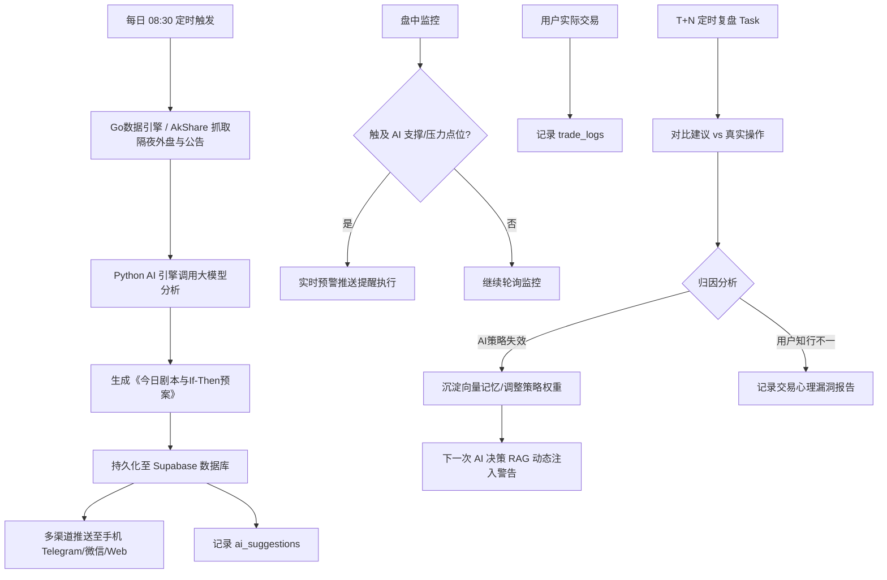
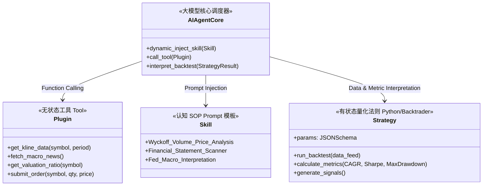
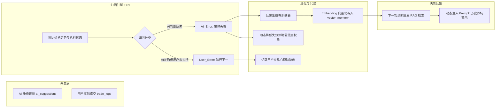
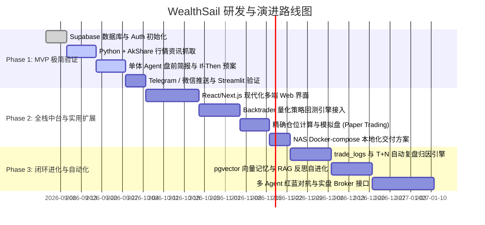

# WealthSail 智能量化投研平台 需求规范文档 (PRD)

> **文档版本**：v1.0.0  
> **编写日期**：2026-08-21  
> **文档状态**：正式发布 (Approved)  
> **适用范围**：WealthSail 投研平台整体架构设计、MVP 研发、功能扩展与版本迭代

---

## 1. 项目背景与产品愿景

### 1.1 行业痛点与背景
在现代证券投资（A股、港股、美股）中，个人与中小投资者面临着多重核心痛点：
1. **信息过载与碎片化**：宏观新闻、隔夜外盘、上市公司公告与海量研报充斥市场，投资者难以在开盘前快速提炼出高价值信息与确定性主线。
2. **情绪化交易与知行不一**：缺乏严格的量化纪律，容易陷入追涨杀跌、扛单不设止损、利润大幅回撤等认知偏差与心理误区。
3. **缺乏客观量化工具**：大模型往往存在“自然语言脑补”倾向，缺少严谨的代码级回测引擎和数学模型验证。
4. **决策链路断裂且无复盘闭环**：传统投资辅助工具仅停留在“单向推送建议”，没有追踪用户实际执行情况，无法形成“建议-执行-归因-记忆沉淀-自我进化”的闭环。
5. **多端协同与私有化诉求**：投资者需要随时随地通过手机/PC访问系统，同时注重个人财务数据与 API Key 的隐私安全。

### 1.2 产品定位与愿景
**WealthSail（扬帆财富）** 是一款融合 **“多端跨设备协同”**、**“大模型深度推理”**、**“量化策略回测”** 与 **“认知闭环自进化”** 的新一代全栈智能量化投研中台与决策助手。

- **阶段一 (MVP)**：极简轻量化盯盘与盘前预案助手，验证大模型在行情总结、技术面诊断与 If-Then 操盘剧本生成上的有效性。
- **阶段二 (扩展演进)**：构建模块化解耦的投研中台，引入量化回测引擎、精确仓位控制、双向复盘归因、向量记忆 RAG 与私有化部署。
- **阶段三 (成熟生态)**：打造具备自进化能力的虚拟交易员，对接模拟盘与实盘交易适配器，实现人机协同的智能资产配置。

---

## 2. 用户画像与典型业务场景

### 2.1 目标用户画像
- **自主决策型个人投资者**：有一定股票/基金投资经验，白天有本职工作，希望在盘前 10 分钟快速掌握核心要点并挂出条件单。
- **量化与技术派投资者**：希望验证均线、MACD、RSI 等指标策略，并借助大模型进行综合解读与多维度过滤。
- **成长反思型投资者**：渴望记录自身交易心理漏洞，沉淀亏损教训，建立严谨的投资纪律。

### 2.2 核心业务流程与典型场景



#### 场景 1：晨间盘前 10 分钟操盘剧本
- **时间**：每个交易日早上 08:30 - 09:00（开盘前）。
- **动作**：系统自动采集昨夜美股大盘、中概金龙指数、富时 A50 期指、昨夜重大上市公司公告及昨日量价支撑/阻力位。
- **输出**：生成结构化《今日盘前简报与操作预案》，列出清晰的“支撑位、压力位、买入/卖出条件单触发阈值”，推送到用户手机。用户据此在券商端预埋条件单。

#### 场景 2：个股一键 AI 深度诊股
- **动作**：用户在 Web 或移动端输入股票代码（如 `600519` / `00700` / `NVDA`）。
- **流程**：系统自动抓取近 20 日 K 线、估值分位、资金流向及最新 5 条核心资讯，驱动单体/多 Agent 输出“看多/看空/观望”评级、关键买卖点位及核心逻辑。

#### 场景 3：策略配置与硬核量化回测
- **动作**：用户在前端选择或配置量化策略（如双均线、网格、ATR波动通道），设置回测区间与标的。
- **流程**：后端 Python 量化回测引擎（Backtrader/Qlib）运行历史数据，计算真实年化收益率、最大回撤、夏普比率。
- **输出**：将客观量化数据作为 Context 喂给大模型，由大模型生成通俗易懂的策略优缺点评估与改进建议。

#### 场景 4：交易执行与复盘自进化闭环
- **动作**：AI 给出操作建议后，系统记录建议内容与目标价；用户完成实际交易后录入成交数据。
- **流程**：T+3/T+5 后台触发归因分析。若 AI 判断错误，提炼教训写入向量记忆表（`vector_memory`）；若用户因贪婪/恐惧未执行，生成交易纪律诊断报告。
- **进化**：下次 AI 生成类似标的建议时，自动召回历史教训并插入 System Prompt 进行风险拦截。

---

## 3. 功能需求详细规格

### 3.1 模块一：资产中枢与自选股管理 (Portfolio & Watchlists)

| 功能项 | 需求描述 | 优先级 |
| :--- | :--- | :--- |
| **多市场标的支持** | 支持 A 股（主板/创业板/科创板）、港股、美股以及场内外基金代码检索与行情适配。 | P0 (MVP) |
| **持仓记录与管理** | 记录用户的持仓标的、买入成本价、持仓数量、目标止损/止盈点位，支持增删改查。 | P0 (MVP) |
| **资产与资金大盘** | 记录用户总可用资金、证券总市值、浮动盈亏总额及当日收益率，生成资金走势折线图。 | P1 (扩展) |
| **自选股分组监控** | 支持将关注股票加入自选池，支持添加“关注原因”备注与自定义标签。 | P0 (MVP) |
| **AI 情绪实时标记** | 自选股列表中直观展示最新一次 AI 诊断的看多/看空/中性状态与置信度。 | P0 (MVP) |
| **多端实时同步** | 基于 Supabase 实时数据库（Realtime），保证 Web 端、移动端数据即时双向同步。 | P0 (MVP) |

### 3.2 模块二：AI 诊股与盘前简报引擎 (AI Diagnosis & Briefing)

| 功能项 | 需求描述 | 优先级 |
| :--- | :--- | :--- |
| **隔夜多源数据清洗** | 盘前自动聚合：美股三大指数、中概金龙指数、富时 A50 夜盘、外汇离岸人民币、隔夜公司公告。 | P0 (MVP) |
| **一键 AI 深度诊股** | 支持单股即时诊断，抓取 20 日 K 线数据及近期新闻，生成包含技术面支撑位、压力位及操作方向的诊断报告。 | P0 (MVP) |
| **If-Then 操盘预案** | 盘前报告必须结构化输出 If-Then 剧本（例：*“若开盘冲高至 385 承压，执行减仓 30%；若回调至 368 企稳，加仓 20%”*）。 | P0 (MVP) |
| **报告持久化与归档** | 所有生成的简报与诊股记录持久化至数据库，支持按日期、股票代码、报告类型检索与历史回看。 | P0 (MVP) |
| **多渠道自动推送** | 支持配置 Telegram Bot、Server酱 (微信通知)、企业微信 Webhook、移动端 Push 推送盘前简报。 | P0 (MVP) |
| **盘中触点异动预警** | （扩展）盘中定时轮询市价，当价格触及盘前设定的关键支撑/压力位时触发即时推送。 | P1 (扩展) |

### 3.3 模块三：量化策略、Skill 与 Plugin 架构解耦体系

系统明确划分三大核心能力边界，杜绝大模型“凭空猜测”，保证量化严谨性：



#### 1. Plugin (工具插件层 - 无状态“手眼”)
- **职责**：封装所有外部数据拉取与外部系统对接能力。
- **能力集**：
  - `akshare_kline_fetcher`：获取指定标的日线/分钟级 K 线数据。
  - `macro_data_fetcher`：获取离岸汇率、大宗商品、国债收益率数据。
  - `news_crawler`：获取个股公告、行业要闻与财报摘要。
  - `broker_adapter`：对接模拟盘或实盘交易网关。

#### 2. Skill (认知 SOP 层 - 结构化 Prompt 模板)
- **职责**：定义 AI 在特定领域的思考逻辑框架与分析步骤（思维链 CoT）。
- **能力集**：
  - *威科夫量价分析 SOP*：吸筹、洗盘、拉升、派发阶段诊断。
  - *财报穿透排雷 SOP*：应收账款异动、存货减值、经营现金流与净利润背离检测。
  - *业绩会管理层情绪解读 SOP*：回避措辞、信心指数打分。

#### 3. Strategy (量化策略层 - 严谨数学与代码逻辑)
- **职责**：通过 Python 代码（Backtrader / Qlib 引擎）执行真实历史数据回测，杜绝自然语言幻觉。
- **输出指标**：年化收益率 (CAGR)、最大回撤 (Max Drawdown)、夏普比率 (Sharpe Ratio)、胜率与盈亏比。
- **协同机制**：后端执行真实回测后，将结构化回测指标作为输入数据传递给大模型，由大模型为用户提供易读的优劣势洞察。

### 3.4 模块四：精确仓位管理与交易决策闭环

| 功能项 | 需求描述 | 优先级 |
| :--- | :--- | :--- |
| **精确买入股数计算** | AI 输出建议时，根据用户可用现金与风险偏好计算具体买入股数：$$\text{目标股数} = \lfloor \frac{\text{可用资金} \times \text{建议比例}}{\text{当前市价}} \rfloor$$ | P1 (扩展) |
| **操作建议标准化** | AI 建议以结构化格式输出（动作：BUY/SELL/HOLD、标的、指导价格区间、建议股数、强制止损价）。 | P1 (扩展) |
| **交易适配器抽象 (BrokerInterface)** | 统一抽象交易接口：`get_balance()`、`get_positions()`、`submit_order()`。前期实现为模拟盘 `PaperTradingBroker`，未来平滑切换至 QMT/富途等实盘。 | P1 (扩展) |
| **风控拦截与人工确认 (HITL)** | AI 生成的交易指令必须进入 `pending_orders` 表，必须由用户在 Web/手机端确认授权后才放行至交易接口，严禁全自动直接发单。 | P1 (扩展) |

### 3.5 模块五：AI 建议与人类真实操作的“复盘自进化”机制

这是系统实现“越用越聪明、胜率逐步提高”的核心闭环：



#### 1. 双向数据记录
- 系统持久化每一笔 `ai_suggestions`（包含建议买卖点、推荐逻辑与建议日期）。
- 系统记录用户真实发生的 `trade_logs`（包含实际买卖时间、成交均价、成交股数）。

#### 2. T+N 自动归因引擎
后台定时任务（如 T+3/T+5）自动对比历史建议、真实成交与后续实际行情走势：
- **AI_Error（AI 策略失效）**：AI 给出买入信号，但后市出现破位大跌；或 AI 提示卖出，但后市主升浪突破。
- **User_Error（用户知行不一）**：AI 给出精准止损建议，但用户因侥幸心理扛单导致大幅回撤；或 AI 建议分批止盈，用户过早清仓卖飞。

#### 3. 三维自修正与经验沉淀
1. **反面模式向量记忆 (Negative RAG Memory)**：
   - 将 AI 失败教训生成结构化反思文本并打上 `[Anti-Pattern]` 标签（例：*“2026年8月在流动性收紧宏观背景下，科技股日线金叉容易形成诱多陷阱”*）。
   - 将文本向量化存入 Supabase `vector_memory`。
   - 下次执行类似市场环境分析时，通过向量相似度检索出该教训，作为 System Prompt 注入：“*警示：历史记忆显示此类形态存在重大诱多风险，请上调止损阈值。*”
2. **量化策略动态权重调整**：
   - 追踪不同量化策略在当期市场环境下的胜率，动态微调其在多策略投票中的权重系数（Weight）。
3. **Skill SOP 迭代优化**：
   - 累积多起同类误判后，主控 Agent 自动重写并优化对应的 Skill Prompt 规则。

### 3.6 模块六：模型配置与系统偏好管理

| 功能项 | 需求描述 | 优先级 |
| :--- | :--- | :--- |
| **大模型多端切换** | 支持用户在后台配置并切换底层 LLM（如 OpenAI GPT-4o、DeepSeek-R1/V3、Claude 等）。 | P1 (扩展) |
| **模型推理参数可视化** | 支持自定义 `Temperature`（逻辑回测设为 0，宏观新闻研读设为 0.5）、`Max Tokens` 等参数。 | P1 (扩展) |
| **安全存储与环境变量** | 严格采用环境变量与 Supabase 用户级加密存储 API Key，严禁前端明文暴露。 | P0 (MVP) |
| **定时任务自定义** | 用户可自定义盘前简报触发时间（默认 08:30）、盘后复盘时间及推送渠道开关。 | P0 (MVP) |

---

## 4. 非功能性需求 (NFR)

### 4.1 性能与响应要求
- **盘前简报批处理**：单个用户 10 只持仓/自选股的完整多源数据采集与 AI 简报生成控制在 60 秒内完成。
- **Web 界面加载与交互**：首屏加载时间（FCP）小于 1.5 秒，数据切换与图表渲染流畅（60 FPS）。
- **实时通知延迟**：盘中触点监控预警消息从触发到推送到达用户终端延迟不超过 5 秒。

### 4.2 跨端兼容性与体验
- **自适应响应式布局**：基于现代 Web 体系，无缝适配 PC 宽屏、平板以及移动端手机浏览器。
- **现代化设计质感**：采用现代化金融暗黑/明亮主题，配备清晰的 K 线图表、卡片式 If-Then 剧本展示、直观的盈亏色标与流畅交互动效。

### 4.3 安全性与数据合规
- **身份鉴权与隔离**：基于 Supabase Auth 实行严格的行级安全策略（Row Level Security, RLS），确保任何用户仅能读取和修改自身的持仓、配置及记忆数据。
- **敏感信息防护**：券商接口凭证与大模型 API Key 采用非对称加密存储或本地环境变量管理。

### 4.4 可靠性与私有化部署
- **7x24 小时无人值守运行**：支持通过 `docker-compose` 部署于家庭/办公室 NAS（如极空间、群晖）或轻量云服务器，具备容器崩溃自动重启与定时任务异常告警机制。

---

## 5. 系统整体架构与技术选型

### 5.1 整体分层架构

```
+-----------------------------------------------------------------------+
|                       前端呈现层 (Presentation)                        |
|   React / Next.js + TypeScript + TailwindCSS / AntD / TradingView图表  |
|          (支持 PC 浏览器、移动端 Web、PWA、后续 React Native App)         |
+-----------------------------------------------------------------------+
                                  │ HTTPS / WebSocket (Supabase Realtime)
+-----------------------------------------------------------------------+
|                       API 网关与业务服务层 (Backend)                    |
|   Python FastAPI (核心计算、AI调度、量化回测、策略管理、用户接口)       |
+-----------------------------------------------------------------------+
          │                                           │
+-------------------------+                 +-------------------------+
|   数据同步引擎 (Go Engine) |                 |   量化回测引擎 (Quant)   |
|   高并发K线轮询 / 新闻爬取 |                 |   Backtrader / Qlib     |
+-------------------------+                 +-------------------------+
          │                                           │
+-----------------------------------------------------------------------+
|                    数据存储与记忆中枢 (Storage & Vector)               |
|            Supabase (PostgreSQL 16 + pgvector + Auth + Realtime)       |
|    - 关系表: profiles / portfolio / positions / ai_suggestions        |
|    - 向量表: vector_memory (OpenAI/Text-Embedding-3 向量记忆)          |
+-----------------------------------------------------------------------+
                                  │
+-----------------------------------------------------------------------+
|                      外部服务与基础设施 (External & Infra)             |
|   - 数据源: AkShare, Tushare, 新浪财经, 东方财富                       |
|   - LLM: DeepSeek API, OpenAI API                                     |
|   - 消息渠道: Telegram Bot, Server酱, 企业微信 Webhook                 |
|   - 部署环境: NAS Docker / Linux VPS                                  |
+-----------------------------------------------------------------------+
```

### 5.2 核心技术栈清单

| 层次 | 选型技术 | 选型理由 |
| :--- | :--- | :--- |
| **前端框架** | **React / Next.js + TypeScript** | 组件化生态丰富，天然支持响应式，便于后续打包移动端 App。 |
| **后端主服务** | **Python 3.12+ (FastAPI)** | AI 与量化生态第一语言，异步高性能，丰富的金融工具库集成。 |
| **数据同步引擎** | **Go (Goroutines)** | 高并发协程，极低内存占用，适合高频行情轮询与数据清洗。 |
| **数据库 & Auth** | **Supabase (Cloud / Self-hosted)** | 零运维 PostgreSQL，内置 Auth、RLS 安全策略、实时 Realtime 与 `pgvector` 向量检索。 |
| **量化回测引擎** | **Backtrader / Qlib** | 成熟的量化回测与信号生成框架，提供严谨的数学评价指标。 |
| **开源金融数据** | **AkShare / Tushare** | 免费覆盖 A/港/美股行情、宏观数据、资金流向与财经新闻。 |
| **容器化交付** | **Docker & Docker-compose** | 一键将数据库、后端与爬虫服务部署在 NAS 或云服务器上。 |

---

## 6. 核心数据模型设计 (Database Schema)

基于 Supabase (PostgreSQL) 设计的 4 大核心数据模块：

### 6.1 用户与资产中枢 (User & Portfolio Core)

```sql
-- 1. 用户扩展信息表
CREATE TABLE profiles (
    id UUID PRIMARY KEY REFERENCES auth.users(id) ON DELETE CASCADE,
    nickname VARCHAR(64),
    risk_level VARCHAR(16) DEFAULT 'balanced' CHECK (risk_level IN ('conservative', 'balanced', 'aggressive')),
    model_configs JSONB DEFAULT '{"provider": "deepseek", "temperature": 0.2}',
    created_at TIMESTAMPTZ DEFAULT NOW(),
    updated_at TIMESTAMPTZ DEFAULT NOW()
);

-- 2. 资金账户大盘表
CREATE TABLE portfolio (
    id UUID PRIMARY KEY DEFAULT gen_random_uuid(),
    user_id UUID REFERENCES profiles(id) ON DELETE CASCADE,
    total_capital NUMERIC(15, 2) NOT NULL DEFAULT 0.00,
    available_cash NUMERIC(15, 2) NOT NULL DEFAULT 0.00,
    updated_at TIMESTAMPTZ DEFAULT NOW()
);

-- 3. 持仓明细表
CREATE TABLE positions (
    id UUID PRIMARY KEY DEFAULT gen_random_uuid(),
    user_id UUID REFERENCES profiles(id) ON DELETE CASCADE,
    symbol VARCHAR(32) NOT NULL,
    stock_name VARCHAR(64),
    market VARCHAR(16) NOT NULL CHECK (market IN ('A', 'HK', 'US')),
    avg_cost NUMERIC(15, 4) NOT NULL,
    quantity INT NOT NULL CHECK (quantity > 0),
    ai_stop_loss NUMERIC(15, 4),
    ai_take_profit NUMERIC(15, 4),
    updated_at TIMESTAMPTZ DEFAULT NOW()
);

-- 4. 自选股列表
CREATE TABLE watchlists (
    id UUID PRIMARY KEY DEFAULT gen_random_uuid(),
    user_id UUID REFERENCES profiles(id) ON DELETE CASCADE,
    symbol VARCHAR(32) NOT NULL,
    stock_name VARCHAR(64),
    market VARCHAR(16) NOT NULL,
    notes TEXT,
    latest_ai_sentiment VARCHAR(16) CHECK (latest_ai_sentiment IN ('bullish', 'bearish', 'neutral')),
    created_at TIMESTAMPTZ DEFAULT NOW()
);
```

### 6.2 决策与复盘闭环 (Decision & Feedback Loop)

```sql
-- 5. AI 操盘建议与预案表
CREATE TABLE ai_suggestions (
    id UUID PRIMARY KEY DEFAULT gen_random_uuid(),
    user_id UUID REFERENCES profiles(id) ON DELETE CASCADE,
    symbol VARCHAR(32),
    report_type VARCHAR(32) NOT NULL CHECK (report_type IN ('daily_briefing', 'diagnosis', 'intraday_alert')),
    suggested_action VARCHAR(16) CHECK (suggested_action IN ('BUY', 'SELL', 'HOLD', 'WAIT')),
    target_price NUMERIC(15, 4),
    suggested_qty INT,
    support_price NUMERIC(15, 4),
    resistance_price NUMERIC(15, 4),
    if_then_plan JSONB,
    logic_summary TEXT,
    status VARCHAR(16) DEFAULT 'pending' CHECK (status IN ('pending', 'executed', 'ignored', 'expired')),
    created_at TIMESTAMPTZ DEFAULT NOW()
);

-- 6. 用户真实交易执行记录表
CREATE TABLE trade_logs (
    id UUID PRIMARY KEY DEFAULT gen_random_uuid(),
    user_id UUID REFERENCES profiles(id) ON DELETE CASCADE,
    suggestion_id UUID REFERENCES ai_suggestions(id) ON DELETE SET NULL, -- 关键关联
    symbol VARCHAR(32) NOT NULL,
    actual_action VARCHAR(16) NOT NULL CHECK (actual_action IN ('BUY', 'SELL')),
    executed_price NUMERIC(15, 4) NOT NULL,
    executed_qty INT NOT NULL,
    executed_at TIMESTAMPTZ DEFAULT NOW(),
    execution_notes TEXT
);

-- 7. T+N 复盘归因与反思表
CREATE TABLE post_mortem (
    id UUID PRIMARY KEY DEFAULT gen_random_uuid(),
    user_id UUID REFERENCES profiles(id) ON DELETE CASCADE,
    suggestion_id UUID REFERENCES ai_suggestions(id) ON DELETE CASCADE,
    trade_log_id UUID REFERENCES trade_logs(id) ON DELETE SET NULL,
    error_type VARCHAR(32) NOT NULL CHECK (error_type IN ('AI_ERROR', 'USER_ERROR', 'CORRECT_EXECUTION', 'MARKET_NOISE')),
    pnl_impact NUMERIC(15, 2),
    lesson_summary TEXT NOT NULL,
    is_vectorized BOOLEAN DEFAULT FALSE,
    created_at TIMESTAMPTZ DEFAULT NOW()
);
```

### 6.3 引擎配置与向量记忆 (Engine & Vector Memory)

```sql
-- 启用 pgvector 插件
CREATE EXTENSION IF NOT EXISTS vector;

-- 8. 向量记忆表 (沉淀 AI 反思与反面模式)
CREATE TABLE vector_memory (
    id UUID PRIMARY KEY DEFAULT gen_random_uuid(),
    user_id UUID REFERENCES profiles(id) ON DELETE CASCADE,
    content TEXT NOT NULL,
    embedding VECTOR(1536), -- 适配 text-embedding-3-small
    tags TEXT[],
    metadata JSONB,
    created_at TIMESTAMPTZ DEFAULT NOW()
);

-- 9. AI 认知 SOP / Skill 表
CREATE TABLE agent_skills (
    id UUID PRIMARY KEY DEFAULT gen_random_uuid(),
    name VARCHAR(64) UNIQUE NOT NULL,
    description TEXT,
    prompt_template TEXT NOT NULL,
    is_active BOOLEAN DEFAULT TRUE,
    version INT DEFAULT 1,
    updated_at TIMESTAMPTZ DEFAULT NOW()
);

-- 10. 量化策略注册表
CREATE TABLE strategies (
    id UUID PRIMARY KEY DEFAULT gen_random_uuid(),
    name VARCHAR(64) UNIQUE NOT NULL,
    code_path VARCHAR(255),
    params_schema JSONB,
    current_weight NUMERIC(3, 2) DEFAULT 1.00,
    win_rate NUMERIC(5, 2),
    updated_at TIMESTAMPTZ DEFAULT NOW()
);
```

### 6.4 任务调度与推送通知 (Tasks & Notifications)

```sql
-- 11. 推送配置表
CREATE TABLE user_push_configs (
    id UUID PRIMARY KEY DEFAULT gen_random_uuid(),
    user_id UUID REFERENCES profiles(id) ON DELETE CASCADE,
    channel VARCHAR(32) NOT NULL CHECK (channel IN ('telegram', 'serverchan', 'wechat_work', 'webpush')),
    config_json JSONB NOT NULL,
    is_enabled BOOLEAN DEFAULT TRUE,
    notify_time TIME DEFAULT '08:30:00',
    created_at TIMESTAMPTZ DEFAULT NOW()
);

-- 12. 历史报告长文本归档表
CREATE TABLE daily_reports (
    id UUID PRIMARY KEY DEFAULT gen_random_uuid(),
    user_id UUID REFERENCES profiles(id) ON DELETE CASCADE,
    report_date DATE NOT NULL,
    report_type VARCHAR(32) NOT NULL,
    markdown_content TEXT NOT NULL,
    created_at TIMESTAMPTZ DEFAULT NOW()
);
```

---

## 7. 演进路线与阶段划分 (Roadmap)



### 阶段一：MVP 极简验证期（目标：2-3 周跑通核心价值）
- **核心目标**：以极低开发成本跑通“持仓管理 -> 隔夜数据采集 -> LLM 盘前简报 -> 手机推送”的主干链路。
- **交付产物**：Python 自动化调度脚本、Supabase 云数据库、Telegram/微信通知、基础 Web 页面。

### 阶段二：全栈中台与实用功能扩展期（目标：4-6 周搭建完整系统）
- **核心目标**：提供高颜值自适应 Web 客户端，引入严谨的 Python 量化回测与精确仓位管理，支持 NAS 私有化部署。
- **交付产物**：Next.js Web 端控制台、Backtrader 回测引擎集成、Go 数据拉取服务、Docker-compose 一键部署包。

### 阶段三：认知闭环自进化与高级量化期（目标：持续迭代）
- **核心目标**：打通操作日志与 AI 建议的 T+N 归因，建立向量反思记忆库，实现策略动态降权与 Prompt 自主进化。
- **交付产物**：双向复盘归因系统、pgvector 经验沉淀模块、多 Agent 红蓝对抗决策沙盘、实盘交易适配层。
