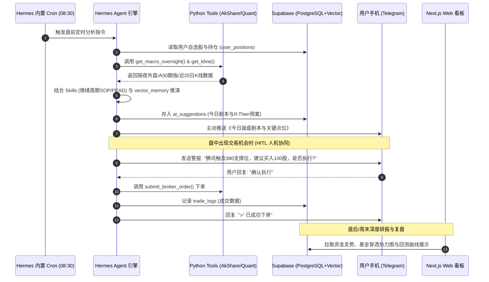
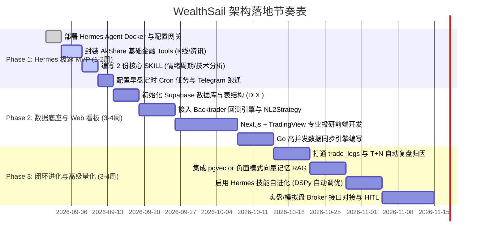

# WealthSail 智能量化投研平台 技术选型综合评估与架构决策报告

> **文档版本**：v1.0.0  
> **编写日期**：2026-08-21  
> **评估目标**：针对 [01.WealthSail投研平台需求文档.md](file:///d:/develop/gitee/WealthSail/docs/01.WealthSail投研平台需求文档.md) 的完整需求，评估最优技术选型体系并对比主流替代方案。  
> **参考依据**：`reference/14.基于HermesAgent的投研平台设计方案.md`、`reference/13.HermesAgent框架分析及与其它框架对比.md`、`reference/09.Agent框架选择建议.md`

---

## 1. 执行摘要与核心决策 (Executive Summary)

### 1.1 核心结论
实现 WealthSail 智能量化投研平台，**最合适的技术选型不是孤立地依赖某一个“全家桶”框架，而是采用“以 Hermes Agent 为智能中枢的分层混合架构（Layered Hybrid Architecture）”**：

```
+-----------------------------------------------------------------------------------------+
|                        【双端交互层】                                                    |
|  1. ChatOps 极速端: Telegram / 微信 Bot (依托 Hermes Gateway，实现 0 前端成本手机交互)   |
|  2. 专业投研 Web 看板: Next.js + TypeScript + TailwindCSS + TradingView (资产与深度研报)  |
+-----------------------------------------------------------------------------------------+
                                             │
+-----------------------------------------------------------------------------------------+
|                        【智能体调度与自进化中枢】                                         |
|  底座框架: Nous Research Hermes Agent (Python 3.12+)                                    |
|  - Tools 层: AkShare / Backtrader / 龙虎榜 / 券商交易适配器 (纯 Python 函数)            |
|  - Skills 层: agentskills.io 标准 SOP (情绪周期 / PEAD / 财报透视 / 威科夫分析)         |
|  - 记忆与自进化: DSPy/GEPA 驱动的 Skill 动态优化 + 历史踩坑反思                          |
|  - 自动化调度: 内置 Cron 盘前 08:30 自动触发 + 多平台主动推送                           |
+-----------------------------------------------------------------------------------------+
                                             │
+-----------------------------------------------------------------------------------------+
|                        【业务、量化与高并发数据中枢】                                     |
|  1. 高并发数据服务 (Go): 常驻 Goroutines 轮询行情与宏观异动，毫秒级响应                 |
|  2. 严谨量化引擎 (Python): Backtrader / Qlib 负责真实历史回测与 NL2Strategy 代码执行     |
|  3. 存储与向量底座: Supabase (PostgreSQL 16 + pgvector + Auth + Realtime 实时消息)      |
+-----------------------------------------------------------------------------------------+
                                             │
+-----------------------------------------------------------------------------------------+
|                        【私有化部署基础设施】                                             |
|  本地 NAS (极空间/群晖) 或云服务器 Docker-compose 一键容器化交付，7x24 小时无人值守运行  |
+-----------------------------------------------------------------------------------------+
```

---

## 2. 需求拆解：WealthSail 的核心技术挑战

评估技术选型前，必须清醒剖析 WealthSail 区别于普通“AI 聊天机器人”的 5 大硬核特性：

| 维度 | 业务需求 | 对技术选型的核心诉求 |
| :--- | :--- | :--- |
| **1. 金融量化与数据主场** | A/港/美行情、龙虎榜、财报预期差、Backtrader 回测 | **必须在 Python 原生环境中运行**，杜绝跨语言 RPC 性能损耗与调试灾难。 |
| **2. 严谨性与确定性** | 杜绝大模型自然语言脑补回测，严格量化指标 | 工具（Tool）与量化策略（Strategy）必须硬代码解耦，大模型只作为调用者与解释者。 |
| **3. 全天候无人值守与通知** | 每日 08:30 盘前推演、盘中触点告警、HITL 人工确认 | 框架必须具备**可靠的 Cron 定时调度**与**多渠道主动推送网关 (Telegram/微信)**。 |
| **4. 闭环归因与自进化** | AI 策略失效 vs 用户知行不一、反面模式沉淀 | 框架必须具备**持久化记忆 (Memory)** 与 **Prompt/Skill 自主优化迭代能力**。 |
| **5. 多端体验与数据隐私** | 手机随时随地可用，个人资产与 API Key 绝不泄露 | 支持 NAS 本地私有化部署；兼顾极简聊天交互（ChatOps）与专业可视化 Web 界面。 |

---

## 3. 主流技术路线全景横向对比 (Framework Comparison)

针对 Agent 核心层的选型，我们对市面上 5 种主流技术路线进行深度对比：

| 评估维度 | 方案 A：Hermes Agent (推荐) | 方案 B：LangGraph (Python) | 方案 C：CrewAI / AutoGen | 方案 D：全栈 TS (Mastra/DSH) | 方案 E：纯 Python 自研手撕 |
| :--- | :--- | :--- | :--- | :--- | :--- |
| **框架定位** | 自进化全天候智能体底座 | 复杂状态图工作流编排 | 多角色拟人化协作辩论 | 前端驱动的全栈 TS 智能体 | 裸写 FastAPI + 异步调度 |
| **金融量化生态契合度** | 🟢 **原生 Python**（无缝调用 AkShare/Backtrader） | 🟢 **原生 Python** | 🟢 **原生 Python** | 🔴 **严重脱节**（需跨语言 RPC 调 Python 脚本） | 🟢 **原生 Python** |
| **框架厚度与 Token 消耗** | 🟢 **极轻量**（薄封装 Tool Calling） | 🔴 **极重**（状态全量透传，易 Token 爆炸） | 🟡 **中等**（黑盒 Prompt，消耗大） | 🟢 **轻量** | 🟢 **极致轻量** |
| **多平台网关与推送** | 🟢 **开箱即用**（Telegram/Discord/Slack） | 🔴 **无**（需自行对接） | 🔴 **无**（需自行对接） | 🟡 **部分支持** | 🔴 **无**（需完全手写） |
| **定时调度 (Cron)** | 🟢 **内置自动化引擎** | 🔴 **无**（需外挂 Celery/APScheduler） | 🔴 **无** | 🟡 **支持** | 🔴 **需外挂调度器** |
| **自进化与技能生长** | 🟢 **原生支持**（基于 DSPy/GEPA 自动重写 Skill） | 🔴 **无**（需完全自研） | 🔴 **无** | 🔴 **无** | 🔴 **需完全自研** |
| **人机协同 (HITL)** | 🟢 **原生聊天挂起与确认** | 🟢 **Checkpointer 断点强大** | 🟡 **较弱** | 🟡 **中等** | 🔴 **需手写状态机** |
| **综合落地效率 (Time to Market)** | 🚀 **极高**（几天即可跑通 MVP） | 🐢 **低**（概念繁多，图语法学习曲线陡峭） | 🐇 **中等**（易出 Demo，难做工业级定制） | 🐢 **低**（跨语言通信维护成本高） | 🐢 **极低**（造轮子工作量巨大） |

---

## 4. 深度剖析：为什么推荐“Hermes Agent + Supabase + Go + Next.js”？

### 4.1 为什么 Hermes Agent 是 Agent 调度的“绝佳底座”？
1. **保住 Python 的量化绝对优势**：
   量化投研的核心是数据（`AkShare`、`Tushare`）、矩阵计算（`Pandas`、`NumPy`）和回测引擎（`Backtrader`、`Qlib`）。Hermes Agent 基于 Python 编写，开发一个股票工具只需写一个标准的 Python 函数加 Docstring，Agent 就能通过 Function Calling 完美调用，零性能损耗。
2. **天生自带“多平台网关 + Cron 调度器”，MVP 阶段直接免去前端开发**：
   传统方案需要写后端 API、搭建前端 Web、做推送服务。而 Hermes Agent 原生集成了 Telegram、Discord 等网关和 Cron 定时器。开发者只需配置几行 YAML 并编写几个 Tools，系统就能在每天 08:30 自动抓取外盘数据、生成盘前预案并主动推送到手机 Telegram 上，**研发周期从数周压缩至 2 天**。
3. **与 WealthSail“认知自进化与复盘”需求 100% 契合**：
   Hermes Agent 由顶尖开源大模型团队 Nous Research 开发，其灵魂特性就是 **“Self-Evolution (技能自进化)”**。当系统运行一段时间或用户在对话中指出判断漏洞时，Hermes 能够利用 DSPy/GEPA 自动优化或创建新的 `SKILL.md` 文件（如自动修正《A 股情绪周期诊断 SOP》中的阈值），真正实现“越用越聪明”。
4. **克制的“薄封装”哲学，杜绝 LangGraph 式的 Token 爆炸**：
   金融多轮分析中，LangGraph 容易因图状态（State）层层堆叠导致上下文急剧膨胀。Hermes Agent 坚持标准化的 Tool Calling 与模块化 Skill（`agentskills.io` 规范），按需动态注入，保持上下文窗口清爽高效。

### 4.2 为什么必须搭配 Supabase、Go 与 Next.js 形成混合架构？
虽然 Hermes Agent 在智能体调度、ChatOps 和自进化上表现完美，但单一的 Agent 框架无法覆盖复杂投研平台的所有场景，必须分工协作：
1. **Supabase (PostgreSQL + pgvector) —— 解决结构化数据与向量记忆中枢**：
   Hermes Agent 侧重运行时（Runtime），而用户的持仓明细（`positions`）、资金流水（`portfolio`）、AI 建议与真实操作日志（`trade_logs`）需要强一致性的关系型数据库持久化。Supabase 提供了零运维 PostgreSQL、行级安全（RLS）和 `pgvector` 向量检索，是存储反面模式记忆（`[Anti-Pattern]`）与长文本研报的完美底座。
2. **Go 语言微服务 —— 解决高并发数据采集与毫秒级触点监控**：
   盘中高频轮询几千只股票的实时价格与异动，Python 的 GIL 和单线程性能开销较大。使用轻量级 Go 协程服务进行高频抓取，清洗后直接写入 Supabase 或推送 Redis，不仅占用极少 NAS 内存，还能保证盘中触点告警在 5 秒内触发。
3. **Next.js + TypeScript Web 端 —— 解决专业级可视化大盘**：
   手机 Telegram 适合接收“结论”与“If-Then 操作指令”，但当用户需要查看多周期 K 线图表、基金穿透重合度热力图、策略历史回测收益曲线（Equity Curve）时，Next.js + TradingView 图表库提供了不可替代的专业投研工作台体验。

---

## 5. 详细分层实现方案与数据流转



---

## 6. 研发演进路线与落地节奏 (Phased Implementation)

得益于 Hermes Agent 的模块化能力，团队可以采取**“极速启动，渐进增强”**的最佳落地路径：



---

## 7. 风险评估与应对策略 (Risk & Mitigation)

| 潜在风险点 | 风险影响 | 应对与规避策略 |
| :--- | :--- | :--- |
| **1. 框架过度依赖风险** | 若 Hermes Agent 上游开源项目更新缓慢或架构变动 | Hermes 的核心仅依赖标准 Python 函数（Tools）与通用 Markdown（Skills，`agentskills.io` 标准）。业务资产完全与框架解耦，即便未来迁移至原生 FastAPI，代码迁移成本几乎为 0。 |
| **2. 实盘误操作风险** | AI 出现幻觉擅自发出错误交易指令导致亏损 | **严格执行 Human-in-the-loop (HITL)**：所有下单 Tool 必须在代码层加锁，只有在聊天交互端收到用户明确签名或点击确认后才允许放行发单。 |
| **3. 数据源封禁或失效** | AkShare 免费接口受到频次限制或页面结构变化 | 采用 Go 语言服务进行缓冲与代理，集成多数据源容灾（AkShare + Tushare + 东方财富 API 自动切换与失败重试）。 |
| **4. NAS 硬件资源开销** | 7x24 小时运行导致内存与 CPU 负载过高 | Hermes Agent 采用极轻量进程常驻，LLM 推理全部通过 API 调用云端大模型（DeepSeek/OpenAI），NAS 本地仅消耗 < 500MB 内存。 |

---

## 8. 总结：最终选型决策表

| 层次模块 | 选定技术栈 | 核心理由 |
| :--- | :--- | :--- |
| **智能体中枢 (AI Agent Engine)** | **Nous Research Hermes Agent (Python 3.12)** | 原生 Python 量化生态、自带 Telegram/Discord 网关、内置 Cron 定时器、原生 Skill 自进化能力。 |
| **工具与量化回测 (Tools & Quant)** | **AkShare + Backtrader + Pandas** | 免费覆盖全市场数据，业界标准回测框架，提供客观严谨的数学夏普与回撤指标。 |
| **数据存储与向量记忆 (Database)** | **Supabase (PostgreSQL 16 + pgvector)** | 开箱即用 Auth 鉴权、行级安全 RLS、实时 Realtime 订阅、原生向量检索，免除本地运维痛点。 |
| **高频数据引擎 (Data Sync Engine)**| **Go (Goroutines)** | 高并发轻量协程，极低内存占用，保障盘中触点告警秒级响应。 |
| **专业投研前端 (Web Frontend)** | **Next.js + TypeScript + TradingView + AntD**| 现代响应式 Web UI，专业金融 K 线图表与基金穿透可视化，流式响应渲染。 |
| **私有化交付部署 (DevOps)** | **Docker & Docker-compose (NAS / VPS)** | 一键容器化部署于极空间/群晖 NAS，数据完全本地私有化，7x24 小时无人值守。 |
