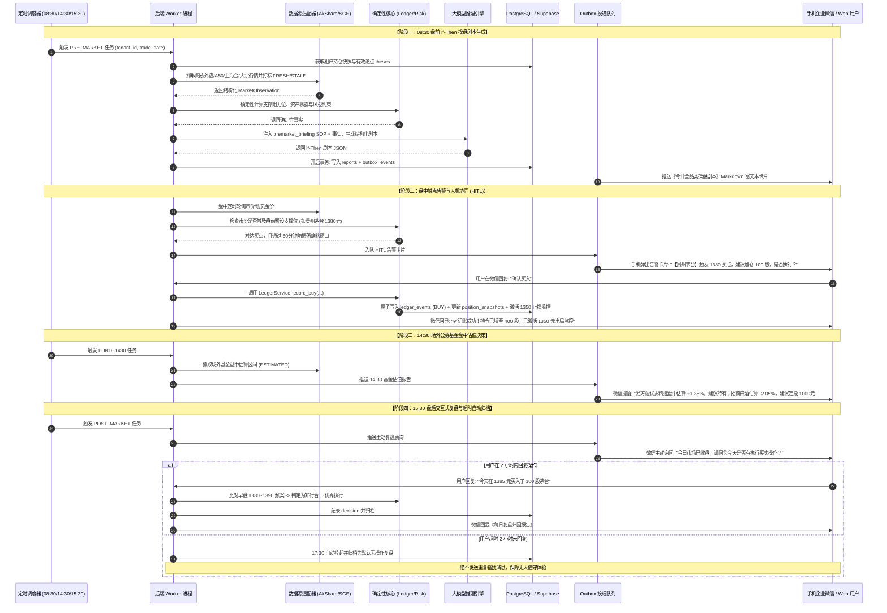
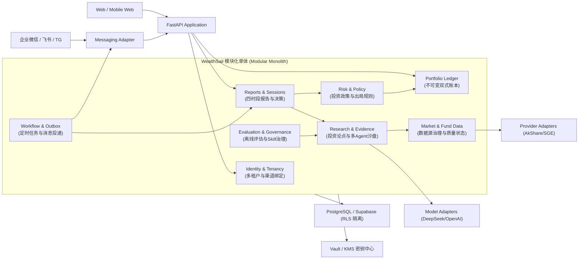
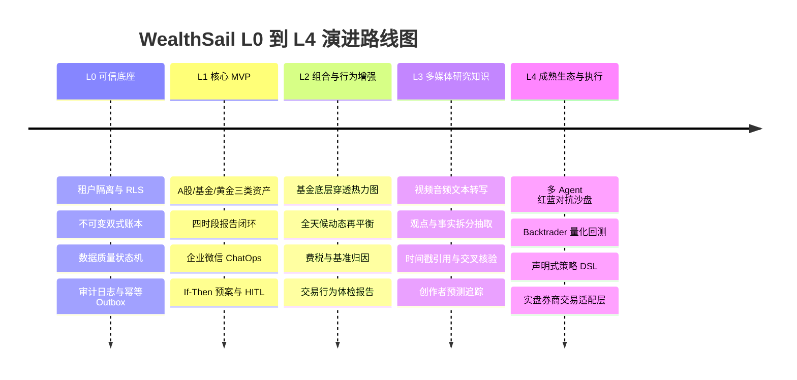

# WealthSail 智能量化投研平台 技术选型综合评估与架构决策报告 (v2.0)

> **文档版本**：v2.0.0 (全栈混合架构与可演进单体版)  
> **编写日期**：2026-08-23  
> **文档状态**：正式发布 (Approved)  
> **适用范围**：L0 可信底座、L1 核心 MVP，并定义 L2–L4 全栈演进路径  
> **架构结论**：模块化单体 + PostgreSQL/Supabase (不可变双式记账 + RLS 行级隔离) + Python 3.12+ 领域服务与 Worker + 可插拔 Hermes / 数据源 / 渠道适配器  
> **相关文档**：[PRD](./01.WealthSail投研平台需求文档.md) · [实战指南](./03.WealthSail-MVP快速构建与实战指南.md) · [数据设计](./06.WealthSail数据模型与数据源治理设计.md) · [安全设计](./07.WealthSail安全隐私与合规设计.md) · [追溯矩阵](./08.WealthSail需求设计测试追溯矩阵.md)

---

## 1. 执行摘要与核心架构决策 (Executive Summary)

### 1.1 核心结论
实现 WealthSail 全品类（A 股股票 + 场内 ETF/LOF + 场外公募基金 + 上海金现货与黄金 ETF + 宏观大宗原油/铜晴雨表 + 经济周期量化）智能投研平台，**最合适的技术选型不是孤立地依赖某一个“全家桶”框架，而是采用“以模块化单体为领域信任边界、以 Hermes Agent 为智能中枢的分层混合架构（Layered Hybrid Architecture）”**：

```
+-----------------------------------------------------------------------------------------+
|                        【双端与全渠道交互层 (Edge & Presentation)】                     |
|  1. 全渠道 ChatOps 极速端: 企业微信自建应用 / 飞书 / Telegram / 钉钉 (适配器即插即用，0门槛) |
|  2. 专业投研 Web 工作台: React 19 / Next.js + TypeScript + TailwindCSS + TradingView 图表 |
+-----------------------------------------------------------------------------------------+
                                             │
+-----------------------------------------------------------------------------------------+
|                        【领域安全边界与应用服务 (Domain API & Core Monolith)】           |
|  底座框架: Python 3.12+ / FastAPI + Pydantic v2 + 确定性金融规则引擎                    |
|  - 身份与租户: identity.is_tenant_member 从可信会话解析 tenant_id，杜绝越权              |
|  - 不可变双式账本: ledger_events + ledger_legs (资金与份额借贷守恒，派生投影完全幂等重建)  |
|  - 数据源治理: 数据质量状态机 (FRESH / ESTIMATED / STALE / UNAVAILABLE)，严禁伪造假数据   |
|  - 风险与投资政策: 集中度控制、出局规则 invalidation_conditions、防振荡静默窗口           |
|  - Outbox 事务保障: 报告生成与异步投递原子提交，实现 At-Least-Once 与幂等去重             |
+-----------------------------------------------------------------------------------------+
                                             │
+-----------------------------------------------------------------------------------------+
|                        【智能体调度与认知大脑 (Agent Runtime & Skills)】                 |
|  智能调度底座: Nous Research Hermes Agent (Python 3.12+)                                |
|  - Tools 插件层: AkShare / SGE上海金 / 基金估值与穿透 / Backtrader / 微信适配器           |
|  - Skills SOP库: 盘前 If-Then 剧本 / 盘中 HITL 监控 / 14:30 基金估值 / 盘后复盘 / 宏观周期 |
|  - 记忆与自进化: 结构化反面模式 [Anti-Pattern] 向量记忆沉淀 + RAG 历史踩坑警示注入       |
|  - 自动化调度: 盘前 08:30 Cron 触发 + 盘中触点告警 + 15:30 质询与 2小时超时自动归档      |
+-----------------------------------------------------------------------------------------+
                                             │
+-----------------------------------------------------------------------------------------+
|                        【存储与基础设施底座 (Data & Infrastructure)】                    |
|  1. 存储与安全底座: PostgreSQL 16 / Supabase (pgcrypto + pgvector + RLS 行级物理隔离)    |
|  2. 凭证与配置中心: Vault / KMS 环境变量引用，严禁明文硬编码 API Key                     |
|  3. 私有化部署: 本地 NAS (极空间/群晖) 或云服务器 VPS Docker-compose，7x24 小时无人值守   |
+-----------------------------------------------------------------------------------------+
```

---

## 2. 架构原则 (Architecture Principles)

1. **领域后端是信任边界**：浏览器、企业微信、Agent Runtime、大模型和外部网络内容均不可信，所有请求必须由后端可信会话解析 `tenant_id`。
2. **LLM 不拥有金融事实**：账本余额、收益率、交易费税、持仓仓位、关键点位阈值与业务状态机必须由确定性代码严谨计算，模型仅做证据提炼与结论解释。
3. **模块化单体优先**：先建立清晰的模块边界与应用服务契约，避免在 L0/L1 阶段引入微服务带来的一致性与运维灾难。
4. **事实与投影分离**：不可变账本事件（`ledger_events`）、数据源快照（`source_snapshots`）、证据链与审计日志是不可篡改的事实；持仓快照、资产净值、四时段报告与向量索引是可完全幂等重建的投影。
5. **外部副作用走 Outbox 事务**：数据库业务提交与外部消息/任务投递绑定在同一数据库事务中，确保 At-Least-Once 与幂等去重。
6. **所有外部能力通过 Port / Adapter 解耦**：大模型、数据源、通讯渠道、工作流调度与密钥存储均通过抽象适配器接入，支持无缝替换。
7. **契约版本化与向下兼容**：事件与 API 遵循 Additive-First 原则，消费者容忍未知可选字段，拒绝未知 major 版本。
8. **数据不可用不等于零**：严格使用 `UNAVAILABLE` / `STALE` / `CONFLICT` 状态，触发系统弃权（ABSTAIN），禁止用常量或伪造数字冒充生产数据。
9. **可扩展不是提前实现**：L0/L1 专注当前闭环，但稳定主键 ID、多租户边界与数据库 migration 机制在演进中绝不推倒重来。

---

## 3. 需求拆解：WealthSail 的 5 大硬核技术挑战

| 维度 | 业务需求 | 对技术选型的核心诉求 |
| :--- | :--- | :--- |
| **1. 全品类量化与大宗宏观主场** | A 股、港美股、公募/ETF 基金、上海金 Au99.99、WTI/Brent 原油、LME/沪铜、库存周期量化 | **必须在 Python 原生环境中运行**，无缝调用 `AkShare`、`Pandas`、`Backtrader`，杜绝跨语言 RPC 性能损耗与调试灾难。 |
| **2. 确定性金融记账与防幻觉** | 杜绝大模型自然语言脑补收益与持仓，严格双式记账借贷守恒与大宗比价计算 | 账本、收益、费税与仓位必须由**确定性代码计算**，大模型仅作为证据提炼与结论解释者。 |
| **3. 全天候无人值守与全渠道触达** | 每日 08:30 盘前推演、盘中触点告警、14:30 基金决策、15:30 交互复盘与 2 小时超时归档 | 框架必须具备**可靠的 Cron 定时调度**与**即插即用的多渠道网关 (企业微信/飞书/TG/钉钉)**。 |
| **4. 闭环归因与自进化** | AI 策略失效 vs 用户知行不一归因、反面模式记忆沉淀 | 框架必须具备**持久化向量记忆 (Memory)** 与 **基于评估集的 Prompt/Skill 离线优化能力**。 |
| **5. 多租户安全隔离与私有化** | 手机随时随地可用，个人资产、交易流水与 API Key 绝不泄露 | 支持 NAS 私有化部署与 PostgreSQL RLS 行级物理隔离；兼顾极简 ChatOps 与专业 Web 界面。 |

---

## 4. 主流技术路线全景横向对比 (Framework Comparison)

针对核心 Agent 与工作流层，我们对市面上 5 种主流技术路线进行深度评估与选型对比：

| 评估维度 | 方案 A：Hermes Agent + 单体 (推荐) | 方案 B：LangGraph (Python) | 方案 C：CrewAI / AutoGen | 方案 D：全栈 TypeScript (Mastra) | 方案 E：纯 Python 自研手撕 |
| :--- | :--- | :--- | :--- | :--- | :--- |
| **框架定位** | 自进化全天候智能体底座 | 复杂状态图工作流编排 | 多角色拟人化协作辩论 | 前端驱动的全栈 TS 智能体 | 裸写 FastAPI + 异步调度 |
| **金融量化生态契合度** | 🟢 **原生 Python 3.12+**（无缝调用 AkShare/Backtrader） | 🟢 **原生 Python** | 🟢 **原生 Python** | 🔴 **严重脱节**（需跨语言 RPC 调 Python 脚本） | 🟢 **原生 Python** |
| **框架厚度与 Token 消耗** | 🟢 **极轻量**（薄封装 Tool Calling） | 🔴 **极重**（状态全量透传，易 Token 爆炸） | 🟡 **中等**（黑盒 Prompt，消耗大） | 🟢 **轻量** | 🟢 **极致轻量** |
| **多平台网关与推送** | 🟢 **开箱即用**（企业微信/Telegram/Discord） | 🔴 **无**（需自行写网关） | 🔴 **无**（需自行对接） | 🟡 **部分支持** | 🔴 **无**（需完全手写） |
| **定时调度 (Cron)** | 🟢 **内置自动化引擎** | 🔴 **无**（需外挂 Celery/APScheduler） | 🔴 **无** | 🟡 **支持** | 🔴 **需外挂调度器** |
| **自进化与技能生长** | 🟢 **原生支持**（Skill SOP 模块化热插拔） | 🔴 **无**（需完全自研） | 🔴 **无** | 🔴 **无** | 🔴 **需完全自研** |
| **人机协同 (HITL)** | 🟢 **原生聊天挂起与确认** | 🟢 **Checkpointer 断点强大** | 🟡 **较弱** | 🟡 **中等** | 🔴 **需手写状态机** |
| **综合落地效率 (Time to Market)** | 🚀 **极高**（几天即可跑通 MVP 闭环） | 🐢 **低**（概念繁多，学习曲线陡峭） | 🐇 **中等**（易出 Demo，难做工业级定制） | 🐢 **低**（跨语言通信维护成本高） | 🐢 **极低**（造轮子工作量巨大） |

---

## 5. 详细分层实现方案与核心模块职责分工

### 5.1 核心模块职责分工

| 架构层级 | 核心组件 | 核心职责 | 技术实现方式 |
| :--- | :--- | :--- | :--- |
| **交互端** | **企业微信自建应用 / Telegram / 飞书 / 钉钉 + Next.js Web** | 手机端即时交互决策 (HITL) + Web 端多周期专业图表呈现与大盘看板 | Hermes Gateway (WeCom / Bot) + Next.js / TypeScript / TradingView |
| **Agent 中枢** | **Hermes Agent (Python 3.12+)** | 统一调度 Tools、加载 Skill 认知 SOP、执行四核投研、自进化与定时触发 | Nous Research Hermes Agent + DSPy/GEPA 技能迭代 |
| **量化与配置引擎** | **Backtrader / Qlib** | 运行单股及股债金全天候多资产组合回测与动态再平衡测算 | Python Quant 引擎 + NL2Strategy 编译器 |
| **数据同步与清洗** | **Provider Adapters (AkShare / SGE / 大宗商品)** | 异步抓取全市场行情、金价、异动与大宗数据，执行数据质量状态打标 | Python 异步/多线程 Provider + 质量状态机清洗 |
| **存储与安全中枢** | **Supabase (PostgreSQL 16 + pgcrypto + pgvector)** | 全品类资产双式账本、决策闭环流水、向量反思记忆及多租户行级隔离 | PostgreSQL 16 + pgvector + RLS 行级安全策略 |
| **基础设施** | **Docker-compose** | 本地 NAS (极空间/群晖) 或云 VPS 私有化交付与 24/7 无人值守监控 | Docker 容器化编排 |

---

### 5.2 核心业务时序流转与人机协同 (HITL Sequence Flow)



---

## 6. 模块化单体组件与安全边界 (Modular Monolith Components)

系统组件边界划分严格，任何跨模块交互均通过领域服务或版本化事件完成：



### 6.1 Identity & Tenancy (身份与租户)
负责用户注册登录、会话鉴权、企业微信多端绑定与解绑。它从可信会话中解析 `tenant_id`，其他业务模块一律不得信任客户端或模型传入的租户 ID。

### 6.2 Portfolio Ledger (资产与双式账本)
不可变双式记账中枢。负责处理 `CASH_IN`、`BUY`、`SELL`、`DIVIDEND_CASH`、`DIVIDEND_REINVEST` 等金融事件。它是资产余额的**唯一事实源**，通过应用服务提供查询，严禁直接修改持仓快照表。

### 6.3 Market & Fund Data (行情与数据源治理)
负责标的主数据（`instrument_id`）、交易日历、行情与基金净值抓取。输出结构化 `MarketObservation` 并打上 `FRESH` / `ESTIMATED` / `STALE` / `UNAVAILABLE` 质量标签。

### 6.4 Research & Evidence (投研论点与证据链)
管理投资论点（`theses`）、催化剂、出局条件（`invalidation_conditions`）与多 Agent 对抗研报。模型输出必须附带数据来源快照与时间戳引用。

### 6.5 Risk & Policy (风控与出局规则)
管理全天候大类资产目标配比、单标的仓位上限、回撤预算与防振荡静默窗口。所有 AI 建议发布前必须经过该模块的确定性规则校验。

### 6.6 Workflow & Outbox (工作流与 Outbox)
负责定时 Cron 调度、异步 Outbox 事件投递、重试与去重。确保数据库写事务与外部微信推送具有一致性边界。

---

## 7. 核心技术决策记录 (Architecture Decision Records - ADR)

### 7.1 ADR-001：模块化单体优先 (Modular Monolith First)
- **决策**：L0/L1 采用模块化单体架构，不引入 Go 微服务。
- **理由**：2–3 个测试租户与低频四时段报告不存在高并发吞吐瓶颈；单体架构可利用单一数据库事务完美保障不可变账本、四时段报告与 Outbox 消息的强一致性。
- **演进触发条件**：当单点 CPU/内存分析证明存在瓶颈，或需要独立扩容多市场行情网关时，沿现有 Port 契约将数据采集模块拆分为独立服务。

### 7.2 ADR-002：PostgreSQL / Supabase 不可变双式记账与 RLS
- **决策**：以 PostgreSQL 作为事实源存储，采用不可变双式账本模型；启用强制 `ROW LEVEL SECURITY` (RLS) 实现多租户行级安全物理隔离。
- **理由**：传统单式“直接改余额”极易造成账目不平与数据分叉；双式账本借贷守恒，任何持仓均可从不可变事件流完全幂等重建；RLS 从数据库底层杜绝越权漏洞。

### 7.3 ADR-003：Hermes 企业微信安全网关
- **决策**：采用 Hermes WeCom 官方适配器配合临时一次性绑定码（`WS-8899`，HMAC-SHA256 加盐防碰撞，15 分钟有效）接入企业微信。
- **理由**：国内网络直连，支持在普通个人微信置顶聊天中交互；安全网关仅持有 scoped API，不持有数据库 service role 密钥。

### 7.4 ADR-004：数据质量状态机与弃权机制 (Fail-Closed)
- **决策**：所有外部数据输出携带质量状态；当主备数据源均不可用时，系统输出 `ABSTAIN`（弃权），严禁使用本地假数据或常量冒充生产行情。
- **理由**：金融决策首重真实性与严谨性，宁可弃权说明原因，绝不提供误导性交易信号。

---

## 8. L0/L1 到 L4 的平滑演进体系 (Evolutionary Architecture)



### 8.1 稳定内核标识 (Stable Identifiers)
以下业务主键在全生命周期演进中保持稳定：`tenant_id`、`account_id`、`instrument_id`、`ledger_event_id`、`source_id`、`evidence_id`、`report_id`。

### 8.2 数据库平滑演进原则 (Expand–Migrate–Contract)
1. **Expand**：增加新表或新字段，旧版本代码仍可正常读写；
2. **Migrate**：执行后台历史数据回填与双读验证；
3. **Switch**：将读写流量切换至新结构；
4. **Contract**：待所有旧客户端与服务下线后，安全清理旧结构。
