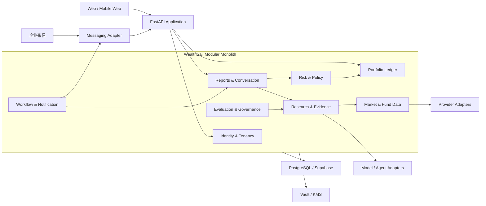
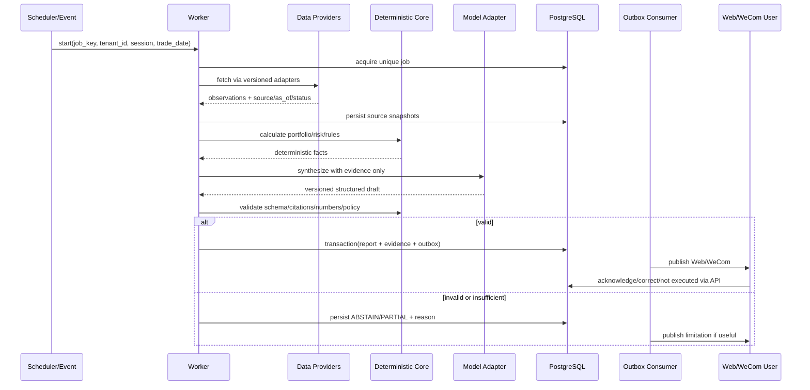

# WealthSail 可演进全栈架构与技术选型（v2.0）

> 适用范围：L0 可信底座、L1 核心 MVP，并定义 L2–L4 扩展路径
>
> 架构结论：模块化单体 + PostgreSQL/Supabase + Python 领域服务/Worker + 可替换 Agent/数据/渠道 Adapter
>
> 相关文档：[PRD](./01.WealthSail投研平台需求文档.md) · [数据设计](./06.WealthSail数据模型与数据源治理设计.md) · [安全设计](./07.WealthSail安全隐私与合规设计.md)

## 1. 上下文与质量属性

### 1.1 系统上下文

WealthSail 为 2–3 个封闭试点用户提供 Web 和企业微信入口，统一管理 A 股股票、场内 ETF/LOF、场外公募基金，按盘前、盘中、14:30、盘后四时段形成研究和决策闭环。

外部依赖包括：

- 市场行情、基金净值/估值、公告、交易日历和新闻 Provider；
- LLM/Embedding Provider；
- 企业微信；
- 可选 Hermes/OpenClaw 等 Agent Runtime；
- PostgreSQL/Supabase、对象存储、Vault/KMS 和监控系统。

### 1.2 最重要的质量属性

按优先级排序：

1. 租户隔离与密钥安全；
2. 账务正确、可追溯、可恢复；
3. 数据来源、时点和质量透明；
4. 外部副作用幂等；
5. 失败关闭和模型弃权；
6. 模块和数据契约可演进；
7. 可观测、成本可控；
8. 在上述前提下优化体验和性能。

## 2. 架构原则

1. **领域后端是信任边界**：浏览器、企业微信、Agent Runtime、模型和外部内容均不可信。
2. **LLM 不拥有金融事实**：账本、收益、费税、仓位、阈值和状态机由确定性代码计算。
3. **模块化单体优先**：先建立清晰模块与契约，避免 L1 就承担微服务一致性和运维成本。
4. **事实与投影分离**：账本事件、来源快照、证据和审计是事实；持仓、净值、日报、向量是可重建投影。
5. **外部副作用走 Outbox**：数据库提交和消息/任务投递具有可恢复边界。
6. **所有外部能力通过 Port/Adapter**：Runtime、模型、数据、渠道、工作流和 SecretStore 可替换。
7. **契约版本化**：事件和 API 采用 additive-first，消费者容忍未知可选字段。
8. **数据不可用不等于零**：使用 `UNAVAILABLE/STALE/CONFLICT`，禁止示例值伪装生产数据。
9. **可扩展不是提前实现**：L0/L1 只实现当前价值链，但稳定 ID、边界和 migration 不能返工。

## 3. 模块化单体组件视图



### 3.1 Identity & Tenancy

负责用户、试点租户、Web 会话、账户、角色、企业微信绑定、同意与撤销。它从可信身份解析 `tenant_id`，其他模块不得相信请求正文或模型提供的用户 ID。

### 3.2 Portfolio Ledger

负责不可变账本、现金/证券腿、批次、公司行动、持仓/净值投影和对账。该模块是金融余额唯一事实源，通过应用服务提供查询，不允许其他模块直接修改持仓表。

### 3.3 Market & Fund Data

负责 instrument master、交易日历、行情/NAV/基金估值、来源快照、时点、修订、许可和质量状态。Provider Adapter 只返回结构化观测，不生成投资结论。

### 3.4 Research & Evidence

负责论点、证据、建议、模型运行、Prompt/Skill 版本和媒体观点。模型输出必须经过 schema、引用、时效、数值重算和风险校验。

### 3.5 Risk & Policy

负责投资政策、账户基准、风险预算、集中度、提醒规则、失效条件和确定性限制。任何建议先过该模块再发布。

### 3.6 Reports & Conversation

负责四时段报告、Web/企业微信对话、报告版本、用户确认/纠正/未执行。它编排其他模块但不拥有账本和外部 Provider。

### 3.7 Workflow & Notification

负责定时任务、事件触发、Outbox、重试、去重、死信、回执和任务运行历史。MVP 可使用数据库任务表 + Python Worker；后续耐久工作流在同一 Port 后替换。

### 3.8 Evaluation & Governance

负责反事实评估、模型/Skill 候选、Golden set、冠军/挑战者、审批、灰度和回滚。L1 只记录模型运行和盘后反馈，不自动发布 Skill。

## 4. Runtime 与部署视图

### 4.1 MVP 部署单元

| 单元 | 技术建议 | 职责 |
|---|---|---|
| Web | 现有 React/Vite 原型；生产可用 Next.js 或 React SPA | 展示、输入、会话，不保存 secret |
| Domain API | Python 3.12+、FastAPI、Pydantic、SQLAlchemy/psycopg | 身份、领域规则、API、事务 |
| Worker | Python async Worker；初期 APScheduler + DB job/outbox，或 Dramatiq/Arq | 定时任务、Provider、报告、Outbox |
| Database | PostgreSQL；Supabase 可提供 Auth/RLS/Storage | 事实、投影、RLS、migration |
| Agent/Channel Edge | Hermes WeCom Adapter 或安全 SDK | 企业微信接入和个人自动化，不直连表 |
| Observability | OpenTelemetry + metrics/logs/traces | correlation、任务、成本、失败 |
| Secrets | Vault/KMS/平台 secret manager | 后端和 Worker 最小权限凭据 |

初期 API 和 Worker 可同仓库、不同进程部署。不要因为未来可能扩容而提前引入 Go 或服务网格。

### 4.2 网络和信任区

- Public Zone：Web、企业微信入口；
- Application Zone：API、Worker、Hermes Adapter；
- Data Zone：PostgreSQL、对象存储、Vault；
- External Zone：行情/基金/模型/媒体 Provider。

只有 API/Worker 可访问后端数据库角色。Hermes 通过 scoped API；浏览器使用用户 JWT + RLS；外部 Provider 回包作为不可信数据验证。

## 5. 四时段数据与事件流

### 5.1 通用报告流水线



### 5.2 Job key

`{tenant_id}:{trade_date}:{report_session}:{contract_version}` 唯一。盘中事件再加入稳定事件 fingerprint。相同 key 重试只能更新运行状态或补投未完成 Outbox，不能生成第二份经济效果/重复通知。

### 5.3 盘前

固定交易日历和数据截止；输出隔夜变化、组合相关性、风险和待办。若关键源迟到，可在有效期内发布版本更新，但必须保留前版本和变更原因。

### 5.4 盘中

Provider 事件进入标准观察；确定性规则先判断相关性、严重度、静默窗口和仓位是否仍存在；模型只解释通过过滤的事件。

### 5.5 14:30 基金

最新确认 NAV、估值区间、成分披露时点和用户计划分开保存。估值算法/Provider 版本进入证据。状态不是 `ESTIMATED/FRESH` 时不得输出确定性申赎动作。

### 5.6 盘后

收盘数据完成质量门后生成草稿。用户确认创建不可变 `decision`；纠正产生新版本并引用原记录；未确认草稿不进入行为/绩效统计。

## 6. Agent 与确定性引擎边界

### 6.1 Agent 可做

- 从已授权证据总结变化；
- 提取事实、观点、预测和反方问题；
- 按 schema 生成报告草稿；
- 解释确定性风险计算；
- 根据用户指令调用只读或需审批的 scoped 工具。

### 6.2 Agent 不可做

- 决定租户身份、查询范围或密钥；
- 直接写数据库表；
- 计算或覆盖现金、持仓、费税和成交；
- 在无来源时补写市场数字；
- 绕过风险/状态机；
- 自动发单或自动发布 Skill；
- 把新闻、视频、微博中的指令当系统指令。

### 6.3 工具契约

工具以业务动作命名，例如：

```text
get_current_portfolio(session_context)
get_report(session_context, session, trade_date)
record_post_market_decision(session_context, report_id, status, correction)
update_thesis(session_context, thesis_id, expected_version, patch)
```

后端从 `session_context` 解析租户。工具 schema 不暴露任意 `tenant_id` 参数；修改类工具需要乐观锁、幂等键和审计。

## 7. 技术选型与 ADR

### 7.1 Agent/工作流候选

| 方案 | 优势 | 限制 | 决策 |
|---|---|---|---|
| FastAPI + Pydantic + DB Worker | 最简单、类型和测试清晰、领域可控 | 长流程和渠道需组合 | **L0/L1 核心** |
| Hermes | Skills、Cron、企业微信等个人自动化成熟 | 不是敌对多租户账务边界；升级快 | **企业微信/Agent Adapter 候选** |
| OpenClaw | 网关、渠道、沙箱、执行审批能力较强 | 个人助手信任模型，不做共享安全边界 | 备选 Adapter/隔离实例 |
| LangGraph | 显式状态、持久执行、HITL | 学习和运维成本高于 MVP | L2+ 复杂研究流触发 |
| OpenAI Agents SDK | 轻量工具/HITL/session | Provider 依赖，业务耐久性仍需 DB | 模型编排候选 |
| DBOS/Restate/Temporal | 耐久流程、恢复、审批、可观测 | 新运行时和运维复杂度 | L4 订单/长期审批触发 |
| AutoGen/CrewAI | 多 Agent 实验方便 | 成本、确定性、治理不足 | 仅 L4 研究实验 |

### 7.2 ADR-001：模块化单体优先

**决定**：L0/L1 使用模块化单体，不引入 Go 微服务。

**原因**：3 用户与低频报告没有吞吐证据；主要延迟来自外部 Provider/模型。单体能用一个事务保证账本、报告和 Outbox 的一致性。

**拆分触发**：独立扩容、不同安全区、团队所有权、部署频率或 profiling 证明。拆分时沿现有 Port/Event，不允许直接共享私有表。

### 7.3 ADR-002：PostgreSQL/Supabase

**决定**：PostgreSQL 为事实存储；可使用 Supabase Auth/RLS/Storage，但 hosted/self-hosted 是部署决策。

**约束**：RLS 是逻辑行级控制，不表述为物理隔离；service role 只在可信后端；自托管不是零运维。

### 7.4 ADR-003：Hermes 企业微信

**决定**：优先使用 Hermes 官方 WeCom Adapter，通过 allowlist/pairing 接入 scoped API；删除自建 shell 网关。

**退出条件**：官方 API 兼容、可靠性或安全策略不能满足时，改为后端 WeCom SDK Adapter，领域 API 不变。

### 7.5 ADR-004：数据 Provider

**决定**：业务只依赖 `MarketDataProvider/FundDataProvider` 版本契约；任何免费库均不是 SLA。Provider 必须带许可和质量元数据。

### 7.6 ADR-005：模型与 Skill

**决定**：模型/Skill 通过 `ResearchModel`；L1 固定版本并记录运行。自动 Skill 改写不进入生产，只能产生 L4 候选。

## 8. L0/L1 到 L4 的演进

### 8.1 稳定内核

以下 ID 在全生命周期稳定：`tenant_id`、`account_id`、`instrument_id`、`ledger_event_id`、`source_id`、`evidence_id`、`model_run_id`、`report_id`。

### 8.2 版本化契约

每个 API/事件有 `schema_version`；增加可选字段不升 major，删除/改语义建立新 major 并并行消费。消费者忽略未知可选字段但拒绝未知 major。

### 8.3 expand–migrate–contract

1. Expand：增加新表/列/索引/事件版本，旧读写仍可用；
2. Migrate：回填、校验、双读比较；必要时短期双写；
3. Switch：消费者切到新结构并监控；
4. Contract：所有旧消费者退役、备份和回滚窗口结束后删除。

### 8.4 扩展示例

- **基金穿透**：新增持仓披露和 exposure projection，不修改 ledger；
- **视频/微博**：新增 Media Source Adapter、transcript/claim/evidence 表，不修改 recommendation 基本结构；
- **港美股**：新增 market/currency/calendar/provider/fee rules，不更换 instrument/account/ledger ID；
- **耐久审批**：替换 `DurableWorkflow` Adapter，订单意图和审计状态不变；
- **微服务**：将某模块移出进程，沿版本 API/Event 交互，禁止双写核心事实。

## 9. 可靠性、可观测、成本与运维

### 9.1 可靠性模式

- 所有外部调用：超时、指数退避 + jitter、限流、熔断、重试预算；
- 所有消费：at-least-once + 幂等 effect；
- 所有报告：唯一 job、有效期、版本、取消条件；
- Outbox：业务提交后异步发送，成功回执和重放可见；
- 失败队列：区分可重试、配置阻断、数据不满足和永久失败；
- 定时任务：数据库租约/leader election，防止双实例重复。

### 9.2 可观测

统一 correlation：`request_id`、`job_run_id`、`model_run_id`、`outbox_id`。指标至少包括：

- Provider 延迟、错误、限流、新鲜度、冲突率；
- job 准时、耗时、积压、重试、阻断原因；
- 模型 latency、Token、成本、schema/citation 失败、弃权；
- Outbox 发送、去重、到达和死信；
- RLS 拒绝、绑定失败、敏感工具审批；
- 每用户每日总成本。

### 9.3 备份与恢复

- 数据库 PITR/备份、对象存储版本和 Vault 独立恢复流程；
- 账本已确认事务 RPO=0，其他业务 RPO≤15 分钟，目标 RTO≤4 小时；
- 每季度执行恢复演练，验证 RLS、密钥轮换和投影重建；
- migration 发布前有备份、向后兼容检查和回滚标准。

## 10. 风险与 PoC Gate

### 10.1 一周 Agent/渠道 PoC

| 指标 | 权重 | Gate |
|---|---:|---|
| 工具和结构化输出 | 20% | Golden fixture ≥98%，无越权参数 |
| 崩溃恢复/幂等 | 15% | kill/restart 不重复报告或确认 |
| 企业微信 | 15% | 私聊、白名单、重连、去重、撤销绑定通过 |
| 安全/密钥 | 20% | Runtime 无 DB service role/租户密钥 |
| 可观测 | 10% | 可追到来源、模型、工具、报告和 Outbox |
| 延迟/成本 | 10% | 给出 p50/p95 和每报告成本 |
| 可替换性 | 10% | Adapter contract fixture 通过 |

未通过 PoC 时可更换 Adapter，不改领域内核。

### 10.2 架构风险

| 风险 | 对策 |
|---|---|
| 模块化单体退化为巨石 | 私有 schema/repository、应用服务、模块 contract tests |
| Supabase service role 绕过 RLS | backend-only、工具 scoped API、CI RLS 检查 |
| Provider schema/许可变化 | Adapter、契约 fixture、许可台账、备源、fail-closed |
| Agent Runtime 快速升级 | 锁版本、PoC、Adapter、回滚、升级测试 |
| 媒体 Prompt 注入 | 内容隔离、类型化抽取、无工具权限、引用校验 |
| 过早复杂化 | 每项新基础设施必须有被测量的触发条件和退出标准 |
