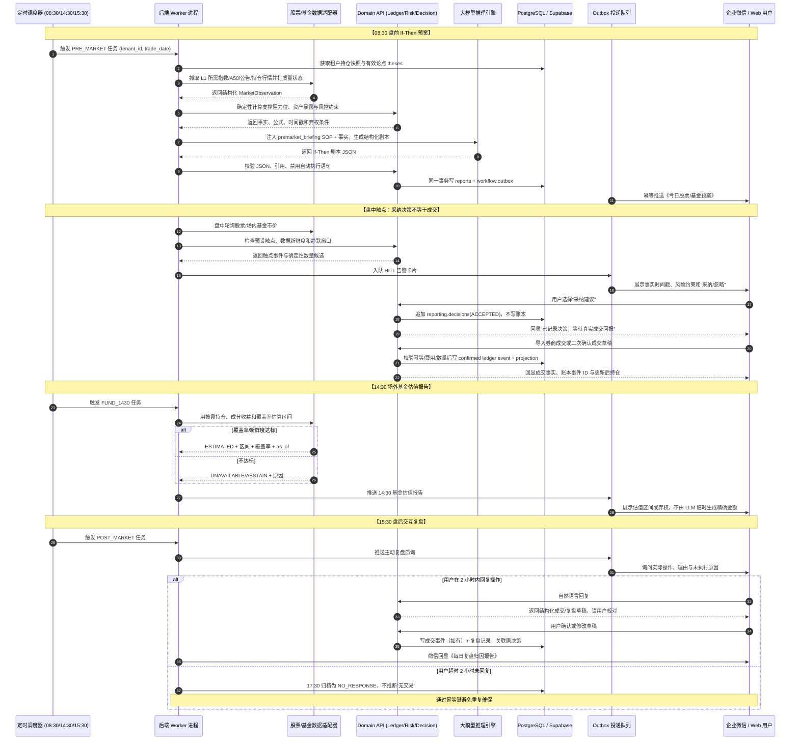
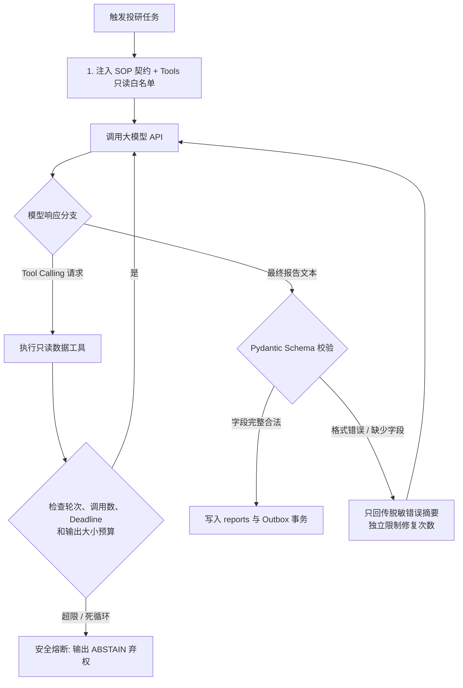
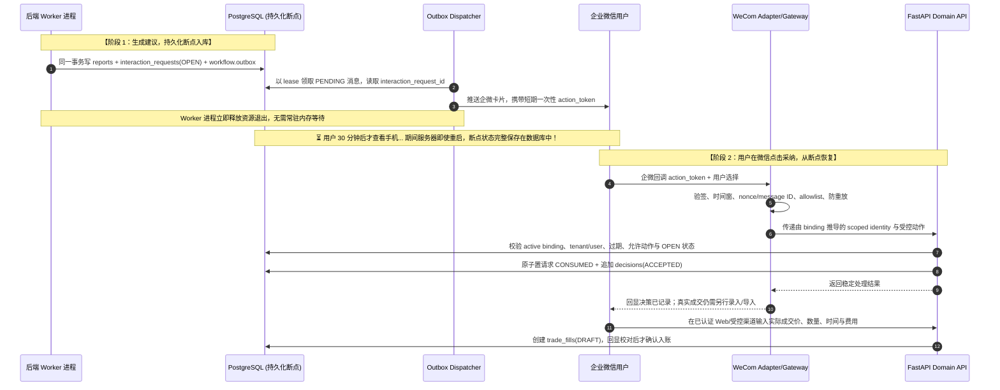
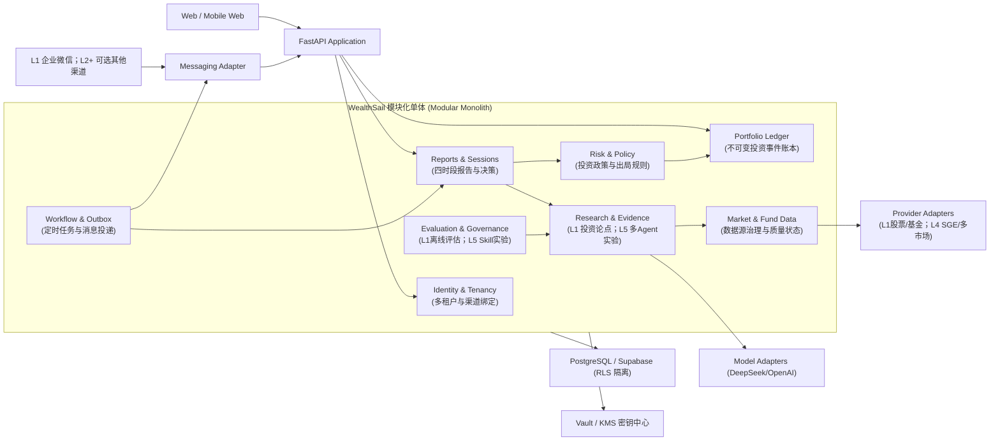
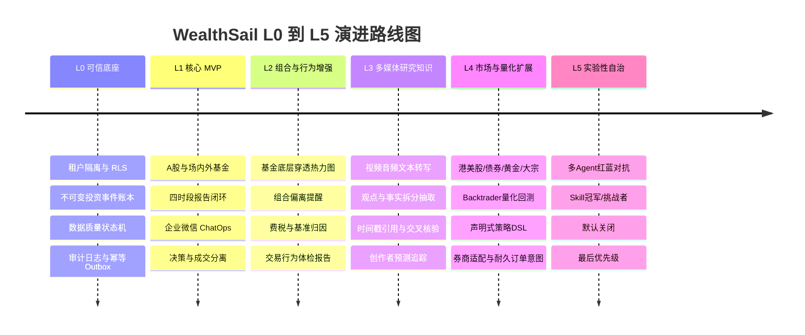

# WealthSail 智能量化投研平台 技术选型综合评估与架构决策报告 (v2.1)

> **文档版本**：v2.1.0-draft (全栈混合架构与可演进单体版)  
> **编写日期**：2026-08-23  
> **文档状态**：评审修订中 (Review Required)  
> **适用范围**：L0 可信底座、L1 核心 MVP，并定义 L2–L5 全栈演进路径  
> **架构结论**：模块化单体 + PostgreSQL/Supabase（不可变投资事件账本 + RLS 逻辑行隔离）+ Python 3.12+ 领域服务与 Worker + 可插拔 Agent / 数据源 / 渠道适配器  
> **相关文档**：[PRD](./01.WealthSail投研平台需求文档.md) · [实战指南](./03.WealthSail-MVP快速构建与实战指南.md) · [Web工作台规范](./09.WealthSail-MVP-Web投研工作台设计与实现规范.md) · [全栈部署规范](./10.WealthSail-MVP前后端实现与系统部署规范.md) · [数据设计](./06.WealthSail数据模型与数据源治理设计.md) · [安全设计](./07.WealthSail安全隐私与合规设计.md) · [追溯矩阵](./08.WealthSail需求设计测试追溯矩阵.md)

---

## 1. 执行摘要与核心架构决策 (Executive Summary)

### 1.1 核心结论
WealthSail 的长期产品方向覆盖多资产研究，但 **L0/L1 当前交付只包含 A 股股票、场内 ETF/LOF、场外公募基金、2–3 个用户、企业微信与四时段闭环**。架构采用“模块化单体领域内核 + 可替换智能与渠道边缘”的分层混合方式。**MVP 阶段不强制依赖 Hermes 等外部 Agent 框架**，目标基线是“FastAPI + 轻量企业微信适配器 + 直接模型 API 调用 + PostgreSQL 持久工作流”。当前仓库仍缺 FastAPI、Worker、回调和持久化 Repository，以下是待实现并通过验收的目标架构，不是已上线声明。移除任一 Agent 运行时后，领域内核、Worker、数据库契约和测试仍应独立运行。

```
+-----------------------------------------------------------------------------------------+
|                        【双端与全渠道交互层 (Edge & Presentation)】                     |
|  L1 ChatOps: 企业微信自建应用；L2+ 按价值验证飞书 / Telegram / 钉钉等适配器             |
|  2. MVP Web 工作台: React 19 / Vite + TypeScript + TailwindCSS + TanStack Query + Recharts |
+-----------------------------------------------------------------------------------------+
                                             │
+-----------------------------------------------------------------------------------------+
|                        【领域安全边界与应用服务 (Domain API & Core Monolith)】           |
|  底座框架: Python 3.12+ / FastAPI + Pydantic v2 + 确定性金融规则引擎                    |
|  - 身份与租户: tenant-scoped 会话建立上下文；is_tenant_member 仅验证 active membership   |
|  - 不可变事件账本: ledger_events + ledger_legs（幂等、追加/冲正、派生投影可完全重建）    |
|  - 数据源治理: 数据质量状态机 (FRESH / ESTIMATED / STALE / UNAVAILABLE)，严禁伪造假数据   |
|  - 风险与投资政策: 集中度控制、出局规则 invalidation_conditions、防振荡静默窗口           |
|  - Outbox 事务保障: 报告生成与异步投递原子提交，实现 At-Least-Once 与幂等去重             |
+-----------------------------------------------------------------------------------------+
                                             │
+-----------------------------------------------------------------------------------------+
|                        【智能与编排边缘 (Agent Runtime & Tool Loop)】                   |
|  MVP 基线: 轻量 Python Tool Loop + 数据库断点持久化 (无需外挂复杂 Agent 框架)           |
|  - Loop 可靠性: max_steps 熔断 + 指数退避重试 + Pydantic 自我修复 + Fail-Closed 弃权     |
|  - HITL 等待: interaction_requests + Outbox；用户行动后才追加 decisions，不在内存挂起  |
|  - L1 Tools: 只读股票/基金数据与证据检索；报告持久化和企微推送由受控工作流完成          |
|  - L1 Skills: 盘前 / 盘中 / 14:30 基金估值 / 盘后复盘的输入输出与弃权契约                |
|  - L3 记忆与媒体知识；L4 回测和多市场；L5 多 Agent / Skill 演进实验                       |
+-----------------------------------------------------------------------------------------+
                                             │
+-----------------------------------------------------------------------------------------+
|                        【存储与基础设施底座 (Data & Infrastructure)】                    |
|  1. 存储与安全底座: PostgreSQL 16 / Supabase（pgcrypto + RLS 逻辑行隔离；pgvector L3）    |
|  2. 凭证与配置中心: Vault / KMS 环境变量引用，严禁明文硬编码 API Key                     |
|  3. 私有化部署: 本地 NAS (极空间/群晖) 或云服务器 VPS Docker-compose，7x24 小时无人值守   |
+-----------------------------------------------------------------------------------------+
```

---

## 2. 架构原则 (Architecture Principles)

1. **领域后端是信任边界**：浏览器、企业微信、Agent Runtime、大模型和外部网络内容均不可信。L1 access token 只绑定一个经服务端确认的 active tenant；Domain API 从可信会话建立 `TenantContext` 并重新验证 membership，不能相信请求 Body、模型或回调正文自报的 `tenant_id`。`identity.is_tenant_member` 只验证给定 tenant，不负责选择 tenant。
2. **LLM 不拥有金融事实**：账本余额、收益率、交易费税、持仓仓位、关键点位阈值与业务状态机必须由确定性代码严谨计算，模型仅做证据提炼与结论解释。
3. **模块化单体优先**：先建立清晰的模块边界与应用服务契约，避免在 L0/L1 阶段引入微服务带来的一致性与运维灾难。
4. **事实与投影分离**：已确认账本事件（`ledger_events`）、数据源快照（`source_snapshots`）、证据链与审计日志是追加/冲正管理的事实；持仓快照、资产净值和衍生指标是可幂等重建的投影。报告是带版本、证据与运行批次的历史产物，不能被无痕覆盖。
5. **外部副作用走 Outbox 事务**：数据库业务提交与外部消息/任务投递绑定在同一数据库事务中，确保 At-Least-Once 与幂等去重。
6. **所有外部能力通过 Port / Adapter 解耦**：大模型、数据源、通讯渠道、工作流调度与密钥存储均通过抽象适配器接入，支持无缝替换。
7. **契约版本化与向下兼容**：事件与 API 遵循 Additive-First 原则，消费者容忍未知可选字段，拒绝未知 major 版本。
8. **数据不可用不等于零**：严格使用 `UNAVAILABLE` / `STALE` / `CONFLICT` 状态，触发系统弃权（ABSTAIN），禁止用常量或伪造数字冒充生产数据。
9. **可扩展不是提前实现**：L0/L1 专注当前闭环，但稳定主键 ID、多租户边界与数据库 migration 机制在演进中绝不推倒重来。

---

## 3. 需求拆解：WealthSail 的 5 大硬核技术挑战

| 维度 | 业务需求 | 对技术选型的核心诉求 |
| :--- | :--- | :--- |
| **1. 分阶段资产与数据治理** | L1 为 A 股/场内外基金；L4 才扩展港美股、黄金、债券与大宗 | Python 生态便于接入 AkShare/Pandas，但 Provider 必须可替换，并统一交易日、复权、时区和质量状态。 |
| **2. 确定性金融事实与防幻觉** | 杜绝模型脑补收益、持仓、成交和仓位 | 账本、收益、费税、数量和阈值由确定性代码计算；MVP 是不可变投资事件账本，不冒充会计级复式总账。 |
| **3. 四时段可靠运行与企微触达** | 08:30 盘前、盘中触点、14:30 基金报告、15:30 交互复盘 | Cron、任务租约、重试、幂等与 Outbox 由 Worker/数据库保障；L1 只验收企业微信。 |
| **4. 决策—成交—复盘闭环** | 区分“建议、采纳、订单意图、成交、账本、复盘” | 使用显式状态机和关联 ID；采纳不能直接入账，报告必须关联数据快照、模型版本和 `job_run_id`。 |
| **5. 多租户安全与低运维成本** | 2–3 个用户起步，个人资产和凭据不可跨租户泄露 | 领域 API 负责授权，RLS 作纵深防御；BYPASSRLS/service-role 类高权限凭据只允许受控后台持有，不进入 Agent。 |

---

## 4. 主流技术路线全景横向对比与 MVP 选型结论

选型必须拆成三个独立问题：**领域内核**、**Agent/渠道边缘**、**耐久工作流**。任何 Agent 框架都不能替代账本、授权、RLS、Outbox 和数据质量治理。

| 方案 | 适合解决的问题 | 与当前企微 MVP 的优势 | 主要局限/新增成本 | 阶段结论 |
| :--- | :--- | :--- | :--- | :--- |
| **FastAPI + PostgreSQL + Python Worker（无 Agent 框架基线）** | 领域 API、四时段确定性任务、Outbox、审计 | 最少抽象、易测、最清楚的安全边界；即使模型不可用也能退化运行 | Tool loop、会话上下文与结构化输出要自行封装 | **L0/L1 必选内核与生产基线（推荐）** |
| **Hermes Agent（边缘候选）** | 消息入口、Tool Calling、Skill/SOP | 官方消息文档列出 WeCom；Python 栈与现有模块接近 | Agent 具备广泛工具能力，必须缩权；原生 Windows 指南仍标为 early beta，生产宜 Linux/容器；耐久业务状态仍需领域库 | **L1 作为受限 PoC，非 MVP 必需** |
| **OpenClaw** | 自托管个人助理、丰富聊天渠道与插件 | 渠道生态广、消息原生，适合非企微渠道扩展试验 | 官方渠道清单未把 WeCom 列为内建通道；默认面向通用个人助理，仍需自建企业微信、租户授权和金融领域边界 | **L2+ 备选，不优于当前企微 PoC** |
| **LangGraph** | 显式状态图、checkpoint、interrupt/resume、耐久 HITL | 适合流程分支很多、暂停时间长且需要重放的场景 | L1 四个固定会话用它可能增加状态模型和运维复杂度；渠道仍另接 | **当手写状态机复杂度或恢复需求达到阈值时引入** |
| **OpenAI Agents SDK** | 轻量 Agent loop、工具、guardrails、handoff、session/tracing | 抽象较少，适合结构化 Tool Calling 与评估；可作为模型编排替代 | 企业微信与定时调度另接；handoff/guardrail 不等于领域授权，外部副作用仍由应用保证 | **L1/L2 可替换 PoC** |
| **CrewAI / AutoGen 等多 Agent 框架** | 角色协作与探索性辩论 | 能快速验证“多空观点”形式 | 成本、延迟、相关性错误、可复现性和攻击面都更差，且不能证明投资质量提高 | **仅 L5 实验，最后优先级** |
| **Temporal / Restate / DBOS 类耐久执行** | 长事务、恢复、调度、exactly-once/at-least-once 语义 | 当任务规模、长暂停和跨服务协调显著增长时，比会话内状态可靠 | 新基础设施、部署和学习成本；2–3 用户的 L1 可先用 PostgreSQL 租约 + Outbox | **达到量化触发条件后再选，不与 Agent 框架捆绑** |

### 4.1 为什么 MVP 阶段不强制依赖 Hermes？
1. **金融事实内核不可替代**：不可变投资事件账本、数据清洗、多租户授权与 RLS 必须由确定性代码和数据库事务实现；当前账本尚无会计科目、借贷方向和平衡校验，不宣称为会计级复式总账。
2. **企业微信边界较小但尚未完成**：现有 `wecom_adapter.py` 只验证定向发送、凭据失败关闭和绑定 Token 摘要；接收回调、签名、防重放、持久 Outbox 和 Token 缓存仍待实现，不能声称已经稳定收发。
3. **依赖与排障可控**：Python 3.12、FastAPI、Pydantic 和模型 SDK 属于常规 Python 生态，可按最小集合锁定；FastAPI 并非标准库，跨平台、目标硬件和长时间运行稳定性必须通过 Windows 开发与 Linux/NAS 试运行验证，不能只由选型推断。

---

## 5. 详细分层实现方案与可靠性架构

### 5.1 核心模块职责分工

| 阶段 | 架构层级 | 核心组件 | 核心职责与实现 |
| :--- | :--- | :--- | :--- |
| **L1** | 交互端 | 企业微信自建应用 + MVP Web 工作台 | 企业微信接收四时段报告、提交决策/成交草稿；Web 完成初始化导入、组合/报告/证据查看、L1 风险政策、本人绑定和受控审计摘要。通道经 `MessagingPort` 接入。 |
| **L0/L1** | 领域内核 | FastAPI + Pydantic + Python 确定性服务 | 身份授权、账本、风险规则、报告会话、决策/成交状态机；是唯一允许业务写入的入口。 |
| **L1 可选** | Agent 边缘 | 原生 Python Tool Loop / Hermes PoC | 只做语言解析、证据摘要与结构化输出；使用 scoped API token，禁止数据库高权限凭据和任意终端工具。 |
| **L0/L1** | 数据适配 | 股票/场内基金行情、场外基金净值与持仓成分 Provider | 统一 `MarketObservation`、时间戳、交易日和质量状态；估值覆盖不足时 `ABSTAIN`。 |
| **L0/L1** | 可靠工作流 | Python Worker + PostgreSQL job lease + transactional Outbox | 四时段调度、重试、租约、消息去重和恢复；不把 Agent 会话当作耐久工作流。 |
| **L0/L1** | 数据与安全 | PostgreSQL 16 / Supabase + pgcrypto + RLS | 不可变投资事件、决策证据、报告批次、审计与逻辑行隔离；组合外键防跨租户引用。 |
| **L2/L3** | 组合/知识扩展 | 归因、基金穿透、媒体转写与检索 | 复用稳定 ID 和证据模型；`pgvector` 仅在检索指标证明需要后启用。 |
| **L4/L5** | 高级扩展 | Backtrader/DSL/多市场；多 Agent 与 Skill 实验 | 独立端口接入，不改变 L0/L1 事实模型；多 Agent 位于 L5 最后优先级。 |
| **部署** | 基础设施 | Docker Compose（Linux/NAS/VPS） | 小规模单机部署、备份与可观测性；Windows 用于开发，Hermes 原生 Windows early beta 不作为生产承诺。 |

---

### 5.2 核心业务时序流转与人机协同 (HITL Sequence Flow)



---

### 5.3 模型调用 Loop 可靠性保障体系 (Tool Calling Loop Reliability)

模型输出本身不具确定性；MVP 采用的是**有确定边界的控制循环**。当前可执行原型位于 [`modules/agent/tool_loop.py`](../modules/agent/tool_loop.py)，Provider SDK 先归一化为 `ModelResponse/ToolCall`，再进入与模型厂商无关的控制层。



1. **独立预算**：`LoopBudget` 分别限制 `max_rounds`、`max_schema_repairs`、`max_total_tool_calls`、模型尝试次数、单次超时、总 Deadline、模型响应和工具结果字节数；默认值只是 L1 起始配置，按四时段 Deadline、成本和 p95 数据调整。
2. **严格结构校验**：模型工具参数先经工具专属 Pydantic Schema 校验，最终输出再经报告 Schema 校验。多 Tool Call 只追加一条包含完整调用集合的 assistant 消息；非法 JSON、未知工具、参数错误、工具异常和超大结果均失败关闭。
3. **重试与故障分类**：模型适配器只对明确可重试的限流/暂时性故障重试，尊重 `Retry-After`，生产加入指数退避、jitter 和熔断。模型故障返回 `MODEL_UNAVAILABLE`；确定性工具以受限 `ToolAbort(DATA_UNAVAILABLE/ABSTAIN, reason_code)` 保留数据与弃权语义，二者不得混写为行情质量变化。
4. **可信工具上下文**：Domain API 从已验证会话/绑定构造 `ToolContext(tenant_id,user_id,correlation_id)` 并注入 Handler；模型参数不能选择 tenant/user。工具注册表只包含查询能力，禁止任意 HTTP、文件、终端、账本、持仓、风险参数和下单工具。
5. **审计与观测**：记录模型/Prompt/Skill 版本、调用轮次、工具名、参数摘要、数据 `as_of`、质量状态、Token/成本、延迟、重试和 reason code；不记录密钥、完整账户号或不必要的原始聊天。

稳定结果类别为 `SUCCESS / DATA_UNAVAILABLE / MODEL_UNAVAILABLE / TOOL_ERROR / SCHEMA_INVALID / BUDGET_EXCEEDED / DEADLINE_EXCEEDED / ABSTAIN`。调用者依据类别决定重试、降级、人工介入或放弃，不解析自由文本猜测错误。

---

### 5.4 数据库级持久化等待与人机协同 (Database-Backed HITL)

人机协同（HITL）会等待数十分钟甚至跨进程重启。等待状态使用 **`workflow.interaction_requests` + `workflow.outbox`** 持久化；`reporting.decisions` 只在用户真正作出选择后追加，绝不承担 PENDING 状态。



- **不占用等待线程**：报告、交互请求与 Outbox 提交后 Worker 可释放；服务器重启后可从 OPEN 请求继续等待，但正在进行的模型/HTTP 调用仍需由 `job_run` 幂等重跑，不能称为任意指令级 checkpoint。
- **Capability 安全**：数据库只保存 action token 的带密钥摘要。回调 tenant/user 从已验证企业微信绑定派生，不能信任请求正文；Token 绑定请求版本、允许动作和有效期，原子单次消费。
- **经济效果幂等**：重复点击返回首次处理结果，不重复追加 decision；外部消息仍是 At-Least-Once，允许重复投递，但不能产生重复经济效果。
- **决策与成交分离**：采纳只追加 decision，不创建 fill。用户录入、对账导入或券商回报才创建 `trade_fills(DRAFT)`，二次确认后才关联账本事件。

---

## 6. 模块化单体组件与安全边界 (Modular Monolith Components)



### 6.1 Identity & Tenancy (身份与租户)
负责受邀注册与登录、tenant-scoped 会话鉴权、`binding_challenges`、企业微信正式 binding 与软撤销。L1 禁止匿名创建 tenant；邀请令牌必须一次性、限邮箱、限 tenant、可过期并可审计。登录时由服务端选择并验证 active tenant 后签发 token；切换 tenant 必须重新校验成员关系、重新签发并清空旧缓存。其他业务模块一律不得信任客户端、模型或企微正文传入的租户 ID。

### 6.2 Portfolio Ledger (资产与不可变事件账本)
不可变投资事件中枢，处理 `CASH_IN`、`CASH_OUT`、`BUY`、`SELL`、`FEE`、`TAX`、`DIVIDEND_CASH`、`DIVIDEND_REINVEST` 与 `REVERSAL` 等已确认金融事实。`ledger_events + ledger_legs` 支持多分录扩展，但当前未定义会计科目、借/贷方向和逐事件平衡约束，因此不宣称会计级复式总账。已确认事件只允许追加冲正，持仓快照只能由应用服务重建，严禁直接编辑。

### 6.3 Market & Fund Data (行情与数据源治理)
负责标的主数据（`instrument_id`）、交易日历、行情与基金净值抓取。输出结构化 `MarketObservation` 并打上 `FRESH` / `ESTIMATED` / `STALE` / `UNAVAILABLE` 质量标签。

### 6.4 Research & Evidence (投研论点与证据链)
L1 管理投资论点（`theses`）、催化剂、出局条件（`invalidation_conditions`）和证据引用；L5 才允许多 Agent 对抗实验。模型输出必须附带数据来源快照与时间戳，且不能直接写账本或执行订单。

### 6.5 Risk & Policy (风控与出局规则)
管理全天候大类资产目标配比、单标的仓位上限、回撤预算与防振荡静默窗口。所有 AI 建议发布前必须经过该模块的确定性规则校验。

### 6.6 Workflow & Outbox (工作流与 Outbox)
负责定时 Cron 调度、异步 Outbox 事件投递、重试与去重。确保数据库写事务与外部微信推送具有一致性边界。

---

## 7. 核心技术决策记录 (Architecture Decision Records - ADR)

### 7.1 ADR-001：模块化单体优先 (Modular Monolith First)
- **决策**：L0/L1 采用模块化单体架构，不引入 Go 微服务。
- **理由**：对 2–3 个试点租户，吞吐预计不是首要瓶颈，但仍需在目标硬件和四时段任务重叠场景测量。单体架构可在同一数据库事务内原子提交核心事实与 Outbox，减少跨服务一致性故障面。
- **演进触发条件**：当单点 CPU/内存分析证明存在瓶颈，或需要独立扩容多市场行情网关时，沿现有 Port 契约将数据采集模块拆分为独立服务。

### 7.2 ADR-002：PostgreSQL / Supabase 不可变投资事件与 RLS
- **决策**：以 PostgreSQL 作为事实源，采用不可变投资事件 + 分录 + 可重建投影；启用 `ROW LEVEL SECURITY` (RLS)、角色策略和含 `tenant_id` 的组合外键，实现多租户**逻辑行隔离**。
- **理由**：直接改余额容易造成数据分叉；幂等事件、追加/冲正和投影重建更容易审计。RLS 是纵深防御而非物理隔离，表所有者和 `BYPASSRLS/service-role` 角色可能绕过，因此高权限凭据只能由受控后台使用，Agent 和客户端不得持有；缓存、队列、对象存储和模型上下文还需独立 tenant scope。

### 7.3 ADR-003：企业微信轻量安全网关
- **决策**：MVP 采用轻量原生适配器通过标准 HTTP 接入企业微信；通道经 `MessagingPort` 调用领域 API。绑定码至少 128 bit 随机熵，服务端保存带密钥摘要，15 分钟有效、限速、原子单次消费和可撤销。Hermes 只做受限 PoC，安装与能力边界以其[消息通道文档](https://github.com/NousResearch/hermes-agent/blob/main/website/docs/user-guide/messaging/index.md)和[原生 Windows 指南](https://github.com/NousResearch/hermes-agent/blob/main/website/docs/user-guide/windows-native.md)为准。
- **理由**：企业微信满足 L1 国内移动触达；网关只持有 scoped API token，不接触数据库高权限密钥。每次调用审计 `tenant_id/user_id/tool_name/correlation_id` 和脱敏输入摘要；若 PoC 未通过安全、可靠性、成本和延迟门槛，回退原生适配器。

### 7.4 ADR-004：数据质量状态机与弃权机制 (Fail-Closed)
- **决策**：所有外部数据输出携带质量状态；当主备数据源均不可用时，系统输出 `ABSTAIN`（弃权），严禁使用本地假数据或常量冒充生产行情。
- **理由**：金融决策首重真实性与严谨性，宁可弃权说明原因，绝不提供误导性交易信号。

---

## 8. L0/L1 到 L5 的平滑演进体系 (Evolutionary Architecture)



### 8.1 稳定内核标识 (Stable Identifiers)
以下业务主键在全生命周期演进中保持稳定：`tenant_id`、`account_id`、`instrument_id`、`ledger_event_id`、`source_id`、`evidence_id`、`report_id`。

### 8.2 数据库平滑演进原则 (Expand–Migrate–Contract)
1. **Expand**：增加新表或新字段，旧版本代码仍可正常读写；
2. **Migrate**：执行后台历史数据回填与双读验证；
3. **Switch**：将读写流量切换至新结构；
4. **Contract**：待所有旧客户端与服务下线后，安全清理旧结构。

### 8.3 L5 多 Agent 实验边界与退出机制

多 Agent 不是“多找几个模型就能互相纠错”。若角色共享基础模型、检索结果或系统提示，其错误常具有相关性；角色扮演可能把同一未经证实结论包装成表面共识。更多 Agent 会增加 Token、外部搜索、p95 延迟、重试组合、观测数据和失败点，并放大 Prompt 注入、工具越权、敏感信息横向传播与不可复现风险。

因此 L5 必须遵循：

1. 默认路径为单 Agent + 确定性规则 + 固定反方核对清单；多 Agent 由 feature flag 隔离，可随时回退。
2. Agent 间消息和检索内容均视为不可信输入；每个 Agent 使用独立最小工具集、显式 tenant context、调用深度/Token/时间预算和端到端 trace。
3. 各 Agent 只能提交带引用的观点与反例，不能计算最终仓位/收益、改变数据质量、写风险参数、账本、成交或订单。
4. 风控“裁判”只汇总证据与分歧，不具有更高事实权威；最终输出仍经过相同确定性校验和人工确认。
5. 在冻结 Golden set 上与单 Agent 比较事实错误率、引用正确率、人工盲评、成本、p95 延迟、复现率和安全攻击成功率，并预先定义最小增益和最大成本。
6. 任一核心指标未达门槛、出现跨租户/越权工具、事实不可复现或预算失控，立即关闭 feature flag 并保留审计记录。
