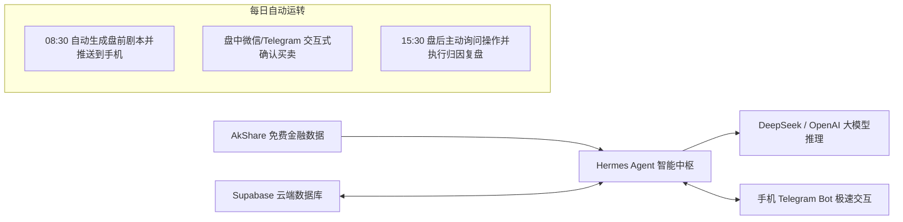

# WealthSail MVP 快速构建与实战指南 (Windows + Hermes Agent)

> **文档版本**：v1.0.0  
> **编写日期**：2026-08-22  
> **适用对象**：初学者、量化与 AI 开发者、个人独立投资者  
> **核心目标**：在 Windows 环境下，以 **零前端手写成本、零数据库运维负担** 的极简方式，基于 **Hermes Agent + Supabase + AkShare** 快速跑通全天候智能投研 MVP。

---

## 1. 架构总览与 MVP 闭环目标

本指南带你从 0 开始搭建一个全自动运行的投研助手，无需安装复杂的 Docker，在 Windows 电脑/笔记本上即可直接运行并实现以下闭环：



### MVP 核心交付成果
1. **跨设备资产与自选股管理**：数据安全保存在 Supabase 云端，支持随时增删改查持仓与自选股。
2. **一键 AI 深度诊股**：在手机 Telegram 聊天框输入股票代码，自动抓取 K 线、资讯与估值，输出专业诊断与支撑/压力位。
3. **08:30 盘前全自动预案推送**：每天早晨自动抓取昨夜美股、A50 期指与隔夜公告，生成 If-Then 操盘剧本推送到手机。
4. **15:30 盘后互动复盘**：收盘后 Agent 主动质询今日操作并归因，若超时未回复自动归档，绝不反复打扰。

---

## 2. 第一步：环境准备与基础工具安装

### 2.1 安装 Python 3.12+
1. 前往 Python 官网下载并安装 [Python 3.12+ for Windows](https://www.python.org/downloads/)。
2. **极其重要**：安装界面务必勾选 **“Add python.exe to PATH”**。
3. 打开 PowerShell 终端，验证安装成功：
   ```powershell
   python --version
   pip --version
   ```

### 2.2 安装金融数据与数据库依赖库
在 PowerShell 中运行以下命令，安装数据抓取与数据库 SDK：
```powershell
pip install --upgrade akshare supabase pandas requests pydantic
```

### 2.3 在 Windows 下安装 Hermes Agent

Hermes Agent (Nous Research 开源) 是本系统的智能调度中枢。支持以下两种安装方式：

#### 方式 A：使用官方 Desktop 桌面安装包 (最推荐新手)
1. 访问 Hermes Agent 官网下载 Windows 安装包：[https://hermes-agent.nousresearch.com/](https://hermes-agent.nousresearch.com/)
2. 双击 `.exe` 安装包，按照向导完成安装。它会自动配置好 Python 虚拟环境与桌面运行管理界面。

#### 方式 B：使用原生 PowerShell 一键脚本安装 (CLI 开发者)
打开 PowerShell 终端（无需管理员权限），运行：
```powershell
iex (irm https://raw.githubusercontent.com/NousResearch/hermes-agent/main/scripts/install.ps1)
```
*安装完成后，**关闭并重新打开** 一个新的 PowerShell 终端，输入 `hermes --version` 验证安装成功。*

### 2.4 配置大模型 API Key
在 PowerShell 中运行 Hermes 初始化配置向导：
```powershell
hermes setup
```
或者直接在用户目录下的配置文件 `C:\Users\<你的用户名>\.hermes\.env` 中添加你的大模型密钥（以 DeepSeek 或 OpenAI 为例）：
```ini
# 配置大模型厂商与密钥 (推荐 DeepSeek-V3/R1，性价比极高且中文投研能力强)
OPENAI_API_KEY="sk-xxxxxxxxxxxxxxxxxxxxxxxxxxxxxxxx"
OPENAI_BASE_URL="https://api.deepseek.com/v1"
HERMES_MODEL="deepseek-chat"
```

---

## 3. 第二步：云端数据库一键初始化 (Supabase)

为了让手机、PC 多端能随时随地读取持仓与历史研报，且无需在本地搭建维护数据库，我们选用 **Supabase**（免费 PostgreSQL 云服务）。

### 3.1 创建 Supabase 免费项目
1. 访问 [https://supabase.com/](https://supabase.com/) 并使用 GitHub 账号登录。
2. 点击 **“New project”**，填写项目名称（如 `WealthSail-DB`），设置数据库密码并选择亚太地区节点（如 `Singapore` 或 `Tokyo`）。
3. 项目创建约需 1~2 分钟。

### 3.2 一键执行 MVP 数据表 DDL
进入 Supabase 左侧菜单的 **“SQL Editor”**，点击 **“New query”**，将以下精简版 MVP DDL 粘贴进去并点击右下角 **“Run”** 执行：

```sql
-- 1. 启用向量扩展 (为后续自进化记忆准备)
CREATE EXTENSION IF NOT EXISTS vector;

-- 2. 用户账户资金表
CREATE TABLE IF NOT EXISTS portfolio (
    id UUID PRIMARY KEY DEFAULT gen_random_uuid(),
    total_capital NUMERIC(15, 2) NOT NULL DEFAULT 100000.00,
    available_cash NUMERIC(15, 2) NOT NULL DEFAULT 100000.00,
    updated_at TIMESTAMPTZ DEFAULT NOW()
);

-- 3. 持仓明细表
CREATE TABLE IF NOT EXISTS positions (
    id UUID PRIMARY KEY DEFAULT gen_random_uuid(),
    symbol VARCHAR(32) NOT NULL,
    stock_name VARCHAR(64),
    market VARCHAR(16) NOT NULL CHECK (market IN ('A', 'HK', 'US')),
    avg_cost NUMERIC(15, 4) NOT NULL,
    quantity INT NOT NULL CHECK (quantity > 0),
    ai_stop_loss NUMERIC(15, 4),
    ai_take_profit NUMERIC(15, 4),
    updated_at TIMESTAMPTZ DEFAULT NOW()
);

-- 4. 自选关注表
CREATE TABLE IF NOT EXISTS watchlists (
    id UUID PRIMARY KEY DEFAULT gen_random_uuid(),
    symbol VARCHAR(32) NOT NULL UNIQUE,
    stock_name VARCHAR(64),
    market VARCHAR(16) NOT NULL,
    notes TEXT,
    latest_ai_sentiment VARCHAR(16) DEFAULT 'neutral',
    created_at TIMESTAMPTZ DEFAULT NOW()
);

-- 5. 出局规则绑定表
CREATE TABLE IF NOT EXISTS exit_rules (
    id UUID PRIMARY KEY DEFAULT gen_random_uuid(),
    symbol VARCHAR(32) NOT NULL,
    rule_type VARCHAR(32) NOT NULL,
    rule_params JSONB NOT NULL,
    is_triggered BOOLEAN DEFAULT FALSE,
    created_at TIMESTAMPTZ DEFAULT NOW()
);

-- 6. AI 操盘预案与建议记录表
CREATE TABLE IF NOT EXISTS ai_suggestions (
    id UUID PRIMARY KEY DEFAULT gen_random_uuid(),
    symbol VARCHAR(32),
    market VARCHAR(16) NOT NULL DEFAULT 'A',
    report_type VARCHAR(32) NOT NULL,
    suggested_action VARCHAR(16),
    target_price NUMERIC(15, 4),
    support_price NUMERIC(15, 4),
    resistance_price NUMERIC(15, 4),
    if_then_plan JSONB,
    logic_summary TEXT,
    status VARCHAR(16) DEFAULT 'pending',
    created_at TIMESTAMPTZ DEFAULT NOW()
);

-- 7. 真实成交记录表
CREATE TABLE IF NOT EXISTS trade_logs (
    id UUID PRIMARY KEY DEFAULT gen_random_uuid(),
    symbol VARCHAR(32) NOT NULL,
    actual_action VARCHAR(16) NOT NULL,
    executed_price NUMERIC(15, 4) NOT NULL,
    executed_qty INT NOT NULL,
    execution_notes TEXT,
    executed_at TIMESTAMPTZ DEFAULT NOW()
);

-- 8. 向量记忆表 (反思沉淀)
CREATE TABLE IF NOT EXISTS vector_memory (
    id UUID PRIMARY KEY DEFAULT gen_random_uuid(),
    content TEXT NOT NULL,
    tags TEXT[],
    created_at TIMESTAMPTZ DEFAULT NOW()
);

-- 插入一条初始测试资金数据
INSERT INTO portfolio (total_capital, available_cash) 
SELECT 100000.00, 100000.00 WHERE NOT EXISTS (SELECT 1 FROM portfolio);
```

### 3.3 获取 Supabase 连接密钥
1. 点击左侧设置 **Project Settings -> API**。
2. 复制 **Project URL**（如 `https://xyzcompany.supabase.co`）。
3. 复制 **anon / public key** 或 **service_role key**。
4. 将它们配置进 `C:\Users\<你的用户名>\.hermes\.env`：
   ```ini
   SUPABASE_URL="https://你的项目ID.supabase.co"
   SUPABASE_KEY="你的Supabase密钥"
   ```

---

## 4. 第三步：编写自定义金融 Tools (Python 插件)

Hermes Agent 的强大之处在于：**任何 Python 函数只要写好标准入参类型和注释，就会自动转化为大模型可调用的 Tool。**

打开目录 `C:\Users\<你的用户名>\.hermes\tools\`，新建以下两个 Python 工具文件：

### 4.1 编写金融数据工具：`finance_tools.py`
创建文件 `C:\Users\<你的用户名>\.hermes\tools\finance_tools.py`：

```python
"""
Finance Data Tools for WealthSail MVP.
基于 AkShare 抓取 A股/港股/美股行情、隔夜外盘与新闻资讯。
"""
import akshare as ak
import pandas as pd
from datetime import datetime, timedelta

def get_stock_kline(symbol: str, market: str = "A", days: int = 20) -> str:
    """
    获取指定股票最近 N 个交易日的日 K 线数据（开高低收量）。
    
    Args:
        symbol: 股票代码，如 A股 '600519', 港股 '00700', 美股 'AAPL'
        market: 市场类型，可选 'A', 'HK', 'US'
        days: 获取天数，默认 20 天
        
    Returns:
        包含最近 N 日量价数据的字符串总结
    """
    try:
        if market.upper() == "A":
            # A 股日 K 线
            df = ak.stock_zh_a_hist(symbol=symbol, period="daily", adjust="qfq")
        elif market.upper() == "HK":
            # 港股日 K 线
            df = ak.stock_hk_hist(symbol=symbol, period="daily", adjust="qfq")
        else:
            # 美股日 K 线
            df = ak.stock_us_hist(symbol=symbol, period="daily", adjust="qfq")
            
        if df.empty:
            return f"未能获取到标的 {symbol} 的 K 线数据。"
            
        # 取最近 days 天
        df_recent = df.tail(days)
        summary = f"=== 【{symbol}】近 {len(df_recent)} 个交易日行情 ===\n"
        for _, row in df_recent.iterrows():
            date_str = str(row.get('日期', row.get('date', '')))[:10]
            close_price = row.get('收盘', row.get('close', 0))
            pct_change = row.get('涨跌幅', row.get('pct_chg', 0))
            vol = row.get('成交量', row.get('volume', 0))
            summary += f"[{date_str}] 收盘: {close_price}, 涨跌幅: {pct_change}%, 成交量: {vol}\n"
        return summary
    except Exception as e:
        return f"获取 K 线数据出错: {str(e)}"

def get_overnight_macro_data() -> str:
    """
    盘前抓取隔夜外盘核心数据（美股三大指数、富时A50夜盘、人民币汇率）。
    
    Returns:
        隔夜宏观外盘表现摘要
    """
    try:
        report = "=== 隔夜外盘与宏观风向标 ===\n"
        # 抓取主要外盘股指数据
        try:
            global_df = ak.stock_us_famous_spot_em()
            report += f"美股重点科技股表现:\n{global_df[['名称', '最新价', '涨跌幅']].head(5).to_string(index=False)}\n\n"
        except Exception:
            report += "美股行情暂无变动或抓取超时。\n"
            
        return report
    except Exception as e:
        return f"获取隔夜外盘数据出错: {str(e)}"

def get_stock_news(symbol: str) -> str:
    """
    获取指定股票最新的 5 条重要财经新闻与公告。
    
    Args:
        symbol: 股票代码，如 '600519'
    """
    try:
        news_df = ak.stock_news_em(symbol=symbol)
        if news_df.empty:
            return f"标的 {symbol} 最近 24 小时无重大异动新闻。"
        
        top_news = news_df.head(5)
        result = f"=== 【{symbol}】最新资讯 ===\n"
        for _, row in top_news.iterrows():
            title = row.get('新闻标题', '')
            pub_time = row.get('发布时间', '')
            result += f"- [{pub_time}] {title}\n"
        return result
    except Exception as e:
        return f"获取个股资讯出错: {str(e)}"
```

### 4.2 编写 Supabase 数据存取工具：`db_tools.py`
创建文件 `C:\Users\<你的用户名>\.hermes\tools\db_tools.py`：

```python
"""
Database & Portfolio Tools for WealthSail MVP.
基于 Supabase 进行持仓、自选股读写与交易记录落盘。
"""
import os
from supabase import create_client, Client

def get_supabase_client() -> Client:
    url = os.getenv("SUPABASE_URL", "")
    key = os.getenv("SUPABASE_KEY", "")
    if not url or not key:
        raise ValueError("请在 ~/.hermes/.env 中配置 SUPABASE_URL 和 SUPABASE_KEY")
    return create_client(url, key)

def get_user_portfolio() -> str:
    """
    查询用户当前的总资产、可用资金以及所有持仓股票明细。
    """
    try:
        supabase = get_supabase_client()
        # 查资金
        p_res = supabase.table("portfolio").select("*").execute()
        cash_info = p_res.data[0] if p_res.data else {"total_capital": 0, "available_cash": 0}
        
        # 查持仓
        pos_res = supabase.table("positions").select("*").execute()
        positions = pos_res.data or []
        
        result = f"=== 用户当前资产大盘 ===\n总资产: {cash_info.get('total_capital')} 元 | 可用现金: {cash_info.get('available_cash')} 元\n\n=== 当前持仓列表 ===\n"
        if not positions:
            result += "暂无任何持仓标的。\n"
        else:
            for p in positions:
                result += f"• [{p['market']}] {p['stock_name']}({p['symbol']}): 成本 {p['avg_cost']}, 持股 {p['quantity']}股, 止损价 {p.get('ai_stop_loss', '未设')}\n"
        return result
    except Exception as e:
        return f"读取资产数据失败: {str(e)}"

def get_user_watchlists() -> str:
    """
    查询用户关注的自选股/基金列表。
    """
    try:
        supabase = get_supabase_client()
        res = supabase.table("watchlists").select("*").execute()
        items = res.data or []
        if not items:
            return "自选关注列表中暂无股票。"
        result = "=== 自选关注列表 ===\n"
        for item in items:
            result += f"• [{item['market']}] {item['stock_name']}({item['symbol']}) - 关注原因: {item.get('notes', '无')}\n"
        return result
    except Exception as e:
        return f"查询自选股失败: {str(e)}"

def record_trade_log(symbol: str, action: str, price: float, quantity: int, notes: str = "") -> str:
    """
    记录用户的真实买卖交易并落盘到 Supabase。
    
    Args:
        symbol: 股票代码，如 '600519'
        action: 交易动作，如 'BUY_OPEN'(建仓), 'BUY_ADD'(加仓), 'SELL_REDUCE'(减仓), 'SELL_CLEAR'(清仓)
        price: 成交均价
        quantity: 成交股数
        notes: 操作备注或心得
    """
    try:
        supabase = get_supabase_client()
        supabase.table("trade_logs").insert({
            "symbol": symbol,
            "actual_action": action,
            "executed_price": price,
            "executed_qty": quantity,
            "execution_notes": notes
        }).execute()
        return f"✅ 已成功记录交易：{action} {symbol}，成交价 {price} 元，数量 {quantity} 股。"
    except Exception as e:
        return f"记录交易失败: {str(e)}"

def save_ai_suggestion(symbol: str, report_type: str, action: str, target_price: float, logic_summary: str) -> str:
    """
    持久化 AI 生成的预案或建议至 Supabase。
    """
    try:
        supabase = get_supabase_client()
        supabase.table("ai_suggestions").insert({
            "symbol": symbol,
            "report_type": report_type,
            "suggested_action": action,
            "target_price": target_price,
            "logic_summary": logic_summary,
            "status": "pending"
        }).execute()
        return "✅ AI 建议预案已成功存档至云端。"
    except Exception as e:
        return f"保存建议失败: {str(e)}"
```

---

## 5. 第四步：注入专业投研 Skills (认知 SOP)

在 Hermes 中，**Skill 是教导 Agent 如何在专业场景下思考并组合调用 Tools 的认知 SOP**。

在目录 `C:\Users\<你的用户名>\.hermes\skills\` 下创建以下 Skill 文件夹与 Markdown 文件：

### 5.1 盘前剧本与情绪诊断 Skill
创建文件夹 `C:\Users\<你的用户名>\.hermes\skills\premarket_briefing\`并在其中新建 `SKILL.md`：

```markdown
---
name: premarket_briefing
description: 每日盘前 08:30 自动抓取外盘与持仓自选，生成 If-Then 操盘剧本与关键点位
---

# 盘前推演与 If-Then 预案分析 SOP

当你被要求生成每日盘前简报时，请严格按照以下步骤执行：

1. **读取资产与关注列表**：
   - 首先调用 `get_user_portfolio` 获取用户持仓；
   - 调用 `get_user_watchlists` 获取用户关注的自选股。

2. **拉取多源市场数据**：
   - 调用 `get_overnight_macro_data` 分析隔夜美股与宏观风向；
   - 针对用户持仓和自选股中的每一个标的，调用 `get_stock_kline(symbol, days=15)` 获取最新量价趋势；
   - 调用 `get_stock_news(symbol)` 检查昨夜是否有减持、预增等突发公告。

3. **生成结构化操盘剧本**：
   对于重点标的，必须明确给出：
   - **支撑位与阻力位**（基于近 15 日量价高低点与均线）；
   - **今日 If-Then 操盘对策**（如：“*若冲高至 385 承压，减仓 30%；若回调至 368 企稳，加仓 20%*”）；
   - **操作方向评级**：看多 (BULLISH) / 看空 (BEARISH) / 观望 (NEUTRAL)。

4. **持久化保存与输出**：
   - 调用 `save_ai_suggestion` 将生成的建议保存到 Supabase；
   - 将精炼的人话剧本输出给用户，方便其在开盘前挂出条件单。
```

### 5.2 盘后互动复盘 Skill
创建文件夹 `C:\Users\<你的用户名>\.hermes\skills\postmarket_review\`并在其中新建 `SKILL.md`：

```markdown
---
name: postmarket_review
description: 每日收盘后 (15:30) 主动询问用户今日操作，执行即日买卖归因或被动持仓扫描复盘
---

# 盘后互动式复盘 SOP

当你触发盘后复盘任务时，请按以下逻辑与用户交互：

1. **第一步：主动发起问询**：
   - 向用户发送消息：“*🔔 今日市场已收盘。请问您今天是否有执行买卖操作？（若有，请回复股票代码、买卖方向与成交价；若无操作请回复‘无’）*”

2. **第二步：根据用户反馈分支处理**：
   - **分支 A（用户回复了操作）**：
     - 调用 `record_trade_log` 将成交数据写入数据库；
     - 自动对比今日早盘给出的 If-Then 预案，评估用户是“严格执行纪律”还是“冲动追涨/恐慌卖出”，给出知行合一点评。
   - **分支 B（用户回复‘无操作’）**：
     - 调用 `get_user_portfolio` 与 `get_user_watchlists`；
     - 扫描持仓与自选股今日表现，指出是否有标的已回调到买点或跌破止损位，给出明日应对提示。
   - **分支 C（用户超过 2 小时未回复）**：
     - 自动执行被动持仓复盘并归档，不持续轮询或发送骚扰消息。
```

---

## 6. 第五步：配置 Telegram 移动端网关与 Cron 定时调度

这是让系统从“命令行玩具”蜕变为“24/7 掌上私人交易助理”的最关键一步！

### 6.1 申请 Telegram Bot Token (3 分钟搞定)
1. 在 Telegram 中搜索官方机器人 `@BotFather`。
2. 发送 `/newbot`，按照提示输入机器人名称和用户名（如 `WealthSail_AI_bot`）。
3. BotFather 会生成一段 **Token**（如 `7123456789:ABCdefGhIJKlmNoPQRstuvWXyz`）。
4. 在 Telegram 中向你新建的机器人发送一条 `/start` 消息。

### 6.2 配置 Hermes Gateway 连接 Telegram
在 PowerShell 中运行网关配置向导：
```powershell
hermes gateway setup telegram
```
按照提示粘贴你的 Telegram Bot Token。完成后启动网关：
```powershell
hermes gateway start
```
*此时，你的 Telegram 机器人就已经与本地 Windows 上的 Hermes Agent 建立实时双向通信了！在手机 Telegram 上向机器人发送“你好”，机器人便会实时回复。*

### 6.3 配置内置 Cron 定时任务
为了让 Hermes Agent 每天早晨 08:30 自动生成简报并推送，在 PowerShell 中执行：
```powershell
hermes cron add --name "morning_briefing" --schedule "30 8 * * 1-5" --prompt "执行 premarket_briefing Skill，帮我分析持仓和自选股，生成今日盘前剧本并推送到 Telegram"
```
再配置一个每日 15:30 收盘后的复盘任务：
```powershell
hermes cron add --name "afternoon_review" --schedule "30 15 * * 1-5" --prompt "执行 postmarket_review Skill，主动询问我今天的操作并执行盘后复盘"
```

---

## 7. 第六步：端到端实战验证全流程

现在，你的 WealthSail MVP 已经全部搭建完毕！请打开手机 Telegram 或桌面终端进行以下 3 个场景测试：

### 实战场景 1：手机聊天框一键 AI 诊股
- **操作**：在手机 Telegram 机器人中发送：
  > `“帮我诊断一下腾讯控股 00700，最近走势怎么样？现在能建仓吗？”`
- **Agent 执行流程**：
  1. 自动识别意图，调用 `get_stock_kline(symbol='00700', market='HK')`；
  2. 调用 `get_stock_news(symbol='00700')` 抓取资讯；
  3. 结合量价趋势计算支撑位（如 375 元）与压力位（如 390 元）；
  4. 给出看多评级与建议建仓仓位。

### 实战场景 2：人机协同 (HITL) 模拟买入建仓
- **操作**：在 Telegram 中发送：
  > `“我刚才在 380 元买入了 100 股腾讯，帮我记录一下，同时设定止损价为 365 元。”`
- **Agent 执行流程**：
  1. 调用 `record_trade_log` 将成交数据落盘至 Supabase；
  2. 在 `positions` 表中创建持仓并绑定出局止损规则；
  3. 手机收到确认回复：*“✅ 已为您记录建仓腾讯 100 股，止损位 365 元已激活监控。”*

### 实战场景 3：手动测试触发 08:30 盘前推演
- **操作**：在 Telegram 中发送：
  > `“立即运行一次盘前推演”`
- **手机呈现效果**：
  ```
  🌅 【WealthSail 今日操盘剧本与点位】 2026-08-22
  --------------------------------------------------
  📊 隔夜风向：纳斯达克中国金龙指数 +1.8%，富时A50夜盘微涨，外部流动性平稳。

  🎯 重点标的应对策略：
  • 【腾讯控股 (00700)】
    - 支撑位: 375.00 元 | 阻力位: 392.00 元
    - If-Then 预案: 今日若高开冲过 390，建议持有观望；若回踩 378 获得支撑，可顺势加仓 20%。
    - 止损底线: 365.00 元（严格执行）。

  💡 今日操作纪律：退潮期控制总仓位在 50% 以内，严禁盘中追高急拉标的。
  --------------------------------------------------
  （预案已同步存入云端数据库）
  ```

---

## 8. 常见问题排查 (FAQ)

| 异常现象 | 排查原因 | 解决方案 |
| :--- | :--- | :--- |
| `akshare` 抓取报错或超时 | 国内部分财经网站防爬或网络波动 | 重试或更新依赖：`pip install --upgrade akshare`；对于美股亦可配置备用数据源。 |
| Supabase 报错 `KeyError: SUPABASE_URL` | 未在环境变量中配置连接串 | 检查 `C:\Users\<用户名>\.hermes\.env` 文件是否存在并包含正确的 URL 与 Key。 |
| Telegram 机器人收不到消息 | 本地网络无法直连 Telegram 服务器 | 确保本地网络环境可正常访问 Telegram API，或在 Hermes 网关配置中填入本地代理端口（如 `http://127.0.0.1:7890`）。 |
| 电脑关机后定时任务无法触发 | Windows 处于睡眠或关机状态 | 后期可将此套配置好的环境无缝迁移至全天候开机的家庭 NAS（如极空间 Docker）或云主机上运行。 |

---

## 9. 总结与后续扩展路线

恭喜！通过本文档，你已经以极低的成本拥有了一个**具备真实量化数据源、云端持久化记忆、多端手机即时推送与人机协同交易**的智能投研 MVP。

- **阶段总结**：当前版本完全满足了 [01. 需求文档](file:///d:/develop/gitee/WealthSail/docs/01.WealthSail投研平台需求文档.md) 规定的 MVP 核心目标。
- **下一步演进**：
  1. 接入 [02. 架构评估文档](file:///d:/develop/gitee/WealthSail/docs/02.WealthSail投研平台全栈技术选型与架构评估.md) 规划的 Next.js Web 专业看板；
  2. 将 Python 环境与 Go 数据引擎打包为 `docker-compose` 部署在 NAS 上，实现 7x24 小时无人值守运行！
