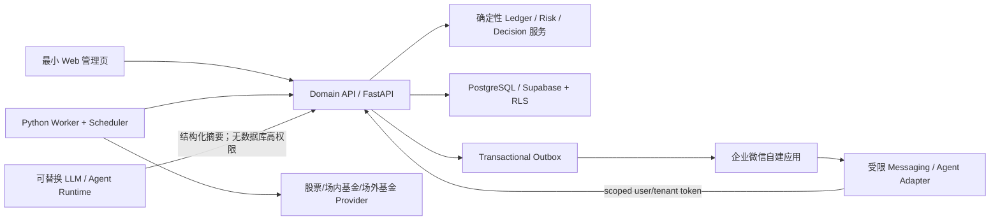
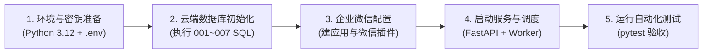
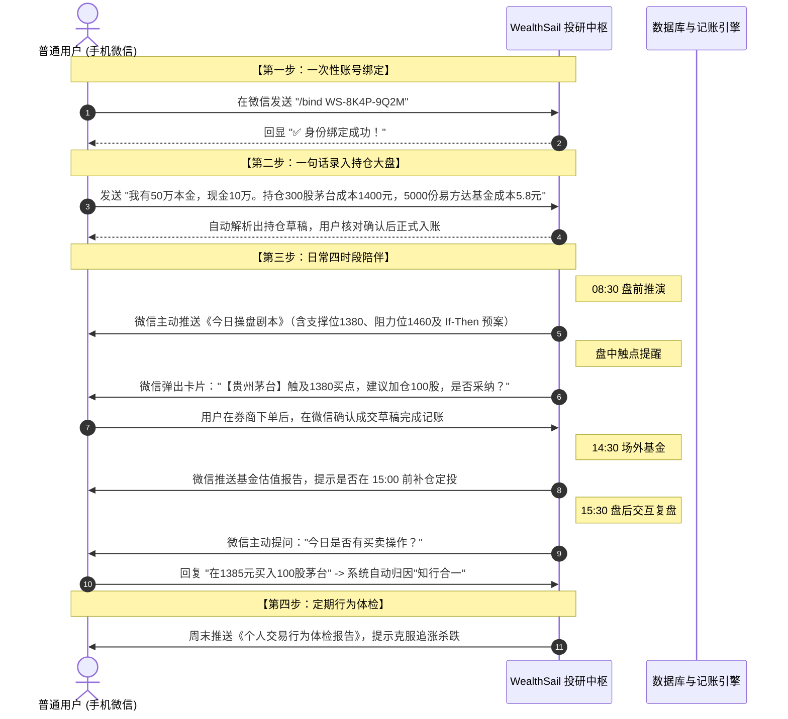
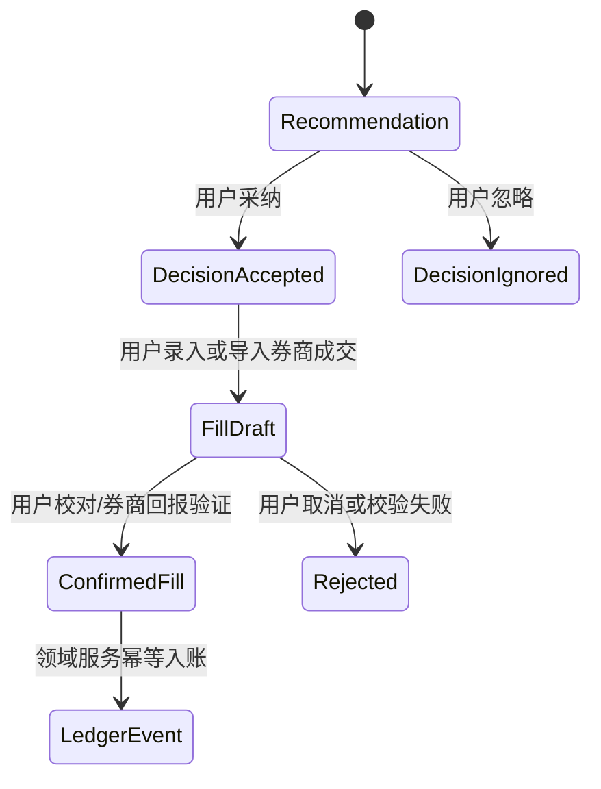

# WealthSail MVP 构建、联调与试运行指南（Windows 开发 + Linux/NAS 部署）

> **文档版本**：v2.1.0-draft  
> **编写日期**：2026-08-23  
> **文档状态**：评审修订中（当前仓库包含领域原型、Migration、Skill 和测试，并非已经可生产部署的完整应用）  
> **L1 范围**：A 股股票、场内 ETF/LOF、场外公募基金；2–3 个用户；08:30 盘前、盘中跟踪、14:30 基金报告、15:30 盘后交互复盘；企业微信  
> **关联资产**：[migrations/](../migrations/) · [skills/](../skills/) · [modules/](../modules/) · [adapters/](../adapters/) · [tests/](../tests/)

---

## 1. 先理解当前边界与用户使用全景

本指南把“现在能验证的代码资产”和“完整 MVP 仍需实现的工程”分开，避免把原型测试误写成上线完成。

### 1.1 L0/L1 目标架构



关键边界如下：

1. Agent、模型、企业微信消息和外部网页都不可信，只能调用带租户作用域的 Domain API。
2. 租户身份从登录会话/绑定关系解析，禁止信任模型或客户端随意传入的 `tenant_id`。
3. 建议、用户采纳、订单意图、真实成交和账本事件是五种不同事实；L1 不自动下单。
4. 行情、基金估值、仓位、费税与数量由确定性代码计算；数据不足时返回 `ABSTAIN`。
5. 报告与 Outbox 在同一事务提交；消息可能至少一次投递，因此必须靠幂等键去重。

### 1.2 开发者 5 步构建全景（从环境到上线的极简路径）



1. **第一步：环境与密钥准备**（安装 Python 3.12+ 虚拟环境，配置大模型 API Key 与企业微信应用凭证）；
2. **第二步：云端数据库初始化**（在 Supabase 或 PostgreSQL 16 中按顺序执行 `migrations/001~007.sql`，建立不可变账本表与 RLS 租户行隔离策略）；
3. **第三步：企业微信自建应用配置**（创建应用获取 `CorpId`/`Secret`/`AgentId`，开启微信插件让个人普通微信置顶接收卡片）；
4. **第四步：启动服务与调度**（启动 FastAPI 服务与 Python Worker 定时调度器，每天在 08:30、盘中、14:30、15:30 自动生成报告并推送到微信）；
5. **第五步：运行测试验收**（运行 `pytest tests -q` 确认测试通过，验证账本计算、数据质量和消息去重完全正常）。

### 1.3 最终普通用户（个人投资者）的 4 步日常使用旅程

普通用户**无需编写任何代码**，日常投资交互完全在**手机微信**中完成：



- **第一步：一次性绑定微信**：用户在 Web 控制台注册后获得 10 位一次性绑定码（如 `WS-8K4P-9Q2M`），在手机微信聊天框发送 `/bind WS-8K4P-9Q2M` 完成身份绑定；
- **第二步：一句话初始化资产大盘**：直接打字发送持仓描述，系统自动解析出结构化草稿，用户核对无误后点击确认，生成初始不可变账本；
- **第三步：全天候四时段微信自动交互（核心日常）**：
  - **🌅 08:30 盘前**：微信自动收到《今日操盘剧本》（隔夜外盘、持仓标的关键支撑/压力位与 If-Then 预案）；
  - **🔔 盘中触点**：市价跌到预设支撑买点时微信弹出卡片告警，用户在券商 App 下单后确认成交草稿记账；
  - **📊 14:30 基金估值**：微信收到场外基金估算涨跌幅，提示是否在申赎截止前定投补仓；
  - **🌙 15:30 盘后复盘**：收盘后 Agent 主动质询操作，用户回复后系统对比早盘预案自动归因知行合一；
- **第四步：周末接收《个人交易行为体检报告》**：分析历史决策，提示克服心理偏误。

### 1.4 开发者与管理员的运维监控使用方式

- **Web 管理控制台**：查看所有租户的资产净值走势（Equity Curve）、各标的持仓权重与资产大盘分布；
- **任务与队列监控**：监控后台定时任务运行日志（`job_runs`）、Outbox 异步消息投递状态与数据源新鲜度（`FRESH / STALE / UNAVAILABLE`）；
- **本地运维与回归测试**：终端运行 `pytest tests -q` 与 `powershell -File scripts/validate_docs.ps1` 进行自动化验收。

### 1.5 当前仓库已有与未有

| 状态 | 资产 | 能证明什么 | 不能证明什么 |
|---|---|---|---|
| 已有 | `modules/ledger/service.py` | 现金、买入、卖出、分红、幂等和投影数学的内存原型 | 不能替代 PostgreSQL 事务、并发和对账集成测试 |
| 已有 | `modules/market_data/providers.py` | 数据质量状态、股票/基金抓取边界、基金持仓成分估值与弃权 | 不能证明真实 Provider 长期稳定或数据授权合规 |
| 已有 | `adapters/messaging/wecom_adapter.py` | 明确收件人、缺凭据失败关闭、进程内幂等与显式 dry-run | 进程内幂等不能替代数据库 Outbox；尚未完成真实企微回调联调 |
| 已有 | `migrations/001`–`007` | 目标 Schema、RLS、组合外键、追加式事实、Outbox 租约字段 | 必须在临时 PostgreSQL/Supabase 实例真正执行后才算通过 |
| 已有 | `skills/` | 四时段输入、约束、输出和弃权 SOP | Skill 文档本身不是调度器或生产运行时 |
| 待实现 | FastAPI、Worker、真实 Auth/企微回调、持久化 Repository、Web 管理页 | 完整 MVP 的运行闭环 | 在实现和验收前状态均为 `NOT_RUN` |

---

## 2. 开发环境与依赖

### 2.1 Windows 本地开发

推荐 Python 3.12+ 和独立虚拟环境：

```powershell
py -3.12 -m venv .venv
.\.venv\Scripts\python.exe -m pip install --upgrade pip
.\.venv\Scripts\python.exe -m pip install -r requirements-dev.txt
.\.venv\Scripts\python.exe -m pytest tests -q
```

不要全局无版本上限安装整套依赖。生产依赖应在真正实现 FastAPI/Worker 时按最小集合锁定，并由依赖扫描和集成测试验证升级。

### 2.2 Hermes 仅作为受限 PoC

Hermes 当前只承担企业微信/Tool Calling 边缘候选，不承担 Cron、账本、RLS 或耐久工作流。其官方原生 Windows 指南标记为 **early beta**，所以 Windows 可用于开发验证，长期无人值守试运行优先 Linux 容器/NAS/VPS。安装步骤以 [Hermes 官方 Windows 指南](https://github.com/NousResearch/hermes-agent/blob/main/website/docs/user-guide/windows-native.md) 和 [消息通道文档](https://github.com/NousResearch/hermes-agent/blob/main/website/docs/user-guide/messaging/index.md) 为准，不在本仓库复制可能过期的一键脚本。

PoC 必须使用工具白名单：

- 只开放报告查询、决策记录、成交草稿和绑定等 scoped Domain API；
- 关闭终端、任意文件读写、任意 HTTP 和数据库直连能力；
- 每次调用记录 `tenant_id`、`user_id`、`tool_name`、输入摘要、结果和 `correlation_id`；
- Hermes 不达安全/可靠性/成本门槛时，替换为轻量企微适配器，不改变领域内核。

### 2.3 本地配置模板

`.env` 不得提交 Git。Agent/企业微信进程只配置最小权限字段：

```ini
# EXAMPLE / NOT_LIVE
MODEL_API_KEY="replace-me"
MODEL_BASE_URL="https://provider.example/v1"
MODEL_NAME="replace-me"

WECOM_CORPID="ww-replace-me"
WECOM_CORPSECRET="replace-me"
WECOM_AGENTID="1000002"

WEALTHSAIL_API_URL="https://wealthsail.example/api"
WEALTHSAIL_AGENT_TOKEN="scoped-short-lived-token"
BINDING_TOKEN_SECRET="random-secret-from-vault"
```

数据库绕过 RLS 的管理凭据不得出现在 Agent、浏览器、企业微信适配器、日志、错误响应或客户端构建产物中。Migration/备份若需要高权限，使用独立 CI/运维身份并记录审计。

---

## 3. PostgreSQL / Supabase 初始化

### 3.1 部署 Profile

- **Supabase Profile（当前推荐）**：`identity.profiles.id` 与 `auth.users.id` 一致，RLS 通过 `auth.uid()` 判断成员关系。需要在 Supabase API 设置中显式暴露所需自定义 Schema，并配置最小 `GRANT`。
- **纯 PostgreSQL Profile（备选）**：不能直接使用 Supabase `auth.uid()`；必须实现等价的 Identity Adapter，把已验证会话映射为数据库用户上下文。没有完成该适配前，不能声称 RLS 验收通过。

### 3.2 执行 7 个 Migration

在全新临时数据库按顺序执行，任何一步失败都停止发布：

1. [001_initial_schemas.sql](../migrations/001_initial_schemas.sql)：扩展与 9 个领域 Schema。
2. [002_identity_and_tenancy.sql](../migrations/002_identity_and_tenancy.sql)：租户、Profile、成员、账户、绑定和密钥引用。
3. [003_reference_and_ledger.sql](../migrations/003_reference_and_ledger.sql)：标的、投资事件、分录、批次与投影。
4. [004_market_and_research.sql](../migrations/004_market_and_research.sql)：行情快照、研究、报告、风险、Job、Outbox 与审计。
5. [005_rls_security_policies.sql](../migrations/005_rls_security_policies.sql)：基于成员/角色的 RLS 策略。
6. [006_mock_seed_data.sql](../migrations/006_mock_seed_data.sql)：仅开发环境的确定性 A/B/C 租户测试模拟数据 (Test Fixtures：张明、李华、王芳 3 个独立测试租户，用于验证多租户数据隔离；不等于 Supabase Auth 用户)。
7. [007_security_and_integrity_hardening.sql](../migrations/007_security_and_integrity_hardening.sql)：升级既有环境的策略、跨租户组合外键、追加式约束、租约与去重字段。

推荐用 `psql -v ON_ERROR_STOP=1` 或 Migration 工具执行，而不是人工忽略 SQL Editor 中间错误。至少验证：全新执行、重复执行预期行为、从 `006` 前版本升级到 `007`、失败回滚和备份恢复。

### 3.3 A/B 租户隔离验收

仅统计“有三个 tenant”不能证明隔离。必须创建两个真实 Auth 测试用户 A/B，使 `identity.profiles.id = auth.users.id`，分别加入 tenant A/B，然后以 `authenticated` 角色和各自 JWT 上下文执行：

```sql
-- EXAMPLE / NOT_LIVE：在测试事务中替换 USER_A_UUID
BEGIN;
SET LOCAL ROLE authenticated;
SELECT set_config(
  'request.jwt.claims',
  '{"sub":"USER_A_UUID","role":"authenticated"}',
  true
);

-- 应只返回 tenant A 的行
SELECT DISTINCT tenant_id FROM ledger.ledger_events;

-- 使用 tenant B 的 tenant_id 插入配置应失败，而不是插入 0 行后被忽略
-- INSERT INTO risk.alert_rules (...) VALUES ('TENANT_B_UUID', ...);
ROLLBACK;
```

至少覆盖以下矩阵：

| 身份 | 操作 | 预期 |
|---|---|---|
| A active member | 读取 A 数据 | 允许 |
| A active member | 读取/写入 B 数据 | 0 行或权限拒绝 |
| A viewer | 写可变配置 | 拒绝 |
| A editor | 写允许的配置表 | 允许且 `WITH CHECK` 生效 |
| A 任意普通用户 | 直接写 ledger/report/job/outbox/audit | 拒绝 |
| revoked member | 读取原租户 | 拒绝 |
| 受控后台 | 领域命令写账本 | 允许，且应用授权与审计均有证据 |

RLS 是逻辑行隔离和纵深防御，不是独立数据库级物理隔离。表所有者/绕过 RLS 的角色需要额外的凭据隔离、代码授权与审计。

---

## 4. 领域原型与正式实现契约

### 4.1 不可变投资事件账本

[modules/ledger/service.py](../modules/ledger/service.py) 是内存数学原型，已覆盖：

- `record_cash_in(...)`：资金流入；
- `record_buy(...)`：校验现金、数量、价格与非负费用；
- `record_sell(...)`：禁止超卖，按剩余平均成本更新投影；
- 现金分红与红利再投资；
- 幂等键去重、UTC 事件时间、不可变事件/分录对象和投影重建。

该模型是“不可变投资事件账本”，不是会计级复式总账。正式 Repository 仍需数据库事务、并发幂等唯一约束、跨租户组合外键、确认/冲正状态机、公司行动更正和券商对账测试。禁止直接更新已确认事件或持仓快照。

### 4.2 市场与基金估值

[modules/market_data/providers.py](../modules/market_data/providers.py) 统一返回：

- `FRESH`：来源时间在允许交易日窗口内；
- `ESTIMATED`：有确定性输入、覆盖率和不确定区间；
- `STALE`：有真实来源但超过新鲜度门槛；
- `UNAVAILABLE`：无可靠输入，调用方必须弃权。

场外基金估值不得使用固定百分比区间。确定性估值以披露持仓权重、成分股/资产收益、剩余仓位基准与不确定性为输入；覆盖率低于门槛时返回 `ABSTAIN`。报告必须显示 `as_of`、来源、披露日期、覆盖率和“估值非基金公司实时净值”的免责声明。

### 4.3 建议、采纳与成交



“确认建议”只写决策，不写 `BUY/SELL`。只有真实券商回报、对账文件或用户二次确认的成交草稿才能产生账本事件。所有自然语言持仓初始化和盘后交易回复也先形成草稿，关键字段缺失时不能猜测。

---

## 5. 企业微信安全联调

### 5.1 前置准备

在企业微信管理后台创建自建应用并记录 `CorpId`、`AgentId`、应用 Secret。账号主体、可见范围、回调域名和个人微信插件能力受企业微信当时规则与管理员配置影响，不能把“个人免费、无需资质、普通微信必然可交互”写成系统保证；联调前以 [企业微信官方文档](https://developer.work.weixin.qq.com/) 为准。

### 5.2 发送与回调安全

[adapters/messaging/wecom_adapter.py](../adapters/messaging/wecom_adapter.py) 的原型规则：

- `to_user` 必填，空值和 `@all` 默认拒绝；
- 缺凭据返回 `CONFIG_ERROR`，不会伪装为发送成功；
- `dry_run=True` 才允许本地演示，结果明确标为 `DRY_RUN`；
- 进程内幂等只适合单元测试，生产必须使用 `workflow.outbox` 唯一键、租约和外部消息 ID；
- 回调端还必须验证企业微信签名、时间戳、nonce、防重放、消息长度和用户绑定。

### 5.3 一次性绑定

Web 为已登录用户生成至少 10 个随机字符的绑定码，例如 `WS-8K4P-9Q2M`。数据库仅保存带服务端密钥的摘要、过期时间、尝试次数和 `consumed_at`。用户在企业微信私聊发送 `/bind WS-8K4P-9Q2M` 后，后端必须在同一事务内校验、绑定 `user_id + tenant_id` 并原子消费；错误尝试限速，群聊、广播和重复消费默认拒绝，用户可在 Web 立即撤销绑定。

---

## 6. 四时段任务的可执行定义

### 6.1 08:30 盘前简报

- 输入：交易日历、持仓/自选、隔夜指数/A50、公告、有效 thesis、数据质量；
- 确定性步骤：数据新鲜度、支撑/阻力算法、风险预算与数量公式；
- 模型步骤：把事实整理为 If-Then 预案和风险解释，不补造点位；
- 输出：报告版本、`job_run_id`、来源与 `as_of`、弃权项、Outbox 幂等键。

```text
EXAMPLE / NOT_LIVE | 2026-08-24
标的：600519；行情状态：STALE；来源日期：2026-08-21
结论：最新行情超过策略允许的新鲜度，本次不生成盘中触点和数量建议。
下一步：等待主数据源恢复，或由用户查看带明确来源的备源数据。
```

### 6.2 盘中跟踪

触点由预先保存的阈值与确定性规则触发，并经过新鲜度、交易状态、静默窗口、租户/收件人和提醒预算检查。用户“采纳”只产生决策记录；确认成交是单独动作。停牌、涨跌停、行情倒退、重复 tick、跨午休、数据冲突、用户撤销和消息重复回执都必须有显式分支。

### 6.3 14:30 场外基金报告

报告展示估值区间、覆盖率、披露滞后、剩余仓位假设、来源和 `as_of`。阈值建议只能引用用户已经确认的定投/申赎计划，不能由 LLM 临时生成精确金额。临近 15:00 的截止时间只是提示，实际申赎确认时间以基金销售机构规则为准。

### 6.4 15:30 盘后交互复盘

系统询问实际操作、执行理由和偏离原因。自然语言交易先变成 `FillDraft` 并回显关键字段；用户确认后才入账。2 小时未回复记为 `NO_RESPONSE`，不能推断“今日无交易”。复盘关联盘前报告、盘中触点、决策、成交和证据，区分策略问题、执行偏差与数据不可用。

### 6.5 L4 宏观与 L5 多 Agent

[skills/macro_cycle_analysis/SKILL.md](../skills/macro_cycle_analysis/SKILL.md) 属于 L4 研究扩展，不进入 MVP 的数据和验收承诺。多 Agent/Skill 自进化属于 L5 最后优先级实验，默认关闭；它们不能拥有行情事实、计算、账本或下单权限。详细局限和退出指标见[架构文档 8.3](./02.WealthSail投研平台全栈技术选型与架构评估.md#83-l5-多-agent-实验边界与退出机制)。

---

## 7. 验证命令与上线门槛

### 7.1 本地原型测试

```powershell
.\.venv\Scripts\python.exe -m pytest tests -q
powershell -ExecutionPolicy Bypass -File scripts\validate_docs.ps1
git diff --check
```

测试结果以当次命令输出和 CI 记录为准，文档不硬编码“必然通过 N 个”。当前 Python 测试只能证明内存领域原型；以下项目在实现前均保持 `NOT_RUN`：

- 7 个 Migration 在临时数据库的全新/升级/回滚验证；
- 真实 Supabase Auth A/B 越权矩阵与数据库并发幂等；
- 企业微信签名回调、token 过期、重复回执、明确收件人与 Outbox 恢复；
- 四时段定时漂移、节假日、午休、进程中断、数据源故障与模型故障；
- 备份恢复、RPO/RTO、72 小时稳定性、成本与 p95 延迟。

### 7.2 试运行放行条件

只有同时满足以下条件，才进入 2–3 用户封闭试运行：

1. 需求—设计—测试矩阵无孤儿 Must，L0/L1 用例全部有证据；
2. A/B/C 租户读写越权、撤销成员和 Agent scoped token 均通过；
3. 决策采纳不能直接入账，重复成交回报只有一个经济效果，超卖与负费用被拒绝；
4. 真实数据失败时报告明确降级/弃权，不出现常量假行情、固定估值区间或“模拟发送成功”；
5. 消息只发给绑定用户，Outbox 崩溃恢复不重复产生业务效果；
6. 完成备份恢复演练、告警、运行手册、回滚方案和人工暂停开关；
7. 所有输出明确是研究辅助与决策记录，不承诺收益、不替用户自动交易。
