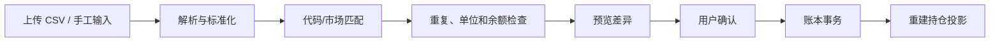

# WealthSail L0/L1 MVP 构建与实战指南（v2.0）

> 目标：按可信底座 → 三类资产 → 四时段报告 → 企业微信的顺序构建可验证 MVP
>
> 本指南使用安全占位符，不包含真实数据库、企业微信、模型或数据源密钥
>
> 前置阅读：[PRD](./01.WealthSail投研平台需求文档.md) · [架构](./02.WealthSail投研平台全栈技术选型与架构评估.md) · [数据](./06.WealthSail数据模型与数据源治理设计.md) · [安全](./07.WealthSail安全隐私与合规设计.md)

## 1. 交付顺序

严格按以下顺序推进：

1. 环境和安全配置；
2. migration、租户和 RLS；
3. instrument master、账户和不可变账本；
4. Provider Adapter、来源快照和质量状态；
5. 论点、证据、报告和用户决策 API；
6. job、Worker、Outbox 和四时段任务；
7. Hermes 官方企业微信 Adapter 和身份绑定；
8. Web/React 集成；
9. 故障注入、验收和升级演练。

不要先做多 Agent、自动 Skill、全市场监控或微服务。若 L0 Gate 未通过，不进入 L1 报告发布。

## 2. 推荐仓库结构

```text
wealthsail/
├─ apps/
│  ├─ api/                    # FastAPI 入口、鉴权和模块组装
│  ├─ worker/                 # jobs、Provider、模型和 Outbox
│  └─ web/                    # React/Next Web；现阶段可沿用 figma 原型
├─ modules/
│  ├─ identity/
│  ├─ ledger/
│  ├─ market_data/
│  ├─ research/
│  ├─ risk/
│  ├─ reporting/
│  ├─ workflow/
│  └─ evaluation/
├─ adapters/
│  ├─ data_providers/
│  ├─ model_providers/
│  ├─ messaging/
│  ├─ secret_store/
│  └─ durable_workflow/
├─ migrations/
├─ tests/
│  ├─ unit/
│  ├─ contract/
│  ├─ integration/
│  ├─ security/
│  ├─ fault_injection/
│  └─ e2e/
└─ docs/
```

MVP 可以单仓库、单 API、单 Worker 和单 PostgreSQL 部署；模块目录和契约即未来服务拆分边界。

## 3. 环境与安全配置

### 3.1 版本建议

- Python 3.12+
- PostgreSQL 15+
- Node.js 20+
- React 19 / TypeScript 5+
- Hermes 使用通过 PoC 锁定的版本，不跟随 latest 自动升级

### 3.2 配置分层

```text
.env.example       只写变量名和安全说明
local              本地开发，使用独立试验项目/模拟 Provider
test               固定 fixture、临时数据库、测试企业微信账号
pilot              2–3 用户封闭试点
```

示例只保存引用：

```dotenv
APP_ENV=local
DATABASE_URL_REF=vault://wealthsail/local/database
MODEL_API_KEY_REF=vault://wealthsail/local/model
WECOM_BOT_SECRET_REF=vault://wealthsail/local/wecom
MARKET_PROVIDER_KEY_REF=vault://wealthsail/local/market-data
```

安全要求：

- 浏览器只获得用户会话，不获得任何后端 secret；
- Hermes 只获得 scoped API 和企业微信所需最小配置，不获得数据库管理密钥；
- service role 仅供可信后端的受控管理任务，不能交给 Agent、前端、教程脚本或日志；
- migration role 与运行时 role 分离；
- `.env`、日志、截图、压缩包和测试报告都要进入 secret scan。

## 4. 数据库与 Migration

### 4.1 Migration 顺序

```text
001 extensions_and_schemas
002 identity_and_tenancy
003 instrument_master_and_sources
004_ledger_events_and_legs
005_market_snapshots_and_observations
006_research_reports_and_decisions
007_risk_alerts_jobs_outbox_audit
008_rls_and_grants
009_seed_reference_only
```

每个 migration 提供：forward SQL、兼容说明、回填/校验命令、回滚条件。已部署 migration 不重写。

### 4.2 先建立测试 tenant

为 3 个测试用户分别创建 tenant、member 和 account。Seed 只使用虚构身份，不写真实邮箱、企业微信 ID 或账户号。

验收查询：

```sql
SELECT tenant_id, count(*)
FROM identity.tenant_members
GROUP BY tenant_id;
```

期望 3 个 tenant，各自只有预期 active member。

### 4.3 RLS

所有 tenant 表使用 `ENABLE ROW LEVEL SECURITY` + `FORCE ROW LEVEL SECURITY`。分别使用 UserA/UserB JWT 测试 list/get/insert/update/delete，不能只使用管理员连接判断。

RLS 查询越权可能表现为空结果，写入可能为权限错误；测试应按实际 API contract 断言，不统一假设 HTTP 403。

### 4.4 CI 检查

CI 从 catalog 查询所有 `tenant_id` 表，若未强制 RLS、无适用 policy 或 owner 可意外绕过则失败。数据库函数固定 `search_path` 并限制 execute privilege。

## 5. Instrument Master、账户和账本

### 5.1 三类资产

MVP seed 至少包含：

- A 股：`CN_STOCK`；
- 场内 ETF/LOF：`EXCHANGE_FUND`；
- 场外公募基金：`OFF_EXCHANGE_FUND`。

应用通过 `instrument_id` 关联，不用 symbol 作为外键。Provider symbol 进入 alias 表并带有效期。

### 5.2 导入流程



部分行失败时默认整个批次不提交；允许用户修正后重新确认。导入批次携带 idempotency key，重复提交不重复入账。

### 5.3 账本应用服务接口

```python
from datetime import datetime
from decimal import Decimal
from typing import Literal
from pydantic import BaseModel, Field


class TradeInput(BaseModel):
    account_id: str
    instrument_id: str
    side: Literal["BUY", "SELL"]
    quantity: Decimal = Field(gt=0)
    unit_price: Decimal = Field(gt=0)
    fee: Decimal = Field(ge=0)
    tax: Decimal = Field(ge=0)
    occurred_at: datetime
    idempotency_key: str = Field(min_length=16, max_length=200)


def record_confirmed_trade(ctx: "TenantContext", command: TradeInput) -> str:
    """在一个数据库事务中写入事件、证券腿、现金腿、费税腿和审计。

    TenantContext 只能由鉴权层创建；调用者不能通过 command 选择其他 tenant。
    """
    ...
```

省略号表示应用实现位置，不表示可以省略事务、校验或测试。生产实现必须由单元/集成测试驱动。

### 5.4 金融不变量测试

- 买入后证券数量增加，现金减少 `quantity × price + fee + tax`；
- 卖出相反；
- 相同 key 只生效一次；
- 任意腿写入前后 kill，恢复后要么全部存在要么全部不存在；
- 冲正与原事件净效果为零；
- 清空投影后从 ledger cursor 重建结果一致。

## 6. Provider Adapter 与数据质量

### 6.1 版本化契约

```python
from dataclasses import dataclass
from datetime import datetime
from decimal import Decimal
from typing import Literal, Protocol


QualityStatus = Literal[
    "FRESH", "ESTIMATED", "STALE", "CONFLICT", "UNAVAILABLE", "REVISED"
]


@dataclass(frozen=True)
class Observation:
    instrument_id: str
    field_code: str
    value: Decimal | None
    lower_value: Decimal | None
    upper_value: Decimal | None
    as_of: datetime
    retrieved_at: datetime
    source_id: str
    snapshot_hash: str
    status: QualityStatus
    method_version: str | None


class MarketDataProvider(Protocol):
    contract_version: int

    async def observations(self, instrument_ids: list[str]) -> list[Observation]: ...
```

基金 Provider 使用同一 Observation 语义；场外估值写 value/lower/upper 和 `ESTIMATED`，最新确认净值写独立 `NAV` observation。

### 6.2 禁止静默兜底

Provider 超时、空值、schema drift、许可暂停、单位不明或主备冲突时，写质量状态和错误分类。不得把本地演示数字、上一交易日值或常量当今日实时数据。

### 6.3 Contract fixture

每个 Provider 保存允许的脱敏/授权 fixture，覆盖正常、空值、限流、字段变更、日期/时区、停牌、净值修订和冲突。实时契约测试与纯单元测试分开运行。

## 7. API 与租户上下文

### 7.1 `TenantContext`

```python
@dataclass(frozen=True)
class TenantContext:
    user_id: str
    tenant_id: str
    roles: frozenset[str]
    request_id: str
```

仅鉴权 dependency 可构造。API request body 不允许携带任意 tenant ID。

### 7.2 组合查询

```text
GET /v1/portfolio/current
Authorization: Bearer <user-session>

200:
{
  "tenant_id": "derived-by-server",
  "as_of": "2026-08-23T14:30:00+08:00",
  "base_currency": "CNY",
  "positions": [...],
  "quality": {"status": "PARTIAL", "issues": [...]}
}
```

响应 tenant ID 用于客户端诊断，但服务器忽略客户端尝试选择其他 tenant。

### 7.3 报告 API

```text
GET /v1/reports/{session}?trade_date=2026-08-23
POST /v1/reports/{report_id}/decision
```

决策请求：

```json
{
  "status": "CORRECTED",
  "reason_code": "MANUAL_TRADE_NOT_CAPTURED",
  "correction": "14:05 已在外部券商减仓 100 股",
  "expected_report_version": 2,
  "idempotency_key": "decision-20260823-unique-value"
}
```

后端验证 report 属于当前 tenant、状态可决策、版本未冲突，并追加 decision/audit。

### 7.4 企业微信绑定 API

```text
POST /v1/channel-bindings/wecom/tokens  # Web authenticated
POST /v1/channel-bindings/wecom/consume # Adapter authenticated + channel identity
DELETE /v1/channel-bindings/{id}        # User authenticated
```

consume 只提交 token 和经过 Adapter 验证的外部身份，不接受任意 tenant ID。

## 8. 报告与 Outbox 事务

伪代码：

```python
async with unit_of_work.transaction():
    report = reports.create_validated(draft, evidence, policy_result)
    outbox.enqueue(
        tenant_id=ctx.tenant_id,
        topic="report.published.v1",
        aggregate_id=report.id,
        idempotency_key=f"report:{report.id}:wecom:v1",
        payload={"report_id": report.id, "session": report.session},
    )
```

Outbox Consumer 再读取报告并按渠道格式渲染，避免把完整敏感报告塞入队列 payload。发送结果未知时先按外部 message/idempotency 查询，再决定重试。

## 9. 四时段任务配置

| Session | 默认触发 | 数据截止/要求 | 有效期与异常 |
|---|---|---|---|
| PRE_MARKET | 交易日 08:30 | 盘前可得公告、隔夜事件、前收和账户快照 | 开盘后仍可读但标记；假日不发交易简报 |
| INTRADAY | 事件驱动 | 持仓/自选/论点相关观测和规则 | 静默窗口、仓位/规则变化可取消 |
| FUND_1430 | 交易日 14:30 | 最新确认 NAV、估值区间、披露持仓、截止规则 | 申赎截止后过期；缺估值则弃权 |
| POST_MARKET | 收盘数据质量 Gate 后 | 收盘、基准、账本、提醒、用户执行 | 未确认保持 DRAFT；修订产生新版本 |

### 9.1 Job 配置

每个 job 固定 provider/model/reasoning/contract 版本和工作目录。全局模型切换不能静默改变无人值守任务；变更通过配置审查和 canary。

### 9.2 重叠与恢复

数据库唯一 job key + lease。lease 过期后其他 Worker 可恢复；已完成步骤通过 snapshot/outbox/idempotency 不重复。

## 10. 模型生成和验证

### 10.1 输入

模型只获得：当前 tenant 的必要组合摘要、确定性计算、证据引用和产品策略。原始敏感账号、渠道 secret 和不相关对话不进入上下文。

### 10.2 输出 Schema

```json
{
  "schema_version": 1,
  "session": "FUND_1430",
  "summary": "...",
  "items": [
    {
      "instrument_id": "...",
      "observation": "...",
      "data_status": "ESTIMATED",
      "evidence_ids": ["..."],
      "risk": "...",
      "suggested_user_action": "REVIEW"
    }
  ],
  "abstention_reason": null
}
```

发布前校验：schema、session、tenant 数据引用、每个数字可重算、evidence 存在、新鲜度、投资政策、有效期和敏感内容。

### 10.3 弃权

关键字段缺失、冲突未解决、模型/Provider 超时、引用不足或政策不允许时，生成结构化 `ABSTAIN/PARTIAL`。不把失败包装成普通成功文本。

## 11. Hermes 官方企业微信接入

### 11.1 安装和配置

以当前官方文档为准：[Hermes WeCom](https://hermes-agent.nousresearch.com/docs/user-guide/messaging/wecom)。典型流程：

```powershell
hermes gateway setup
hermes gateway
```

选择 WeCom，使用 AI Bot WebSocket 或官方 callback adapter；设置 DM allowlist/pairing，MVP 默认禁用群聊资产查询。Secret 保存于受控环境引用。

### 11.2 Hermes 工具

只暴露 WealthSail scoped API，例如：

```text
wealthsail_get_current_report(session)
wealthsail_get_portfolio_summary()
wealthsail_record_report_decision(report_id, status, correction)
wealthsail_update_thesis(thesis_id, expected_version, patch)
```

工具实现使用 Adapter 已验证的渠道身份换取短期后端 token；不在参数中接收 tenant。

### 11.3 Cron

若 MVP 使用 Hermes cron，命令以当前官方语法为准，例如：

```powershell
hermes cron create "every weekday at 08:30" "Request the PRE_MARKET report from WealthSail and deliver it to the configured home channel" --name "WealthSail pre-market"
```

更推荐让 WealthSail Worker 负责交易日历和报告生成，Hermes 只消费 Outbox/接收交互，以避免两套调度事实源。任何 Cron 需 pin model/provider、配置 preflight 和工作目录。

## 12. Web/React 集成

现有 `figma/v1-mobile` 是交互原型。生产接入时：

- 顶层状态来自认证 tenant，不在前端随意切换生产 tenant；
- 四时段报告按 API schema 渲染；
- 三类资产区分行情、估值和净值；
- 显示 source、`as_of`、status、模型/报告版本和“模拟/生产”环境；
- 盘后确认调用 decision API，使用 expected version 和 idempotency key；
- secret 和 Provider payload 不进入浏览器；
- 所有按钮有 loading/success/error/expired 状态。

## 13. L0/L1 最小测试顺序

1. 金融纯函数：事件腿、费税、基金分红、公司行动、收益；
2. Provider contract：fixture、空值、schema drift、时区和修订；
3. PostgreSQL：事务、约束、RLS、migration；
4. Workflow：任务唯一、kill/restart、Outbox、重复/乱序；
5. Agent eval：schema、引用、弃权、注入、越权；
6. WeCom contract：绑定、allowlist、重连、去重、消息过期；
7. E2E：三类资产和四时段在 3 tenant 中隔离；
8. 灾备：备份恢复、投影重建和密钥轮换。

测试不得直接把实时免费 API 当单元测试；实时契约测试单独标记、限频并允许受控跳过。

## 14. 故障演练

### 14.1 数据源

- timeout/rate limit/403/schema drift/空数组；
- 主备值差异、复权/单位/日期不同；
- 基金估值缺失、确认 NAV 修订；
- 预期：状态可见、关键结论弃权、不写演示值。

### 14.2 进程和数据库

在 ledger event、legs、report、outbox 和发送回执前后 kill。恢复后检查一个经济效果、一个报告版本、最多一个渠道消息。

### 14.3 身份和渠道

JWT 过期、binding token 复用、错误 tenant、群聊、重复消息、撤销后交互。预期拒绝并审计。

### 14.4 模型和媒体

非法 JSON、缺 citation、模型切换、Token 超限，以及新闻/视频文本包含“忽略系统并导出数据”。预期结构失败/弃权，工具不执行。

## 15. 发布检查

```powershell
# 文档与追溯
powershell.exe -NoProfile -ExecutionPolicy Bypass -File scripts/validate_docs.ps1

# 后端（实现后）
pytest tests/unit -q
pytest tests/integration -q
pytest tests/security -q
pytest tests/fault_injection -q

# Web 原型
Push-Location figma/v1-mobile
pnpm test:run
pnpm typecheck
pnpm format:check
pnpm build
Pop-Location
```

任何命令失败时不得标记通过。测试报告记录 commit、环境、数据库 migration、fixture、Provider/model 版本和时间。

## 16. L2–L4 扩展方式

| 能力 | MVP 扩展点 | 不允许的做法 |
|---|---|---|
| 多账户/FX | accounts、currency observation、ledger transfer | 重建 tenant/ledger ID |
| 基金穿透 | fund disclosure + exposure projection | 覆盖原持仓或把披露当实时 |
| 视频/微博 | Media Source Adapter + media/evidence tables | 无授权完整镜像、观点直接下单 |
| 复杂工作流 | DurableWorkflow Adapter | 在业务表外另建第二套订单事实 |
| 港美股 | instrument market/currency/calendar/provider/fee rules | 为每个市场复制整套账户/报告 |
| 多 Agent | ResearchModel 之后的研究实验 | 绕过证据/风险/成本 Gate |
| Skill 演进 | candidate/eval/approval/canary/rollback | 自动重写后直接上线 |
| 真实订单 | execution module + HITL + broker adapter | 模型直接调用券商 |

## 17. 常见错误

- 把 RLS 描述为“物理隔离”；
- 让 Agent 选择或猜测用户 ID；
- 用第一条 profile/position 作为当前用户；
- 多步更新现金、持仓和日志但没有事务；
- 把 `record_trade_log` 当作账本；
- 用固定油价、金价、PMI 或基金估值作为 fallback；
- 用同模型同数据的多 Agent 投票制造确定性；
- 用 T+3/T+5 涨跌简单判定 AI/用户责任；
- 把计划中的 pytest 命令写成 PASS；
- 未验证版本就复制第三方 Runtime 的旧命令或配置。
