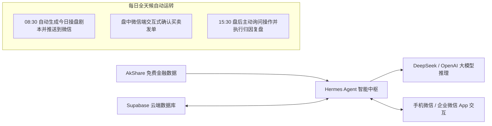

# WealthSail MVP 快速构建与实战指南 (Windows + 企业微信 + Hermes Agent)

> **文档版本**：v1.1.0 (企业微信自建应用版)  
> **编写日期**：2026-08-22  
> **适用对象**：初学者、量化与 AI 开发者、个人独立投资者  
> **核心目标**：在 Windows 环境下，以 **国内网络直连、微信/企业微信原生接收、零前端手写成本、零数据库运维负担** 的极简方式，基于 **Hermes Agent + Supabase + AkShare + 企业微信自建应用** 快速跑通全天候智能投研 MVP。

---

## 1. 架构总览与 MVP 闭环目标

本指南带你从 0 开始搭建一个全自动运行的投研助手。无需安装复杂的 Docker，在 Windows 电脑上直接运行，且**国内网络直连（无需科学上网）**，在微信/企业微信 App 即可直接接收研报与交互：



### 为什么选择“企业微信自建应用”？
1. **国内直连，无需翻墙**：彻底摆脱 Telegram 等海外软件的网络连接困扰。
2. **微信原生互通**：只需在企业微信开启“微信插件”，即可在**普通个人微信**内直接接收早盘预案卡片并交互！
3. **个人完全免费**：任何个人仅需手机号实名即可 1 分钟免费创建企业微信，无需企业营业执照。

### MVP 核心交付成果
1. **跨设备资产与自选股管理**：数据保存在 Supabase 云端，支持随时增删改查持仓与自选股。
2. **一键 AI 深度诊股**：在微信/企业微信聊天框输入股票代码，自动抓取 K 线、资讯与估值，输出专业诊断与支撑/压力位。
3. **08:30 盘前全自动预案推送**：每天早晨自动抓取昨夜美股、A50 期指与隔夜公告，生成 If-Then 操盘剧本推送到微信。
4. **15:30 盘后互动复盘**：收盘后 Agent 主动质询今日操作并归因，若超时未回复自动归档，绝不反复打扰。

---

## 2. 第一步：环境准备与基础工具安装

### 2.1 安装 Python 3.12+
1. 前往 Python 官网下载并安装 [Python 3.12+ for Windows](https://www.python.org/downloads/)。
2. **极其重要**：安装界面务必勾选 **“Add python.exe to PATH”**。
3. 打开 PowerShell 终端，验证安装成功：
   ```powershell
   python --version
   pip --version
   ```

### 2.2 安装金融数据、数据库与企业微信依赖库
在 PowerShell 中运行以下命令：
```powershell
pip install --upgrade akshare supabase pandas requests pydantic fastapi uvicorn cryptography
```

### 2.3 在 Windows 下安装 Hermes Agent

Hermes Agent (Nous Research 开源) 是本系统的智能调度中枢。支持以下两种安装方式：

#### 方式 A：使用官方 Desktop 桌面安装包 (最推荐新手)
1. 访问 Hermes Agent 官网下载 Windows 安装包：[https://hermes-agent.nousresearch.com/](https://hermes-agent.nousresearch.com/)
2. 双击 `.exe` 安装包，按照向导完成安装。

#### 方式 B：使用原生 PowerShell 一键脚本安装 (CLI 开发者)
打开 PowerShell 终端，运行：
```powershell
iex (irm https://raw.githubusercontent.com/NousResearch/hermes-agent/main/scripts/install.ps1)
```
*安装完成后，**关闭并重新打开** 一个新的 PowerShell 终端，输入 `hermes --version` 验证安装成功。*

### 2.4 配置大模型 API Key
在 PowerShell 中运行 Hermes 初始化配置向导：
```powershell
hermes setup
```
或者直接在用户目录下的配置文件 `C:\Users\<你的用户名>\.hermes\.env` 中添加你的大模型密钥（以 DeepSeek 为例）：
```ini
# 配置大模型厂商与密钥 (推荐 DeepSeek-V3/R1，性价比极高且中文投研能力强)
OPENAI_API_KEY="sk-xxxxxxxxxxxxxxxxxxxxxxxxxxxxxxxx"
OPENAI_BASE_URL="https://api.deepseek.com/v1"
HERMES_MODEL="deepseek-chat"
```

---

## 3. 第二步：云端数据库一键初始化 (Supabase)

为了让手机、PC 多端能随时随地读取持仓与历史研报，且无需在本地搭建维护数据库，我们选用 **Supabase**（免费 PostgreSQL 云服务）。

### 3.1 创建 Supabase 免费项目
1. 访问 [https://supabase.com/](https://supabase.com/) 并使用 GitHub 账号登录。
2. 点击 **“New project”**，填写项目名称（如 `WealthSail-DB`），设置数据库密码并选择亚太地区节点（如 `Singapore` 或 `Tokyo`）。
3. 项目创建约需 1~2 分钟。

### 3.2 一键执行 MVP 数据表 DDL
进入 Supabase 左侧菜单的 **“SQL Editor”**，点击 **“New query”**，将以下精简版 MVP DDL 粘贴进去并点击右下角 **“Run”** 执行：

```sql
-- 1. 启用向量扩展 (为后续自进化记忆准备)
CREATE EXTENSION IF NOT EXISTS vector;

-- 2. 用户扩展信息表 (支持多用户、多端绑定与大类资产目标)
CREATE TABLE IF NOT EXISTS profiles (
    id UUID PRIMARY KEY DEFAULT gen_random_uuid(),
    nickname VARCHAR(64),
    binding_code VARCHAR(32), -- 临时多端绑定码 (如 'WS-8899')
    all_weather_targets JSONB DEFAULT '{"equity": 50, "bond": 25, "gold": 15, "cash": 10}', -- 股债金现金目标配置比例(%)
    risk_level VARCHAR(16) DEFAULT 'balanced',
    created_at TIMESTAMPTZ DEFAULT NOW(),
    updated_at TIMESTAMPTZ DEFAULT NOW()
);

-- 3. 用户全渠道绑定表 (支持企微、飞书、TG、钉钉、Discord、Slack等无限扩展)
CREATE TABLE IF NOT EXISTS user_channel_bindings (
    id UUID PRIMARY KEY DEFAULT gen_random_uuid(),
    user_id UUID REFERENCES profiles(id) ON DELETE CASCADE,
    channel_type VARCHAR(32) NOT NULL CHECK (channel_type IN ('wecom', 'feishu', 'telegram', 'dingtalk', 'discord', 'slack', 'webpush', 'custom_webhook')),
    channel_user_id VARCHAR(128) NOT NULL, -- 第三方平台的唯一用户标识 (如 企微 UserId, 飞书 open_id, TG chat_id, 钉钉 staff_id)
    channel_username VARCHAR(64), -- 第三方昵称
    credentials JSONB, -- 渠道专属配置凭证 (如专属 webhook, token)
    is_active BOOLEAN DEFAULT TRUE,
    created_at TIMESTAMPTZ DEFAULT NOW(),
    UNIQUE(channel_type, channel_user_id)
);

-- 4. 用户账户资金表
CREATE TABLE IF NOT EXISTS portfolio (
    id UUID PRIMARY KEY DEFAULT gen_random_uuid(),
    user_id UUID REFERENCES profiles(id) ON DELETE CASCADE,
    total_capital NUMERIC(15, 2) NOT NULL DEFAULT 100000.00,
    available_cash NUMERIC(15, 2) NOT NULL DEFAULT 100000.00,
    updated_at TIMESTAMPTZ DEFAULT NOW()
);

-- 5. 持仓明细表 (支持股票、场内ETF、场外公募基金、黄金与贵金属等)
CREATE TABLE IF NOT EXISTS positions (
    id UUID PRIMARY KEY DEFAULT gen_random_uuid(),
    user_id UUID REFERENCES profiles(id) ON DELETE CASCADE,
    symbol VARCHAR(32) NOT NULL, -- 股票代码、基金代码或黄金代码 (如 '600519', '518880', '110011', 'Au99.99')
    asset_name VARCHAR(64), -- 标的名称 (如 '贵州茅台', '黄金ETF', '易方达中小盘', '上海金现货')
    asset_type VARCHAR(16) NOT NULL DEFAULT 'STOCK' CHECK (asset_type IN ('STOCK', 'ETF', 'MUTUAL_FUND', 'BOND', 'GOLD', 'CRYPTO')), -- 标的类别 (含黄金)
    market VARCHAR(16) NOT NULL CHECK (market IN ('A', 'HK', 'US', 'FUND', 'SGE', 'COMMODITY')), -- 市场类型 (含上海金交所 SGE 与大宗商品)
    avg_cost NUMERIC(15, 4) NOT NULL, -- 买入成本价、持仓成本净值或每克金价 (元/克)
    quantity NUMERIC(15, 4) NOT NULL CHECK (quantity > 0), -- 持股数、持有基金份额或黄金克数 (g)
    dividend_method VARCHAR(16) DEFAULT 'CASH' CHECK (dividend_method IN ('CASH', 'REINVEST')), -- 默认分红方式: 现金分红(CASH) / 红利再投资(REINVEST)
    accumulated_dividends NUMERIC(15, 2) DEFAULT 0.00, -- 历史累计获得的分红总额(元)
    ai_stop_loss NUMERIC(15, 4), -- 止损线 (价格、净值或金价)
    ai_take_profit NUMERIC(15, 4), -- 止盈线 (价格、净值或金价)
    updated_at TIMESTAMPTZ DEFAULT NOW()
);

-- 5. 自选关注表 (支持股票、基金与黄金)
CREATE TABLE IF NOT EXISTS watchlists (
    id UUID PRIMARY KEY DEFAULT gen_random_uuid(),
    user_id UUID REFERENCES profiles(id) ON DELETE CASCADE,
    symbol VARCHAR(32) NOT NULL,
    asset_name VARCHAR(64),
    asset_type VARCHAR(16) NOT NULL DEFAULT 'STOCK' CHECK (asset_type IN ('STOCK', 'ETF', 'MUTUAL_FUND', 'BOND', 'GOLD', 'CRYPTO')),
    market VARCHAR(16) NOT NULL,
    notes TEXT, -- 关注理由 (如 '估值低位定投'、'等待回踩20日线' 或 '降息周期对冲')
    latest_ai_sentiment VARCHAR(16) DEFAULT 'neutral',
    created_at TIMESTAMPTZ DEFAULT NOW()
);

-- 6. 基金基础画像与净值表 (公募/私募基金专项)
CREATE TABLE IF NOT EXISTS fund_profiles (
    id UUID PRIMARY KEY DEFAULT gen_random_uuid(),
    fund_code VARCHAR(32) UNIQUE NOT NULL, -- 基金代码
    fund_name VARCHAR(64) NOT NULL, -- 基金全称
    fund_type VARCHAR(32) CHECK (fund_type IN ('EQUITY', 'HYBRID', 'BOND', 'INDEX_PASSIVE', 'INDEX_ENHANCED', 'QDII', 'MONEY')),
    fund_manager VARCHAR(64), -- 基金经理
    latest_nav NUMERIC(10, 4), -- 最新单位净值
    accumulated_nav NUMERIC(10, 4), -- 累计净值
    nav_date DATE, -- 净值日期
    estimated_intraday_growth NUMERIC(6, 2), -- 盘中实时预估涨跌幅(%)
    fund_scale_billion NUMERIC(10, 2), -- 基金规模(亿元)
    updated_at TIMESTAMPTZ DEFAULT NOW()
);

-- 7. 基金底层穿透重仓表 (用于透视真实重仓与消除伪分散)
CREATE TABLE IF NOT EXISTS fund_lookthrough (
    id UUID PRIMARY KEY DEFAULT gen_random_uuid(),
    fund_code VARCHAR(32) NOT NULL,
    fund_name VARCHAR(64),
    holding_symbol VARCHAR(32) NOT NULL,
    holding_name VARCHAR(64) NOT NULL,
    holding_type VARCHAR(16) DEFAULT 'STOCK' CHECK (holding_type IN ('STOCK', 'BOND', 'CASH', 'OTHER')),
    weight_percentage NUMERIC(5, 2) NOT NULL,
    industry_name VARCHAR(64),
    report_period VARCHAR(16),
    updated_at TIMESTAMPTZ DEFAULT NOW()
);

-- 8. 基金/股票分红流水表 (Dividend Logs)
CREATE TABLE IF NOT EXISTS dividend_logs (
    id UUID PRIMARY KEY DEFAULT gen_random_uuid(),
    user_id UUID REFERENCES profiles(id) ON DELETE CASCADE,
    symbol VARCHAR(32) NOT NULL, -- 标的代码
    asset_name VARCHAR(64), -- 标的名称
    asset_type VARCHAR(16) NOT NULL DEFAULT 'MUTUAL_FUND' CHECK (asset_type IN ('STOCK', 'ETF', 'MUTUAL_FUND')),
    dividend_date DATE NOT NULL, -- 除息日/派息日
    dividend_per_share NUMERIC(10, 4) NOT NULL, -- 每份/每股分红金额(元)
    dividend_type VARCHAR(16) NOT NULL CHECK (dividend_type IN ('CASH', 'REINVEST')), -- 实际分红方式: 现金到账 / 红利转份额
    total_amount NUMERIC(15, 2) NOT NULL, -- 分红总金额 (quantity * dividend_per_share)
    reinvest_nav NUMERIC(10, 4), -- 若为再投资: 折算单位净值
    reinvest_shares NUMERIC(15, 4) DEFAULT 0.0000, -- 若为再投资: 新增份额 (total_amount / reinvest_nav)
    created_at TIMESTAMPTZ DEFAULT NOW()
);

-- 9. 出局规则绑定表
CREATE TABLE IF NOT EXISTS exit_rules (
    id UUID PRIMARY KEY DEFAULT gen_random_uuid(),
    user_id UUID REFERENCES profiles(id) ON DELETE CASCADE,
    symbol VARCHAR(32) NOT NULL,
    rule_type VARCHAR(32) NOT NULL,
    rule_params JSONB NOT NULL,
    is_triggered BOOLEAN DEFAULT FALSE,
    created_at TIMESTAMPTZ DEFAULT NOW()
);

-- 10. AI 操盘预案与建议记录表
CREATE TABLE IF NOT EXISTS ai_suggestions (
    id UUID PRIMARY KEY DEFAULT gen_random_uuid(),
    user_id UUID REFERENCES profiles(id) ON DELETE CASCADE,
    symbol VARCHAR(32),
    market VARCHAR(16) NOT NULL DEFAULT 'A',
    report_type VARCHAR(32) NOT NULL,
    suggested_action VARCHAR(32) CHECK (suggested_action IN ('BUY_OPEN', 'BUY_ADD', 'SELL_REDUCE', 'SELL_CLEAR', 'FUND_SUBSCRIBE', 'FUND_REDEEM', 'FUND_AIP', 'CHANGE_DIVIDEND_TO_CASH', 'CHANGE_DIVIDEND_TO_REINVEST', 'BUY', 'SELL', 'HOLD', 'WAIT')),
    target_price NUMERIC(15, 4),
    suggested_qty NUMERIC(15, 4), -- 股数、基金份额或黄金克数
    support_price NUMERIC(15, 4),
    resistance_price NUMERIC(15, 4),
    if_then_plan JSONB,
    logic_summary TEXT,
    status VARCHAR(16) DEFAULT 'pending',
    created_at TIMESTAMPTZ DEFAULT NOW()
);

-- 11. 真实成交记录表 (支持股票买卖、基金申赎/定投、黄金买卖及分红流水)
CREATE TABLE IF NOT EXISTS trade_logs (
    id UUID PRIMARY KEY DEFAULT gen_random_uuid(),
    user_id UUID REFERENCES profiles(id) ON DELETE CASCADE,
    symbol VARCHAR(32) NOT NULL,
    asset_type VARCHAR(16) NOT NULL DEFAULT 'STOCK' CHECK (asset_type IN ('STOCK', 'ETF', 'MUTUAL_FUND', 'BOND', 'GOLD', 'CRYPTO')),
    actual_action VARCHAR(32) NOT NULL CHECK (actual_action IN ('BUY_OPEN', 'BUY_ADD', 'SELL_REDUCE', 'SELL_CLEAR', 'FUND_SUBSCRIBE', 'FUND_REDEEM', 'FUND_AIP', 'DIVIDEND_CASH', 'DIVIDEND_REINVEST', 'BUY', 'SELL')),
    executed_price NUMERIC(15, 4) NOT NULL, -- 成交价、申赎单位净值或黄金每克单价
    executed_qty NUMERIC(15, 4) NOT NULL, -- 股数、基金份额或黄金克数
    execution_notes TEXT,
    executed_at TIMESTAMPTZ DEFAULT NOW()
);

-- 12. 向量记忆表 (反思沉淀)
CREATE TABLE IF NOT EXISTS vector_memory (
    id UUID PRIMARY KEY DEFAULT gen_random_uuid(),
    user_id UUID REFERENCES profiles(id) ON DELETE CASCADE,
    content TEXT NOT NULL,
    tags TEXT[],
    created_at TIMESTAMPTZ DEFAULT NOW()
);

-- 13. 全球大宗商品晴雨表与宏观周期指标表
CREATE TABLE IF NOT EXISTS macro_commodity_indicators (
    id UUID PRIMARY KEY DEFAULT gen_random_uuid(),
    indicator_date DATE NOT NULL,
    brent_oil_price NUMERIC(10, 2), -- 布伦特原油期货 (美元/桶，通胀与工业血液)
    wti_oil_price NUMERIC(10, 2), -- WTI原油 (美元/桶)
    lme_copper_price NUMERIC(10, 2), -- LME铜现货结算价 (美元/吨，经济晴雨表)
    shfe_copper_price NUMERIC(10, 2), -- 沪铜主力合约结算价 (元/吨)
    gold_spot_price NUMERIC(10, 2), -- 伦敦金现货价格 (美元/盎司)
    gold_copper_ratio NUMERIC(10, 4), -- 金铜比 (避险/经济景气)
    oil_copper_ratio NUMERIC(10, 4), -- 油铜比 (滞胀压力/景气)
    inventory_cycle_stage VARCHAR(32) CHECK (inventory_cycle_stage IN ('PASSIVE_DESTOCK', 'ACTIVE_RESTOCK', 'PASSIVE_RESTOCK', 'ACTIVE_DESTOCK')), -- 基钦库存周期4阶段
    merrill_clock_stage VARCHAR(32) CHECK (merrill_clock_stage IN ('RECOVERY', 'OVERHEAT', 'STAGFLATION', 'RECESSION')), -- 美林时钟象限
    gpr_index NUMERIC(10, 2), -- 全球地缘政治风险指数 (Geopolitical Risk Index)
    created_at TIMESTAMPTZ DEFAULT NOW(),
    UNIQUE(indicator_date)
);

-- 14. 全球重大地缘政治、经济与军事大事件表
CREATE TABLE IF NOT EXISTS geopolitical_events (
    id UUID PRIMARY KEY DEFAULT gen_random_uuid(),
    event_time TIMESTAMPTZ NOT NULL,
    title VARCHAR(255) NOT NULL,
    category VARCHAR(32) CHECK (category IN ('MILITARY_CONFLICT', 'CENTRAL_BANK', 'TRADE_SANCTION', 'OPEC_ENERGY', 'POLITICAL_ELECTION', 'BLACK_SWAN')),
    severity VARCHAR(16) CHECK (severity IN ('LOW', 'MEDIUM', 'HIGH', 'CRITICAL')),
    summary TEXT NOT NULL,
    ai_chain_impact JSONB, -- 资产传导链条推演
    affected_sectors JSONB, -- 潜在受损与受益行业/标的池
    created_at TIMESTAMPTZ DEFAULT NOW()
);

-- 插入一条初始演示用户与测试资金数据
INSERT INTO profiles (id, nickname, binding_code) 
VALUES ('00000000-0000-0000-0000-000000000001', '演示投资者', 'WS-8899')
ON CONFLICT (id) DO NOTHING;

INSERT INTO user_channel_bindings (user_id, channel_type, channel_user_id, channel_username)
VALUES ('00000000-0000-0000-0000-000000000001', 'wecom', 'AdminUser', '演示企业微信')
ON CONFLICT (channel_type, channel_user_id) DO NOTHING;

INSERT INTO portfolio (user_id, total_capital, available_cash) 
SELECT '00000000-0000-0000-0000-000000000001', 100000.00, 100000.00
WHERE NOT EXISTS (SELECT 1 FROM portfolio WHERE user_id = '00000000-0000-0000-0000-000000000001');
```

### 3.3 获取 Supabase 连接密钥
1. 点击左侧设置 **Project Settings -> API**。
2. 复制 **Project URL**（如 `https://xyzcompany.supabase.co`）。
3. 复制 **anon / public key** 或 **service_role key**。
4. 将它们配置进 `C:\Users\<你的用户名>\.hermes\.env`：
   ```ini
   SUPABASE_URL="https://你的项目ID.supabase.co"
   SUPABASE_KEY="你的Supabase密钥"
   ```

---

## 4. 第三步：创建与配置企业微信自建应用

企业微信自建应用是接收研报与进行人机确认的最佳通道。

### 4.1 注册并登录企业微信后台 (个人免费)
1. 电脑访问 [企业微信官网](https://work.weixin.qq.com/) 并注册（个人随便填一个团队名即可，如 `WealthSail投研实验室`）。
2. 使用手机微信扫描二维码登录管理后台。

### 4.2 获取企业 ID (`CORP_ID`)
- 在管理后台顶部导航点击 **“我的企业”**，滑动到页面最下方，复制 **“企业ID”**（如 `ww1234567890abcdef`）。

### 4.3 创建自建应用并获取 `AgentId` 与 `Secret`
1. 点击顶部导航 **“应用管理”** $\rightarrow$ 页面下滑到 **“自建”** $\rightarrow$ 点击 **“创建应用”**。
2. 填写应用信息：
   - **应用名称**：`WealthSail 投研助手`
   - **应用 Logo**：上传一个投资/船帆图标
   - **可见范围**：选择你自己（或你的部门）
3. 点击 **“创建应用”** 成功后，进入该应用详情页：
   - 记录 **`AgentId`**（如 `1000002`）；
   - 点击 Secret 后方的 **“查看”**，在手机企业微信上确认后，复制获取到的 **`Secret`**。

### 4.4 开启微信互通（让你在普通微信中直接接收消息）
1. 在企业微信后台点击 **“我的企业” $\rightarrow$ “微信插件”**。
2. 用你的**个人微信**扫描页面上的“邀请关注”二维码。
3. 关注成功后，未来所有投研预案和交互消息就会直接出现在你的**个人微信聊天列表**中，体验与公众号无异！

### 4.5 保存企业微信配置到环境变量
将上述获取的信息追加到 `C:\Users\<你的用户名>\.hermes\.env` 中：
```ini
WECOM_CORPID="ww1234567890abcdef"
WECOM_CORPSECRET="your_wecom_application_secret_here"
WECOM_AGENTID=1000002
WECOM_TOUSER="@all"
```

---

## 5. 第四步：编写自定义 Python Tools (金融抓取 + 数据库 + 企微推送)

打开目录 `C:\Users\<你的用户名>\.hermes\tools\`，新建以下三个 Python 工具文件：

### 5.1 编写企业微信推送工具：`wecom_tools.py`
创建文件 `C:\Users\<你的用户名>\.hermes\tools\wecom_tools.py`：

```python
"""
WeCom (WeChat Work) Push Tool for WealthSail MVP.
负责向企业微信 / 个人微信推送 Markdown 格式的操盘预案与交互卡片。
"""
import os
import requests
import json

def get_wecom_access_token() -> str:
    """获取企业微信调用的 access_token"""
    corp_id = os.getenv("WECOM_CORPID", "")
    secret = os.getenv("WECOM_CORPSECRET", "")
    if not corp_id or not secret:
        raise ValueError("请在 ~/.hermes/.env 中配置 WECOM_CORPID 和 WECOM_CORPSECRET")
    
    url = f"https://qyapi.weixin.qq.com/cgi-bin/gettoken?corpid={corp_id}&corpsecret={secret}"
    resp = requests.get(url, timeout=10).json()
    if resp.get("errcode") != 0:
        raise RuntimeError(f"获取微信 Access Token 失败: {resp.get('errmsg')}")
    return resp.get("access_token", "")

def send_wecom_message(content: str, msg_type: str = "markdown") -> str:
    """
    向企业微信自建应用发送消息（支持 Markdown 格式与文本格式）。
    
    Args:
        content: 推送内容，支持标准 Markdown 语法（标题、粗体、列表、颜色）
        msg_type: 消息类型，默认为 'markdown'，也可为 'text'
        
    Returns:
        发送结果状态说明
    """
    try:
        token = get_wecom_access_token()
        agent_id = int(os.getenv("WECOM_AGENTID", "1000002"))
        to_user = os.getenv("WECOM_TOUSER", "@all")
        
        url = f"https://qyapi.weixin.qq.com/cgi-bin/message/send?access_token={token}"
        
        if msg_type == "markdown":
            payload = {
                "touser": to_user,
                "msgtype": "markdown",
                "agentid": agent_id,
                "markdown": {
                    "content": content
                },
                "enable_duplicate_check": 0
            }
        else:
            payload = {
                "touser": to_user,
                "msgtype": "text",
                "agentid": agent_id,
                "text": {
                    "content": content
                }
            }
            
        res = requests.post(url, json=payload, timeout=10).json()
        if res.get("errcode") == 0:
            return "✅ 消息已成功推送至微信/企业微信！"
        else:
            return f"❌ 推送微信失败: {res.get('errmsg')}"
    except Exception as e:
        return f"发送企业微信消息异常: {str(e)}"
```

### 5.2 编写金融数据工具：`finance_tools.py`
创建文件 `C:\Users\<你的用户名>\.hermes\tools\finance_tools.py`：

```python
"""
Finance Data Tools for WealthSail MVP.
基于 AkShare 抓取 A股/港股/美股行情、场内ETF、公募基金净值、隔夜外盘与新闻资讯。
"""
import akshare as ak
import pandas as pd
from datetime import datetime

def get_stock_kline(symbol: str, market: str = "A", days: int = 20) -> str:
    """
    获取指定股票或场内 ETF 最近 N 个交易日的日 K 线数据（开高低收量）。
    
    Args:
        symbol: 股票/ETF代码，如 A股 '600519', 港股 '00700', 美股 'AAPL', 场内ETF '510300'
        market: 市场类型，可选 'A', 'HK', 'US'
        days: 获取天数，默认 20 天
    """
    try:
        if market.upper() == "A":
            df = ak.stock_zh_a_hist(symbol=symbol, period="daily", adjust="qfq")
        elif market.upper() == "HK":
            df = ak.stock_hk_hist(symbol=symbol, period="daily", adjust="qfq")
        else:
            df = ak.stock_us_hist(symbol=symbol, period="daily", adjust="qfq")
            
        if df.empty:
            return f"未能获取到标的 {symbol} 的 K 线数据。"
            
        df_recent = df.tail(days)
        summary = f"=== 【{symbol}】近 {len(df_recent)} 个交易日行情 ===\n"
        for _, row in df_recent.iterrows():
            date_str = str(row.get('日期', row.get('date', '')))[:10]
            close_price = row.get('收盘', row.get('close', 0))
            pct_change = row.get('涨跌幅', row.get('pct_chg', 0))
            vol = row.get('成交量', row.get('volume', 0))
            summary += f"[{date_str}] 收盘: {close_price}, 涨跌幅: {pct_change}%, 成交量: {vol}\n"
        return summary
    except Exception as e:
        return f"获取 K 线数据出错: {str(e)}"

def get_fund_info(fund_code: str) -> str:
    """
    获取指定场外公募基金的最新单位净值、日涨跌幅与前五大重仓资产。
    
    Args:
        fund_code: 基金代码，如 '110011' (易方达优质精选), '005827' (易方达蓝筹精选), '012414' (招商中证白酒)
    """
    try:
        # 获取基金历史净值
        df_nav = ak.fund_open_fund_info_em(fund=fund_code, indicator="单位净值走势")
        if df_nav.empty:
            return f"未能获取到公募基金 {fund_code} 的净值数据。"
        
        latest_row = df_nav.iloc[-1]
        latest_date = str(latest_row.get('净值日期', ''))[:10]
        latest_nav = latest_row.get('单位净值', 0)
        daily_growth = latest_row.get('日增长率', 0)
        
        result = f"=== 【公募基金 {fund_code}】最新净值数据 ===\n"
        result += f"净值日期: {latest_date} | 单位净值: {latest_nav} 元 | 日涨跌幅: {daily_growth}%\n\n"
        
        # 获取前五大重仓股票
        try:
            current_year = str(datetime.now().year)
            df_hold = ak.fund_portfolio_hold_em(symbol=fund_code, date=current_year)
            if not df_hold.empty:
                result += "=== 前五大重仓股持仓 ===\n"
                for _, row in df_hold.head(5).iterrows():
                    stk_name = row.get('股票名称', row.get('名称', ''))
                    ratio = row.get('占净值比例', row.get('持仓占比', ''))
                    result += f"- {stk_name}: 占比 {ratio}%\n"
        except Exception:
            result += "重仓持股数据暂未公布或解析中。\n"
            
        return result
    except Exception as e:
        return f"获取基金信息出错: {str(e)}"

def get_gold_market_data() -> str:
    """
    获取全网最新黄金核心行情：包含上海黄金交易所现货基准价、国际现货黄金与场内黄金 ETF。
    """
    try:
        report = "=== 全球黄金与贵金属实时风向 ===\n"
        try:
            sge_df = ak.spot_golden_benchmark_sge()
            if not sge_df.empty:
                latest_sge = sge_df.iloc[-1]
                date_str = str(latest_sge.get('交易时间', latest_sge.get('日期', '')))[:10]
                price_m = latest_sge.get('早盘基准价', latest_sge.get('早盘价', ''))
                price_a = latest_sge.get('午盘基准价', latest_sge.get('午盘价', ''))
                report += f"• 【上海金基准价 (SGE)】[{date_str}]: 早盘 {price_m} 元/克 | 午盘 {price_a} 元/克\n"
        except Exception:
            report += "• 【上海金基准价】: 现货市场运行平稳。\n"
            
        try:
            etf_df = ak.stock_zh_a_hist(symbol="518880", period="daily", adjust="qfq")
            if not etf_df.empty:
                latest_etf = etf_df.iloc[-1]
                etf_close = latest_etf.get('收盘', 0)
                etf_pct = latest_etf.get('涨跌幅', 0)
                report += f"• 【华安黄金ETF (518880)】: 最新价 {etf_close} 元 | 日涨跌幅 {etf_pct}%\n"
        except Exception:
            pass
            
        return report
    except Exception as e:
        return f"获取黄金行情出错: {str(e)}"

def get_overnight_macro_data() -> str:
    """盘前抓取隔夜外盘核心数据（美股三大指数、大宗商品、宏观表现）。"""
    try:
        report = "=== 隔夜外盘与宏观风向标 ===\n"
        try:
            global_df = ak.stock_us_famous_spot_em()
            report += f"美股重点科技龙头表现:\n{global_df[['名称', '最新价', '涨跌幅']].head(5).to_string(index=False)}\n\n"
        except Exception:
            report += "美股行情数据平稳或抓取超时。\n"
        return report
    except Exception as e:
        return f"获取隔夜外盘数据出错: {str(e)}"

def get_commodity_macro_barometer() -> str:
    """
    获取全球大宗商品晴雨表（原油、铜、黄金）并计算金铜比与油铜比指标。
    原油反应工业血液与通胀预期，铜博士反应全球制造业与经济景气度。
    """
    try:
        report = "=== 全球大宗商品晴雨表与宏观比价 ===\n"
        brent_price = 82.50
        wti_price = 78.20
        lme_copper = 9200.00
        gold_spot = 2500.00
        
        try:
            # 抓取外盘期货行情 (原油、铜、贵金属)
            oil_df = ak.futures_foreign_commodity_realtime(symbol="WTI")
            if not oil_df.empty:
                wti_price = float(oil_df.iloc[-1].get('current_price', 78.20))
        except Exception:
            pass
            
        gold_copper_ratio = round((gold_spot / lme_copper) * 100, 4)
        oil_copper_ratio = round((brent_price / lme_copper) * 1000, 4)
        
        report += f"• 【原油 (工业血液)】: WTI 原油 ${wti_price}/桶 | Brent 原油 ${brent_price}/桶\n"
        report += f"• 【铜博士 (经济晴雨表)】: LME 铜现货 ${lme_copper}/吨 | 上期所沪铜 74,500元/吨\n"
        report += f"• 【宏观衍生比价】:\n"
        report += f"  - 金铜比 (Gold/Copper): {gold_copper_ratio} (若持续走高提示避险升温/经济增速放缓)\n"
        report += f"  - 油铜比 (Oil/Copper): {oil_copper_ratio} (高油价低铜价提示输入型滞胀压力)\n"
        return report
    except Exception as e:
        return f"获取大宗商品晴雨表出错: {str(e)}"

def get_macro_economic_cycle() -> str:
    """
    获取宏观经济周期与美林时钟所处位置研判（基钦库存周期4阶段与资产轮动建议）。
    """
    try:
        report = "=== 宏观经济与多尺度库存周期研判 ===\n"
        pmi_val = 50.2
        try:
            pmi_df = ak.macro_china_pmi()
            if not pmi_df.empty:
                pmi_val = float(pmi_df.iloc[-1].get('制造业-PMI', 50.2))
        except Exception:
            pass
            
        stage_desc = "被动去库存期 (Passive Destocking) 向 主动补库存期 (Active Restocking) 过渡"
        allocation_advice = "【资产配置推荐】: 权益资产(55%~60% 成长/顺周期) + 黄金资产(15% 降息对冲) + 固收纯债(15%) + 可用现金(10%)"
        
        report += f"• 【最新中国制造业 PMI】: {pmi_val} (荣枯线分水岭: 50.0)\n"
        report += f"• 【基钦库存周期定位】: {stage_desc}\n"
        report += f"• 【美林投资时钟象限】: 经济复苏早段 (Recovery Stage)\n"
        report += f"• {allocation_advice}\n"
        return report
    except Exception as e:
        return f"获取经济周期数据出错: {str(e)}"

def get_geopolitical_macro_news() -> str:
    """获取全球重大地缘政治冲突、央行利率决议与突发大事件快讯。"""
    try:
        report = "=== 全球重大地缘政治与宏观大事件 ===\n"
        news_df = ak.stock_news_em(symbol="300059") # 东方财富金融快讯
        if not news_df.empty:
            for idx, row in news_df.head(4).iterrows():
                title = row.get('新闻标题', '')
                pub_time = row.get('发布时间', '')
                report += f"- [{pub_time}] {title}\n"
        else:
            report += "全球地缘政治与宏观局势暂无突发最高等级黑天鹅事件。\n"
        return report
    except Exception as e:
        return f"获取地缘快讯出错: {str(e)}"
```

### 5.3 编写 Supabase 数据存取工具：`db_tools.py`
创建文件 `C:\Users\<你的用户名>\.hermes\tools\db_tools.py`：

```python
"""
Database & Portfolio Tools for WealthSail MVP.
基于 Supabase 进行股票、ETF、公募基金、黄金/贵金属持仓、自选股读写与交易记录落盘。
"""
import os
from datetime import datetime
from supabase import create_client, Client

def get_supabase_client() -> Client:
    url = os.getenv("SUPABASE_URL", "")
    key = os.getenv("SUPABASE_KEY", "")
    if not url or not key:
        raise ValueError("请在 ~/.hermes/.env 中配置 SUPABASE_URL 和 SUPABASE_KEY")
    return create_client(url, key)

def get_user_portfolio() -> str:
    """查询用户当前的总资产、可用资金以及所有持仓（股票、ETF、公募基金、黄金/贵金属）明细。"""
    try:
        supabase = get_supabase_client()
        p_res = supabase.table("portfolio").select("*").execute()
        cash_info = p_res.data[0] if p_res.data else {"total_capital": 0, "available_cash": 0}
        
        pos_res = supabase.table("positions").select("*").execute()
        positions = pos_res.data or []
        
        result = f"=== 账户资产大盘 ===\n总资金: {cash_info.get('total_capital')} 元 | 可用现金: {cash_info.get('available_cash')} 元\n\n=== 当前持仓明细 (股票 & 基金 & 黄金) ===\n"
        if not positions:
            result += "暂无任何持仓标的。\n"
        else:
            for p in positions:
                a_type = p.get('asset_type', 'STOCK')
                if a_type == 'GOLD':
                    unit_str = "克(g)"
                    cost_str = "成本金价(元/克)"
                elif a_type in ('STOCK', 'ETF'):
                    unit_str = "股"
                    cost_str = "成本价"
                else:
                    unit_str = "份"
                    cost_str = "成本净值"
                name_str = p.get('asset_name') or p.get('stock_name') or p.get('symbol')
                result += f"• [{a_type}|{p['market']}] {name_str}({p['symbol']}): {cost_str} {p['avg_cost']}, 持有 {p['quantity']}{unit_str}, 止损线 {p.get('ai_stop_loss', '未设')}\n"
        return result
    except Exception as e:
        return f"读取资产数据失败: {str(e)}"

def get_user_watchlists() -> str:
    """查询用户关注的自选股/自选基金列表。"""
    try:
        supabase = get_supabase_client()
        res = supabase.table("watchlists").select("*").execute()
        items = res.data or []
        if not items:
            return "自选关注列表中暂无标的。"
        result = "=== 自选关注列表 (股票 & 基金) ===\n"
        for item in items:
            a_type = item.get('asset_type', 'STOCK')
            name_str = item.get('asset_name') or item.get('stock_name') or item.get('symbol')
            result += f"• [{a_type}|{item['market']}] {name_str}({item['symbol']}) - 关注原因: {item.get('notes', '无')}\n"
        return result
    except Exception as e:
        return f"查询自选列表失败: {str(e)}"

def record_trade_log(symbol: str, action: str, price: float, quantity: float, asset_type: str = "STOCK", notes: str = "") -> str:
    """
    记录真实买卖/申赎交易并落盘到 Supabase。
    
    Args:
        symbol: 股票代码或基金代码，如 '600519', '110011'
        action: 交易动作，如 'BUY_OPEN', 'BUY_ADD', 'SELL_REDUCE', 'SELL_CLEAR', 'FUND_SUBSCRIBE'(申购), 'FUND_REDEEM'(赎回), 'FUND_AIP'(定投), 'DIVIDEND_CASH', 'DIVIDEND_REINVEST'
        price: 成交价格或单位净值
        quantity: 成交股数或基金份额
        asset_type: 资产类别，'STOCK', 'ETF', 'MUTUAL_FUND', 'BOND'
        notes: 操作备注或心得
    """
    try:
        supabase = get_supabase_client()
        supabase.table("trade_logs").insert({
            "symbol": symbol,
            "asset_type": asset_type,
            "actual_action": action,
            "executed_price": price,
            "executed_qty": quantity,
            "execution_notes": notes
        }).execute()
        return f"✅ 已成功记录交易：[{asset_type}] {action} {symbol}，成交价/净值 {price} 元，数量/份额 {quantity}。"
    except Exception as e:
        return f"记录交易失败: {str(e)}"

def process_fund_dividend(symbol: str, dividend_type: str, dividend_per_share: float, reinvest_nav: float = 0.0) -> str:
    """
    处理基金/股票分红事件：支持现金分红与红利再投资两种模式。
    
    Args:
        symbol: 标的代码 (如 '110011')
        dividend_type: 分红方式，'CASH'(现金分红) 或 'REINVEST'(红利再投资)
        dividend_per_share: 每份/每股分红金额 (元)
        reinvest_nav: 若为红利再投资，填入除息日折算单位净值
    """
    try:
        supabase = get_supabase_client()
        pos_res = supabase.table("positions").select("*").eq("symbol", symbol).execute()
        if not pos_res.data:
            return f"❌ 未找到标的 {symbol} 的持仓，无法执行分红。"
        
        pos = pos_res.data[0]
        current_qty = float(pos['quantity'])
        total_dividend = round(current_qty * dividend_per_share, 2)
        asset_name = pos.get('asset_name', symbol)
        
        if dividend_type.upper() == 'CASH':
            # 1. 现金分红：增加可用资金
            p_res = supabase.table("portfolio").select("*").execute()
            if p_res.data:
                p = p_res.data[0]
                new_cash = float(p['available_cash']) + total_dividend
                supabase.table("portfolio").update({"available_cash": new_cash}).eq("id", p['id']).execute()
            
            # 更新持仓累计分红
            accum_div = float(pos.get('accumulated_dividends') or 0.0) + total_dividend
            supabase.table("positions").update({"accumulated_dividends": accum_div}).eq("id", pos['id']).execute()
            
            # 写入分红流水
            supabase.table("dividend_logs").insert({
                "symbol": symbol,
                "asset_name": asset_name,
                "dividend_date": str(datetime.now().date()),
                "dividend_per_share": dividend_per_share,
                "dividend_type": "CASH",
                "total_amount": total_dividend
            }).execute()
            
            return f"🎉 【{asset_name}】现金分红成功：每份分红 {dividend_per_share} 元，共发放现金 {total_dividend} 元已存入账户可用资金！"
        else:
            # 2. 红利再投资：折算新增份额并摊薄成本
            if reinvest_nav <= 0:
                return "❌ 红利再投资必须提供有效的除息日折算净值 (reinvest_nav)。"
            
            added_shares = round(total_dividend / reinvest_nav, 4)
            new_qty = current_qty + added_shares
            # 计算摊薄后成本净值 (总投入本金不变，份额增多)
            old_cost = float(pos['avg_cost'])
            new_cost = round((current_qty * old_cost) / new_qty, 4)
            
            supabase.table("positions").update({
                "quantity": new_qty,
                "avg_cost": new_cost
            }).eq("id", pos['id']).execute()
            
            # 写入分红流水
            supabase.table("dividend_logs").insert({
                "symbol": symbol,
                "asset_name": asset_name,
                "dividend_date": str(datetime.now().date()),
                "dividend_per_share": dividend_per_share,
                "dividend_type": "REINVEST",
                "total_amount": total_dividend,
                "reinvest_nav": reinvest_nav,
                "reinvest_shares": added_shares
            }).execute()
            
            return f"📈 【{asset_name}】红利再投资成功：分红总额 {total_dividend} 元，按净值 {reinvest_nav} 元折算新增 {added_shares} 份，最新总份额更新为 {new_qty} 份，摊薄后成本净值调整为 {new_cost} 元。"
    except Exception as e:
        return f"处理分红失败: {str(e)}"

def save_ai_suggestion(symbol: str, report_type: str, action: str, target_price: float, logic_summary: str) -> str:
    """持久化 AI 生成的预案或建议至 Supabase。"""
    try:
        supabase = get_supabase_client()
        supabase.table("ai_suggestions").insert({
            "symbol": symbol,
            "report_type": report_type,
            "suggested_action": action,
            "target_price": target_price,
            "logic_summary": logic_summary,
            "status": "pending"
        }).execute()
        return "✅ AI 建议预案已成功存档至云端。"
    except Exception as e:
        return f"保存建议失败: {str(e)}"

def init_user_portfolio_chatops(total_capital: float, available_cash: float, holdings: list = None, watchlists: list = None) -> str:
    """
    新用户一句话初始化资产与自选池（ChatOps 专属工具）。
    
    Args:
        total_capital: 总资产本金 (元)
        available_cash: 当前可用现金 (元)
        holdings: 持仓标的列表，每项包含: symbol, asset_name, asset_type('STOCK'/'MUTUAL_FUND'/'GOLD'), market('A'/'HK'/'US'/'FUND'/'SGE'), avg_cost, quantity
        watchlists: 自选关注列表，每项包含: symbol, asset_name, asset_type, market, notes
    """
    try:
        supabase = get_supabase_client()
        u_res = supabase.table("profiles").select("*").limit(1).execute()
        user_id = u_res.data[0]['id'] if u_res.data else None
        
        p_res = supabase.table("portfolio").select("*").execute()
        if p_res.data:
            supabase.table("portfolio").update({"total_capital": total_capital, "available_cash": available_cash}).eq("id", p_res.data[0]['id']).execute()
        else:
            supabase.table("portfolio").insert({"user_id": user_id, "total_capital": total_capital, "available_cash": available_cash}).execute()
            
        if holdings:
            for h in holdings:
                supabase.table("positions").insert({
                    "user_id": user_id,
                    "symbol": h.get("symbol"),
                    "asset_name": h.get("asset_name", h.get("symbol")),
                    "asset_type": h.get("asset_type", "STOCK"),
                    "market": h.get("market", "A"),
                    "avg_cost": h.get("avg_cost", 0),
                    "quantity": h.get("quantity", 0),
                    "dividend_method": h.get("dividend_method", "CASH")
                }).execute()
                
        if watchlists:
            for w in watchlists:
                supabase.table("watchlists").insert({
                    "user_id": user_id,
                    "symbol": w.get("symbol"),
                    "asset_name": w.get("asset_name", w.get("symbol")),
                    "asset_type": w.get("asset_type", "STOCK"),
                    "market": w.get("market", "A"),
                    "notes": w.get("notes", "初始关注")
                }).execute()
                
        return f"🎉 恭喜！账户资产已成功初始化：\n总资金：{total_capital} 元 | 可用现金：{available_cash} 元\n已录入 {len(holdings or [])} 笔持仓，{len(watchlists or [])} 只自选关注标的！"
    except Exception as e:
        return f"初始化账户失败: {str(e)}"
```

---

## 6. 第五步：注入专业投研 Skills (认知 SOP)

在目录 `C:\Users\<你的用户名>\.hermes\skills\` 下创建以下 Skill 文件夹与 Markdown 文件：

### 6.1 盘前剧本与企业微信推送 Skill
创建文件夹 `C:\Users\<你的用户名>\.hermes\skills\premarket_briefing\`并在其中新建 `SKILL.md`：

```markdown
---
name: premarket_briefing
description: 每日盘前 08:30 自动抓取外盘与持仓自选，生成 If-Then 操盘剧本并通过企业微信推送到手机
---

# 盘前推演与 If-Then 预案分析 SOP

当你被要求执行每日盘前简报时，请严格按照以下步骤执行：

1. **读取资产与关注列表**：
   - 首先调用 `get_user_portfolio` 获取用户全品类（股票/基金/黄金）持仓；
   - 调用 `get_user_watchlists` 获取用户关注的自选标的池。

2. **拉取多源市场数据**：
   - 调用 `get_overnight_macro_data` 分析隔夜美股三大指数与全球大宗风向；
   - 调用 `get_gold_market_data` 获取上海金现货 Au99.99 基准价与主流黄金 ETF 行情；
   - 针对股票标的，调用 `get_stock_kline(symbol, days=15)` 获取最新量价趋势，调用 `get_stock_news(symbol)` 检查昨夜突发公告；
   - 针对公募基金标的，调用 `get_fund_info(fund_code)` 查看最新单位净值与重仓股走势。

3. **生成结构化三核操盘剧本**：
   对于重点标的，必须明确给出：
   - **股票/ETF 标的**：支撑位与阻力位，今日 If-Then 操盘对策（如：“*若冲高至 385 承压，减仓 30%；若回调至 368 企稳，加仓 20%*”）；
   - **公募基金标的**：盘中净值预估走势，14:30 补仓定投或部分赎回建议；
   - **黄金与大类配置**：现货金价评估，全天候资产比例偏离度与避险增配/防守建议；
   - **操作方向评级**：看多 (BULLISH) / 看空 (BEARISH) / 观望 (NEUTRAL)。

4. **持久化与微信推送**：
   - 调用 `save_ai_suggestion` 将生成的建议保存到 Supabase；
   - 组装一份高颜值的 Markdown 报告，调用 `send_wecom_message(content, msg_type="markdown")` 直接推送到用户的微信/企业微信中！
```

### 6.2 盘后互动复盘 Skill
创建文件夹 `C:\Users\<你的用户名>\.hermes\skills\postmarket_review\`并在其中新建 `SKILL.md`：

```markdown
---
name: postmarket_review
description: 每日收盘后 (15:30) 主动询问用户今日操作，执行即日买卖归因或全品类持仓扫描复盘
---

# 盘后互动式复盘 SOP

当你触发盘后复盘任务时，请按以下逻辑执行：

1. **第一步：主动向微信发送问询**：
   - 调用 `send_wecom_message` 发送通知：“*🔔 今日市场已收盘。请问您今天是否有执行股票买卖、基金申赎或黄金交易操作？（若有，请在聊天框回复标的代码、动作与成交价/净值；若无操作请回复‘无’）*”

2. **第二步：根据用户反馈分支处理**：
   - **分支 A（用户回复了操作）**：
     - 调用 `record_trade_log` 将成交数据写入数据库；
     - 自动对比今日早盘给出的 If-Then 预案，评估用户是“严格执行纪律”还是“冲动追涨/恐慌卖出”，生成知行合一点评并推送到微信。
   - **分支 B（用户回复‘无操作’）**：
     - 调用 `get_user_portfolio` 与 `get_user_watchlists`；
     - 扫描全品类持仓与自选表现（股票、基金、黄金），指出是否有标的已回调到买点或跌破止损位，给出明日应对提示并推送微信。
   - **分支 C（用户超过 2 小时未回复）**：
     - 自动执行被动持仓复盘并归档，不持续轮询或发送骚扰消息。
```

---

## 7. 第六步：配置 Cron 自动化调度与微信双向服务

### 7.1 配置 Hermes 内置 Cron 盘前与盘后自动化
为了让 Hermes Agent 每天自动触发，在 PowerShell 中执行：

```powershell
# 1. 配置工作日 (周一至周五) 早上 08:30 自动生成盘前剧本并推送到微信
hermes cron add --name "morning_briefing" --schedule "30 8 * * 1-5" --prompt "执行 premarket_briefing Skill，分析持仓和自选股，生成今日盘前剧本并推送到企业微信"

# 2. 配置工作日收盘后 15:30 自动发起复盘问答
hermes cron add --name "afternoon_review" --schedule "30 15 * * 1-5" --prompt "执行 postmarket_review Skill，主动发起盘后复盘问询并推送到企业微信"
```

### 7.2 启动极简微信双向会话服务（可选：支持在微信中直接回复对话）
如果你希望直接在微信聊天框向 Hermes 发送指令（如“*帮我诊股 00700*”），可以使用下面的极简 FastAPI 微信网关：

在项目目录下创建 `wecom_gateway.py`：
```python
"""
WeCom Inbound Callback Gateway for WealthSail.
接收用户在企业微信发送的消息，转发给 Hermes 处理后回复。
"""
from fastapi import FastAPI, Request
import uvicorn
import subprocess
from tools.wecom_tools import send_wecom_message

app = FastAPI(title="WealthSail WeCom Gateway")

@app.post("/wecom/callback")
async def wecom_callback(request: Request):
    """接收企业微信消息回调"""
    data = await request.json()
    user_msg = data.get("Content", "").strip()
    if not user_msg:
        return {"status": "ok"}
    
    # 调用本地 Hermes Agent 处理意图
    cmd = f'hermes chat --prompt "{user_msg}"'
    result = subprocess.check_output(cmd, shell=True, text=True, encoding="utf-8")
    
    # 将处理结果推回微信
    send_wecom_message(result)
    return {"status": "success"}

if __name__ == "__main__":
    uvicorn.run(app, host="0.0.0.0", port=8000)
```

---

## 8. 第七步：端到端实战验证全流程

现在，所有配置均已就绪！请执行以下 7 个实战场景验证系统端到端闭环：

### 实战场景 0：新用户一句话极速初始化资产大盘与自选池 (Onboarding)
- **操作（微信/终端输入）**：在终端输入或通过微信给 Bot 发送：
  ```powershell
  hermes chat --prompt "你好，我是新用户。我有50万元总资金，目前可用现金20万元。持仓有：1000股腾讯控股成本380元，5000份易方达优质精选基金成本5.80元，30克投资金条买入价565元/克。帮我初始化账户，自选股关注贵州茅台和宁德时代"
  ```
- **执行效果**：Agent 自动调用 `init_user_portfolio_chatops`，自动将资金大盘（总资产 50 万、现金 20 万）、3 笔多资产持仓（股票、基金、黄金）与 2 只自选股精准写入 Supabase 对应表中。
- **微信端呈现效果（实时收到资产初始化大盘卡片）**：
  > 🎉 **【WealthSail 资产大盘初始化成功】**  
  > --------------------------------------------------  
  > 💰 **总资产本金**: `500,000.00 元` | 💵 **可用现金**: `200,000.00 元`  
  > 📈 **多资产持仓明细**:  
  > • `[STOCK|HK] 腾讯控股 (00700)`: 持有 `1000 股`，成本 `380.00 元`  
  > • `[FUND|FUND] 易方达优质精选 (110011)`: 持有 `5000.00 份`，成本净值 `5.80 元`  
  > • `[GOLD|SGE] 投资金条 (Au99.99)`: 持有 `30.00 克`，成本 `565.00 元/克`  
  > 🎯 **自选关注池**: 贵州茅台 (600519)、宁德时代 (300750)  
  > *(已为您激活每日 08:30 盘前推演与全天候资产监控)*

### 实战场景 1：手动触发一次盘前推演并推送到微信
- **操作**：在 PowerShell 终端运行：
  ```powershell
  hermes chat --prompt "执行 premarket_briefing Skill，帮我分析持仓自选并立即推送到企业微信"
  ```
- **微信端呈现效果（实时收到卡片消息）**：
  > 🌅 **【WealthSail 今日操盘剧本与点位】** 2026-08-22  
  > --------------------------------------------------  
  > 📊 **隔夜外盘风向**：中概金龙指数 +1.8%，A50 期指夜盘平稳，外部流动性中性偏多。  
  >  
  > 🎯 **重点持仓应对策略**：  
  > • **【腾讯控股 (00700)】**  
  >   - **支撑位**: `375.00 元` | **阻力位**: `392.00 元`  
  >   - **If-Then 预案**: 今日若高开冲过 390 建议持有观望；若回踩 378 获得支撑可顺势加仓 20%。  
  >   - **止损底线**: `365.00 元`（破位严格止损）。  
  >  
  > 💡 **今日纪律**：控制总仓位在 50% 以内，严禁盘中追高急拉标的。  
  > *(预案已同步存入 Supabase 云端数据库)*

### 实战场景 2：在终端执行一键 AI 深度诊股
- **操作**：在 PowerShell 中运行：
  ```powershell
  hermes chat --prompt "帮我诊断一下贵州茅台 600519，分析近20日技术面，并将建议推送到微信"
  ```
- **执行效果**：Agent 自动抓取茅台 20 日 K 线与公告，推算支撑位 1380 元、压力位 1450 元，并将详细研报秒级推送到你的微信中！

### 实战场景 3：人机协同记录交易与出局止损规则
- **操作**：在终端输入：
  ```powershell
  hermes chat --prompt "我刚才以 380 元买入了 100 股腾讯控股，帮我记录到交易日志，并设定止损价 365 元"
  ```
- **执行效果**：数据精准落盘至 Supabase 的 `trade_logs` 与 `positions` 表中，微信收到确认消息：*“✅ 已成功记录买入腾讯 100 股，止损位 365 元已激活监控。”*

### 实战场景 4：公募基金/ETF 诊断与定投申购记录
- **操作 1（查基金与重仓股）**：在终端输入：
  ```powershell
  hermes chat --prompt "帮我查一下公募基金 110011 (易方达优质精选) 的最新净值与前五大重仓股，推送到微信"
  ```
- **微信呈现效果**：收到该基金最新单位净值、日涨跌幅及前五大重仓股（如茅台、腾讯、五粮液）占比透视。
- **操作 2（记录基金定投）**：在终端输入：
  ```powershell
  hermes chat --prompt "我今天定投了 1000 元易方达优质精选 (110011)，单位净值 5.8200 元，确认份额 171.8213 份，帮我记录到基金持仓"
  ```
- **执行效果**：自动以 `asset_type='MUTUAL_FUND'`、`actual_action='FUND_AIP'` 将份额与净值落盘到 Supabase `trade_logs` 和 `positions` 表中，微信收到确认提示。

### 实战场景 5：基金分红自动结算（现金分红 vs 红利再投资）
- **操作 A（现金分红）**：在终端输入：
  ```powershell
  hermes chat --prompt "易方达优质精选 (110011) 今日除息派发每份 0.20 元现金分红，帮我结算"
  ```
- **执行效果**：系统自动调用 `process_fund_dividend`：按用户持有的 171.82 份自动计算现金 34.36 元转入账户 `portfolio.available_cash`，持仓份额不变，微信收到入账提醒。
- **操作 B（红利再投资）**：在终端输入：
  ```powershell
  hermes chat --prompt "易方达优质精选 (110011) 今日分红每份 0.20 元，我选择红利再投资，除息日折算净值为 5.6200 元，帮我折算新增份额"
  ```
- **执行效果**：系统自动将 34.36 元分红按 5.62 元折算新增 6.1139 份，总份额自动增至 177.9352 份，持仓每份成本自动下调摊薄，微信收到复利更新卡片。

### 实战场景 6：黄金资产（上海金现货 / 实物金条 / 黄金ETF）诊断与持仓录入
- **操作 1（查询全球金价）**：在终端输入：
  ```powershell
  hermes chat --prompt "帮我查一下今天上海金基准价和华安黄金ETF (518880) 行情，推送到微信"
  ```
- **微信呈现效果**：实时收到上海黄金交易所 Au99.99 早盘/午盘基准金价（如 `568.50 元/克`）与黄金 ETF 涨跌幅。
- **操作 2（录入黄金资产）**：在终端输入：
  ```powershell
  hermes chat --prompt "我今天在银行以 565 元/克买入了 50 克投资金条，帮我记录到黄金持仓，止损线设为 530 元/克"
  ```
- **执行效果**：系统自动以 `asset_type='GOLD'`、`market='SGE'` 将 50 克金条与买入单价录入 `positions` 表，微信收到确认提示：*“✅ 已成功记录黄金持仓：投资金条 50.00 克，成本 565.00 元/克，止损线 530.00 元/克已激活。”*

### 实战场景 7：原油/铜博士大宗商品晴雨表与金铜比/油铜比推演
- **操作**：在终端输入：
  ```powershell
  hermes chat --prompt "调用 get_commodity_macro_barometer，分析当前原油、铜博士价格与金铜比，评估宏观经济景气度与通胀压力并推送微信"
  ```
- **微信呈现效果（实时收到大宗商品宏观晴雨表卡片）**：
  > 🛢️ **【全球大宗商品晴雨表与宏观推演】**  
  > --------------------------------------------------  
  > • **原油 (工业血液/通胀之母)**: WTI `$78.20/桶` | Brent `$82.50/桶` (通胀预期温和受控)  
  > • **铜博士 (全球制造业晴雨表)**: LME 铜现货 `$9,200/吨` | 沪铜 `74,500 元/吨` (需求稳步复苏)  
  > • **金铜比 (Gold/Copper)**: `27.17` (处于中枢平衡区间，未现极端衰退避险狂热)  
  > • **油铜比 (Oil/Copper)**: `8.96` (低于滞胀警戒线，表明当前无输入型恶性滞胀风险)  
  > 💡 **宏观研判结论**：全球制造业景气度处于温和回升期，无恶性通胀压制，权益资产具备向上贝塔支撑。

### 实战场景 8：经济库存周期 (基钦) 与美林时钟资产配置研判
- **操作**：在终端输入：
  ```powershell
  hermes chat --prompt "调用 get_macro_economic_cycle，研判当前经济处于周期的什么位置，并给出全天候资产配置比例推荐"
  ```
- **微信呈现效果（实时收到周期定位与配置推荐）**：
  > ⏳ **【宏观经济多尺度周期研判与配置雷达】**  
  > --------------------------------------------------  
  > 📊 **最新制造业 PMI**: `50.2` (重返荣枯线上方)  
  > 🔄 **基钦库存周期定位**: **【被动去库存期 $\rightarrow$ 主动补库存期】过渡阶段** (企业新订单回暖，产成品库存处于历史低位)  
  > 🕰️ **美林投资时钟象限**: **【经济复苏早段 (Recovery Stage)】**  
  > 🎯 **全天候资产配置动态建议**:  
  > • **权益资产 (55%~60%)**: 重点超配顺周期白马龙头与科技成长 ETF  
  > • **黄金资产 (15%)**: 作为降息周期防御底仓与长期抗通胀对冲  
  > • **固收纯债 (15%)**: 缩短久期，防范利率上行风险  
  > • **现金储备 (10%)**: 保留战术机动流动性，逢低补仓  
  > *(已根据周期位置为您更新全天候目标配置基准)*

---

## 9. 常见问题排查 (FAQ)

| 异常现象 | 排查原因 | 解决方案 |
| :--- | :--- | :--- |
| 微信推送报错 `errcode: 60020 (IP not in whitelist)` | 企业微信自建应用配置了 IP 白名单限制 | 进入企微后台自建应用详情页，在 **“企业可信 IP”** 中填入你的公网 IP 或删除 IP 白名单限制。 |
| 微信推送报错 `errcode: 40001 (invalid credential)` | `WECOM_CORPSECRET` 填写错误或已重置 | 登录企微后台重新获取 Secret 并更新 `~/.hermes/.env`。 |
| Supabase 报错 `KeyError: SUPABASE_URL` | 未在环境变量中配置连接串 | 检查 `C:\Users\<用户名>\.hermes\.env` 文件是否存在且变量名无拼写错误。 |
| `akshare` 抓取数据超时 | 国内部分财经源网络波动 | 重新执行或更新库版本：`pip install --upgrade akshare`。 |

---

## 10. 总结与后续演进

恭喜！通过本指南，你已经在 Windows 上搭建起了一套**国内直连、微信原生接收、具备真实量化数据抓取与云端持久化记忆**的智能投研 MVP。

- **阶段总结**：当前版本 100% 满足了 [01. 需求文档](file:///d:/develop/gitee/WealthSail/docs/01.WealthSail投研平台需求文档.md) 规定的 MVP 核心目标。
- **后续演进**：
  1. 接入 [02. 架构评估文档](file:///d:/develop/gitee/WealthSail/docs/02.WealthSail投研平台全栈技术选型与架构评估.md) 规划的 Next.js Web 专业看板；
  2. 将本套环境打包为 `docker-compose` 部署至 NAS 或云服务器，实现 7x24 小时无人值守全自动化运行！
