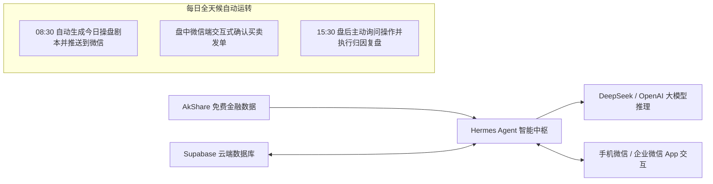

# WealthSail MVP 快速构建与实战指南 (Windows + 企业微信 + Hermes Agent)

> **文档版本**：v1.1.0 (企业微信自建应用版)  
> **编写日期**：2026-08-22  
> **适用对象**：初学者、量化与 AI 开发者、个人独立投资者  
> **核心目标**：在 Windows 环境下，以 **国内网络直连、微信/企业微信原生接收、零前端手写成本、零数据库运维负担** 的极简方式，基于 **Hermes Agent + Supabase + AkShare + 企业微信自建应用** 快速跑通全天候智能投研 MVP。

---

## 1. 架构总览与 MVP 闭环目标

本指南带你从 0 开始搭建一个全自动运行的投研助手。无需安装复杂的 Docker，在 Windows 电脑上直接运行，且**国内网络直连（无需科学上网）**，在微信/企业微信 App 即可直接接收研报与交互：



### 为什么选择“企业微信自建应用”？
1. **国内直连，无需翻墙**：彻底摆脱 Telegram 等海外软件的网络连接困扰。
2. **微信原生互通**：只需在企业微信开启“微信插件”，即可在**普通个人微信**内直接接收早盘预案卡片并交互！
3. **个人完全免费**：任何个人仅需手机号实名即可 1 分钟免费创建企业微信，无需企业营业执照。

### MVP 核心交付成果
1. **跨设备资产与自选股管理**：数据保存在 Supabase 云端，支持随时增删改查持仓与自选股。
2. **一键 AI 深度诊股**：在微信/企业微信聊天框输入股票代码，自动抓取 K 线、资讯与估值，输出专业诊断与支撑/压力位。
3. **08:30 盘前全自动预案推送**：每天早晨自动抓取昨夜美股、A50 期指与隔夜公告，生成 If-Then 操盘剧本推送到微信。
4. **15:30 盘后互动复盘**：收盘后 Agent 主动质询今日操作并归因，若超时未回复自动归档，绝不反复打扰。

---

## 2. 第一步：环境准备与基础工具安装

### 2.1 安装 Python 3.12+
1. 前往 Python 官网下载并安装 [Python 3.12+ for Windows](https://www.python.org/downloads/)。
2. **极其重要**：安装界面务必勾选 **“Add python.exe to PATH”**。
3. 打开 PowerShell 终端，验证安装成功：
   ```powershell
   python --version
   pip --version
   ```

### 2.2 安装金融数据、数据库与企业微信依赖库
在 PowerShell 中运行以下命令：
```powershell
pip install --upgrade akshare supabase pandas requests pydantic fastapi uvicorn cryptography
```

### 2.3 在 Windows 下安装 Hermes Agent

Hermes Agent (Nous Research 开源) 是本系统的智能调度中枢。支持以下两种安装方式：

#### 方式 A：使用官方 Desktop 桌面安装包 (最推荐新手)
1. 访问 Hermes Agent 官网下载 Windows 安装包：[https://hermes-agent.nousresearch.com/](https://hermes-agent.nousresearch.com/)
2. 双击 `.exe` 安装包，按照向导完成安装。

#### 方式 B：使用原生 PowerShell 一键脚本安装 (CLI 开发者)
打开 PowerShell 终端，运行：
```powershell
iex (irm https://raw.githubusercontent.com/NousResearch/hermes-agent/main/scripts/install.ps1)
```
*安装完成后，**关闭并重新打开** 一个新的 PowerShell 终端，输入 `hermes --version` 验证安装成功。*

### 2.4 配置大模型 API Key
在 PowerShell 中运行 Hermes 初始化配置向导：
```powershell
hermes setup
```
或者直接在用户目录下的配置文件 `C:\Users\<你的用户名>\.hermes\.env` 中添加你的大模型密钥（以 DeepSeek 为例）：
```ini
# 配置大模型厂商与密钥 (推荐 DeepSeek-V3/R1，性价比极高且中文投研能力强)
OPENAI_API_KEY="sk-xxxxxxxxxxxxxxxxxxxxxxxxxxxxxxxx"
OPENAI_BASE_URL="https://api.deepseek.com/v1"
HERMES_MODEL="deepseek-chat"
```

---

## 3. 第二步：云端数据库一键初始化 (Supabase)

为了让手机、PC 多端能随时随地读取持仓与历史研报，且无需在本地搭建维护数据库，我们选用 **Supabase**（免费 PostgreSQL 云服务）。

### 3.1 创建 Supabase 免费项目
1. 访问 [https://supabase.com/](https://supabase.com/) 并使用 GitHub 账号登录。
2. 点击 **“New project”**，填写项目名称（如 `WealthSail-DB`），设置数据库密码并选择亚太地区节点（如 `Singapore` 或 `Tokyo`）。
3. 项目创建约需 1~2 分钟。

### 3.2 一键执行 MVP 数据表 DDL
进入 Supabase 左侧菜单的 **“SQL Editor”**，点击 **“New query”**，将以下精简版 MVP DDL 粘贴进去并点击右下角 **“Run”** 执行：

```sql
-- 1. 启用向量扩展 (为后续自进化记忆准备)
CREATE EXTENSION IF NOT EXISTS vector;

-- 2. 用户账户资金表
CREATE TABLE IF NOT EXISTS portfolio (
    id UUID PRIMARY KEY DEFAULT gen_random_uuid(),
    total_capital NUMERIC(15, 2) NOT NULL DEFAULT 100000.00,
    available_cash NUMERIC(15, 2) NOT NULL DEFAULT 100000.00,
    updated_at TIMESTAMPTZ DEFAULT NOW()
);

-- 3. 持仓明细表
CREATE TABLE IF NOT EXISTS positions (
    id UUID PRIMARY KEY DEFAULT gen_random_uuid(),
    symbol VARCHAR(32) NOT NULL,
    stock_name VARCHAR(64),
    market VARCHAR(16) NOT NULL CHECK (market IN ('A', 'HK', 'US')),
    avg_cost NUMERIC(15, 4) NOT NULL,
    quantity INT NOT NULL CHECK (quantity > 0),
    ai_stop_loss NUMERIC(15, 4),
    ai_take_profit NUMERIC(15, 4),
    updated_at TIMESTAMPTZ DEFAULT NOW()
);

-- 4. 自选关注表
CREATE TABLE IF NOT EXISTS watchlists (
    id UUID PRIMARY KEY DEFAULT gen_random_uuid(),
    symbol VARCHAR(32) NOT NULL UNIQUE,
    stock_name VARCHAR(64),
    market VARCHAR(16) NOT NULL,
    notes TEXT,
    latest_ai_sentiment VARCHAR(16) DEFAULT 'neutral',
    created_at TIMESTAMPTZ DEFAULT NOW()
);

-- 5. 出局规则绑定表
CREATE TABLE IF NOT EXISTS exit_rules (
    id UUID PRIMARY KEY DEFAULT gen_random_uuid(),
    symbol VARCHAR(32) NOT NULL,
    rule_type VARCHAR(32) NOT NULL,
    rule_params JSONB NOT NULL,
    is_triggered BOOLEAN DEFAULT FALSE,
    created_at TIMESTAMPTZ DEFAULT NOW()
);

-- 6. AI 操盘预案与建议记录表
CREATE TABLE IF NOT EXISTS ai_suggestions (
    id UUID PRIMARY KEY DEFAULT gen_random_uuid(),
    symbol VARCHAR(32),
    market VARCHAR(16) NOT NULL DEFAULT 'A',
    report_type VARCHAR(32) NOT NULL,
    suggested_action VARCHAR(16),
    target_price NUMERIC(15, 4),
    support_price NUMERIC(15, 4),
    resistance_price NUMERIC(15, 4),
    if_then_plan JSONB,
    logic_summary TEXT,
    status VARCHAR(16) DEFAULT 'pending',
    created_at TIMESTAMPTZ DEFAULT NOW()
);

-- 7. 真实成交记录表
CREATE TABLE IF NOT EXISTS trade_logs (
    id UUID PRIMARY KEY DEFAULT gen_random_uuid(),
    symbol VARCHAR(32) NOT NULL,
    actual_action VARCHAR(16) NOT NULL,
    executed_price NUMERIC(15, 4) NOT NULL,
    executed_qty INT NOT NULL,
    execution_notes TEXT,
    executed_at TIMESTAMPTZ DEFAULT NOW()
);

-- 8. 向量记忆表 (反思沉淀)
CREATE TABLE IF NOT EXISTS vector_memory (
    id UUID PRIMARY KEY DEFAULT gen_random_uuid(),
    content TEXT NOT NULL,
    tags TEXT[],
    created_at TIMESTAMPTZ DEFAULT NOW()
);

-- 插入一条初始测试资金数据
INSERT INTO portfolio (total_capital, available_cash) 
SELECT 100000.00, 100000.00 WHERE NOT EXISTS (SELECT 1 FROM portfolio);
```

### 3.3 获取 Supabase 连接密钥
1. 点击左侧设置 **Project Settings -> API**。
2. 复制 **Project URL**（如 `https://xyzcompany.supabase.co`）。
3. 复制 **anon / public key** 或 **service_role key**。
4. 将它们配置进 `C:\Users\<你的用户名>\.hermes\.env`：
   ```ini
   SUPABASE_URL="https://你的项目ID.supabase.co"
   SUPABASE_KEY="你的Supabase密钥"
   ```

---

## 4. 第三步：创建与配置企业微信自建应用

企业微信自建应用是接收研报与进行人机确认的最佳通道。

### 4.1 注册并登录企业微信后台 (个人免费)
1. 电脑访问 [企业微信官网](https://work.weixin.qq.com/) 并注册（个人随便填一个团队名即可，如 `WealthSail投研实验室`）。
2. 使用手机微信扫描二维码登录管理后台。

### 4.2 获取企业 ID (`CORP_ID`)
- 在管理后台顶部导航点击 **“我的企业”**，滑动到页面最下方，复制 **“企业ID”**（如 `ww1234567890abcdef`）。

### 4.3 创建自建应用并获取 `AgentId` 与 `Secret`
1. 点击顶部导航 **“应用管理”** $\rightarrow$ 页面下滑到 **“自建”** $\rightarrow$ 点击 **“创建应用”**。
2. 填写应用信息：
   - **应用名称**：`WealthSail 投研助手`
   - **应用 Logo**：上传一个投资/船帆图标
   - **可见范围**：选择你自己（或你的部门）
3. 点击 **“创建应用”** 成功后，进入该应用详情页：
   - 记录 **`AgentId`**（如 `1000002`）；
   - 点击 Secret 后方的 **“查看”**，在手机企业微信上确认后，复制获取到的 **`Secret`**。

### 4.4 开启微信互通（让你在普通微信中直接接收消息）
1. 在企业微信后台点击 **“我的企业” $\rightarrow$ “微信插件”**。
2. 用你的**个人微信**扫描页面上的“邀请关注”二维码。
3. 关注成功后，未来所有投研预案和交互消息就会直接出现在你的**个人微信聊天列表**中，体验与公众号无异！

### 4.5 保存企业微信配置到环境变量
将上述获取的信息追加到 `C:\Users\<你的用户名>\.hermes\.env` 中：
```ini
WECOM_CORPID="ww1234567890abcdef"
WECOM_CORPSECRET="your_wecom_application_secret_here"
WECOM_AGENTID=1000002
WECOM_TOUSER="@all"
```

---

## 5. 第四步：编写自定义 Python Tools (金融抓取 + 数据库 + 企微推送)

打开目录 `C:\Users\<你的用户名>\.hermes\tools\`，新建以下三个 Python 工具文件：

### 5.1 编写企业微信推送工具：`wecom_tools.py`
创建文件 `C:\Users\<你的用户名>\.hermes\tools\wecom_tools.py`：

```python
"""
WeCom (WeChat Work) Push Tool for WealthSail MVP.
负责向企业微信 / 个人微信推送 Markdown 格式的操盘预案与交互卡片。
"""
import os
import requests
import json

def get_wecom_access_token() -> str:
    """获取企业微信调用的 access_token"""
    corp_id = os.getenv("WECOM_CORPID", "")
    secret = os.getenv("WECOM_CORPSECRET", "")
    if not corp_id or not secret:
        raise ValueError("请在 ~/.hermes/.env 中配置 WECOM_CORPID 和 WECOM_CORPSECRET")
    
    url = f"https://qyapi.weixin.qq.com/cgi-bin/gettoken?corpid={corp_id}&corpsecret={secret}"
    resp = requests.get(url, timeout=10).json()
    if resp.get("errcode") != 0:
        raise RuntimeError(f"获取微信 Access Token 失败: {resp.get('errmsg')}")
    return resp.get("access_token", "")

def send_wecom_message(content: str, msg_type: str = "markdown") -> str:
    """
    向企业微信自建应用发送消息（支持 Markdown 格式与文本格式）。
    
    Args:
        content: 推送内容，支持标准 Markdown 语法（标题、粗体、列表、颜色）
        msg_type: 消息类型，默认为 'markdown'，也可为 'text'
        
    Returns:
        发送结果状态说明
    """
    try:
        token = get_wecom_access_token()
        agent_id = int(os.getenv("WECOM_AGENTID", "1000002"))
        to_user = os.getenv("WECOM_TOUSER", "@all")
        
        url = f"https://qyapi.weixin.qq.com/cgi-bin/message/send?access_token={token}"
        
        if msg_type == "markdown":
            payload = {
                "touser": to_user,
                "msgtype": "markdown",
                "agentid": agent_id,
                "markdown": {
                    "content": content
                },
                "enable_duplicate_check": 0
            }
        else:
            payload = {
                "touser": to_user,
                "msgtype": "text",
                "agentid": agent_id,
                "text": {
                    "content": content
                }
            }
            
        res = requests.post(url, json=payload, timeout=10).json()
        if res.get("errcode") == 0:
            return "✅ 消息已成功推送至微信/企业微信！"
        else:
            return f"❌ 推送微信失败: {res.get('errmsg')}"
    except Exception as e:
        return f"发送企业微信消息异常: {str(e)}"
```

### 5.2 编写金融数据工具：`finance_tools.py`
创建文件 `C:\Users\<你的用户名>\.hermes\tools\finance_tools.py`：

```python
"""
Finance Data Tools for WealthSail MVP.
基于 AkShare 抓取 A股/港股/美股行情、隔夜外盘与新闻资讯。
"""
import akshare as ak
import pandas as pd

def get_stock_kline(symbol: str, market: str = "A", days: int = 20) -> str:
    """
    获取指定股票最近 N 个交易日的日 K 线数据（开高低收量）。
    
    Args:
        symbol: 股票代码，如 A股 '600519', 港股 '00700', 美股 'AAPL'
        market: 市场类型，可选 'A', 'HK', 'US'
        days: 获取天数，默认 20 天
    """
    try:
        if market.upper() == "A":
            df = ak.stock_zh_a_hist(symbol=symbol, period="daily", adjust="qfq")
        elif market.upper() == "HK":
            df = ak.stock_hk_hist(symbol=symbol, period="daily", adjust="qfq")
        else:
            df = ak.stock_us_hist(symbol=symbol, period="daily", adjust="qfq")
            
        if df.empty:
            return f"未能获取到标的 {symbol} 的 K 线数据。"
            
        df_recent = df.tail(days)
        summary = f"=== 【{symbol}】近 {len(df_recent)} 个交易日行情 ===\n"
        for _, row in df_recent.iterrows():
            date_str = str(row.get('日期', row.get('date', '')))[:10]
            close_price = row.get('收盘', row.get('close', 0))
            pct_change = row.get('涨跌幅', row.get('pct_chg', 0))
            vol = row.get('成交量', row.get('volume', 0))
            summary += f"[{date_str}] 收盘: {close_price}, 涨跌幅: {pct_change}%, 成交量: {vol}\n"
        return summary
    except Exception as e:
        return f"获取 K 线数据出错: {str(e)}"

def get_overnight_macro_data() -> str:
    """盘前抓取隔夜外盘核心数据（美股三大指数、大宗商品、宏观表现）。"""
    try:
        report = "=== 隔夜外盘与宏观风向标 ===\n"
        try:
            global_df = ak.stock_us_famous_spot_em()
            report += f"美股重点科技龙头表现:\n{global_df[['名称', '最新价', '涨跌幅']].head(5).to_string(index=False)}\n\n"
        except Exception:
            report += "美股行情数据平稳或抓取超时。\n"
        return report
    except Exception as e:
        return f"获取隔夜外盘数据出错: {str(e)}"

def get_stock_news(symbol: str) -> str:
    """获取指定股票最新的 5 条重要财经资讯与公告。"""
    try:
        news_df = ak.stock_news_em(symbol=symbol)
        if news_df.empty:
            return f"标的 {symbol} 最近 24 小时无重大异动新闻。"
        
        top_news = news_df.head(5)
        result = f"=== 【{symbol}】最新资讯 ===\n"
        for _, row in top_news.iterrows():
            title = row.get('新闻标题', '')
            pub_time = row.get('发布时间', '')
            result += f"- [{pub_time}] {title}\n"
        return result
    except Exception as e:
        return f"获取个股资讯出错: {str(e)}"
```

### 5.3 编写 Supabase 数据存取工具：`db_tools.py`
创建文件 `C:\Users\<你的用户名>\.hermes\tools\db_tools.py`：

```python
"""
Database & Portfolio Tools for WealthSail MVP.
基于 Supabase 进行持仓、自选股读写与交易记录落盘。
"""
import os
from supabase import create_client, Client

def get_supabase_client() -> Client:
    url = os.getenv("SUPABASE_URL", "")
    key = os.getenv("SUPABASE_KEY", "")
    if not url or not key:
        raise ValueError("请在 ~/.hermes/.env 中配置 SUPABASE_URL 和 SUPABASE_KEY")
    return create_client(url, key)

def get_user_portfolio() -> str:
    """查询用户当前的总资产、可用资金以及所有持仓股票明细。"""
    try:
        supabase = get_supabase_client()
        p_res = supabase.table("portfolio").select("*").execute()
        cash_info = p_res.data[0] if p_res.data else {"total_capital": 0, "available_cash": 0}
        
        pos_res = supabase.table("positions").select("*").execute()
        positions = pos_res.data or []
        
        result = f"=== 账户资产大盘 ===\n总资金: {cash_info.get('total_capital')} 元 | 可用现金: {cash_info.get('available_cash')} 元\n\n=== 当前持仓列表 ===\n"
        if not positions:
            result += "暂无任何持仓标的。\n"
        else:
            for p in positions:
                result += f"• [{p['market']}] {p['stock_name']}({p['symbol']}): 成本 {p['avg_cost']}, 持股 {p['quantity']}股, 止损价 {p.get('ai_stop_loss', '未设')}\n"
        return result
    except Exception as e:
        return f"读取资产数据失败: {str(e)}"

def get_user_watchlists() -> str:
    """查询用户关注的自选股/基金列表。"""
    try:
        supabase = get_supabase_client()
        res = supabase.table("watchlists").select("*").execute()
        items = res.data or []
        if not items:
            return "自选关注列表中暂无股票。"
        result = "=== 自选关注列表 ===\n"
        for item in items:
            result += f"• [{item['market']}] {item['stock_name']}({item['symbol']}) - 关注原因: {item.get('notes', '无')}\n"
        return result
    except Exception as e:
        return f"查询自选股失败: {str(e)}"

def record_trade_log(symbol: str, action: str, price: float, quantity: int, notes: str = "") -> str:
    """记录真实买卖交易并落盘到 Supabase。"""
    try:
        supabase = get_supabase_client()
        supabase.table("trade_logs").insert({
            "symbol": symbol,
            "actual_action": action,
            "executed_price": price,
            "executed_qty": quantity,
            "execution_notes": notes
        }).execute()
        return f"✅ 已成功记录交易：{action} {symbol}，成交价 {price} 元，数量 {quantity} 股。"
    except Exception as e:
        return f"记录交易失败: {str(e)}"

def save_ai_suggestion(symbol: str, report_type: str, action: str, target_price: float, logic_summary: str) -> str:
    """持久化 AI 生成的预案或建议至 Supabase。"""
    try:
        supabase = get_supabase_client()
        supabase.table("ai_suggestions").insert({
            "symbol": symbol,
            "report_type": report_type,
            "suggested_action": action,
            "target_price": target_price,
            "logic_summary": logic_summary,
            "status": "pending"
        }).execute()
        return "✅ AI 建议预案已成功存档至云端。"
    except Exception as e:
        return f"保存建议失败: {str(e)}"
```

---

## 6. 第五步：注入专业投研 Skills (认知 SOP)

在目录 `C:\Users\<你的用户名>\.hermes\skills\` 下创建以下 Skill 文件夹与 Markdown 文件：

### 6.1 盘前剧本与企业微信推送 Skill
创建文件夹 `C:\Users\<你的用户名>\.hermes\skills\premarket_briefing\`并在其中新建 `SKILL.md`：

```markdown
---
name: premarket_briefing
description: 每日盘前 08:30 自动抓取外盘与持仓自选，生成 If-Then 操盘剧本并通过企业微信推送到手机
---

# 盘前推演与 If-Then 预案分析 SOP

当你被要求执行每日盘前简报时，请严格按照以下步骤执行：

1. **读取资产与关注列表**：
   - 首先调用 `get_user_portfolio` 获取用户持仓；
   - 调用 `get_user_watchlists` 获取用户关注的自选股。

2. **拉取多源市场数据**：
   - 调用 `get_overnight_macro_data` 分析隔夜美股与宏观风向；
   - 针对用户持仓和自选股中的每一个标的，调用 `get_stock_kline(symbol, days=15)` 获取最新量价趋势；
   - 调用 `get_stock_news(symbol)` 检查昨夜是否有减持、预增等突发公告。

3. **生成结构化操盘剧本**：
   对于重点标的，必须明确给出：
   - **支撑位与阻力位**（基于近 15 日量价高低点与均线）；
   - **今日 If-Then 操盘对策**（如：“*若冲高至 385 承压，减仓 30%；若回调至 368 企稳，加仓 20%*”）；
   - **操作方向评级**：看多 (BULLISH) / 看空 (BEARISH) / 观望 (NEUTRAL)。

4. **持久化与微信推送**：
   - 调用 `save_ai_suggestion` 将生成的建议保存到 Supabase；
   - 组装一份高颜值的 Markdown 报告，调用 `send_wecom_message(content, msg_type="markdown")` 直接推送到用户的微信/企业微信中！
```

### 6.2 盘后互动复盘 Skill
创建文件夹 `C:\Users\<你的用户名>\.hermes\skills\postmarket_review\`并在其中新建 `SKILL.md`：

```markdown
---
name: postmarket_review
description: 每日收盘后 (15:30) 主动询问用户今日操作，执行即日买卖归因或被动持仓扫描复盘
---

# 盘后互动式复盘 SOP

当你触发盘后复盘任务时，请按以下逻辑执行：

1. **第一步：主动向微信发送问询**：
   - 调用 `send_wecom_message` 发送通知：“*🔔 今日市场已收盘。请问您今天是否有执行买卖操作？（若有，请在聊天框回复股票代码、买卖方向与成交价；若无操作请回复‘无’）*”

2. **第二步：根据用户反馈分支处理**：
   - **分支 A（用户回复了操作）**：
     - 调用 `record_trade_log` 将成交数据写入数据库；
     - 自动对比今日早盘给出的 If-Then 预案，评估用户是“严格执行纪律”还是“冲动追涨/恐慌卖出”，生成知行合一点评并推送到微信。
   - **分支 B（用户回复‘无操作’）**：
     - 调用 `get_user_portfolio` 与 `get_user_watchlists`；
     - 扫描持仓与自选股今日表现，指出是否有标的已回调到买点或跌破止损位，给出明日应对提示并推送微信。
   - **分支 C（用户超过 2 小时未回复）**：
     - 自动执行被动持仓复盘并归档，不持续轮询或发送骚扰消息。
```

---

## 7. 第六步：配置 Cron 自动化调度与微信双向服务

### 7.1 配置 Hermes 内置 Cron 盘前与盘后自动化
为了让 Hermes Agent 每天自动触发，在 PowerShell 中执行：

```powershell
# 1. 配置工作日 (周一至周五) 早上 08:30 自动生成盘前剧本并推送到微信
hermes cron add --name "morning_briefing" --schedule "30 8 * * 1-5" --prompt "执行 premarket_briefing Skill，分析持仓和自选股，生成今日盘前剧本并推送到企业微信"

# 2. 配置工作日收盘后 15:30 自动发起复盘问答
hermes cron add --name "afternoon_review" --schedule "30 15 * * 1-5" --prompt "执行 postmarket_review Skill，主动发起盘后复盘问询并推送到企业微信"
```

### 7.2 启动极简微信双向会话服务（可选：支持在微信中直接回复对话）
如果你希望直接在微信聊天框向 Hermes 发送指令（如“*帮我诊股 00700*”），可以使用下面的极简 FastAPI 微信网关：

在项目目录下创建 `wecom_gateway.py`：
```python
"""
WeCom Inbound Callback Gateway for WealthSail.
接收用户在企业微信发送的消息，转发给 Hermes 处理后回复。
"""
from fastapi import FastAPI, Request
import uvicorn
import subprocess
from tools.wecom_tools import send_wecom_message

app = FastAPI(title="WealthSail WeCom Gateway")

@app.post("/wecom/callback")
async def wecom_callback(request: Request):
    """接收企业微信消息回调"""
    data = await request.json()
    user_msg = data.get("Content", "").strip()
    if not user_msg:
        return {"status": "ok"}
    
    # 调用本地 Hermes Agent 处理意图
    cmd = f'hermes chat --prompt "{user_msg}"'
    result = subprocess.check_output(cmd, shell=True, text=True, encoding="utf-8")
    
    # 将处理结果推回微信
    send_wecom_message(result)
    return {"status": "success"}

if __name__ == "__main__":
    uvicorn.run(app, host="0.0.0.0", port=8000)
```

---

## 8. 第七步：端到端实战验证全流程

现在，所有配置均已就绪！请执行以下 3 个实战场景验证：

### 实战场景 1：手动触发一次盘前推演并推送到微信
- **操作**：在 PowerShell 终端运行：
  ```powershell
  hermes chat --prompt "执行 premarket_briefing Skill，帮我分析持仓自选并立即推送到企业微信"
  ```
- **微信端呈现效果（实时收到卡片消息）**：
  > 🌅 **【WealthSail 今日操盘剧本与点位】** 2026-08-22  
  > --------------------------------------------------  
  > 📊 **隔夜外盘风向**：中概金龙指数 +1.8%，A50 期指夜盘平稳，外部流动性中性偏多。  
  >  
  > 🎯 **重点持仓应对策略**：  
  > • **【腾讯控股 (00700)】**  
  >   - **支撑位**: `375.00 元` | **阻力位**: `392.00 元`  
  >   - **If-Then 预案**: 今日若高开冲过 390 建议持有观望；若回踩 378 获得支撑可顺势加仓 20%。  
  >   - **止损底线**: `365.00 元`（破位严格止损）。  
  >  
  > 💡 **今日纪律**：控制总仓位在 50% 以内，严禁盘中追高急拉标的。  
  > *(预案已同步存入 Supabase 云端数据库)*

### 实战场景 2：在终端执行一键 AI 深度诊股
- **操作**：在 PowerShell 中运行：
  ```powershell
  hermes chat --prompt "帮我诊断一下贵州茅台 600519，分析近20日技术面，并将建议推送到微信"
  ```
- **执行效果**：Agent 自动抓取茅台 20 日 K 线与公告，推算支撑位 1380 元、压力位 1450 元，并将详细研报秒级推送到你的微信中！

### 实战场景 3：人机协同记录交易与出局止损规则
- **操作**：在终端输入：
  ```powershell
  hermes chat --prompt "我刚才以 380 元买入了 100 股腾讯控股，帮我记录到交易日志，并设定止损价 365 元"
  ```
- **执行效果**：数据精准落盘至 Supabase 的 `trade_logs` 与 `positions` 表中，微信收到确认消息：*“✅ 已成功记录买入腾讯 100 股，止损位 365 元已激活监控。”*

---

## 9. 常见问题排查 (FAQ)

| 异常现象 | 排查原因 | 解决方案 |
| :--- | :--- | :--- |
| 微信推送报错 `errcode: 60020 (IP not in whitelist)` | 企业微信自建应用配置了 IP 白名单限制 | 进入企微后台自建应用详情页，在 **“企业可信 IP”** 中填入你的公网 IP 或删除 IP 白名单限制。 |
| 微信推送报错 `errcode: 40001 (invalid credential)` | `WECOM_CORPSECRET` 填写错误或已重置 | 登录企微后台重新获取 Secret 并更新 `~/.hermes/.env`。 |
| Supabase 报错 `KeyError: SUPABASE_URL` | 未在环境变量中配置连接串 | 检查 `C:\Users\<用户名>\.hermes\.env` 文件是否存在且变量名无拼写错误。 |
| `akshare` 抓取数据超时 | 国内部分财经源网络波动 | 重新执行或更新库版本：`pip install --upgrade akshare`。 |

---

## 10. 总结与后续演进

恭喜！通过本指南，你已经在 Windows 上搭建起了一套**国内直连、微信原生接收、具备真实量化数据抓取与云端持久化记忆**的智能投研 MVP。

- **阶段总结**：当前版本 100% 满足了 [01. 需求文档](file:///d:/develop/gitee/WealthSail/docs/01.WealthSail投研平台需求文档.md) 规定的 MVP 核心目标。
- **后续演进**：
  1. 接入 [02. 架构评估文档](file:///d:/develop/gitee/WealthSail/docs/02.WealthSail投研平台全栈技术选型与架构评估.md) 规划的 Next.js Web 专业看板；
  2. 将本套环境打包为 `docker-compose` 部署至 NAS 或云服务器，实现 7x24 小时无人值守全自动化运行！
