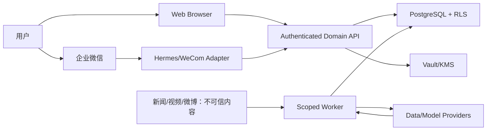

# WealthSail 安全、隐私与合规设计（v2.0）

> 适用范围：个人自用与 2–3 用户封闭试点；公开或收费服务必须重新完成合规 Gate
>
> 安全原则：默认拒绝、最小权限、租户双层隔离、金融副作用需确定性控制和完整审计
>
> 本文不是法律意见，业务公开化或收费前应取得中国大陆证券、网络、数据和知识产权专业意见

## 1. 运行模式和合规 Gate

### 1.1 模式 A：个人自用

单一实际控制人、本地/私有使用。仍需数据许可、密钥安全、备份、隐私和风险提示，但不向他人提供收费建议。

### 1.2 模式 B：2–3 用户封闭试点（MVP）

仅限受邀用户，禁止公开注册和收费；每位用户独立 tenant。功能定位为研究整理、组合记录和决策辅助，不代客管理，不自动下单，不承诺收益。

试点必须：

- 明确试用协议、风险、数据处理和退出/删除；
- 记录用户主动提供的持仓和研究资料；
- 对具体证券结论展示证据、时点、不确定性和适用约束；
- 保留用户确认/纠正/未执行记录；
- 有安全事故和用户投诉处理人。

### 1.3 模式 C：公开或收费 SaaS

进入本模式前必须暂停公开发布并完成：

- 证券投资咨询业务边界、主体资质或持牌合作模式法律意见；
- 投资者适当性、风险揭示、利益冲突、营销文案、记录留存和投诉机制；
- 个人信息保护影响评估、委托处理者和跨境/模型 Provider 分析；
- 所有行情、基金、公告、新闻和媒体内容的商业许可；
- 渗透、灾备、审计、模型治理和服务级别验证。

免责声明不能替代上述控制。

## 2. 资产与威胁模型

### 2.1 关键资产

- 用户身份、联系方式和企业微信绑定；
- 账户、持仓、现金、成本、交易、分红和费税；
- 投资论点、关注清单、报告、对话和决策；
- 模型 Prompt/Skill、工具调用和评估数据；
- Provider、企业微信、数据库和部署密钥；
- 视频/微博等来源内容、转写、观点和权利状态；
- 审计、备份和运维信息。

### 2.2 主要攻击者/失效源

- 试图访问其他用户数据的普通用户；
- 被盗 Web/企业微信会话或绑定码；
- 恶意新闻、网页、视频转写中的 Prompt 注入；
- 配置错误或持有高权限密钥的 Agent/Worker；
- 被入侵的依赖、Provider 或 CI；
- 内部误操作、重复任务和非恶意错配 tenant；
- 模型幻觉、错误工具参数和越权请求；
- 数据接口变更、陈旧、冲突和错误修订。

## 3. 信任边界



可信边界是 Domain API/受控 Worker，不是浏览器、渠道、Agent Runtime 或模型。

## 4. 权限矩阵

| Actor | 允许 | 明确禁止 |
|---|---|---|
| Browser 用户 | 本 tenant 的受控 API；本人 Web 会话 | service role、任意 tenant 参数、直接 Worker/Provider secret |
| 企业微信用户 | 绑定 tenant 的查询、确认、纠正 | 群聊默认读取资产、替他人绑定、任意数据库操作 |
| Hermes/Channel Adapter | 验证渠道身份后调用 scoped API；发送 Outbox 消息 | 直接数据库、持有 service role、执行拼接 shell、决定 tenant |
| Domain API | 领域事务、授权、RLS 用户上下文、审计 | 信任请求正文 user_id、越过状态机、静默忽略数据质量 |
| Worker | 执行指定 job/provider/model/outbox；最小 DB 权限 | 交互登录、任意租户批量导出、自动发布 Skill/订单 |
| Model Provider | 获取任务所需最小脱敏上下文 | 获得登录/渠道/数据库密钥和不相关 tenant 数据 |
| Data Provider | 接收必要 instrument/query | 获得用户身份、持仓全量或论点，除非合同和目的明确 |
| Migration role | CI/CD 执行签名 migration | 运行时使用、Agent 使用 |
| Operator | 经审批的运维和审计 | 直接修改账本、关闭审计、共享密钥 |

## 5. 身份、会话与企业微信绑定

### 5.1 Web 会话

- 使用成熟 Auth/OIDC；短期 access token + 安全 refresh；
- Cookie 使用 Secure、HttpOnly、SameSite；
- 高风险操作重新认证或二次确认；
- 注销、密码/身份变更和用户停用立即撤销会话；
- API 从已验证 token 解析 `user_id`，再查询 active tenant membership。

### 5.2 企业微信绑定

绑定流程：

1. 已登录 Web 用户请求绑定；
2. 后端生成至少 10 个随机字符、高熵、一次性、短期 binding token，只保存带服务端密钥的摘要；
3. 用户在企业微信私聊机器人提交；
4. Adapter 验证渠道身份、allowlist、token、过期、尝试次数和未消费；
5. 后端事务写入绑定并消费 token；
6. Web 和企业微信均通知，记录审计；
7. 用户可从任一已认证渠道撤销。

控制：

- 默认 15 分钟内过期、一次性、每用户/来源限速；安全策略可缩短但不能无上限延长；
- token 不包含 user/tenant 明文；
- 已绑定冲突需 Web 端重新确认，不能自动覆盖；
- 群聊默认不展示个人资产，MVP 建议禁用群聊财务查询；
- 外部用户 ID 加密或 keyed hash 索引；
- 防重放：message ID + timestamp/nonce + 幂等窗口。

### 5.3 Hermes/WeCom

优先使用官方 WeCom Adapter 的 allowlist/pairing、重连和去重能力。配置 secret 进入受控环境/Vault，不写文档、Git、前端或聊天。禁止：

```text
把用户消息插入 shell 调用参数
Agent 读取 service role
WECOM_TOUSER=@all 推送个人资产
默认 open DM/group policy
```

## 6. 租户隔离

### 6.1 双层防御

1. 应用鉴权：领域服务从会话解析 tenant，所有 repository 方法要求 `TenantContext`；
2. PostgreSQL RLS：tenant 表 `ENABLE` + `FORCE ROW LEVEL SECURITY`，读取 policy 通过 active membership，写入 policy 还必须检查 OWNER/ADMIN/EDITOR 角色或由受控后端角色执行。

RLS 是共享数据库中的逻辑行隔离，不是物理分库。缓存 key、对象存储路径、搜索/向量 namespace、队列和日志查询也必须包含 tenant；复合外键必须验证父子资源属于同一 tenant。RLS 不能保护外部缓存、错误拼装的模型上下文或持有 BYPASSRLS/service-role 的进程。

### 6.2 写入权限基线

| 数据类别 | 普通成员 | EDITOR | OWNER/ADMIN | Domain API / Worker |
|---|---|---|---|---|
| 账户/论点/风险配置 | 读 | 受限写 | 写/管理 | 校验后写 |
| 决策、成交草稿/确认、账本事件与交易腿 | 读 | 不可直接写 | 不可直接写 | 受控 command 同事务追加；采纳决策不能直接入账 |
| 报告/模型运行/证据/告警事件 | 读 | 不可直接写 | 不可直接写 | 生成、版本化、审计 |
| Outbox/job/audit | 不可直接写 | 不可直接写 | 不可直接写 | 最小权限写；audit append-only |

### 6.3 测试要求

对每种 tenant 资源进行 A/B 用户：list/get/create/update/delete/export/search/vector/cache/notification 测试；service role 和 Worker 凭据单独验证最小权限。新增 tenant 表无 RLS/policy 时 CI 失败。

### 6.4 管理访问

试点运维若需访问用户数据，必须有工单/原因、最小时间窗口、双人批准（条件允许）、审计和用户协议依据。不得使用共享管理员账号。

## 7. 密钥与供应链

### 7.1 Secret 管理

- secret value 只在 Vault/KMS/部署 secret manager；
- 业务表保存 `secret_ref`，日志只显示版本/尾号；
- 开发、测试、生产独立；
- Provider/渠道/数据库使用独立最小权限 secret；
- 定期和事件驱动轮换；旧 secret 可快速撤销；
- CI 运行 secret scan，发现后按泄露处理，不能只从 Git 删除。

### 7.2 依赖

- lockfile 固定、来源校验、依赖更新评审；
- CI 做漏洞与恶意包策略检查；
- 高风险运行时/Agent 升级先 contract/eval/canary；
- 构建产物可追到 commit 和依赖版本；
- 禁止在生产动态安装未经批准的 Skill/包。

## 8. Prompt 注入与模型安全

### 8.1 内容分层

系统指令、开发约束、用户输入、工具结果、新闻/公告/视频/微博内容分别标记。外部内容只能作为 data，不可改变工具权限、身份、系统 Prompt 或输出渠道。

### 8.2 控制

- 内容抽取在无副作用/无高权限工具环境执行；
- 工具使用 allowlist + JSON Schema + 后端授权；
- 数据库/消息/未来订单等敏感工具需确定性校验或人工批准；
- 模型输出经过 schema、引用、数值重算、数据新鲜度和策略检查；
- 检测“忽略指令、导出数据、调用工具”等典型注入；
- 报告证据必须引用来源 snapshot，无法引用则弃权；
- 模型上下文按 tenant 构建，向量检索强制 tenant filter；
- 不把模型生成的代码默认执行。

### 8.3 模型故障

超时、限流、Provider 切换、结构非法、引用缺失、成本超限均有显式状态。Fallback 模型必须满足同一 contract 和评估门槛；不能静默改变模型后继续声称结果等价。

### 8.4 多 Agent（L5，默认关闭）

多 Agent 会增加可接触上下文和工具的主体数量，也会放大跨 Agent Prompt 注入、权限传递、敏感数据复制、循环调用和审计缺口。角色共享模型或检索结果时，不能假设“多数表决”能纠正相关性错误。安全基线要求每个 Agent 使用独立最小工具集、显式 tenant context、调用深度/Token/时间预算和端到端 trace；Agent 间消息视为不可信外部输入。任何跨租户、越权工具、无法复现的事实结论或预算失控立即触发 feature flag 关闭并回退单 Agent。多 Agent 永远无权写成交、账本、风险参数或订单。

## 9. 金融副作用和工作流安全

### 9.1 账本

- 建议采纳只追加 `reporting.decisions`，自然语言交易先生成 `ledger.trade_fills(DRAFT)`；
- 只有用户校对/券商回报确认的 fill 才能在同一事务创建并关联 ledger event；
- 只有 Portfolio Ledger 应用服务可写事件/腿；
- 事件和全部腿同事务；
- idempotency key 唯一；
- 确认后经济字段不可改，使用冲正；
- 导入/Provider 数据先预览和对账，不直接覆盖余额。

### 9.2 报告与推送

- report + evidence + Outbox 同事务；
- 渠道消费幂等并保存外部 message ID；
- 消息展示 tenant 用户可识别信息但避免完整账户号；
- 报告过期/规则取消/持仓已平时取消待发送消息；
- 群聊、转发和截图风险在试点协议/界面提示。

### 9.3 订单（L4）

模型只能产生 recommendation；用户创建 order intent 后依次经过新鲜报价、费税、风险、适当性、人工批准、提交和回报。审批过期、部分成交、拒单、撤单、重复/乱序回报均由状态机处理。真实成交再进入账本。

## 10. 数据许可和媒体权利

### 10.1 金融数据

Provider 台账记录：所有者、用途、商业许可、再分发、频率、SLA、成本、保留、派生品限制和退出。标有“仅学术研究/禁止商业用途”的源不得用于未来收费服务。

### 10.2 视频、微博和其他媒体

- 用户提交链接或经许可 API 优先；不绕过访问控制和反爬；
- 按权利状态决定仅元数据、短摘录、转写或禁止保存；
- 保留平台、账号唯一 ID、原链接、发布时间、时间戳和哈希；
- 明确事实/观点/预测，不将创作者影响力等同准确性；
- 支持删除、撤权和停止新引用；
- 对候选来源“兔主席”“苏涵”等逐一评估账号真实性、授权、利益冲突和主题，不建立默认正确名单。

## 11. 隐私生命周期

### 11.1 数据分类

| 级别 | 示例 | 控制 |
|---|---|---|
| Restricted | 账户/持仓/交易、渠道 ID、密钥 | 加密、严格权限、审计、最短保留 |
| Confidential | 论点、报告、对话、模型输入 | tenant 隔离、脱敏 Provider、导出/删除 |
| Internal | 系统配置、指标、无身份聚合 | 最小访问、保留策略 |
| Public | 已授权公开来源元数据 | 仍遵守许可和完整性 |

### 11.2 处理目的和最小化

每项数据关联目的、法律/协议依据、owner、共享方和保留期。模型只接收完成当前任务所需字段；不得为了“以后可能有用”长期保存完整原始对话或媒体。

### 11.3 用户权利

支持访问、导出、更正、删除、撤销渠道绑定、撤销媒体/文件授权，以及对自动化分析请求解释或提出异议。删除任务覆盖主库、对象存储、搜索/向量和备份过期流程；法定/安全审计保留需说明。

### 11.4 自动化决策透明

界面说明模型、证据、时点、主要限制、是否估算和用户可选动作；用户可以选择不接受建议。不得因用户拒绝自动化分析而无合理理由拒绝基础账本/组合功能。

## 12. 日志、审计和隐私

- 日志不记录 access/refresh token、secret、完整账户号、绑定码、完整持仓 payload；
- 错误消息分用户安全提示和内部诊断；
- 审计追加写，重要记录防篡改/定期校验；
- correlation ID 可串联请求、job、model、report、outbox，但不作为身份凭据；
- 生产调试临时提升日志级别需审批、时限和自动恢复；
- 导出审计也受 tenant 和权限控制。

## 13. 备份、恢复和删除

- 数据库加密备份/PITR，对象存储版本和 Vault 恢复分别测试；
- 备份凭据和生产凭据分离；
- 每季度恢复演练验证 tenant/RLS、账本 cursor、Outbox 和投影重建；
- 删除用户后主库立即逻辑/物理处理，备份按既定周期自然过期并防止普通恢复再次激活；
- 灾难恢复环境也必须使用独立 secret、网络控制和审计。

## 14. 事故响应

### 14.1 分类

- SEV-0：跨租户泄露、密钥泄露、账本大规模错误、未授权下单；
- SEV-1：报告系统性假数据、重要 Provider 污染、企业微信大规模错发；
- SEV-2：单用户延迟/重复、非敏感功能故障。

### 14.2 流程

1. 发现与确认：保留证据，不在公共频道贴敏感信息；
2. 控制：停用 Provider/渠道/工具、撤销 secret、暂停 job；
3. 影响分析：tenant、时间、数据、报告、决策和外部接收者；
4. 修复与恢复：冲正/报告修订、恢复验证、逐步开放；
5. 通知：按合同、法律和用户影响及时说明；
6. 复盘：根因、控制缺口、测试、owner、期限和验证。

## 15. 发布安全 Gate

### 15.1 L0 必须通过

- 所有 tenant 表 RLS + FORCE RLS + policy 自动检查；
- 全资源跨租户测试；
- secret scan 和配置审查；
- binding 过期/复用/限速/撤销测试；
- 账本幂等、冲正、崩溃恢复；
- Prompt 注入和越权工具评估；
- Provider 许可和数据状态；
- 备份恢复和审计查询。

### 15.2 L1 必须通过

- 企业微信 allowlist、私聊、重连、去重、消息过期和错发测试；
- 四时段报告无伪实时值、引用/时点/估算/弃权完整；
- 2–3 用户 E2E 隔离；
- 盘后纠正保留历史；
- 严重依赖漏洞无未接受风险；
- 试用协议、隐私说明、删除/退出和事故联系人可用。

### 15.3 公开/收费前新增 Gate

- 书面法律/牌照或合作结论；
- 适当性和内容审核；
- 商业数据/媒体授权；
- 外部渗透、隐私影响评估、容量和灾备；
- 客服、投诉、利益冲突和记录留存；
- 对外文案不使用“稳赚、精准、保证、自动赚钱”等表达。

## 16. 控制—测试映射摘要

| 风险 | 核心控制 | 主要测试 |
|---|---|---|
| 跨租户 | 会话 tenant + repository context + RLS | A/B 用户全资源 CRUD/search/export |
| service role 泄露 | Vault、backend-only、secret scan | 前端/Agent/env/log/历史扫描 |
| 绑定劫持 | 短期一次性 token、限速、冲突确认 | 过期/复用/并发/撤销/撞库 |
| Prompt 注入 | 内容不可信、工具 allowlist、后端授权 | 新闻/视频/网页恶意 fixture |
| 重复入账/推送 | 唯一幂等键、事务、Outbox | 每个副作用前后 kill/retry |
| 假数据 | 来源、时点、质量、fail-closed | timeout/stale/conflict/schema drift |
| 媒体侵权 | source registry、rights、最小保存、撤权 | restricted/revoked/delete lifecycle |
| 模型漂移 | 版本、Golden eval、固定/批准 fallback | provider switch/schema/citation/cost |
