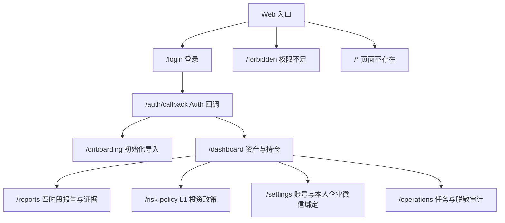
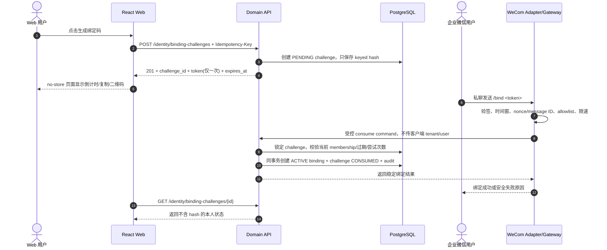
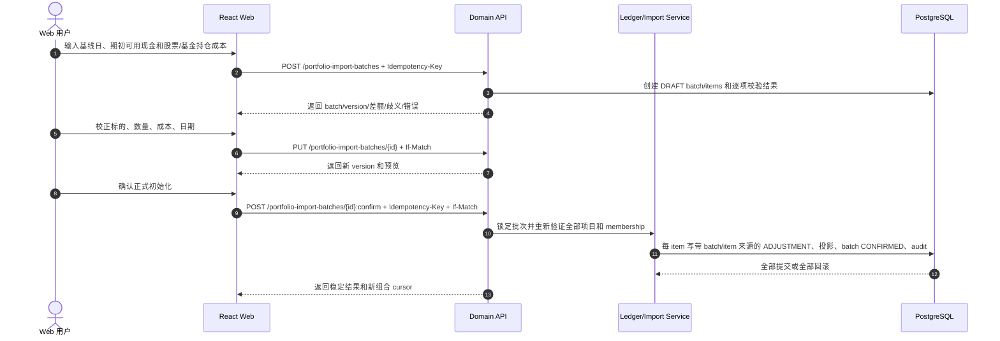
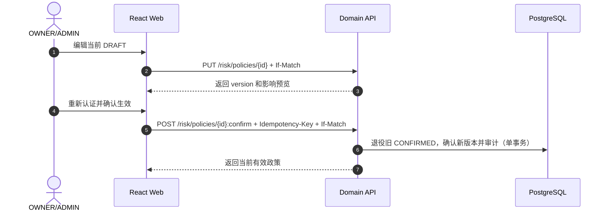

# WealthSail MVP Web 投研工作台设计与实现规范（v2.1）

> **文档版本**：v2.1.1-draft
>
> **编写日期**：2026-08-23
>
> **文档状态**：TARGET / NOT_LIVE；评审修订中。本文定义目标实现，不表示仓库已有完整 Web、FastAPI、Auth 或真实企业微信联调
>
> **适用范围**：L0 可信底座、L1 核心 MVP 的 Web 交互、前端工程和 Domain API 契约
>
> **双端定位**：企业微信负责即时触达、盘中触点、14:30 基金报告和盘后交互；Web 工作台负责注册初始化、组合全景、历史报告与证据、成交校对、L1 风险政策和本人渠道绑定
>
> **关联文档**：[PRD](./01.WealthSail投研平台需求文档.md) · [技术架构](./02.WealthSail投研平台全栈技术选型与架构评估.md) · [实战指南](./03.WealthSail-MVP快速构建与实战指南.md) · [测试规范](./04.WealthSail-MVP功能验收与自动化测试规范.md) · [数据设计](./06.WealthSail数据模型与数据源治理设计.md) · [安全设计](./07.WealthSail安全隐私与合规设计.md) · [追溯矩阵](./08.WealthSail需求设计测试追溯矩阵.md)

---

## 1. 需求映射、范围与交付边界

### 1.1 本文承接的需求

| 需求 ID | Web 责任 | 主要章节 |
|---|---|---|
| `FR-WEB-001` | 登录/初始化、组合、报告、风险、成交确认、本人绑定及完整异常状态 | 2–9 |
| `SEC-TEN-001` | tenant-scoped 会话、服务端授权、缓存和订阅隔离 | 1.4、6.4、7.1、8 |
| `FR-IDN-001` / `SEC-BND-001` | 一次性 binding challenge、绑定状态和软撤销 | 4.4、5.1、7.5 |
| `FR-POR-001` / `FR-IMP-001` | 股票、场内/场外基金、现金通过 `portfolio_import_batches/items` 原子初始化并展示组合 | 3、4.1、5.2、7.2 |
| `DATA-LED-001` / `NFR-IDM-001` | cash/fill/import 职责分离，写操作幂等和终态不可变 | 5.2、7.1–7.2 |
| `FR-RPT-001`–`FR-RPT-004` | 四时段报告归档、证据、决策和成交对账 | 4.2、7.3 |
| `FR-RSK-001` | L1 基准、风险预算、集中度、提醒预算和政策版本 | 4.3、5.3、7.4 |
| `NFR-FIN-001` | Decimal、收益、估值、基准、质量和方法版本 | 3、6.5、7.1 |
| `NFR-ACC-001` / `NFR-MOB-001` | 键盘、读屏、非纯色状态和 360px–4K 响应式 | 2.3、9 |

### 1.2 L1 交付范围

L1 支持：

- A 股股票、场内 ETF/LOF、场外公募基金和 CNY 现金；
- 2–3 个实际用户及其 tenant 数据隔离；
- 08:30 盘前、盘中事件跟踪、14:30 场外基金估值、15:30 盘后交互复盘；
- 企业微信自建应用定向交互；
- 初始化导入、不可变投资事件账本、成交草稿确认、组合投影；
- Web 登录、资产/持仓、历史报告/证据、L1 风险配置和本人企微绑定。

### 1.3 明确不属于 L1 的页面能力

- 页面内即时多租户切换、家庭/团队成员管理：L2；
- 基金底层穿透、跨账户归因、行为金融体检：L2；
- 视频/微博等多媒体内容治理：L3；
- 港美股、债券、黄金/大宗真实行情及其可编辑目标配置：L4；
- 回测、策略 DSL、券商自动下单和订单状态机：L4；
- 多 Agent 和 Skill 自进化：L5，默认关闭。

L1 风险表单不得提交债券、黄金或大宗目标。数据表中的预留列保持 `NULL`，页面若说明路线图，只能显示为禁用且明确标注 L4，不能参与比例求和、报告或建议计算。

### 1.4 多用户与活动租户决策

数据库、RLS 和领域对象保持多租户架构，但 L1 的一个 access token 只绑定一个活动 tenant。登录时后端验证 active membership 后签发 tenant-scoped token；`identity.is_tenant_member(target_tenant)` 只验证已经给定的 tenant，不负责提取或选择 tenant。

若未来同一用户加入多个 tenant，选择新 tenant 必须触发后端重新验证和重新签发 token。前端收到新会话后终止旧请求和订阅，清除旧 tenant Query Cache；不能只在 localStorage 改一个 tenant ID。该取舍降低 L1 实现成本，同时保留 L2 家庭/团队扩展能力。

### 1.5 双端协同职责

| 场景 | 企业微信 ChatOps | Web 工作台 |
|---|---|---|
| 主要使用时机 | 移动碎片时间、即时触达 | 初始化、沉浸式查看、周度复核 |
| 四时段 | 主动推送、按钮/单句回复 | 历史归档、详情、证据与决策对账 |
| 组合 | 轻量查询、盘后询问 | 指标、曲线、持仓、导入和成交草稿 |
| 风险 | 提醒和确认入口 | 草稿配置、差异预览、确认新版本 |
| 渠道 | 接收和回复 | 生成 challenge、查看本人状态、软撤销 |
| 管理运维 | 不承担 | OWNER/ADMIN 可查看脱敏审计和任务摘要 |

---

## 2. 信息架构、角色与体验状态

### 2.1 页面与路由



未完成初始化的用户进入 `/onboarding`；没有当前有效账户、但主动跳过初始化的用户可以进入空态 dashboard。`/operations` 仅 OWNER/ADMIN 可见，不是投资者日常主路径。

### 2.2 角色与服务端授权矩阵

前端隐藏按钮只改善体验，不是授权边界。每个 API command 都必须使用 tenant-scoped 会话在后端重新授权。

| 页面/动作 | VIEWER | EDITOR | ADMIN | OWNER |
|---|---:|---:|---:|---:|
| 查看组合、报告和证据 | 是 | 是 | 是 | 是 |
| 创建/校正初始化草稿 | 否 | 是 | 是 | 是 |
| 确认初始化、出入金和真实成交 | 否 | 是 | 是 | 是 |
| 创建/编辑风险 DRAFT | 否 | 是 | 是 | 是 |
| 确认风险政策生效 | 否 | 否 | 是 | 是 |
| 生成/查看/撤销本人 binding | 是 | 是 | 是 | 是 |
| 操作其他成员 binding | 否 | 否 | 重新认证并审计 | 重新认证并审计 |
| 查看任务摘要与脱敏高风险审计 | 否 | 否 | 是 | 是 |
| 直接写 ledger/report/job/audit 表 | 否 | 否 | 否 | 否 |

### 2.3 全局 UI 状态

每个数据区都必须实现下列状态，不能只实现成功态：

| 状态 | 展示与动作 |
|---|---|
| `LOADING` | 骨架屏保留布局；禁止把旧 tenant 数据当新结果 |
| `EMPTY` | 解释为空原因，给出初始化/清筛选等下一步，不显示零收益伪数据 |
| `FRESH` | 显示 `as_of`、来源或可打开证据 |
| `ESTIMATED` | 明确“估算”，与正式 NAV/收盘值视觉和文本同时区分 |
| `STALE` | 显示陈旧时点、影响和刷新动作；禁止精确操作建议 |
| `UNAVAILABLE/ABSTAINED` | 说明缺失/弃权原因，不渲染虚构图点或默认金额 |
| `OFFLINE/TIMEOUT` | 保留已标时点的缓存只读视图；mutation 不盲目自动重试 |
| `401` | 尝试一次受控 refresh，失败则清会话并回登录 |
| `403` | 清理无权资源缓存，显示权限说明，不泄露对象是否存在 |
| `404` | 当前 tenant 内统一“不存在或不可见” |
| `409/412` | 显示版本冲突，重新拉取并要求用户复核，不覆盖新版本 |
| `429/5xx` | 使用 `Retry-After` 或显式重试；确认类 mutation 先查询幂等结果 |

布局必须覆盖 360px 手机浏览器、平板、桌面和 4K；长中文、大字号、键盘、读屏和弱网属于验收输入。表格在窄屏变为摘要卡片或横向可控滚动，不截断确认、撤销等关键动作。

---

## 3. 金融指标、估值和质量口径

### 3.1 基本不变量

- 后端使用 Decimal/NUMERIC 计算；金额、份额、价格、比例和收益率在 JSON 中使用十进制字符串；
- 所有资产汇总返回 `currency`、`as_of`、`quality_status`、`valuation_method` 和 `method_version`；
- 费税、分红、现金和持仓来自不可变账本及可重建投影，前端不重新计算业务事实；
- 质量聚合按 `UNAVAILABLE > STALE > ESTIMATED > FRESH` 取最弱状态，并返回受影响资产数和市值覆盖率；
- 场外基金盘中估值进入组合时，组合总资产必须标记“估算”，不能显示为正式已确认 NAV。

### 3.2 指标定义

| 指标 | L1 口径 |
|---|---|
| 现金余额 | 已确认 CASH_IN/OUT、买卖、费税、分红等现金腿的确定性投影 |
| 持仓市值 | 数量 × 当前可用行情/正式 NAV；使用基金盘中估算时单项和汇总均标 `ESTIMATED` |
| 当前总资产 | 现金余额 + 持仓市值；无可靠估值的资产单列且整体 `UNAVAILABLE`，不按零计价 |
| 当日盈亏金额 | 当前权益 − 上一交易日收盘权益 − 当日净外部现金流；买卖不是外部现金流 |
| 累计盈亏金额 | 当前权益 + 累计出金 − 累计入金 |
| 组合累计收益率 | 在每次外部现金流处切分子区间并连乘的 TWR；方法版本随结果返回 |
| 年化收益率 | 历史满 365 个自然日后才按 TWR 年化；不足时只显示“成立以来收益” |
| 浮动盈亏 | 当前可估值持仓价值 − 剩余成本；已实现盈亏另列，不混为一个数字 |
| 基准对比 | 使用当前 CONFIRMED 政策中的基准，按相同交易日期和时区对齐；未配置时提示设置，不暗设沪深 300 |

公司行动、复权、基金分红、估值修订和基准修订都必须触发版本化重算并保留 method/source 引用。若外部现金流时间或上一交易日权益缺失，当日收益率返回 `UNAVAILABLE`，不能由前端用近似值补算。

### 3.3 图表精度边界

API DTO 保持字符串。前端使用 Decimal 库做格式化、阈值显示和输入规范化；图表组件只能通过独立 `ChartNumberAdapter` 将已经由后端确定的展示序列转换为 JavaScript Number。该转换只用于像素坐标，不参与告警、收益、比例校验、确认 payload 或回写。

---

## 4. 核心页面详细规格

### 4.1 资产大盘与持仓（`/dashboard`）

#### 顶部指标

- 当前总资产及 FRESH/ESTIMATED/STALE/UNAVAILABLE 标签；
- 可用现金；
- 可估值持仓市值及覆盖率；
- 当日盈亏金额/收益率；
- 累计盈亏、成立以来 TWR；满足时间条件时再显示年化；
- 每个卡片显示统一 `as_of`，混合时点时可展开查看最早/最晚时点。

#### 图表

- 组合净值/TWR 曲线与当前 CONFIRMED 基准；
- 股票、场内基金、场外基金、现金的实际占比；
- 只有存在适用于 L1 的已确认目标时才显示目标偏离，不能使用 DRAFT 或 L4 预留字段；
- 缺点位时断线并显示原因，不用零值连接。

#### 持仓表

字段包含标的代码、名称、类型、数量/份额、剩余成本、最新行情/正式 NAV/估算值、价值、浮动盈亏、权重、`as_of`、质量和来源。支持类型筛选、盈亏/权重排序和分页；默认排序必须稳定。

#### 操作区

- “初始化/批量导入”进入 `/onboarding` 或导入抽屉；
- “出入金登记”创建独立 cash command；
- “成交草稿”只录入已经发生的真实 BUY/SELL，不包含入金；
- “确认入账”展示经济效果预览、幂等请求标识和数据版本，成功后跳转到不可变事件详情；
- 错账使用冲正/更正，不提供“手工改账”或直接编辑确认事件。

### 4.2 四时段报告与决策审计（`/reports`）

#### 筛选与时间轴

- 按交易日期、`PRE_MARKET / INTRADAY / FUND_1430 / POST_MARKET`、标的和关键词筛选；
- cursor 分页，URL 只保存非敏感筛选，不保存 tenant、token 或持仓内容；
- 时间统一显示 Asia/Shanghai，并保留原始 `as_of`/发布时点。

#### 报告详情

- 盘前：持仓相关隔夜事实、风险、If-Then 触发和失效条件；
- 盘中：触发原因、有效期、抑制/合并状态，不把触点称为订单；
- 14:30 基金：披露日、覆盖率、估值区间、误差、产品/销售渠道截止规则和弃权原因，不称“实时净值”；
- 盘后：早盘计划、用户 decision、已确认真实成交和偏差解释；`NO_RESPONSE` 与“无交易”严格区分。

#### 决策与成交对账

展示建议版本、用户动作 `ACCEPTED/IGNORED/DEFERRED`、成交草稿状态、最终确认价格、费用和滑点。接受建议不自动创建 fill，草稿不影响持仓，只有 CONFIRMED fill 进入账本。

#### 证据抽屉

按 `report_item/evidence_ref` 展示来源、origin URI（许可允许时）、published/as_of/retrieved、内容 hash、质量、model/prompt/skill/method version。不是每段自然语言都保证有独立行情点；无直接证据的解释必须标记为解释或推断。

### 4.3 L1 投资政策与风险（`/risk-policy`）

L1 可编辑：

- 组合基准；
- 投资期限；
- 最大回撤容忍线；
- 单标的最大仓位；
- 现金需求/储备约束；
- 每日提醒预算和同原因静默窗口；
- 允许的 L1 标的类型。

所有百分比默认空，不把示例值当用户政策。前端 Zod 和后端 Pydantic 使用同一 OpenAPI contract，但后端仍必须执行完整性、范围、当前资产适用性和角色校验。

政策流程：编辑 DRAFT → 服务端风险影响预览 → OWNER/ADMIN 重新确认 → 在一个事务中退役旧 CONFIRMED 并确认新版本。新确认写入 `confirmation_provenance=USER_CONFIRMED`、确认人和确认时间；Migration 008 前缺少可信确认元数据的历史政策显示 `LEGACY_MIGRATED` 警示，允许受控退役但不得伪造确认人。更新 DRAFT 使用 `If-Match`；冲突返回 `412`，页面重新拉取并让用户合并。DRAFT、RETIRED、含 L4 目标或不完整政策不参与报告和建议。

### 4.4 账号、安全与企业微信绑定（`/settings`）

#### 账号与角色

展示当前活动 tenant 名称（不默认展示完整内部 UUID）、当前用户和 `OWNER/ADMIN/EDITOR/VIEWER`。L1 不提供 TenantSelector；用户属于多个 tenant 的选择/重新签发属于 L2 入口。

#### 本人企业微信绑定

- “生成绑定码”创建 `binding_challenges(PENDING)`；
- 页面只在创建响应中显示一次 token、倒计时、复制和二维码；响应 `Cache-Control: no-store`；
- 页面通过 challenge ID 轮询不含 token hash 的本人状态；
- 绑定成功后展示脱敏 external username、绑定时间和 ACTIVE 状态；
- 普通用户只看本人 binding，不显示当前 tenant 全体成员列表；
- “撤销”要求二次确认，Domain API 将状态变为 REVOKED 并追加审计，不执行物理 DELETE。

#### 管理摘要

OWNER/ADMIN 可查看近 7 日脱敏高风险审计和 `job_runs` 摘要，包括 COMPLETED/FAILED/ABSTAINED、耗时和 correlation ID。详细 payload、token hash、幂等键、完整持仓和外部账号不进入列表。跨用户 binding 恢复需重新认证、理由和单独审计。

---

## 5. 端到端流程与事务边界

### 5.1 企业微信 challenge 绑定



错误 token 只增加有界尝试计数；到达上限、过期、失权、群聊、重放、外部身份冲突均 fail-closed，不覆盖原 binding。

### 5.2 初始资产导入



期初导入不伪造 CASH_IN/BUY/fill，收益从导入基线开始；用户给出的总资产只做差额校验。普通现金登记仍调用 cash endpoint，普通真实成交仍创建单独 fill。导入批次不是未来自动下单的 order intent。

### 5.3 风险政策确认



---

## 6. 前端工程架构

### 6.1 选型结论

- React 19 + Vite + TypeScript；
- Tailwind CSS + CSS variables，深色精细打磨为 Should；
- TanStack Query 负责 server state，不同时引入 SWR；
- 原生 Fetch wrapper 负责 HTTP，不同时保留 Axios/Fetch 两套客户端；
- React Hook Form + Zod 负责表单体验；
- FastAPI OpenAPI 生成 TypeScript DTO，手写 view model 与生成 DTO 分层；
- decimal.js 用于显示格式化和输入规范化；
- Recharts 经 `ChartNumberAdapter` 消费展示数值；
- Lucide React 提供图标，状态不能只靠图标或颜色表达。

### 6.2 目录结构

```text
frontend/src/
├── app/
│   ├── router.tsx
│   ├── auth-session.ts
│   └── query-client.ts
├── api/
│   ├── generated/              # OpenAPI 生成 DTO，不手工编辑
│   ├── client.ts               # Fetch、错误、correlation、refresh
│   ├── portfolio.ts
│   ├── reports.ts
│   ├── risk.ts
│   └── identity.ts
├── domain/
│   ├── money.ts                # Decimal 字符串与格式化
│   ├── quality.ts
│   └── chart-number-adapter.ts # 唯一展示 Number 转换边界
├── features/
│   ├── onboarding/
│   ├── dashboard/
│   ├── reports/
│   ├── risk-policy/
│   ├── settings/
│   └── operations/
├── components/
│   ├── layout/
│   ├── data-state/
│   ├── forms/
│   └── accessibility/
└── test/
    ├── fixtures/
    ├── msw/
    └── render-with-session.tsx
```

### 6.3 状态与组件边界

- Server state 只在 TanStack Query；表单草稿只在 feature scope；不复制一份全局 portfolio store；
- Query Key 第一维包含 API major 和 active tenant subject，例如 `['v1', tenantSubject, 'portfolio', accountId]`；
- tenant 会话变化、membership 失效或退出时 cancel query、关闭 subscription、清除内存缓存；
- GET 可按错误类型有界重试；mutation 默认不自动重试，调用方使用相同 Idempotency-Key 查询稳定结果；
- 页面组件不访问原始 token、service role、数据库或企业微信 secret。

### 6.4 会话实现

短期 access token 只保存在内存并以 Bearer 发送；refresh token 只存在 Secure/HttpOnly/SameSite Cookie。refresh/logout 校验 Origin/CSRF。禁止把 access/refresh token 或 active tenant 写入 localStorage、URL、错误追踪 payload。登录回调完成后先取得安全 session DTO，再启用业务 Query。

### 6.5 DTO 与输入精度

OpenAPI 中金融字段使用带 pattern/description 的 decimal string，不生成 JavaScript number。Zod 做客户端格式和范围提示；最终业务校验仍由 Pydantic/Domain Service 完成。输入先保留用户原文，失焦后规范化显示，提交时发送十进制字符串；禁止用二进制浮点数求和比例或金额。

---

## 7. Domain REST API 契约

### 7.1 全局约定

基础路径 `/api/v1`。业务接口要求 `Authorization: Bearer <access-token>`；token 已绑定 active tenant，Body 不接收 `tenant_id`。服务端从 token 得到 user/active tenant 后重新查询 active membership 和 role，再建立 `TenantContext`。RLS 是第二道防线，不替代应用授权。

#### Header

| Header | 规则 |
|---|---|
| `Authorization` | 短期内存 access token；不得来自 localStorage |
| `Idempotency-Key` | 所有产生状态或外部副作用的 POST/PUT 必填；同 tenant+command+key 返回同一业务结果 |
| `If-Match` | 修改 DRAFT、确认批次/政策、撤销 binding 等版本化资源必填 |
| `X-Correlation-Id` | 客户端可提供合法 UUID；服务端缺失时生成并在响应返回 |
| `Content-Type` | `application/json`；上传另用受限 multipart endpoint |

#### DTO

- Decimal 使用字符串；时间使用带 offset 的 ISO 8601；交易日期单独使用 `YYYY-MM-DD`；
- 资产和报告返回 `as_of`、`quality_status`、`method_version`、`source/evidence` 引用；
- 列表使用 `items + next_cursor`，cursor 不含可解码 tenant/用户敏感数据；
- mutation 返回资源 ID、version、status、correlation ID 和 projection cursor；
- 绑定 token 只在 challenge 创建响应出现一次，后续 DTO 永不返回。

#### 错误

```json
{
  "code": "VERSION_CONFLICT",
  "message": "资源已被更新，请重新核对",
  "correlation_id": "uuid",
  "retryable": false,
  "field_errors": []
}
```

错误至少区分 `VALIDATION_ERROR / AUTH_REQUIRED / FORBIDDEN / NOT_FOUND / VERSION_CONFLICT / IDEMPOTENCY_CONFLICT / RATE_LIMITED / DATA_UNAVAILABLE / INTERNAL_ERROR`。生产 message 不包含 SQL、stack、token、内部路径或其他 tenant 对象是否存在。

### 7.2 组合、导入和账本

- `GET /portfolio/summary?account_id=...`：指标、估值覆盖和质量；
- `GET /portfolio/positions?account_id=...&cursor=...`：持仓分页；
- `GET /portfolio/history?account_id=...&range=1M`：后端计算的 TWR/基准序列；
- `POST /portfolio-import-batches`：创建初始化 DRAFT，要求 Idempotency-Key；
- `GET /portfolio-import-batches/{id}`：返回批次、items、差额和校验，不返回原始敏感输入；
- `PUT /portfolio-import-batches/{id}`：只修改 DRAFT，要求 If-Match 和 Idempotency-Key；
- `POST /portfolio-import-batches/{id}:confirm`：原子确认，要求 If-Match 和 Idempotency-Key；
- `POST /ledger/cash-events`：独立 CASH_IN/CASH_OUT command；
- `POST /ledger/fills`：创建真实成交 DRAFT，不允许入金字段；
- `PUT /ledger/fills/{id}`：只校正 DRAFT；
- `POST /ledger/fills/{id}:confirm`：只确认该真实成交并产生一个幂等经济效果；
- `POST /ledger/events/{id}:reverse`：追加冲正，不修改原事件。

### 7.3 报告、证据和决策

- `GET /reports?session=PRE_MARKET&trade_date=2026-08-24&cursor=...`；
- `GET /reports/{id}`；
- `GET /reports/{id}/evidence?cursor=...`；
- `GET /decisions?report_id=...&cursor=...`；
- `GET /trade-fills?decision_id=...&cursor=...`。

报告查询只读取已经发布或当前角色可见的草稿。关键词检索必须 tenant scope，结果摘要不得泄露其他 tenant 命中数量。

### 7.4 风险政策

- `GET /risk/policies/current?account_id=...`：只返回当前 CONFIRMED；
- `GET /risk/policies/drafts?account_id=...`：返回本人有权编辑的 DRAFT；
- `POST /risk/policies`：创建 DRAFT，要求 Idempotency-Key；
- `PUT /risk/policies/{id}`：更新 DRAFT，要求 If-Match 和 Idempotency-Key；
- `POST /risk/policies/{id}:preview`：返回确定性影响预览，不产生状态变化；
- `POST /risk/policies/{id}:confirm`：OWNER/ADMIN 重新认证后确认，要求 If-Match 和 Idempotency-Key。

L1 DTO 不含可编辑 `bond_target_pct/gold_target_pct/commodity_target_pct`。后端即使收到未知或越级字段也必须拒绝，不能静默忽略后产生用户误解。

### 7.5 身份与绑定

- `GET /identity/me`：当前 user、active tenant subject、role、session expiry；
- `POST /identity/binding-challenges`：生成本人一次性 challenge，要求 Idempotency-Key，响应 no-store；
- `GET /identity/binding-challenges/{id}`：只读本人非敏感状态；
- `GET /identity/bindings/me`：只返回本人绑定；
- `POST /identity/bindings/{id}:revoke`：软撤销本人 binding，要求 If-Match、Idempotency-Key 和二次确认；
- `POST /admin/identity/bindings/{id}:revoke`：OWNER/ADMIN 重新认证、填写 reason 后跨用户软撤销；
- `POST /adapters/wecom/callback`：Adapter 专用入口，先验签和防重放，不使用浏览器 Bearer，不接受客户端 tenant/user。

### 7.6 运维摘要

- `GET /operations/job-runs?cursor=...`：OWNER/ADMIN，返回脱敏状态、耗时、error_class、correlation；
- `GET /operations/audit-events?risk=HIGH&cursor=...`：OWNER/ADMIN，返回受控差异和资源类型，不返回 secret/token hash/完整持仓。

---

## 8. 安全与租户隔离不变量

1. 浏览器 bundle、环境变量、日志和错误追踪中不得出现 service role、数据库连接串、CorpSecret、refresh token、binding/action token；
2. tenant 由已验证 tenant-scoped session 建立；请求 Body、模型输出和企业微信正文中的 tenant/user 一律不可信；
3. Query Cache、WebSocket、对象存储、搜索、向量、队列、日志和导出都包含 tenant scope；
4. membership SUSPENDED/移除、binding REVOKED 或会话撤销后，后续读写/推送立即拒绝并清理缓存；
5. challenge、interaction request 和 mutation 使用独立 token/idempotency namespace，不能跨用途复用；
6. binding token、导出、个人资产和高风险操作响应使用 no-store；二维码/复制组件不接入第三方分析；
7. 入金、确认 fill、确认导入、确认政策和撤销 binding 均由后端授权、幂等、版本校验和追加审计；前端二次确认不是安全边界；
8. 已确认账本、终态 fill、终态 challenge、决策和审计不可删除；更正使用新事实、冲正或软撤销；
9. Cookie 鉴权的 refresh/logout 校验 CSRF/Origin；所有页面部署 CSP、HTTPS 和安全 Header；
10. 对外错误统一隐藏跨 tenant 对象存在性，内部通过 correlation ID 排查。
11. 浏览器 JWT 不直接查询 `secret_refs`、`jobs/job_runs`、`outbox` 或 `audit_log`，OWNER/ADMIN 运维页面也只调用返回脱敏 DTO 的 Domain API；正式 binding DTO 不返回外部 ID hash 或任何新旧 token 列。

---

## 9. 验收与异常覆盖

### 9.1 页面 Definition of Done

- 成功、加载、空、估算、陈旧、不可用、弃权、离线和主要 HTTP 错误状态全部实现；
- VIEWER/EDITOR/ADMIN/OWNER 的路由、按钮和 API 授权逐项一致；
- 360px、平板、桌面、4K、200% 缩放、长中文和键盘/读屏无阻断；
- 金融字段无原生 Number 业务计算，图表转换只存在于适配器；
- 所有 mutation 有幂等/版本测试，重复点击和响应丢失不产生第二个业务效果；
- tenant 会话变化后不会显示或请求旧 tenant 数据；
- 敏感 token、tenant 内部 ID 和持仓 payload 不进入 URL、日志、埋点或截图 fixture；
- 测试状态只有取得真实 Run 证据后才能由 NOT_RUN 改为 PASS。

### 9.2 必测异常包

- 登录/租户：JWT 过期、membership 撤销、伪造 tenant、旧请求晚到、Query Cache 串租户；
- 绑定：错误/过期 token、暴力尝试、并发消费、签名/nonce 重放、群聊、外部身份冲突、软撤销；
- 初始化：代码歧义、重复行、现金与持仓不平、部分失败、并发确认、相同幂等键、撤销冲正；
- 成交：入金字段注入、重复点击、版本冲突、余额不足、超卖、终态修改；
- 风险：前端绕过、越级 L4 字段、DRAFT 误参与、确认并发、无权角色、旧政策退役失败；
- 金融口径：现金流、分红、费税、估算 NAV、陈旧数据、非交易日、基准缺失/修订、历史不足一年；
- 报告：空持仓、证据缺失、数据冲突、ABSTAINED、搜索越权和分页乱序；
- 体验：弱网、离线、超长中文、大字号、仅键盘、读屏、非纯颜色状态和窄屏误触。

具体 Test ID、自动化落点和证据状态以 docs/04 与 docs/08 为准。

---

## 10. 演进策略

L1 保持 SPA + 模块化单体 + Domain API + PostgreSQL/RLS。扩展时优先增加稳定 DTO 字段、projection 和独立状态对象，不把页面动作直接映射为数据库 CRUD。

- L2 多 tenant：增加显式 tenant 选择页和重新签发 tenant-scoped session；binding 的多 tenant 归属需单独设计，不能仅放宽唯一约束；
- L2 组合：增加多账户/FX、基金穿透、TWR/XIRR/归因比较，稳定 ledger/instrument ID 不变；
- L3 媒体：Web 增加来源权利、claim 和验证时间线，不让不可信媒体文本获得工具权限；
- L4 多资产：通过 provider、instrument、valuation 和 policy allocation 扩展，届时再启用债券、黄金/大宗配置；
- L5 多 Agent：只通过 feature flag 和只读 scoped tools 进行对照实验，确定性账本、风险和权限边界不变。

任何后续页面需求先在 PRD 分配唯一 ID，再更新本文、OpenAPI、数据表、docs/04 测试和 docs/08 追溯；不得只改原型或截图后宣称系统能力完成。
