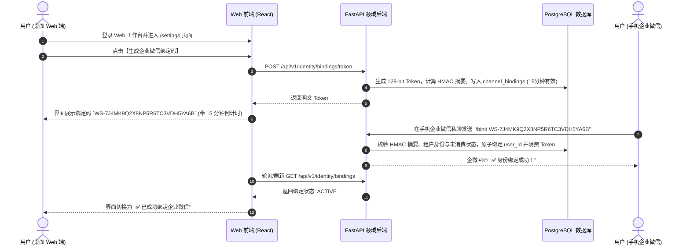
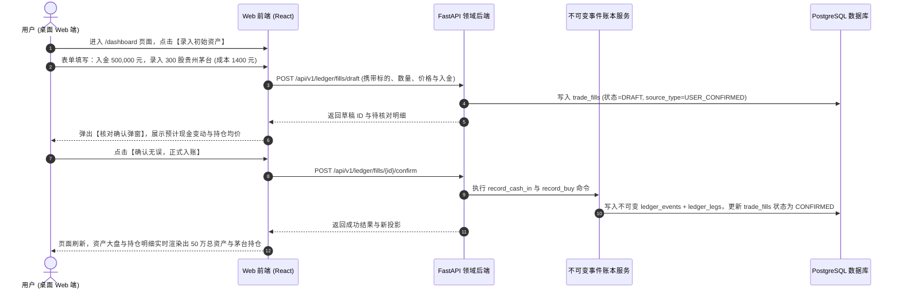

# WealthSail MVP Web 投研工作台设计与实现规范 (v2.1)

> **文档版本**：v2.1.0-draft  
> **编写日期**：2026-08-23  
> **文档状态**：评审修订中 (Review Required)  
> **适用范围**：L0 可信底座、L1 核心 MVP 的 Web 端交互规范与工程实现  
> **双端协同定位**：**手机企业微信（ChatOps）** 负责即时触达、盘中触点与盘后复盘；**Web 工作台** 负责初始化配置、资产大盘概览、历史净值曲线、持仓对账、风控策略管理与安全绑定。  
> **关联文档**：[PRD](./01.WealthSail投研平台需求文档.md) · [技术架构](./02.WealthSail投研平台全栈技术选型与架构评估.md) · [实战指南](./03.WealthSail-MVP快速构建与实战指南.md) · [追溯矩阵](./08.WealthSail需求设计测试追溯矩阵.md)

---

## 1. Web 工作台定位与设计目标

### 1.1 双端协同职责矩阵

| 交互场景 | 手机企业微信 (ChatOps) | Web 投研工作台 (Web Workspace) |
| :--- | :--- | :--- |
| **主要使用者** | 个人投资者（移动碎片时间） | 个人投资者（沉浸式投研/周度复盘） + 管理员 |
| **设备与场景** | 移动端、上下班途中、盘中盯盘 | 桌面宽屏（PC / Mac / 平板）、桌面浏览器 |
| **核心职责** | 接收 08:30 剧本、盘中告警触点、14:30 基金估值、15:30 交互复盘 | 资产大盘监控、历史净值与基准对比、持仓批量对账、风控政策配置、企业微信安全绑定 |
| **交互风格** | 卡片推送、按钮点击、自然语言单句回复 | 数据可视化图表、结构化表格、表单配置、抽屉与弹窗 |

### 1.2 MVP 阶段设计原则
1. **轻量聚焦**：L1 阶段只服务 A 股股票、场内 ETF/LOF、场外公募基金，界面不堆砌港美股、衍生品或复杂回测面板（留待 L4 演进）；
2. **前后端职责解耦**：前端纯粹通过带 JWT 认证的 Domain REST API 进行数据读取与交互，严禁在前端直连数据库或持有任何高权限凭证；
3. **金融事实严肃性**：前端金额计算由后端 Decimal 保证精度，前端严格展示数据源 `as_of` 时点与数据质量状态（`FRESH / ESTIMATED / STALE / UNAVAILABLE`），当数据不足时展示明确的“已弃权”状态。

---

## 2. 页面信息架构与路由规划 (Page Information Architecture)

```mermaid
flowchart TD
    Root["/ (Web 工作台入口)"] --> Dash["/dashboard (资产大盘与持仓看板)"]
    Root --> Reports["/reports (四时段研报与决策审计)"]
    Root --> Policy["/risk-policy (投资政策与风控设置)"]
    Root --> Settings["/settings (账号、安全与企业微信绑定)"]

    Dash --> SubDash1["资产核心指标卡片 (总资产/可用现金/盈亏)"]
    Dash --> SubDash2["历史净值走势图 (Equity Curve vs 沪深300)"]
    Dash --> SubDash3["持仓明细表 (股票/ETF/场外基金)"]
    Dash --> SubDash4["快捷记账弹窗 (出入金/买卖成交草稿校对)"]

    Reports --> SubRep1["四时段报告历史归档 (日历与会话筛选)"]
    Reports --> SubRep2["决策与成交对账表 (建议点位 vs 实际成交)"]
    Reports --> SubRep3["证据链与数据质量抽屉 (as_of 与快照溯源)"]

    Policy --> SubPol1["大类资产配置比例设置 (权益/固收/黄金/现金)"]
    Policy --> SubPol2["单标的持仓风控上限 (%)"]
    Policy --> SubPol3["再平衡偏离容忍度与防振荡静默窗口"]

    Settings --> SubSet1["租户与成员角色信息 (OWNER/ADMIN/VIEWER)"]
    Settings --> SubSet2["企业微信一次性绑定码生成 (128-bit Token)"]
    Settings --> SubSet3["已绑定渠道状态查看与一键撤销"]
```



---

## 3. 四大核心页面详细功能规范

### 3.1 页面一：资产大盘与持仓看板 (`/dashboard`)

#### 核心功能与布局
1. **顶部核心资产指标栏 (Metric Cards)**：
   - **总资产 (Total Asset)**：单位 CNY，展示当前账户全部现金与持仓市值总和；
   - **可用现金 (Cash Balance)**：展示当前未买入标的的可用资金余额；
   - **持仓总市值 (Holdings Value)**：当前持仓股票与基金的最新市值总和；
   - **当日盈亏 (Daily PnL)**：当日绝对盈亏金额与涨跌百分比；
   - **累计盈亏 (Total PnL)**：自建仓以来的累计收益金额与年化收益率。
2. **净值走势与大类资产分布 (Charts View)**：
   - **组合历史净值曲线 (Equity Curve)**：折线图展示组合单位净值走势，并提供基准对照线（沪深 300 / 中证 500）；
   - **大类资产占比饼图 (Asset Allocation Donut)**：直观展示当前股票类、基金类、现金类的实际比例与目标配置比例的偏离度。
3. **持仓资产明细表 (Holdings Data Table)**：
   - 字段包含：标的代码、标的名称、资产类型（股票/场内ETF/场外基金）、持仓份额、持仓均价、最新价/估算净值、最新市值、浮动盈亏（%与金额）、持仓权重占比、数据质量标签（`FRESH / ESTIMATED / STALE`）；
   - 支持按资产类别筛选、按盈亏/权重排序。
4. **快捷记账与成交校对操作 (Action Modals)**：
   - **【出入金登记】**：录入资金充值或提现，生成 `CASH_IN / CASH_OUT` 事件；
   - **【成交草稿校对与确认】**：展示用户在企微或手动录入的 `trade_fills (DRAFT)`，核对标的、买卖方向、数量、单价与手续费后，一键点击【确认入账】，生成不可变投资事件。

---

### 3.2 页面二：四时段研报与决策审计中心 (`/reports`)

#### 核心功能与布局
1. **历史研报日历与时间轴 (Timeline & Filter)**：
   - 左侧按日期与四时段会话筛选（`08:30 盘前`、`盘中触点`、`14:30 基金估值`、`15:30 盘后复盘`）；
   - 支持关键词检索（如输入“600519”或“易方达”筛选相关研报）。
2. **研报内容渲染面板 (Report Detail View)**：
   - **If-Then 预案展示**：渲染结构化支撑位、阻力位、加减仓触发条件与出局条件（`invalidation_conditions`）；
   - **基金盘中估值卡片**：展示披露持仓覆盖率（如 78.5%）、估值涨跌区间（如 +1.20% ± 0.3%）与免责声明；
   - **盘后复盘知行合一对比**：展示早盘计划 vs 实际执行操作，自动高亮执行偏差。
3. **决策历史与成交对账表 (Decision & Execution Audit)**：
   - 表格清晰记录：建议生成时间、建议内容、用户决策动作（`ACCEPTED / IGNORED / DEFERRED`）、关联成交草稿状态、最终成交价格与执行滑点；
4. **数据溯源与证据链抽屉 (Evidence Drawer)**：
   - 点击报告中的任意数据，右侧滑出抽屉展示该结论引用的行情时点快照、数据源名称、新鲜度状态及模型版本号。

---

### 3.3 页面三：投资政策与风控设置 (`/risk-policy`)

#### 核心功能与布局
1. **大类资产目标配置滑块 (Target Allocation Sliders)**：
   - 【权益资产（股票/偏股基金）目标占比 %】
   - 【固收资产（债券/固收基金）目标占比 %】
   - 【黄金/大宗商品目标占比 %】
   - 【现金储备目标占比 %】
   - **前置约束**：四项比例合计必须严格等于 100 个百分点（合计总比例为 1.00），否则保存按钮禁用并提示。
2. **风险预算与单标的约束 (Risk Limits)**：
   - **单标的最大仓位上限**：限制单一股票或基金持仓不得超过总资产的特定比例（如上限 20%）；
   - **组合最大回撤容忍线**：设置回撤警戒阈值（如回撤达 8% 时在盘前提示防御）；
   - **再平衡偏离容忍度**：设置实际比例与目标比例偏离超过多少百分点时触发调仓建议（如偏离超过 5%）；
   - **告警静默防振荡窗口**：设置同一标的在多少分钟内不重复发送触点告警（默认 60 分钟）。
3. **政策版本与确认状态机**：
   - 修改后状态标记为 `DRAFT`，用户点击【确认生效】后生成一条生效记录并更新状态为 `CONFIRMED`。

---

### 3.4 页面四：账号、安全与企业微信绑定中心 (`/settings`)

#### 核心功能与布局
1. **租户成员与角色卡片 (Tenant & Role Management)**：
   - 展示当前所属租户名称、租户 ID、当前用户身份（`OWNER / ADMIN / VIEWER`）；
   - 支持多租户切换（如个人投资账本 vs 模拟盘账本）。
2. **企业微信一键安全绑定入口 (WeCom Channel Binding Card)**：
   - **生成绑定码按钮**：用户点击【生成企业微信绑定码】，前端调用后端生成具有至少 128-bit 随机熵的一次性口令（示例格式：`WS-7J4MK9Q2X8NP5R6TC3VDH5YA6B`）；
   - **绑定指引与倒计时**：界面展示动态 15 分钟倒计时、一键复制按钮与二维码，提示用户在手机企业微信向 WealthSail 应用私聊发送 `/bind <token>`；
   - **实时状态反馈**：绑定成功后界面自动刷新为“✅ 已绑定企业微信（用户账号：xxx）”，并显示绑定时间与渠道 ID。
3. **已绑定渠道治理与解绑**：
   - 展示当前租户已绑定的企业微信成员列表；
   - 提供【解绑 / 撤销授权】按钮，用户点击并二次确认后，后端作废对应渠道密钥与绑定记录。
4. **审计日志与后台调度监控 (Audit & Job Logs)**：
   - 查看近 7 日高风险操作审计日志（手工改账、政策修改、解绑操作）；
   - 查看后台定时任务（`job_runs`）最近运行状态（`COMPLETED / FAILED / ABSTAINED`）与执行耗时。

---

## 4. 典型用户操作流程 (End-to-End User Workflows)

### 4.1 流程一：新用户首次登录与企业微信绑定流程



---

### 4.2 流程二：初次持仓初始化与成交草稿确认记账



---

## 5. 前端工程架构与组件规范

### 5.1 技术选型规范
- **开发框架**：React 19 / Vite + TypeScript；
- **UI 样式体系**：TailwindCSS + CSS 变量主题（支持日间/夜间深色投研主题）；
- **图标库**：Lucide React；
- **图表引擎**：Recharts（用于资产净值走势与饼图分布）；
- **数据请求与缓存**：SWR / TanStack React Query（保证请求去重、自动聚焦刷新与错误重试）；
- **表单与校验**：React Hook Form + Zod（前端格式校验与后端 Pydantic 完全对齐）。

### 5.2 核心组件设计目录结构

```text
frontend/src/
├── api/                    # API 客户端与请求封装
│   ├── client.ts           # Axios / Fetch 实例 (带 JWT Bearer 拦截器)
│   ├── portfolio.ts        # 资产与持仓 API
│   ├── reports.ts          # 研报与决策 API
│   ├── risk.ts             # 投资政策与风控 API
│   └── identity.ts         # 租户与企微绑定 API
├── components/
│   ├── layout/             # 导航栏、侧边栏、租户切换器
│   │   ├── Header.tsx
│   │   ├── Sidebar.tsx
│   │   └── TenantSelector.tsx
│   ├── dashboard/          # 资产看板组件
│   │   ├── MetricCards.tsx
│   │   ├── EquityCurveChart.tsx
│   │   ├── AssetDonutChart.tsx
│   │   ├── HoldingsTable.tsx
│   │   └── TradeFillDraftModal.tsx
│   ├── reports/            # 研报与审计组件
│   │   ├── ReportTimeline.tsx
│   │   ├── ReportContentViewer.tsx
│   │   ├── DecisionAuditTable.tsx
│   │   └── EvidenceDrawer.tsx
│   ├── risk/               # 风控策略配置组件
│   │   ├── AllocationSliders.tsx
│   │   └── RiskBudgetForm.tsx
│   └── settings/           # 渠道绑定与安全组件
│       ├── WeComBindingCard.tsx
│       └── AuditLogViewer.tsx
└── types/                  # TypeScript 类型定义 (与后端 DTO 严格对齐)
    ├── portfolio.ts
    ├── report.ts
    ├── risk.ts
    └── identity.ts
```

---

## 6. 后端 REST API 契约设计 (FastAPI Endpoints)

所有接口统一挂载于 `/api/v1` 前缀下，必须携带 `Authorization: Bearer <JWT>` 凭证。后端由 `identity.is_tenant_member` 统一提取并验证当前租户上下文。

### 6.1 资产与持仓模块 (Portfolio & Holdings)
- **`GET /api/v1/portfolio/summary`**：获取总资产、可用现金、持仓市值、当日与累计盈亏；
- **`GET /api/v1/portfolio/positions`**：获取持仓股票、场内 ETF 与场外公募基金列表（含现价、成本、收益率与数据质量）；
- **`GET /api/v1/portfolio/history?range=1M`**：获取历史净值曲线点位数据（支持 1M / 3M / 1Y / ALL）；
- **`POST /api/v1/ledger/cash`**：出入金登记（`CASH_IN / CASH_OUT`）；
- **`POST /api/v1/ledger/fills/draft`**：创建手工/补录成交草稿（`DRAFT`）；
- **`POST /api/v1/ledger/fills/{id}/confirm`**：确认成交草稿并正式写入不可变账本（`CONFIRMED`）。

### 6.2 四时段研报与决策审计 (Reports & Decisions)
- **`GET /api/v1/reports?session=PRE_MARKET&date=2026-08-24`**：按时段与日期分页查询历史研报；
- **`GET /api/v1/reports/{id}`**：获取单份研报的完整内容、If-Then 预案、基金估值区间与引用快照；
- **`GET /api/v1/reports/{id}/evidence`**：获取研报关联的证据链、来源时间戳与模型版本；
- **`GET /api/v1/decisions/history`**：获取建议采纳与实际执行对账列表。

### 6.3 投资政策与风控配置 (Risk & Policy)
- **`GET /api/v1/risk/policy`**：获取当前生效的投资政策（大类资产目标比例、单标的上限、回撤容忍度）；
- **`PUT /api/v1/risk/policy`**：更新投资政策（保存为 `DRAFT` 或用户确认生效为 `CONFIRMED`）。

### 6.4 身份与企业微信绑定 (Identity & Channel)
- **`GET /api/v1/identity/tenants`**：获取当前用户所属的租户列表与当前角色；
- **`POST /api/v1/identity/bindings/token`**：生成 128-bit 企业微信一次性绑定码；
- **`GET /api/v1/identity/bindings`**：获取当前租户绑定的企业微信状态；
- **`DELETE /api/v1/identity/bindings/{id}`**：撤销并作废指定渠道绑定。

---

## 7. 安全与租户隔离不变量 (Security Invariants)

1. **绝对禁止前端持有高权限凭据**：
   - 生产环境中前端代码与静态资源中严禁出现 `SUPABASE_SERVICE_ROLE_KEY`、数据库连接串或企业微信 `CorpSecret`；
2. **前后端接口多租户隔离防护**：
   - 前端无需且严禁在请求 Body 中显式传入 `tenant_id`；后端应用网关从已验证的 JWT Session 或已认证 Cookie 中自动提取租户 ID，防止跨租户越权查询与篡改；
3. **敏感操作防误触与审计追踪**：
   - 确认成交入账、资金出金、修改风控策略与解绑微信等关键操作，前端必须弹窗进行二次确认；后端必须在 `audit.audit_log` 中记录操作人、时间戳与变更详情；
4. **浮点数计算防御**：
   - 金额、份额、成本与单价等金融数字，前后端 JSON 交互一律采用精确字符串或定点数值传输，严禁前端进行原生 JavaScript `Number` 浮点数加减，防止出现 `0.1 + 0.2 = 0.30000000000000004` 等精度失真问题。
