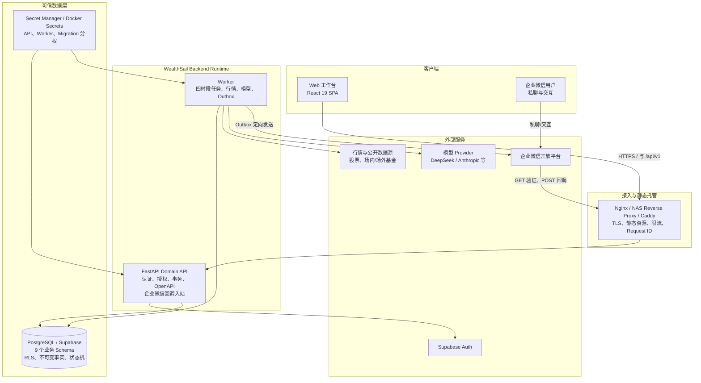
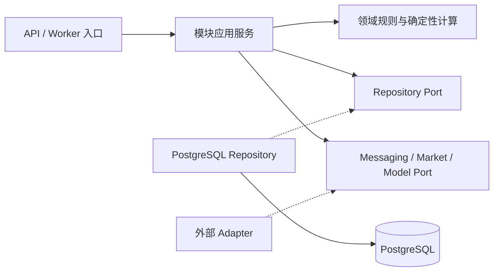
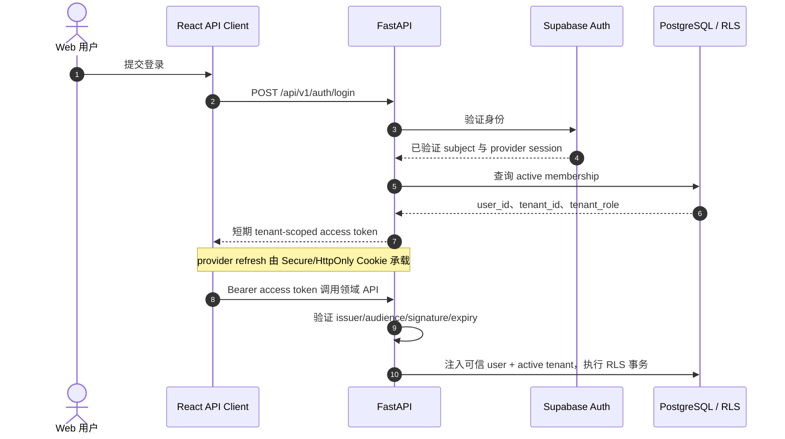
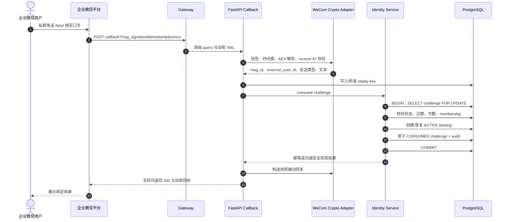
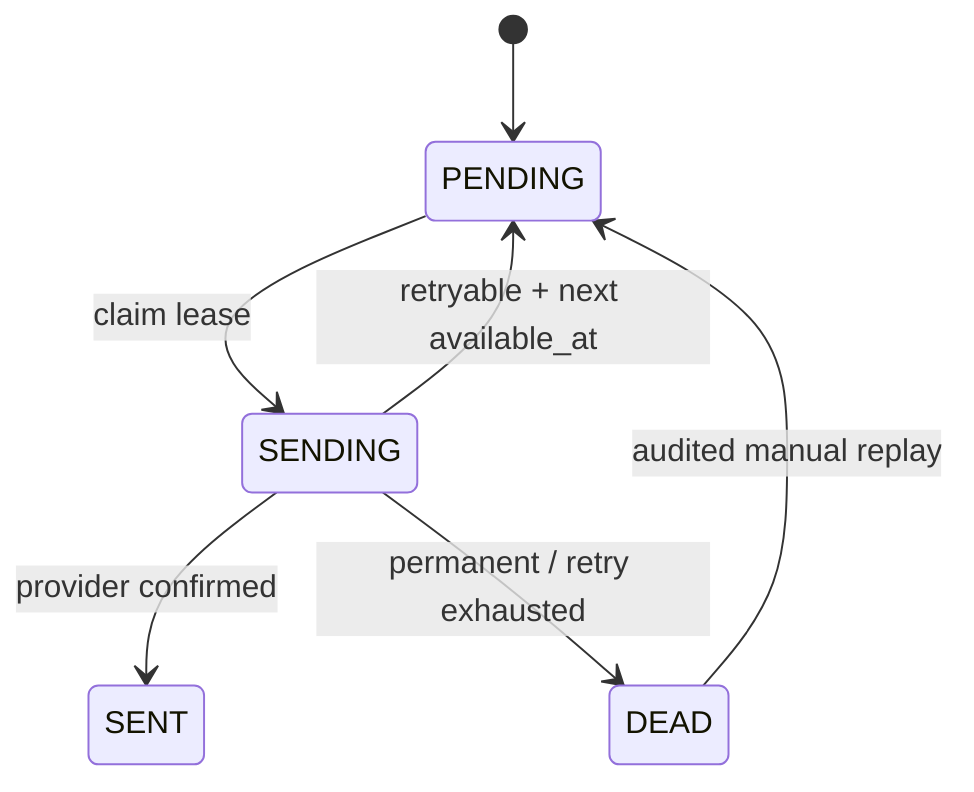
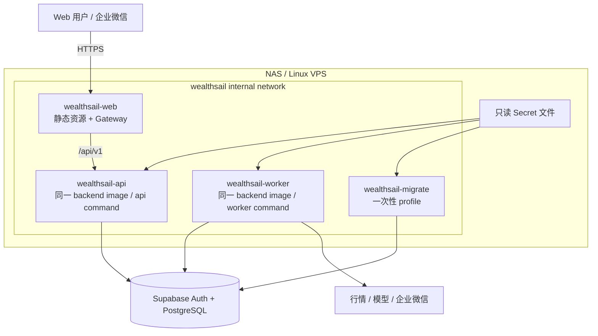

# WealthSail MVP 前后端工程实现与系统部署规范（v2.2）

> **文档版本**：v2.2.0-draft
>
> **更新日期**：2026-08-24
>
> **文档状态**：TARGET / NOT_LIVE。本文定义可实施的目标工程与部署规范；带 `[TARGET]` 的目录、接口、配置和容器尚未全部存在，不能据此声称系统已经上线。
>
> **适用范围**：L0 可信底座、L1 核心 MVP；覆盖股票、场内基金、场外基金，08:30 盘前简报、盘中跟踪、14:30 基金报告、15:30 盘后交互复盘、企业微信交互和 2–3 个初始用户。
>
> **需求与架构**：[PRD](./01.WealthSail投研平台需求文档.md) · [技术架构](./02.WealthSail投研平台全栈技术选型与架构评估.md) · [实战指南](./03.WealthSail-MVP快速构建与实战指南.md)
>
> **设计与安全**：[数据设计](./06.WealthSail数据模型与数据源治理设计.md) · [安全设计](./07.WealthSail安全隐私与合规设计.md) · [Web 工作台规范](./09.WealthSail-MVP-Web投研工作台设计与实现规范.md)
>
> **测试与追踪**：[MVP 测试设计](./04.WealthSail-MVP功能验收与自动化测试规范.md) · [全阶段测试](./05.WealthSail-全量系统功能验收与全栈测试规范.md) · [追踪矩阵](./08.WealthSail需求设计测试追溯矩阵.md)

---

## 0. 文档定位与阅读约定

### 0.1 本文解决什么问题

本文位于“架构决策”和“具体代码”之间，回答以下工程问题：

1. 现有仓库已经具备什么，哪些内容仍是目标设计；
2. Web、FastAPI、Worker、PostgreSQL/Supabase 与企业微信如何协作；
3. 登录身份、活动租户、数据库 RLS 和后台任务如何保持同一安全上下文；
4. 四时段报告如何调度、去重、降级、投递和恢复；
5. 开发、测试、NAS、VPS 与生产环境如何构建和部署；
6. 哪些测试和运行证据齐备后，才允许把文档状态从 `NOT_LIVE` 改为 `LIVE`。

本文不重复完整页面视觉规范、完整字段字典和全部测试用例；这些细节分别以 docs/09、docs/06、docs/04–05 为准。若本文示例与上述权威文档冲突，应先修订决策和追踪矩阵，不能在实现中静默选择。

### 0.2 规范词语

- **必须**：L0/L1 上线门禁，不满足即不能发布；
- **应该**：默认实现方式；偏离时必须记录 ADR、理由和补偿测试；
- **可以**：兼容不同部署环境的可选实现；
- **[CURRENT]**：仓库已有，可被代码或迁移验证；
- **[TARGET]**：目标结构或接口，尚未全部实现；
- **[FOLLOW-UP]**：需要后续代码、迁移或运维工作完成，本文只冻结边界。

### 0.3 L1 明确不做

L1 不自动连接券商下单，不把模型建议直接转换成真实成交，不支持个人微信，不承诺任意媒体抓取，不允许 Agent 在线修改生产规则。多 Agent、OpenClaw/Hermes 等编排实验保留需求，但优先级放在单 Agent、确定性计算、证据链和运行可靠性之后；默认 feature flag 关闭、工具只读、输入输出带 tenant scope。

### 0.4 建议阅读路径

- 产品、架构评审：先读 1–2、6–9、17；
- 前端开发：重点读 3、5–7、15；
- 后端开发：重点读 4–9、13–15；
- 部署与运维：重点读 9–16；
- 安全评审：重点读 2.3、6–7、9、12–16。

---

## 1. 当前实现与目标实现差距

### 1.1 仓库状态基线

| 能力 | 当前状态 | 目标状态 | 验收证据 |
|---|---|---|---|
| Web 工作台 | `[CURRENT]` `frontend/` 已有 React 19、Vite、路由、页面和组件测试；部分 API 仍是 fixture | 接入真实 `/api/v1`、Supabase Auth 会话、OpenAPI DTO 和异常恢复 | lint、typecheck、unit、build、E2E |
| 数据库 | `[CURRENT]` `migrations/001`–`008` 已定义 9 个业务 Schema、RLS、不可变约束和 Web 基础表 | 在临时 PostgreSQL/Supabase 完成新装、升级、A/B 越权与恢复验证 | migration log、schema introspection、RLS 矩阵 |
| 账本与 Agent | `[CURRENT]` 有最小 `modules/ledger` 与 `modules/agent` 代码和测试 | 接入 Repository、FastAPI、持久化 projection 和报告工作流 | unit/component/integration |
| 行情 Provider | `[CURRENT]` 有 Provider 抽象与部分实现 | 接入股票、场内基金、场外基金源，保存快照、质量和时点 | provider contract、降级测试 |
| 企业微信出站 | `[CURRENT]` 有主动 Markdown 和绑定码 HMAC 原语 | 加入持久化 Outbox、加密收件人路由、429/5xx 分类重试 | sandbox 回执、Outbox 恢复测试 |
| 企业微信入站 | `[TARGET]` 尚无 GET 验证、POST 验签/AES 解密 endpoint | 完成回调、绑定、交互 action、重放保护和审计 | 企微测试应用 E2E |
| FastAPI Domain API | `[TARGET]` 目标目录和 endpoint 尚未落地 | 完成 auth、portfolio、ledger、reports、risk、identity、operations | OpenAPI、API contract、E2E |
| Worker | `[TARGET]` 尚无可运行调度与 Outbox 进程 | 四时段任务、租约、幂等、恢复、监控 | 时钟/节假日/崩溃恢复测试 |
| 容器部署 | `[TARGET]` 尚无 `deployment/`、镜像与 Compose 文件 | backend/web 镜像、migrate/API/worker/web 编排、健康与最小权限 | build、compose config、smoke |
| 生产运行 | `NOT_LIVE` | 完成发布、备份、恢复、回滚和告警演练后才能改状态 | 签字验收与发布记录 |

### 1.2 实施时禁止的误解

1. 文档中的目录树和 Compose 是目标规范，不代表文件已经存在；
2. migration SQL 存在不等于已在生产数据库执行；
3. RLS policy 存在不等于跨租户隔离已经验收；
4. UI 页面可浏览不等于真实 API、认证和写入链路已经联调；
5. Outbox 表存在不等于消费者已经具备可靠投递能力；
6. 持久化 HITL 记录存在不等于进程重启后可以自动恢复，必须有恢复扫描和测试。

---

## 2. 关键架构决策与系统拓扑

### 2.1 L1 架构决策

| 决策 | 选择 | 理由 | 延后方案 |
|---|---|---|---|
| 前端 | React 19 SPA + Vite + TanStack Query | 与 docs/09 和现有代码一致，适合桌面投研工作台 | SSR、微前端 |
| 后端 | FastAPI 模块化单体 | 2–3 用户起步，部署简单；模块边界可支持以后拆分 | 微服务、事件总线 |
| 进程 | 同一 backend image，API 与 Worker 两个 command | 隔离请求与后台任务，避免两套镜像依赖漂移 | 独立服务镜像 |
| 数据库 | PostgreSQL/Supabase 为唯一事实源 | 支持 NUMERIC、事务、RLS、触发器和 JSONB | 多数据库拆分 |
| 认证 | Supabase Auth 证明身份，FastAPI 建立 tenant-scoped 应用会话 | 保留成熟 Auth，同时由服务端控制 active tenant | 自建密码认证 |
| 消息 | 原生企业微信 Adapter + Outbox | MVP 只验收企业微信，边界清晰、成本低 | 多渠道网关 |
| 调度 | 单 Worker 逻辑 + 数据库租约/幂等 | MVP 运维简单，仍允许以后扩副本 | 分布式调度平台 |
| AI | 单 Tool Loop、类型化只读工具 | 先保证事实、证据和成本可控 | 多 Agent/OpenClaw/Hermes |

模块化单体不是“所有代码放在一起”。每个模块拥有自己的应用服务、领域规则和 Repository 接口；跨模块调用走明确的服务接口，不能在另一个模块里直接拼 SQL 修改其私有状态。L1 也不需要为每个简单类创建抽象层，只在数据库、企业微信、行情源和模型等真正变化的边界定义 Port/Adapter。

### 2.2 系统拓扑



### 2.3 信任边界

| 输入或主体 | 信任结论 | 必须执行的控制 |
|---|---|---|
| 浏览器 request body/query | 不可信 | Schema 校验；tenant/user 从会话解析；写操作授权、幂等、版本校验 |
| 企业微信正文/XML | 不可信 | 签名、AES、时间窗、nonce/message ID、active binding、action token |
| 模型输出 | 不可信 | 结构化 schema、事实引用、确定性复算、阈值、ABSTAIN、只读工具 |
| 行情/基金源 | 外部不稳定数据 | source、as_of、retrieved_at、质量状态、异常值和 fallback |
| API 进程 | 受控但可能被攻破 | 受限 DB role、RLS、最小 Secret、审计、无 migration 权限 |
| Worker 进程 | 受控后台 | job tenant scope、租约、最小 DB role、发送路由权限、出站限额 |
| Migration 角色 | 高权限临时主体 | 只在发布窗口使用，不进入 API/Worker/Agent |

---

## 3. 前端工程实现规范

### 3.1 目录与职责

前端以 docs/09 的“6.2 目录结构与组件组织”为权威。当前 `frontend/` 已实现主要页面和组件；接入后端时保留页面结构，只替换 fixture 和 API 边界。

```text
frontend/src/
├── app/                  # Router、QueryClient、Session 装配
├── api/
│   ├── client.ts         # Bearer、Cookie、Correlation、401 refresh
│   ├── generated/        # [TARGET] 从 OpenAPI 生成，禁止手改
│   ├── portfolio.ts
│   ├── reports.ts
│   ├── risk.ts
│   └── identity.ts
├── components/           # 可复用展示与交互组件
├── domain/               # Decimal、时间、质量状态和纯函数
├── features/             # 按资产、报告、风险、绑定组织业务 UI
├── layouts/              # 桌面/响应式布局
├── pages/                # 路由页面，只做编排
└── test/                 # fixture、MSW/contract、测试装配
```

### 3.2 API Client 不变量

1. 生产构建统一使用 `VITE_API_BASE_URL=/api/v1`；`VITE_*` 中严禁放 Secret；
2. access token 只保存在内存，refresh token 只存在 Secure/HttpOnly Cookie；
3. 每个请求由 Client 生成或接受服务端返回的 `X-Correlation-Id`，格式必须校验，不能把任意用户输入直接写入日志；
4. 遇到 401 最多执行一次受控 refresh；失败后清会话、清 tenant Query Cache 并回登录；
5. mutation 默认不自动盲重试；只有明确幂等且错误可重试时才重试；
6. tenant 变化必须终止旧请求、取消订阅、清除旧 Query Cache，不能只修改 localStorage；
7. OpenAPI 生成 DTO 是传输边界，页面不能依赖数据库行结构；
8. `development` 可以使用显式 fixture/MSW，`production` 构建检测到 fixture session、固定绑定码或 mock success 时必须失败。

### 3.3 金融精度与展示边界

- API 传输的金额、份额、价格、费税、净值和收益率使用十进制字符串；
- 前端业务计算使用 `decimal.js`，禁止使用 JavaScript `Number` 做资金加减；
- `ChartNumberAdapter` 只把后端已确定的数值序列转换成图形坐标，转换结果不能写回业务状态；
- 所有报告和图表展示 `as_of`、`quality_status`、`method_version`；数据过期时标明影响，不用最新抓取时间冒充事实时点；
- 股票、场内基金、场外基金分别展示价格/估值/净值来源和时点，不能把 14:30 估值当作最终基金净值。

### 3.4 前端异常状态

页面必须覆盖 loading、empty、stale、unavailable、abstained、offline、403、404、409/412、422、429、500 和 timeout。关键写操作还要覆盖重复点击、旧版本、服务端已成功但响应丢失等不确定结果；此时客户端先用幂等键查询结果，不能直接再次产生经济效果。

---

## 4. 后端模块化单体设计

### 4.1 目标目录

以下目录为 `[TARGET]`。结构保留原稿的详细职责，同时把经常一起修改的代码放在同一业务模块，减少横向分层带来的文件跳转。

```text
WealthSail/
├── app/
│   ├── main.py                       # FastAPI 入口、中间件、路由和生命周期
│   ├── worker.py                     # Worker 入口
│   ├── dependencies.py               # AuthSession、TenantContext、DB Pool
│   └── config.py                     # Pydantic Settings 与 *_FILE Secret
├── api/
│   └── v1/
│       ├── router.py                 # /api/v1 聚合路由
│       └── errors.py                 # 统一 error envelope 与映射
├── modules/
│   ├── identity/
│   │   ├── api.py                    # session、tenant、binding endpoint
│   │   ├── schemas.py
│   │   ├── service.py                # membership、challenge、binding
│   │   ├── domain.py
│   │   └── repository.py
│   ├── ledger/
│   │   ├── api.py                    # 导入、入出金、成交草稿/确认
│   │   ├── schemas.py
│   │   ├── service.py
│   │   ├── domain.py
│   │   └── repository.py
│   ├── market_data/                  # Provider、快照、交易日历、质量
│   ├── reporting/                    # 四时段报告、条目、证据、决策
│   ├── research/                     # 论点、模型运行、建议
│   ├── risk/                         # L1 政策 preview/confirm 与告警
│   └── agent/                        # Tool Loop、schema、预算和审计
├── adapters/
│   ├── messaging/
│   │   ├── wecom_adapter.py          # 已有出站/HMAC，目标增加验签/AES
│   │   └── wecom_crypto.py           # [TARGET] 官方协议封装
│   ├── data_sources/
│   │   ├── akshare_adapter.py
│   │   ├── fund_adapter.py
│   │   └── sge_adapter.py
│   └── models/
│       └── model_gateway.py
├── infrastructure/
│   ├── database/
│   │   ├── pool.py                   # asyncpg pool 与预算
│   │   ├── rls.py                    # tenant transaction
│   │   └── migration.py
│   ├── security/
│   │   ├── auth.py                   # Supabase identity 验证
│   │   ├── app_token.py              # tenant-scoped 应用 token
│   │   └── crypto.py                 # HMAC、信封加密、轮换
│   ├── observability/
│   └── repositories/                 # 可共享的 SQL helper，不放业务规则
├── worker/
│   ├── scheduler.py                  # 四时段注册、交易日历、misfire
│   ├── job_runner.py                 # lease、job_run、correlation
│   └── outbox_consumer.py            # claim、发送、重试、DEAD
├── migrations/
├── deployment/                       # [TARGET] 镜像、Compose、Nginx、配置
└── tests/
    ├── unit/
    ├── component/
    ├── contract/
    ├── integration/
    └── e2e/
```

### 4.2 模块边界与依赖



依赖规则如下：

1. Route 负责传输校验、AuthSession 和错误映射，不承载金融计算；
2. Service 负责授权、幂等、状态机、事务边界和跨 Port 编排；
3. Domain 只使用纯 Python 类型、`Decimal` 和显式时钟，不依赖 FastAPI、asyncpg、requests；
4. Repository 不接受裸 `tenant_id` 字符串拼接，必须接受可信 `TenantContext`；
5. 外部 Adapter 不决定 tenant，不写账本，不把 provider success 直接等同于业务成功；
6. 跨模块写入由拥有该状态的 Service 完成，不能绕过状态机直接更新表；
7. 一个业务命令的数据库事实、审计和 Outbox 在同一事务提交。

### 4.3 Agent 与多 Agent 限制

Agent 只负责解释、摘要、论点组织和受控工具编排；持仓、收益、费税、数量、阈值、交易日、基金时点和账本影响由确定性代码计算。模型输出必须带 schema/method/prompt/model 版本以及 evidence refs；数据不足时返回 `ABSTAIN`。

多 Agent 可以在 L5 做只读研究实验，但存在成本膨胀、上下文分叉、相互强化幻觉、难以复现、工具竞争、延迟和审计链变长等局限。L1 不为“角色数量”付出复杂度，先证明单 Tool Loop 的准确率、证据完整度、延迟和边际价值。

---

## 5. API 契约与前后端协同

### 5.1 路由与版本

- 统一前缀：`/api/v1`；
- 业务版本通过 URL 管理，DTO 内的 `schema_version` 管理事件/消息演进；
- OpenAPI 由 FastAPI 构建生成，CI 对规范做 breaking-change 检查，再生成 `frontend/src/api/generated/`；
- 浏览器只访问同源 Gateway，生产默认不开放宽泛 CORS；本地 Vite 使用 proxy 或明确 allowlist。

### 5.2 L1 关键 endpoint

| 领域 | 方法与路径 | 说明 | 关键控制 |
|---|---|---|---|
| Auth | `POST /auth/login` | 委托 Supabase Auth 验证并建立会话 | 限流、统一错误、Cookie |
| Auth | `POST /auth/refresh` | 重新验证身份和 membership | Origin/CSRF、rotation |
| Auth | `POST /auth/logout` | 撤销 refresh、清 Cookie | Origin/CSRF、审计 |
| Session | `GET /identity/me` | 返回本人、active tenant、role | 不返回 Secret/原始 JWT |
| Portfolio | `GET /portfolio/summary?account_id=...` | 股票、场内/外基金组合摘要 | `as_of`、质量、Decimal |
| Import | `POST /portfolio-import-batches` | 创建初始化 DRAFT 批次 | Idempotency-Key |
| Import | `POST /portfolio-import-batches/{id}:confirm` | 原子确认并产生期初事实 | Idempotency-Key、If-Match |
| Fills | `POST /ledger/fills` | 创建真实成交 DRAFT | 不允许夹带入金字段 |
| Fills | `POST /ledger/fills/{id}:confirm` | 确认真实成交 | Idempotency-Key、If-Match |
| Reports | `GET /reports`、`GET /reports/{id}` | 历史报告、条目和证据 | cursor、item evidence |
| Decisions | `GET /decisions?report_id=...` | 查询追加式用户决定 | tenant scope、cursor |
| Risk | `POST /risk/policies/{id}:preview` | 预览政策影响 | 不产生生效版本 |
| Risk | `POST /risk/policies/{id}:confirm` | 形成确认版本 | Idempotency-Key、If-Match、再认证 |
| Binding | `POST /identity/binding-challenges` | 返回一次性绑定码一次 | 128-bit、限速、幂等 |
| Binding | `POST /identity/bindings/{id}:revoke` | 软撤销本人 binding | Idempotency-Key、If-Match、审计 |
| Operations | `GET /operations/job-runs` | OWNER/ADMIN 脱敏运维摘要 | 不直读原始运维表 |
| WeCom | `GET/POST /adapters/wecom/callback` | URL 验证与加密回调 | 签名、AES、重放 |

endpoint 的最终字段与 docs/09 API 交互和 OpenAPI 为准。任何 state-changing endpoint 都不得让客户端提交可信 `tenant_id/user_id`。

### 5.3 响应与错误

成功响应至少包含：

```json
{
  "data": {},
  "meta": {
    "requestId": "01J...",
    "asOf": "2026-08-24T06:30:00Z",
    "qualityStatus": "FRESH",
    "schemaVersion": 1
  }
}
```

错误响应使用稳定机器码，不把 SQL、跨 tenant 对象存在性、token、外部响应正文或 Secret 返回给客户端：

```json
{
  "error": {
    "code": "VERSION_CONFLICT",
    "message": "数据已被更新，请刷新后重试",
    "retryable": false,
    "fieldErrors": []
  },
  "requestId": "01J..."
}
```

最低错误集合与 docs/09 保持一致：`VALIDATION_ERROR`、`AUTH_REQUIRED`、`FORBIDDEN`、`NOT_FOUND`、`VERSION_CONFLICT`、`IDEMPOTENCY_CONFLICT`、`RATE_LIMITED`、`DATA_UNAVAILABLE` 和 `INTERNAL_ERROR`。`SESSION_EXPIRED` 可以作为 Auth 细分码；陈旧、Provider 故障和主动弃权通过 `DATA_UNAVAILABLE` 的安全 `reason` 与质量状态区分。`NOT_FOUND` 的用户消息统一为“不存在或不可见”，不泄漏跨 tenant 对象是否存在。

### 5.4 幂等、并发和分页

- 创建/确认/撤销等命令必须接受 `Idempotency-Key`；同 tenant、同 endpoint、同 key、不同 payload 返回冲突；
- 状态机更新使用 `expected_version` 或 `If-Match`，SQL 同时匹配 `id + tenant_id + version`；
- 客户端超时后先按幂等键查询结果，不能盲目重复确认；
- 列表使用稳定 cursor，不使用大 offset；cursor 内含排序键但不得泄漏 tenant；
- 报告、证据和快照返回 `published_at/as_of/retrieved_at`，禁止用一个 `timestamp` 混合三种语义。

---

## 6. 认证、活动租户与 RLS

### 6.1 L1 认证决策

L1 使用 Supabase Auth 处理身份验证和 provider refresh，FastAPI 负责应用会话、active tenant 和领域授权：



具体实现前必须补充 Auth ADR，冻结 token issuer、audience、算法、key rotation、Cookie 名称/Domain/Path、refresh rotation 和撤销方式。不得同时保留含义不清的 `SECRET_KEY` 与 `JWT_SECRET`。

### 6.2 会话安全

1. Access token 有效期建议 10–30 分钟，只驻留内存；
2. Refresh cookie 使用 `Secure; HttpOnly`，SameSite 根据同源部署取 `Lax` 或更严格值；
3. refresh/logout 同时校验 Origin 和 CSRF token，SameSite 不是唯一防线；
4. 每次 refresh 重新验证用户状态、membership 和 active tenant；
5. membership 撤销后，即使旧 access token 尚未过期，RLS membership 检查也必须拒绝；
6. 高风险政策确认、跨用户管理和恢复操作需要再认证；
7. token、Cookie、绑定码、完整账户号和持仓 payload 不进入 URL、localStorage、日志或模型上下文。

### 6.3 TenantContext 不变量

`TenantContext` 只能由已经验证的应用会话创建，至少包含 `user_id`、`active_tenant_id`、`tenant_role`、`session_id`、`request_id`。请求 Body、模型输出和企业微信正文中的同名字段全部忽略或拒绝。

当前 migrations 的 `identity.is_tenant_member(target_tenant)` 只验证 membership。为了兑现 tenant-scoped token，后续迁移必须增加活动租户检查，例如由 helper 比较 `request.jwt.claims.tenant_id` 与目标表行的 `tenant_id`，再验证 membership。修改前，文档不得声称数据库已经按 active tenant 验收。

### 6.4 事务级 RLS 模式

以下为 `[TARGET]` 实现模式。调用者不能把 `role` 当作自由参数；claims 来自不可变 `VerifiedSession`。

```python
from contextlib import asynccontextmanager
import json

@asynccontextmanager
async def tenant_transaction(pool, session):
    claims = json.dumps({
        "sub": str(session.user_id),
        "role": "authenticated",
        "tenant_id": str(session.active_tenant_id),
        "session_id": str(session.session_id),
    })

    async with pool.acquire() as conn:
        async with conn.transaction():
            await conn.execute("SET LOCAL ROLE authenticated")
            await conn.execute(
                "SELECT set_config('request.jwt.claims', $1, true)",
                claims,
            )
            yield conn
```

必须满足：

- API 连接角色不是表 owner，不带 BYPASSRLS，只被授予 `SET ROLE authenticated` 和必要对象权限；
- 所有用户业务 SQL 都在上述事务建立后执行，禁止在握手前查询 tenant 数据；
- 所有 tenant 表保持 `ENABLE` 与 `FORCE ROW LEVEL SECURITY`；
- Repository 仍带 active tenant predicate，RLS 是纵深防御而非唯一过滤；
- release pool 前事务必须结束，不能遗留 session-level setting；
- A/B、同一用户多 membership、owner/admin/editor/viewer 均有真实数据库测试。

### 6.5 服务角色

| 角色 | 用途 | 允许 | 禁止 |
|---|---|---|---|
| `wealthsail_api` | FastAPI 连接 | 用户请求所需 procedure/table、SET LOCAL 受限角色 | migration、BYPASSRLS、批量跨 tenant |
| `wealthsail_worker` | job/outbox | claim job、读取指定 tenant、写报告/Outbox 状态 | 交互登录、任意运维读取 |
| `wealthsail_migration` | 发布迁移 | DDL、约束、函数、grant | 长驻运行 |
| `authenticated` | RLS 执行角色 | policy 允许的最小列和操作 | Secret、原始 outbox、原始审计 |

Worker 不模拟任意终端用户，也不使用 `authenticated + auth.uid()`。目标实现通过受控 claim/lease helper 或窄 `SECURITY DEFINER` procedure：Worker 先原子 claim `job_run`，数据库验证 lease 后返回该 job 的 tenant scope；后续事务携带 `job_run_id + tenant_id`，只允许执行报告、快照和 Outbox 所需命令。该角色和 policy/procedure 尚未在 migrations 001–008 完整定义，属于上线前 migration。

---

## 7. 企业微信入站、绑定与出站

### 7.1 适配器归属与当前状态

企业微信是后端的 Messaging Adapter，不是独立微服务。当前 [wecom_adapter.py](../adapters/messaging/wecom_adapter.py) 已实现主动 Markdown 和绑定 HMAC 原语；GET 验证、POST 验签/AES、持久化重放保护和加密路由仍为 `[TARGET]`。

API endpoint 目标路径为 `api/v1/adapters_wecom.py`，在文件真正存在前只用代码格式引用，不创建失效链接。

### 7.2 首次回调 URL 验证

企业微信保存回调配置时会对同一 endpoint 发起 GET。API 必须：

1. 读取并 URL decode `msg_signature`、`timestamp`、`nonce`、`echostr`；
2. 使用 callback token 验证签名，检查 timestamp 时间窗；
3. 使用 EncodingAESKey 解密 `echostr` 并校验 receive ID/CorpID；
4. 原样返回解密后的明文，不增加 JSON、引号、BOM 或换行；
5. 对失败请求返回安全错误并记录 error class/request ID，不记录密钥和原始敏感报文；
6. 以企业微信测试应用完成真实配置验证，不能只用本地单元测试替代。

### 7.3 一次性绑定挑战

Web 登录用户调用 `POST /identity/binding-challenges`。服务端生成至少 128-bit CSPRNG 随机熵的 token，明文只返回一次；数据库 `identity.binding_challenges` 保存 keyed HMAC、tenant/user、过期时间、最大尝试次数、状态、幂等键和版本。

token 不得进入 URL query、日志、埋点、错误追踪、模型上下文或浏览器持久存储。15 分钟是 L1 默认值，错误尝试达到上限后置为终态并审计。

### 7.4 POST 回调与绑定时序



群聊、广播、无法识别 external user、错误/过期 token、已达尝试上限、失权 membership、同一外部身份冲突、并发消费和撤销后重试都必须默认拒绝或返回幂等结果，不能改变其他 binding。

### 7.5 正式 binding 的可路由隐私设计

主动推送需要可恢复的企业微信 UserID，因此正式 binding 不能只保存单向哈希。目标数据应包含：

- `external_user_hmac`：确定性 HMAC，用于唯一性、入站查找和冲突检查；
- `external_user_ciphertext`：信封加密后的 UserID；API 只拥有 encrypt-only 能力，只有 Worker 或受控发送 procedure 拥有 decrypt 能力；
- `encryption_key_id`、`nonce`、`algorithm_version`：支持密钥轮换；
- `external_username`：可选脱敏显示名，不能作为发送路由；
- `status/bound_at/revoked_at/last_used_at/version`：状态机和乐观并发。

现有 migration 008 尚未定义密文路由列，必须通过后续 migration 和权限测试实现。Browser JWT、Agent、运维摘要均不得获取 HMAC、密文或解密值。

MVP 如果没有云 KMS，可以使用公钥封装：API 持有路由加密公钥，Worker 持有解密私钥；如果使用 KMS，则以不同 IAM 权限分别授予 API `Encrypt` 和 Worker `Decrypt`。不要为了省一个密钥文件而让 Browser、Agent 或 migration 获得解密能力。

### 7.6 主动消息出站

报告发布与 Outbox 写入在同一数据库事务完成。Worker 从 Outbox 取出事件后：

1. 验证 binding 仍为 ACTIVE、目标用户仍有 membership；
2. 在最小权限边界内解密收件人路由；
3. 以明确 `touser` 调用企业微信，禁止默认 `@all`；
4. 使用 tenant/topic/idempotency key 和企业微信重复检查降低重复；
5. 保存外部 message ID 或可验证回执；不把 access token 写入 URL 日志；
6. 对“不确定是否发送成功”先查回执或等待幂等窗口，不盲目重发；
7. 绑定撤销、用户失权、永久错误进入安全终态并告警。

### 7.7 网络暴露

- **VPS 直出**：公网 443 由 Nginx/Caddy 终止 TLS，只暴露 Gateway；
- **NAS 反向代理**：容器绑定 loopback 高端口，由 NAS 反向代理和证书管理接入；
- **Cloudflare Tunnel**：可以隐藏源站端口，但企微 callback 路径不能被交互式 Access 登录拦截；
- **本地调试**：只使用测试企业微信应用和临时 Tunnel，不把生产 CorpSecret 下发到开发机；
- API 的 8000 端口不得直接暴露到公网。

---

## 8. 四时段 Worker、任务与 Outbox

### 8.1 四类任务不能合并成一条 Cron

| Session | 默认触发 | 主要输入 | 正常产物 | 数据不足/非交易日 |
|---|---|---|---|---|
| `PRE_MARKET` | 交易日 08:30 | 隔夜市场、公告、持仓、日历、待办 | 盘前简报 | 标记缺失或 ABSTAIN；非交易日不生成交易指令 |
| `INTRADAY` | 交易时段事件触发或受控轮询 | 持仓/自选/论点重大偏离 | 去重后的盘中触点 | 无重大偏离不推送；陈旧数据抑制 |
| `FUND_1430` | 交易日 14:30 | 场外基金估值、持仓暴露、instrument cutoff | 基金 2:30 报告 | 估值与最终净值明确区分 |
| `POST_MARKET` | 交易日 15:30 | 收盘行情、成交、决策、报告 | 盘后交互复盘 | 数据迟到时标时点并允许后续补版 |

Scheduler 全部使用 `Asia/Shanghai`，但是否执行由 `reference.trading_calendars` 决定，不能只依赖周一至周五。场外基金的申赎提示还必须读取 `reference.instrument_cutoff_rules`，不能承诺所有基金统一截止时间。

### 8.2 Job lease 与幂等

每次运行先创建或认领 `workflow.job_runs`：

- `job_key = tenant_id + report_session + trading_date + method_version`；
- 唯一约束阻止重复 Cron 或多 Worker 产生第二个经济效果；
- claim 使用租约、`locked_at/locked_by` 或数据库 advisory lock；
- Worker 崩溃后，只有租约超时才允许其他实例接管；
- `misfire_grace_time` 内可以补跑，超过窗口则记录 `ABSTAINED/FAILED` 和原因；
- 同一报告补版使用明确 supersedes 关系，不能静默覆盖已发布报告。

### 8.3 Outbox 状态与投递语义

沿用数据库已有状态：`PENDING → SENDING → SENT`，不可恢复或达到策略上限时进入 `DEAD`。投递语义是“至少一次 + 业务幂等”，不是绝对 exactly-once。



重试策略：

1. 连接超时、429、可恢复 5xx：指数退避 + jitter，遵守 `Retry-After`；
2. 签名/凭据错误、非法收件人、binding 已撤销：不盲目重试，立即告警或进入 DEAD；
3. 不确定结果：优先用 external message ID/幂等窗口查证；
4. `locked_at` 超时的 SENDING 由恢复扫描器重新判定；
5. DEAD 人工重放必须记录 actor、原因、新旧 attempt 和 correlation ID。

### 8.4 模型和数据源降级

- 行情源失败时可以切换已登记 fallback，但必须保留 source lineage；
- 缓存数据必须返回原 `as_of` 和 `STALE`，不能改成当前时间；
- 模型超时或 schema 无法通过时报告标记 `ABSTAINED`，确定性指标仍可单独发布；
- 模型调用设置 token/cost/timeout 预算和断路器，失败不能阻断成交事实入账；
- Worker 不因某一 tenant 或某一 provider 失败而停止处理其他独立任务。

---

## 9. PostgreSQL/Supabase 数据库实现

### 9.1 业务 Schema 与事实归属

当前 migration 已创建 9 个业务 Schema。数量只用于帮助理解，安全验收以实际 catalog、约束和测试为准。

| Schema | 事实归属 | 典型对象 |
|---|---|---|
| `identity` | tenant、用户、账户、binding 和 Secret 引用 | tenants、profiles、tenant_members、accounts、binding_challenges |
| `reference` | 标的、别名、交易日历、来源和 cutoff | instruments、trading_calendars、data_sources |
| `ledger` | 不可变投资事实与可重建投影 | ledger_events、ledger_legs、trade_fills、position/nav snapshots |
| `market` | 外部原始快照、观察和公司行动 | source_snapshots、market_observations、corporate_actions |
| `research` | 论点、模型运行、建议和证据 | theses、model_runs、recommendations、evidence_refs |
| `reporting` | 四时段报告、条目和用户决策 | reports、report_items、decisions |
| `risk` | 投资政策、规则和告警 | investment_policies、alert_rules、alert_events |
| `workflow` | jobs、job_runs、HITL 和 Outbox | jobs、job_runs、interaction_requests、outbox |
| `audit` | 追加式审计事实 | audit_log |

### 9.2 Migration 基线

当前权威顺序：

1. [001_initial_schemas.sql](../migrations/001_initial_schemas.sql)：扩展与 9 个 Schema；
2. [002_identity_and_tenancy.sql](../migrations/002_identity_and_tenancy.sql)：身份、租户、账户和 binding；
3. [003_reference_and_ledger.sql](../migrations/003_reference_and_ledger.sql)：标的、日历与账本；
4. [004_market_and_research.sql](../migrations/004_market_and_research.sql)：行情、研究、报告、风险和 workflow；
5. [005_rls_security_policies.sql](../migrations/005_rls_security_policies.sql)：RLS 与最小权限；
6. [006_mock_seed_data.sql](../migrations/006_mock_seed_data.sql)：仅开发测试 fixture；
7. [007_security_and_integrity_hardening.sql](../migrations/007_security_and_integrity_hardening.sql)：复合外键、租约、状态和完整性升级；
8. [008_web_workbench_foundation.sql](../migrations/008_web_workbench_foundation.sql)：binding challenge、初始化导入和 Web 安全边界。

生产环境禁止执行 006。迁移表、checksum 和执行日志必须能够区分“文件存在”“已执行”“执行成功”和“已经验证”。

### 9.3 连接模式选择

API 和 Worker 是长期运行的 NAS/VPS 容器，默认优先：

1. 网络支持时使用 Supabase Direct 5432；
2. IPv4 长驻应用使用 Supavisor Session Pooler 5432；
3. 只有明确需要 transaction mode 时使用 6543，并为 asyncpg 设置 `statement_cache_size=0`，禁止显式 `Connection.prepare()`；
4. migration、`pg_dump`、restore 使用独立 Direct URL，不共用运行时 pool；
5. 所有连接启用 TLS，证书校验策略按环境固定，不使用明文降级。

Supabase 官方选择依据：

- <https://supabase.com/docs/guides/database/connecting-to-postgres>
- <https://supabase.com/docs/guides/troubleshooting/disabling-prepared-statements-qL8lEL>

对 2–3 用户 MVP，API 与 Worker 每进程可以从 `min_size=1/max_size=5` 起步。总预算必须同时考虑 Supabase 内部服务、migration、监控和故障重连；不能各进程独立配置 `20` 后再叠加。

### 9.4 不可变事实与状态机

数据库已定义的关键保护包括：

- `ledger.protect_ledger_event()`：禁止删除账本事件；已确认/冲正事实不可改，待确认事件的经济身份也受保护；
- `ledger.protect_portfolio_import_item()`：导入批次进入终态后禁止非法修改 item；
- interaction request、binding challenge、risk policy 等状态机触发器；
- audit fact mutation rejection；
- tenant 父子关联的复合外键和唯一约束。

触发器是最后一道完整性边界，不替代应用层授权、幂等和版本校验。数据库 owner、错误 migration 和高权限运维仍可绕过部分限制，因此生产变更必须审计并经过恢复验证。

### 9.5 后续数据迁移

为落实本文安全设计，后续 migration 至少需要评审：

1. active tenant RLS helper，比较可信 claim 与行 tenant，再检查 membership；
2. 企业微信 `external_user_hmac + external_user_ciphertext + key metadata`；
3. Worker claim/lease helper、最小角色、policy 或窄 procedure；
4. 必要的 provider refresh/session 撤销数据，具体取决于 Auth ADR；
5. Outbox `next_attempt_at`/lease 字段是否沿用 `available_at/locked_at`，避免重复概念；
6. key rotation 和密文重加密状态；
7. 必要的索引、唯一约束和列级 GRANT。

新增 migration 必须前向兼容 001–008，不能直接重写已执行文件来假装升级。

### 9.6 备份与恢复

- 至少每日自动备份；是否具备 PITR 取决于 Supabase 套餐和项目配置；
- MVP 初始目标：RPO 不高于 24 小时、RTO 不高于 4 小时，正式上线前根据投资事实录入频率重新确认；
- 每季度或重大 migration 前做一次隔离环境 restore 演练；
- 恢复后执行 schema checksum、RLS A/B、账本投影重建、job/outbox 状态检查；
- 数据库恢复不能自动重发所有 SENDING/PENDING 消息，先依据幂等键和外部回执判定；
- Secret、镜像、配置和数据库备份必须能组合恢复，不能只备份数据库。

---

## 10. 多环境与部署 Profile

### 10.1 环境矩阵

| 环境 | 数据/身份 | 网络 | 目的 | 禁止 |
|---|---|---|---|---|
| `dev` | 本地 fixture 或隔离 Supabase 项目 | Vite proxy、本地端口 | TDD、快速反馈 | 生产 Secret、真实用户持仓 |
| `test` | 临时 PostgreSQL + fake provider/企微 sandbox | CI 网络 | migration、contract、E2E | 共享长期状态 |
| `staging` | 独立 Supabase/Auth/企微测试应用 | 与生产相似 HTTPS | 发布候选、恢复演练 | 生产 CorpSecret、生产收件人 |
| `prod-nas` | 生产 Supabase | NAS reverse proxy 或 Tunnel | 2–3 用户低运维运行 | 直接暴露 API 8000 |
| `prod-vps` | 生产 Supabase | Gateway 直接占用 80/443 | 公网 VPS | 未启用 TLS/备份/限流 |

环境之间使用不同 project、Auth issuer、CorpSecret、模型 key、数据库密码和 encryption key。禁止用一个 `APP_ENV` 条件把生产 Secret 带进 dev 镜像。

### 10.2 目标部署目录

```text
deployment/                         # [TARGET]
├── Dockerfile.backend             # API/Worker/Migrate 共用多阶段镜像
├── Dockerfile.web                 # pnpm/npm build + 固定 Nginx runtime
├── compose.yaml
├── nginx/
│   └── default.conf
├── config/
│   ├── api.env.example            # 非敏感配置模板
│   ├── worker.env.example
│   └── web.env.example
├── secrets/                       # gitignored；生产可替换为 Secret Manager
├── scripts/
│   ├── migrate.ps1
│   ├── smoke.ps1
│   ├── backup.ps1
│   └── restore-verify.ps1
└── runbooks/
    ├── release.md
    ├── rollback.md
    ├── outbox-dead.md
    └── provider-outage.md
```

### 10.3 镜像策略

1. Backend 只构建一个镜像，API、Worker、Migrate 使用不同 command；
2. 依赖使用 lock/constraint 和 hash，Python runtime 固定到经验证的 3.12 patch 版本；
3. Web 在构建阶段运行 typecheck/test/build，runtime 只包含静态产物和 Nginx；
4. 基础镜像固定明确版本，发布候选进一步固定 digest；
5. 镜像以非 root 用户运行；只有 Gateway 需要绑定容器内部 8080/8443 或受控低端口；
6. CI 生成 SBOM、依赖漏洞报告和镜像 digest，严重漏洞需评审后才能放行；
7. 版本标签至少包含 `APP_VERSION` 与 `GIT_SHA`，禁止生产只使用 `latest`。

### 10.4 部署拓扑



Migrate 不作为长驻服务。发布流程先备份和执行 migration，再启动新 API/Worker；API/Worker 进程启动时禁止自动 DDL。

---

## 11. Docker Compose 目标编排

### 11.1 编排原则

以下 `deployment/compose.yaml` 是 `[TARGET]` 示例。实现时必须通过 `docker compose config`，并根据实际镜像中的 health command 调整。现代 Compose 不再需要顶层 `version` 字段。

```yaml
name: wealthsail

x-backend-common: &backend-common
  image: wealthsail-backend:${APP_VERSION:-dev}
  build:
    context: ..
    dockerfile: deployment/Dockerfile.backend
  restart: unless-stopped
  init: true
  read_only: true
  tmpfs:
    - /tmp:size=64m,noexec,nosuid
  cap_drop:
    - ALL
  security_opt:
    - no-new-privileges:true
  networks:
    - internal
  logging:
    driver: json-file
    options:
      max-size: 10m
      max-file: "5"

services:
  wealthsail-api:
    <<: *backend-common
    command: ["python", "-m", "app.main"]
    env_file:
      - ./config/api.env
    secrets:
      - api_database_url
      - app_signing_private_key
      - binding_hmac_key
      - wecom_callback_token
      - wecom_encoding_aes_key
      - wecom_route_encryption_public_key
    expose:
      - "8000"
    healthcheck:
      test:
        - CMD
        - python
        - -c
        - "import urllib.request; urllib.request.urlopen('http://127.0.0.1:8000/health/ready', timeout=2)"
      interval: 15s
      timeout: 3s
      retries: 5
      start_period: 20s
    stop_grace_period: 30s

  wealthsail-worker:
    <<: *backend-common
    command: ["python", "-m", "app.worker"]
    env_file:
      - ./config/worker.env
    secrets:
      - worker_database_url
      - model_api_key
      - wecom_corp_secret
      - wecom_route_decryption_private_key
    stop_grace_period: 60s
    healthcheck:
      test:
        - CMD
        - python
        - -m
        - worker.healthcheck
      interval: 30s
      timeout: 5s
      retries: 3
      start_period: 30s

  wealthsail-web:
    image: wealthsail-web:${APP_VERSION:-dev}
    build:
      context: ..
      dockerfile: deployment/Dockerfile.web
      args:
        VITE_API_BASE_URL: /api/v1
    restart: unless-stopped
    init: true
    read_only: true
    tmpfs:
      - /var/cache/nginx:size=32m
      - /var/run:size=8m
    cap_drop:
      - ALL
    security_opt:
      - no-new-privileges:true
    ports:
      - "${BIND_ADDRESS:-0.0.0.0}:80:8080"
      - "${BIND_ADDRESS:-0.0.0.0}:443:8443"
    volumes:
      - ./nginx/default.conf:/etc/nginx/conf.d/default.conf:ro
      - ./tls:/etc/nginx/tls:ro
    depends_on:
      wealthsail-api:
        condition: service_healthy
    networks:
      - internal
    healthcheck:
      test:
        - CMD
        - wget
        - -q
        - -O
        - /dev/null
        - http://127.0.0.1:8080/healthz
      interval: 15s
      timeout: 3s
      retries: 3
    logging:
      driver: json-file
      options:
        max-size: 10m
        max-file: "5"

  wealthsail-migrate:
    image: wealthsail-backend:${APP_VERSION:-dev}
    build:
      context: ..
      dockerfile: deployment/Dockerfile.backend
    command: ["python", "-m", "infrastructure.database.migration", "upgrade"]
    env_file:
      - ./config/migration.env
    secrets:
      - migration_database_url
    init: true
    read_only: true
    tmpfs:
      - /tmp:size=64m,noexec,nosuid
    cap_drop:
      - ALL
    security_opt:
      - no-new-privileges:true
    networks:
      - internal
    restart: "no"
    profiles:
      - ops

networks:
  internal:
    driver: bridge

secrets:
  api_database_url:
    file: ./secrets/api_database_url.txt
  worker_database_url:
    file: ./secrets/worker_database_url.txt
  migration_database_url:
    file: ./secrets/migration_database_url.txt
  app_signing_private_key:
    file: ./secrets/app_signing_private_key.pem
  binding_hmac_key:
    file: ./secrets/binding_hmac_key.txt
  wecom_callback_token:
    file: ./secrets/wecom_callback_token.txt
  wecom_encoding_aes_key:
    file: ./secrets/wecom_encoding_aes_key.txt
  wecom_route_encryption_public_key:
    file: ./secrets/wecom_route_encryption_public_key.pem
  wecom_corp_secret:
    file: ./secrets/wecom_corp_secret.txt
  wecom_route_decryption_private_key:
    file: ./secrets/wecom_route_decryption_private_key.pem
  model_api_key:
    file: ./secrets/model_api_key.txt
```

### 11.2 Compose 实现注意

- 应用配置层必须实现 `*_FILE` 读取约定，不能假定 Compose Secret 会自动变成环境变量；
- API 和 Worker 使用不同数据库 URL 和权限；
- Worker 不依赖 API 才能启动，它依赖数据库和外部服务；health 失败只阻止被判定为健康，不应循环重启正在安全收尾的任务；
- NAS 已有反向代理时设置 `BIND_ADDRESS=127.0.0.1` 并只映射一个高端 HTTP 端口，可省去容器内 TLS；
- VPS 直接接入时才由容器 Gateway 占用 80/443，并配置证书续期；
- CPU/内存限制由目标 NAS/VPS 实测后写入部署覆盖文件，不在公共示例中伪造通用数值；
- `depends_on` 只帮助本次启动顺序，不替代运行期重连、断路器和 readiness。

---

## 12. Gateway、TLS 与网络安全

### 12.1 Nginx 目标配置

以下片段假设 `conf.d/default.conf` 被包含在 Nginx `http` 上下文；镜像和证书路径实现时必须与 Compose 保持一致。

```nginx
server_tokens off;

limit_req_zone $binary_remote_addr zone=api_per_ip:10m rate=10r/s;
limit_req_zone $binary_remote_addr zone=auth_per_ip:10m rate=2r/s;
limit_req_zone $binary_remote_addr zone=wecom_per_ip:10m rate=20r/s;
map $uri $wealthsail_cache_control {
    default "no-cache";
    ~^/assets/ "public, max-age=31536000, immutable";
}
map $http_x_correlation_id $wealthsail_correlation_id {
    default $request_id;
    ~*^[0-9a-f]{8}-[0-9a-f]{4}-[1-5][0-9a-f]{3}-[89ab][0-9a-f]{3}-[0-9a-f]{12}$ $http_x_correlation_id;
}

upstream wealthsail_api {
    server wealthsail-api:8000;
    keepalive 16;
}

server {
    listen 8080;
    server_name wealth.example.com;

    location = /healthz {
        access_log off;
        return 200 "ok\n";
    }

    location / {
        return 301 https://$host$request_uri;
    }
}

server {
    listen 8443 ssl;
    http2 on;
    server_name wealth.example.com;

    ssl_certificate /etc/nginx/tls/fullchain.pem;
    ssl_certificate_key /etc/nginx/tls/privkey.pem;
    ssl_protocols TLSv1.2 TLSv1.3;

    add_header Strict-Transport-Security "max-age=31536000; includeSubDomains" always;
    add_header X-Content-Type-Options "nosniff" always;
    add_header X-Frame-Options "DENY" always;
    add_header Referrer-Policy "same-origin" always;
    add_header Permissions-Policy "camera=(), microphone=(), geolocation=()" always;
    add_header Content-Security-Policy "default-src 'self'; connect-src 'self'; img-src 'self' data:; style-src 'self' 'unsafe-inline'; script-src 'self'; frame-ancestors 'none'; base-uri 'self'; form-action 'self'" always;
    add_header Cache-Control $wealthsail_cache_control always;

    location = /index.html {
        root /usr/share/nginx/html;
    }

    location /assets/ {
        root /usr/share/nginx/html;
        try_files $uri =404;
    }

    location / {
        root /usr/share/nginx/html;
        try_files $uri $uri/ /index.html;
    }

    location ~ ^/api/v1/auth/(login|refresh|logout)$ {
        limit_req zone=auth_per_ip burst=5 nodelay;
        client_max_body_size 64k;
        proxy_pass http://wealthsail_api;
        proxy_http_version 1.1;
        proxy_set_header Connection "";
        proxy_set_header Host $host;
        proxy_set_header X-Forwarded-Proto $scheme;
        proxy_set_header X-Forwarded-For $proxy_add_x_forwarded_for;
        proxy_set_header X-Real-IP $remote_addr;
        proxy_set_header X-Correlation-Id $wealthsail_correlation_id;
        proxy_connect_timeout 5s;
        proxy_read_timeout 30s;
    }

    location = /api/v1/adapters/wecom/callback {
        limit_req zone=wecom_per_ip burst=40;
        client_max_body_size 1m;
        proxy_pass http://wealthsail_api;
        proxy_http_version 1.1;
        proxy_set_header Connection "";
        proxy_set_header Host $host;
        proxy_set_header X-Forwarded-Proto $scheme;
        proxy_set_header X-Forwarded-For $proxy_add_x_forwarded_for;
        proxy_set_header X-Real-IP $remote_addr;
        proxy_set_header X-Correlation-Id $wealthsail_correlation_id;
        proxy_connect_timeout 5s;
        proxy_read_timeout 10s;
    }

    location /api/v1/ {
        limit_req zone=api_per_ip burst=30 nodelay;
        client_max_body_size 5m;
        proxy_pass http://wealthsail_api;
        proxy_http_version 1.1;
        proxy_set_header Connection "";
        proxy_set_header Host $host;
        proxy_set_header X-Forwarded-Proto $scheme;
        proxy_set_header X-Forwarded-For $proxy_add_x_forwarded_for;
        proxy_set_header X-Real-IP $remote_addr;
        proxy_set_header X-Correlation-Id $wealthsail_correlation_id;
        proxy_connect_timeout 5s;
        proxy_read_timeout 60s;
    }
}
```

### 12.2 配置说明

- `listen ... http2` 已是弃用写法，使用 `http2 on;`，参考 <https://nginx.org/en/docs/http/ngx_http_v2_module.html>；
- HSTS 只在 HTTPS 和域名确认正确后启用，错误配置会影响恢复；
- CSP 必须随实际字体、图表、错误追踪和连接域名测试，不能为了“看起来安全”而破坏应用后关闭；
- Gateway 生成 request ID，API 可以接受合法上游 ID，但必须拒绝超长或非法值；
- 应用只信任受控 Gateway 的 proxy header，公网客户端提交的 `X-Forwarded-For` 不能直接作为安全依据；
- 企微 callback 必须同时允许 GET 和 POST；IP allowlist 只能作为附加防线，签名/AES/重放校验不能省略；
- 证书通过 NAS、ACME/Certbot 或 Caddy 自动续期，续期失败必须告警。

---

## 13. 配置与 Secret 权威矩阵

### 13.1 命名原则

配置只有一个权威名称。现有适配器使用 `WECOM_CORPID`、`WECOM_CORPSECRET`、`WECOM_AGENTID`，目标配置沿用这些名称；如需改名，必须同时修改代码、测试、示例和部署模板，不保留无期限双别名。

非敏感配置可以进入 env 模板；Secret 通过 `*_FILE` 指向只读文件。所有 Settings 在启动时做类型、范围、互斥和必填校验，失败即停止启动，不能用假默认值进入生产。

### 13.2 API 非敏感配置示例

```ini
APP_ENV=production
APP_VERSION=2.2.0
LOG_LEVEL=INFO
LOG_FORMAT=json
TZ=Asia/Shanghai
ALLOWED_HOSTS=wealth.example.com
TRUSTED_PROXY_CIDRS=172.16.0.0/12

API_DATABASE_URL_FILE=/run/secrets/api_database_url
DATABASE_POOL_MIN_SIZE=1
DATABASE_POOL_MAX_SIZE=5
DATABASE_COMMAND_TIMEOUT_SECONDS=10
DATABASE_STATEMENT_CACHE_SIZE=100

SUPABASE_AUTH_URL=https://project-ref.supabase.co/auth/v1
SUPABASE_PUBLISHABLE_KEY=sb_publishable_example
SUPABASE_AUTH_ISSUER=https://project-ref.supabase.co/auth/v1
SUPABASE_AUTH_AUDIENCE=authenticated
APP_TOKEN_ISSUER=https://wealth.example.com
APP_TOKEN_AUDIENCE=wealthsail-api
APP_SIGNING_PRIVATE_KEY_FILE=/run/secrets/app_signing_private_key
ACCESS_TOKEN_EXPIRE_MINUTES=15
REFRESH_COOKIE_NAME=wealthsail_refresh
REFRESH_COOKIE_PATH=/api/v1/auth

BINDING_HMAC_KEY_FILE=/run/secrets/binding_hmac_key
BINDING_CHALLENGE_TTL_SECONDS=900
BINDING_CHALLENGE_MAX_ATTEMPTS=5

WECOM_CORPID=ww-project-corp
WECOM_AGENTID=1000002
WECOM_CALLBACK_TOKEN_FILE=/run/secrets/wecom_callback_token
WECOM_ENCODING_AES_KEY_FILE=/run/secrets/wecom_encoding_aes_key
WECOM_ROUTE_ENCRYPTION_PUBLIC_KEY_FILE=/run/secrets/wecom_route_encryption_public_key
```

如果数据库 URL 选择 transaction mode 6543，`DATABASE_STATEMENT_CACHE_SIZE` 必须改为 `0`；CI/启动校验应检查端口和该参数的组合。

### 13.3 Worker 非敏感配置示例

```ini
APP_ENV=production
APP_VERSION=2.2.0
LOG_LEVEL=INFO
LOG_FORMAT=json
TZ=Asia/Shanghai

WORKER_DATABASE_URL_FILE=/run/secrets/worker_database_url
DATABASE_POOL_MIN_SIZE=1
DATABASE_POOL_MAX_SIZE=5

SCHEDULER_TIMEZONE=Asia/Shanghai
PRE_MARKET_CRON="30 8 * * 1-5"
FUND_1430_CRON="30 14 * * 1-5"
POST_MARKET_CRON="30 15 * * 1-5"
INTRADAY_POLL_SECONDS=300
JOB_LEASE_SECONDS=300
JOB_MISFIRE_GRACE_SECONDS=900

OUTBOX_POLL_SECONDS=2
OUTBOX_BATCH_SIZE=20
OUTBOX_LEASE_SECONDS=60
OUTBOX_MAX_ATTEMPTS=8

MODEL_BASE_URL=https://api.deepseek.com/v1
MODEL_NAME=deepseek-chat
MODEL_TIMEOUT_SECONDS=15
MODEL_API_KEY_FILE=/run/secrets/model_api_key

WECOM_CORPID=ww-project-corp
WECOM_AGENTID=1000002
WECOM_CORPSECRET_FILE=/run/secrets/wecom_corp_secret
WECOM_ROUTE_DECRYPTION_PRIVATE_KEY_FILE=/run/secrets/wecom_route_decryption_private_key
```

Cron 只决定候选触发时刻；真正是否运行仍由交易日历、job key 和数据可用性决定。盘中任务可以从轮询升级为事件触发，但必须保留抑制、合并、冷却和过期规则。

### 13.4 Secret 轮换

| Secret | 持有者 | 轮换要求 |
|---|---|---|
| API DB URL | API | 数据库密码轮换；先双连接验证再切换 |
| Worker DB URL | Worker | 与 API 独立；撤销旧角色会话 |
| Migration DB URL | 发布流程 | 不长驻；每次发布窗口注入 |
| Supabase publishable key | API | 不是 service role；随 Auth 项目配置更新 |
| App signing key | API | 支持 key id/JWKS；保留旧公钥到 token 过期 |
| Binding HMAC key | API | 新旧 key version 并存，挑战过期后退役 |
| WeCom callback token/AES key | API | 与企微后台原子切换并真实验证 |
| WeCom CorpSecret | Worker | 更新 access token cache，禁止日志输出 |
| Route encryption key pair/KMS permission | API encrypt-only、Worker decrypt | 分批重加密，记录 key id，不停机丢路由 |
| Model API key | Worker/API 必需侧 | 限额、用途隔离和成本告警 |

---

## 14. 安全、可观测性与可靠性

### 14.1 容器和网络

- API/Worker 非 root、只读根文件系统、`cap_drop: ALL`、`no-new-privileges`；
- 仅 Gateway 暴露宿主机端口，API/Worker 只在 internal network；
- 出站网络按 provider 域名和目的收敛，超时、DNS 和 TLS 错误分类记录；
- 上传/导入限制 body 大小、行数、格式和处理时间，压缩包防 zip bomb；
- 依赖、镜像和前端 bundle 做 Secret 扫描；生产 source map 单独保护；
- 高风险运维通过脱敏 Domain API，不把原始 `secret_refs/job_runs/outbox/audit_log` 暴露给 Browser JWT。

### 14.2 日志与追踪

所有 API request、job run、model run、report、outbox 和外部调用通过 correlation/request/job ID 串联。结构化日志至少包含：

- timestamp、level、service、version、environment；
- request_id/correlation_id/job_run_id；
- tenant_id 的受控内部标识，不记录用户完整资产和 token；
- operation、duration、result、retryable、error_class；
- provider、HTTP status、attempt，但不记录带 access token 的完整 URL。

日志不能包含 access/refresh token、CorpSecret、callback AES key、绑定码、action token、完整企业微信 UserID、数据库 URL、完整持仓 payload或模型 Secret。

### 14.3 指标与告警

最低指标：

- API request count/latency/error by route class；
- DB pool in-use/wait/timeout；
- job scheduled/start/finish/misfire/lease recovery；
- report completed/failed/abstained、session 和延迟；
- outbox pending/sending/dead、age、attempt、uncertain result；
- provider/model latency、timeout、429、5xx、cost/token；
- callback signature/decrypt/replay/rate-limit failure；
- Auth login/refresh failure和 RLS denial。

必须告警：

- 盘前、基金、盘后在目标窗口未形成报告且没有可解释 ABSTAIN；
- 最老 PENDING Outbox 超过阈值或出现 DEAD；
- callback 验签失败异常增长；
- DB pool 耗尽、备份失败、证书即将过期；
- 跨 tenant 测试或生产安全探针失败；
- 模型/行情成本、错误率或陈旧度超预算。

### 14.4 健康检查

- `/health/live`：进程事件循环和基本启动状态，不访问所有外部服务；
- `/health/ready`：配置有效、DB 能完成轻量受限查询、migration 版本兼容；
- Worker health：心跳、scheduler loop、最近 lease 扫描，不以“每个外部 provider 正常”作为唯一健康条件；
- 第三方故障通过 dependency 指标和功能降级表达，避免容器因外部波动反复重启。

### 14.5 L1 运行目标

在没有生产基线前，以下是待验收目标，不是已达成承诺：

- 交易窗口 API 可用性目标不低于 99%；
- 正常数据条件下，盘前和基金报告在计划时刻后 5 分钟内发布，盘后复盘在 10 分钟内发布；
- 任何缺失都形成可见 `FAILED/ABSTAINED` 记录，不静默跳过；
- 用户确认类命令在重试、超时和进程重启后最多产生一个经济效果；
- RPO/RTO 采用 9.6 的初始目标，并由恢复演练修订。

---

## 15. TDD、测试矩阵与上线门禁

### 15.1 TDD 工作方式

每个需求从可观察行为和异常分支开始：

1. 在 docs/04–05 定义或补齐测试 ID，并在 docs/08 关联需求与设计；
2. 先写失败的 unit/component/contract/integration 测试，确认失败原因正确；
3. 实现最小代码使测试通过；
4. 重构目录和重复逻辑，保持测试绿色；
5. 增加安全、并发、恢复和部署验证；
6. 保存命令、版本、日志和必要截图作为验收证据。

不能以 mock 单元测试代替真实 PostgreSQL RLS、Supabase Auth、企业微信 sandbox 和容器 smoke。

### 15.2 测试层次

| 层次 | 重点 | 典型工具/环境 |
|---|---|---|
| Unit | Decimal、状态机、调度判定、HMAC/加密封装、error mapping | pytest、Vitest |
| Component | Service + fake Port、React 页面 + mocked HTTP | pytest、Testing Library、MSW |
| Contract | OpenAPI、Provider、WeCom XML/AES、模型 schema | schema snapshot、sandbox fixture |
| Integration | Repository、RLS、trigger、lease、Outbox、migration | 临时 PostgreSQL/Supabase |
| E2E | 登录→导入→报告→确认→企微绑定/交互 | staging + 企微测试应用 |
| Security | A/B 越权、multi-membership、CSRF、重放、Secret 泄漏 | 专项脚本/扫描 |
| Operations | build、health、backup/restore、rollout/rollback、故障注入 | Compose、隔离环境 |

### 15.3 必测异常分支

**认证和租户**

- JWT 过期、错误 issuer/audience/signature；
- refresh 过期、复用、CSRF、Origin 错误；
- membership 被撤销、用户停用；
- 一个用户属于 A/B 但 token 激活 A；
- 伪造 tenant、旧请求晚到、Query Cache 串 tenant；
- OWNER/ADMIN/EDITOR/VIEWER 权限矩阵。

**企业微信**

- GET echostr 正常、签名错误、解密错误、CorpID 不符；
- POST timestamp 超窗、nonce/message ID 重放、XML 超限；
- 错误/过期/已消费 token、最大尝试、并发消费；
- 群聊、`@all`、外部身份冲突、binding 已撤销；
- 429、5xx、timeout、响应丢失、不确定发送结果；
- Worker 无权读取明文路由，Browser/Agent 无法取得密文。

**资产和金融事实**

- 股票、ETF/LOF、场外基金代码歧义、单位和币种；
- 初始化导入重复行、总额不平、部分失败、并发确认；
- 成交重复点击、旧 version、余额不足、超卖、费税边界；
- 账本冲正而非修改历史；
- Decimal 极值、舍入、负数和图表转换不回流。

**报告和 Worker**

- 非交易日、临时休市、午休、时区、宿主机时钟漂移；
- 重复 Cron、多 Worker、lease 超时、进程中断、补跑窗口；
- 行情源失效/陈旧/异常、模型超时/schema 失败/预算耗尽；
- 报告部分完成、ABSTAIN、补版和 supersedes；
- Outbox 重试、DEAD、人工重放和恢复后去重。

**部署和恢复**

- 全新 001–最新 migration；
- 已有 001–008 环境升级；
- migration 中途失败与重新执行；
- API/Worker 最小 DB role 越权；
- 镜像无 Secret、非 root、只读文件系统；
- DB restore 后 RLS、投影、jobs/outbox 验证；
- 新版本启动失败和应用回滚。

### 15.4 本地和 CI 基础命令

当前已有命令：

```powershell
powershell -NoProfile -ExecutionPolicy Bypass -File scripts/validate_docs.ps1
python -m pytest -q

Set-Location frontend
npm run lint
npm run typecheck
npm run test
npm run build
```

目标部署文件落地后增加：

```powershell
docker compose -f deployment/compose.yaml config
docker compose -f deployment/compose.yaml build
docker compose -f deployment/compose.yaml --profile ops run --rm wealthsail-migrate
docker compose -f deployment/compose.yaml up -d
powershell -NoProfile -ExecutionPolicy Bypass -File deployment/scripts/smoke.ps1
```

CI 使用锁定 runtime，而不是依赖开发机全局 Python/Node。任何命令跳过都必须记录原因和风险，不能把“未执行”写成“已通过”。

### 15.5 上线门禁

- PRD L0/L1 Must 均有追踪矩阵和执行证据；
- frontend lint/typecheck/unit/build/E2E 完成；
- backend unit/component/contract/integration 完成；
- 真实 PostgreSQL/Supabase A/B 与 multi-membership RLS 完成；
- 企微 GET/POST、绑定、主动推送和异常分支完成；
- 四时段、交易日历、重复 job、崩溃恢复完成；
- migration 新装/升级、备份/restore 完成；
- Compose build/config、Nginx config、health/smoke 完成；
- Secret/依赖/镜像扫描无未接受的高风险项；
- 运维告警、DEAD 重放、发布和回滚责任人明确。

---

## 16. 发布、回滚与故障处理

### 16.1 发布前

1. 冻结 release version、Git SHA、migration checksum 和镜像 digest；
2. 备份数据库并验证最近一次 restore 证据；
3. 在 staging 运行全部门禁，确认企微使用测试应用；
4. 检查 DB connection budget、Secret 文件权限、证书和域名；
5. 评估 migration 是否向后兼容旧 API/Worker；
6. 记录发布人、观察人、回滚判据和维护窗口。

### 16.2 推荐发布顺序

1. 停止领取新的长任务，允许正在运行的 job 安全结束或释放租约；
2. 执行数据库备份；
3. 使用 migration role 运行一次性 migration；
4. 验证 schema version、约束和最小 RLS smoke；
5. 启动新 API，等待 readiness；
6. 启动新 Worker，验证 scheduler/outbox heartbeat；
7. 切换 Gateway 或更新容器；
8. 执行登录、组合、报告、企微回调和发送 smoke；
9. 观察错误率、DB pool、job/outbox 和 provider 指标；
10. 保存发布证据，确认后恢复正常任务领取。

### 16.3 回滚原则

- 应用回滚使用上一版已签名镜像和配置；
- 数据库 migration 优先前向修复，不默认执行破坏性 down；
- 若新 migration 与旧应用不兼容，必须在发布前设计 expand/migrate/contract；
- 回滚前判断新版本是否已经写入旧版本不认识的数据；
- 恢复数据库会影响所有 tenant，只有明确满足恢复判据才执行；
- Outbox、job 和交互请求在回滚后先校验租约与幂等，不能全量重发。

### 16.4 常见故障处置

| 故障 | 首要动作 | 禁止动作 |
|---|---|---|
| 行情源不可用 | 标记 stale/unavailable，启用登记 fallback，告警 | 用模型猜价格/净值 |
| 模型不可用 | 保留确定性指标，报告 ABSTAIN，断路 | 阻断真实成交记录 |
| 企微发送失败 | 分类重试、检查 binding/回执、必要时 DEAD | 广播 `@all` 或无限重试 |
| DB pool 耗尽 | 限流、查看泄漏/慢查询、降低并发 | 直接无限提高 pool |
| Worker 崩溃 | 等 lease 过期，恢复扫描和幂等接管 | 清空 job/outbox 表 |
| RLS 安全探针失败 | 立即阻断发布/隔离服务，保存审计 | 关闭 RLS 临时上线 |
| 证书续期失败 | 使用受控备用证书/修复 ACME，告警 | 降级到公网 HTTP |

---

## 17. 分阶段实施与文档维护

### 17.1 实施优先级

**P0：上线前安全闭环**

1. Auth/token/refresh/active tenant ADR；
2. active tenant RLS migration 和 multi-membership 测试；
3. 企业微信加密路由 migration、GET/POST callback；
4. API/Worker/Migration DB role、Secret 和配置分离；
5. API error、幂等、version 和 OpenAPI 契约。

**P1：核心 MVP 运行闭环**

1. Portfolio/Import/Fill/Report/Risk/Binding API；
2. 前端移除生产 fixture，接入生成 DTO；
3. 四时段 Scheduler、job lease、Outbox；
4. 股票、场内/场外基金 Provider 和数据质量；
5. backend/web 镜像、Compose、Gateway、health；
6. 日志、指标、告警、备份和恢复。

**P2：体验和运维增强**

1. 更丰富盘中事件和报告补版；
2. NAS/VPS 一键安装与自动证书；
3. 更细粒度成本、质量和模型评估；
4. 家庭/团队 tenant 切换和更多角色运维。

**最后优先级：实验能力**

- 多 Agent、OpenClaw/Hermes、多媒体自动摄取和更多渠道；
- 必须 feature flag、只读 scoped tools、独立评估和成本上限；
- 只有单 Agent 基线在价值、准确率和运行可靠性上稳定后才进入生产评审。

### 17.2 文档状态升级条件

只有当目标目录和部署文件实际存在、所有上线门禁有证据、staging 与 production smoke 完成、备份恢复已演练，才允许：

- 把本文状态从 `TARGET / NOT_LIVE` 改为 `LIVE`；
- 将对应差距表条目从 `[TARGET]` 改为 `[CURRENT]`；
- 在 Checklist 使用“已执行/已验证”措辞；
- 记录实际版本、环境、时间、执行人和证据位置。

### 17.3 变更记录

| 版本 | 日期 | 说明 |
|---|---|---|
| v2.1.0-draft | 2026-08-23 | 首版前后端与全栈部署目标规范 |
| v2.2.0-draft | 2026-08-24 | 增加 AS-IS/TARGET、Auth/RLS、企微加密路由、四时段、最小权限部署、TDD、备份和回滚；修复配置、枚举、触发器和版本兼容问题 |

### 17.4 外部技术依据

- Supabase 数据库连接模式：<https://supabase.com/docs/guides/database/connecting-to-postgres>
- Supabase transaction mode 与 prepared statements：<https://supabase.com/docs/guides/troubleshooting/disabling-prepared-statements-qL8lEL>
- Docker Compose 顶层版本说明：<https://docs.docker.com/reference/compose-file/version-and-name/>
- Nginx HTTP/2 指令：<https://nginx.org/en/docs/http/ngx_http_v2_module.html>

外部文档会变化。落地时应记录验证日期和选用版本，不能只复制示例后长期不复核。
