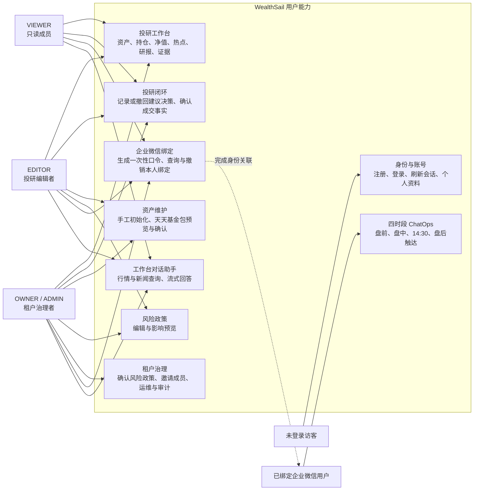
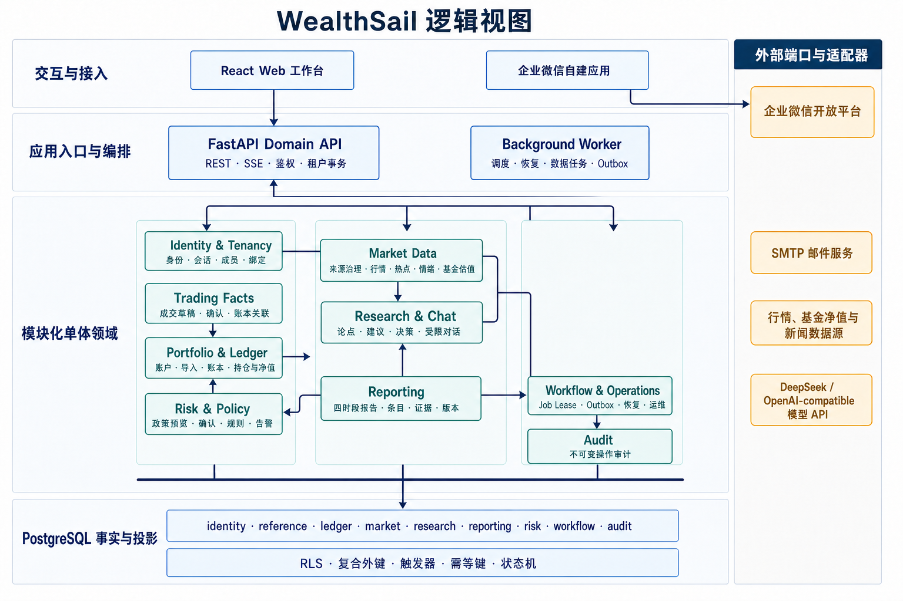
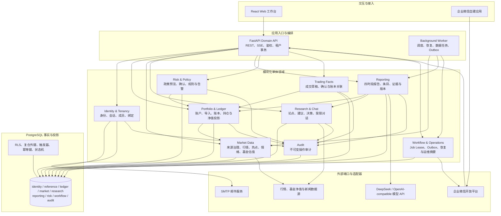
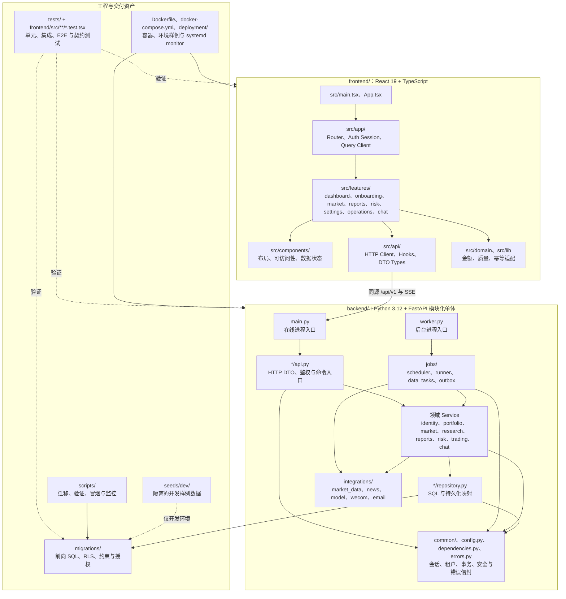
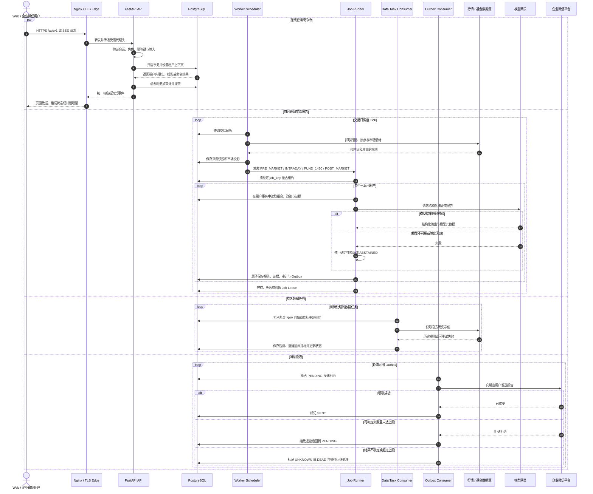
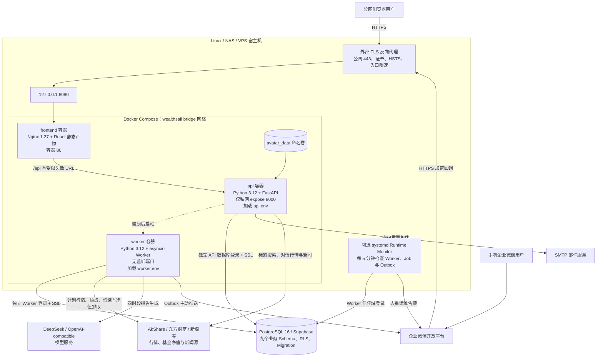

# WealthSail 系统架构五视图

> **文档版本**：v1.0.0  
> **更新日期**：2026-08-29  
> **文档状态**：CURRENT ARCHITECTURE SUMMARY  
> **适用范围**：当前仓库中的 WealthSail L0/L1 Web、API、Worker、数据库、企业微信与部署实现

关联文档：[需求文档](./01.WealthSail投研平台需求文档.md) · [技术架构](./02.WealthSail投研平台全栈技术选型与架构评估.md) · [数据设计](./06.WealthSail数据模型与数据源治理设计.md) · [安全设计](./07.WealthSail安全隐私与合规设计.md) · [Web 工作台规范](./09.WealthSail-MVP-Web投研工作台设计与实现规范.md) · [工程与部署规范](./10.WealthSail-MVP前后端实现与系统部署规范.md) · [多模式部署手册](./15.WealthSail多模式部署与版本更新运维手册.md)

代码基线：[前端路由](../frontend/src/app/router.tsx) · [FastAPI 入口](../backend/main.py) · [Worker 入口](../backend/worker.py) · [Docker Compose](../docker-compose.yml) · [数据库迁移](../migrations/)

---

> **当前模型实现更新**：即时聊天、常规报告中的模型生成和每日公开投研统一使用 Codex，规则计算与确定性报告保持程序执行。下文五视图中的旧模型 API 标识保留为历史架构记录；当前 API / Worker → 独立 Codex runner 的边界、模型配置与登录卷管理见 [Codex 统一模型与 NAS 认证操作指南](./32.Codex统一模型与NAS认证操作指南.md)。

## 1. 系统文字描述

### 1.1 系统定位

WealthSail 是面向个人投资者及小规模家庭/试点团队的多租户投研助手。当前 L1 范围覆盖 A 股、场内 ETF/LOF、场外公募基金与 CNY 现金，围绕“资产事实—市场数据—投研建议—用户决策—成交确认—复盘审计”形成闭环。

系统提供两个互补入口：

- **Web 投研工作台**：负责注册登录、初始化导入、资产与持仓查看、市场热点、历史研报和证据下钻、风险政策、成交事实确认、账号安全及运维摘要。
- **企业微信 ChatOps**：负责用户绑定、08:30 盘前简报、盘中跟踪、14:30 基金报告、15:30 盘后复盘等移动端触达。

### 1.2 总体架构

系统采用“**React 单页应用 + FastAPI 模块化单体 + 独立后台 Worker + PostgreSQL/Supabase + 外部适配器**”架构：

- React 19、TypeScript、TanStack Query 与 Recharts 构成浏览器工作台；生产静态文件由 Nginx 托管。
- FastAPI 是在线信任边界，统一处理身份会话、租户上下文、REST/SSE 接口、领域命令、企业微信回调和审计。
- Worker 以独立进程运行四时段调度、任务恢复、行情刷新、基金净值回填、指标重建和 Outbox 投递。
- PostgreSQL 是共享事实中心，以九个业务 Schema、前向 Migration、事务、约束、RLS 和审计日志保证一致性与租户隔离。
- 行情、基金净值、新闻、模型、企业微信与邮件均通过外部适配边界接入；外部失败不能伪造成可用金融事实。

### 1.3 关键架构原则

1. **后端是信任边界**：浏览器、企业微信回调正文、外部内容和模型输出均不可信；服务端从已验证会话建立 `TenantContext`，并在数据库事务中设置租户上下文。
2. **金融事实确定性优先**：金额、份额、价格和比例由 `Decimal`/`NUMERIC` 与领域规则计算；模型只参与摘要与解释，不拥有账本、持仓和成交事实。
3. **事实与投影分离**：账本事件、成交、来源快照、证据和审计采用追加或受控纠正；持仓、净值、热点与区间指标是可重建投影。
4. **建议、决策和成交分离**：采纳建议不会自动形成成交；成交还需要独立确认并写入交易与账本事实。当前系统不连接券商自动下单。
5. **数据质量显式传播**：数据使用 `FRESH`、`ESTIMATED`、`STALE`、`UNAVAILABLE` 等状态；质量不足时系统降级或 `ABSTAINED`，不使用虚构默认值填补。
6. **副作用异步可靠化**：报告发布与 Outbox 在同一数据库事务中建立投递事实，Worker 通过租约、幂等键、指数退避和 `UNKNOWN/DEAD` 终态控制重复与失败。
7. **API 与 Worker 分权**：二者使用不同环境文件和数据库登录；API 不持有 Worker 的模型和主动推送权限，Worker 不持有浏览器会话密钥。

### 1.4 当前实现边界

本文五视图以仓库当前实现为准，不把路线图当成已交付能力。L2 以上的基金穿透、跨账户归因、多媒体知识治理，以及 L4/L5 的多市场、策略回测、券商自动执行和多 Agent 实验，均不属于本图的当前生产闭环。真实 Supabase、企业微信和公网 TLS 是否已经在目标环境完成验收，应以部署记录和端到端测试证据为准。

---

## 2. 用户视图

用户视图从角色和使用场景出发，说明不同用户通过 Web 与企业微信能够完成什么，以及高风险能力如何受角色限制。

用户侧的主要差异不是“能否看到前端按钮”，而是服务端授权：`VIEWER` 以查看和个人交互为主；`EDITOR` 可以维护组合、确认导入/成交并预览风险政策；只有 `OWNER/ADMIN` 可以确认风险政策生效、邀请成员和查看脱敏运维审计。企业微信是触达渠道，不绕过 Web 会话、租户授权或领域规则。

---

## 3. 逻辑视图

逻辑视图描述系统的领域划分、协作关系和数据归属。FastAPI 与 Worker 是两种应用入口，共用同一组领域规则，但在线请求和后台高权限任务使用不同的运行凭据。

逻辑上的核心边界如下：

- `identity` 决定用户、活动租户和角色；领域 API 不接受客户端自报的 `tenant_id` 作为授权依据。
- `ledger` 保存投资事实与投影，`market` 保存有来源和质量状态的市场事实；报告和模型不能反向修改这些事实。
- `research` 中的建议/决策与 `trading` 中的成交事实分离，通过显式标识建立可选关联。
- `workflow` 保存任务租约、恢复状态和投递状态；外部消息发送不是数据库事务内的同步网络调用。
- `audit` 横切所有高价值命令，运维读取还需要 `OWNER/ADMIN` 权限。

---

## 4. 开发视图

开发视图把逻辑组件映射到仓库目录，并说明编译期/代码级依赖方向。前后端分别按“应用壳 + 业务功能”和“业务领域纵向切片”组织。

开发依赖遵循以下约束：

1. 前端页面通过 `src/api` 访问后端，不连接数据库，也不持有服务端密钥；金额和比例 DTO 使用十进制字符串，图表转换只发生在展示边界。
2. 后端 HTTP 路由与 Job Runner 调用领域 Service，Service 再调用 Repository 或 Integration；高价值业务规则不应沉入路由、Nginx 或前端组件。
3. 跨领域协作优先调用目标领域 Service；数据库约束、RLS 和 Migration 是代码规则之外的第二道防线。
4. `backend/main.py` 与 `backend/worker.py` 复用领域代码和后端镜像，但作为独立发布/运行单元配置、启动和验证。
5. `modules/` 与 `adapters/` 中仍包含可替换能力和原型契约；当前生产主路径以 `backend/` 内已经被入口导入的实现为准。

---

## 5. 运行视图

运行视图展示在线请求与后台任务如何并发工作。API 进程只处理短生命周期请求；Worker 进程内部运行多个相互隔离的 asyncio 循环，持久状态全部落在 PostgreSQL，因此进程重启后可以依据租约和状态继续恢复。

运行时的关键保证是：

- API 请求使用短事务和租户级 RLS 上下文，外部 Provider/模型网络调用不应长期占用数据库事务。
- 四时段调度以 `Asia/Shanghai`、交易日历和稳定 Job Key 决定逻辑时隙；固定时段支持有限补跑，盘中任务避开午间休市。
- Job、数据任务和 Outbox 都先抢占带过期时间的持久租约；重复 Tick 或进程崩溃不会直接产生第二份终态事实。
- 各后台循环相互隔离：行情刷新失败不必阻止报告生成，单个用户投递失败也不阻止其他绑定用户。
- Outbox 采用至少一次尝试语义；网络结果不确定时进入 `UNKNOWN`，避免无依据自动重发。

---

## 6. 部署视图

部署视图以当前首选的 Linux/NAS/VPS 全栈 Docker Compose 模式为基线。Compose 管理前端、API 与 Worker；公网 TLS、托管数据库和可选 systemd Runtime Monitor 位于 Compose 之外。

部署边界与发布单元如下：

- `frontend` 仅把容器 80 映射到宿主机 `127.0.0.1:8080`，公网不能直接访问该端口；外部 TLS 代理是唯一预期入口。
- `api` 只在 Compose 私网提供 8000，`worker` 不监听入站端口。企业微信回调经 TLS Edge 和前端 Nginx 的 `/api/` 反向代理进入 API。
- API 与 Worker 复用后端镜像，但 Secret 与数据库权限严格拆分；生产启动校验发现越权或缺失配置时失败关闭。
- PostgreSQL/Supabase 不在当前 Compose 中，升级由 `migrations/*.sql` 和 `scripts/migrate.py` 独立执行；数据库变更必须先备份、dry-run、正式迁移并 readback，再切换 API、Worker 与前端。
- `avatar_data` 是当前 Compose 内的持久卷；报告、账本、任务和审计均持久化在 PostgreSQL，不依赖容器本地磁盘。
- Runtime Monitor 的 service/timer 文件已在 `deployment/systemd/` 提供，但 Compose 不会自动启用它；正式环境需要显式安装该 timer 或提供等价外部监控。
- 系统也支持宿主机 Nginx + systemd、独立静态站点/CDN 和 Windows 本地开发等模式；这些模式改变物理部署位置，不改变逻辑领域、数据库安全边界和 API/Worker 分权原则。

---

## 7. 五视图之间的对应关系

| 视图 | 回答的问题 | 关键落点 |
|---|---|---|
| 用户视图 | 谁在什么场景使用哪些能力？ | Web/企业微信双端、四类租户角色、只读/编辑/治理权限 |
| 逻辑视图 | 系统由哪些领域组成，数据如何归属？ | 模块化单体、九个业务 Schema、外部 Port/Adapter |
| 开发视图 | 代码如何组织，依赖朝哪个方向流动？ | `frontend/src/features`、`backend/*` 纵向领域、`migrations` 与测试 |
| 运行视图 | 请求和后台任务如何并发、恢复与降级？ | API 短事务、Worker 多循环、Job Lease、Data Task、Outbox |
| 部署视图 | 软件部署到哪些节点，网络与凭据如何隔离？ | TLS Edge、Compose 三容器、外部 PostgreSQL、分权环境与监控 |

五个视图共同表达同一条架构主线：用户通过受控渠道发起操作，领域服务以确定性规则处理金融事实，PostgreSQL 保存可审计状态，Worker 承担可恢复的后台工作，外部智能与数据能力始终停留在可替换、可降级的系统边缘。
