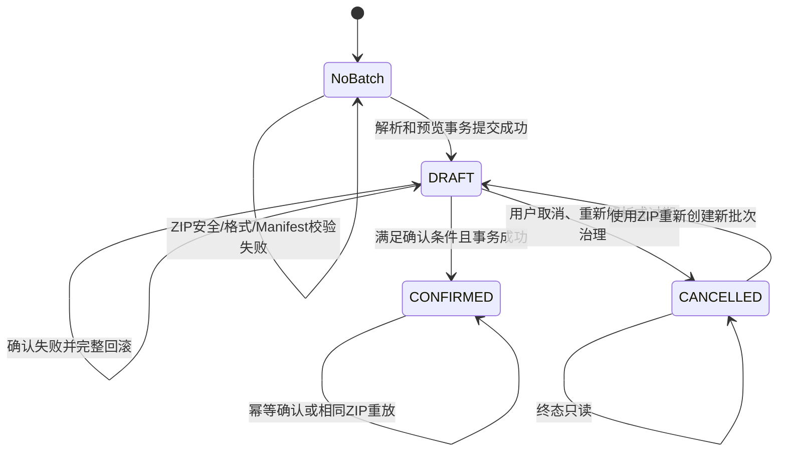

# WealthSail 导入批次状态、幂等与草稿治理设计

> 文档状态：最优方案待用户确认
>
> 适用范围：天天基金 ZIP 导入，以及后续股票、基金、券商和第三方平台的文件导入
>
> 最后更新：2026-08-29

## 1. 文档目的

本文统一回答以下问题：

- WealthSail 怎样判断两个导入包相同；
- 相同 ZIP 应恢复已有草稿，还是取消旧草稿后重新解析；
- “上传失败”“预览成功”和“正式持仓写入成功”之间是什么关系；
- `DRAFT / CONFIRMED / CANCELLED` 怎样转换；
- `VALID / INVALID / NEEDS_REVIEW` 在批次、持仓项和来源记录中分别表示什么；
- 草稿是否可以物理删除，删除后会损失哪些恢复、去重和审计能力；
- 当前实现已经具备哪些安全保证，还有哪些能力需要补齐。

本文只讨论导入工作流状态，不改变以下既有原则：

1. 当前持仓快照用于更新外部账户基线，不伪造成真实买卖；
2. 历史流水作为来源事实保存，不自动生成未经证明的成交和资金流水；
3. 只有用户确认后的批次才能改变正式持仓；
4. 正式持仓写入和净值区间指标计算相互解耦，指标失败不得回滚已确认持仓。

## 2. 核心术语

### 2.1 导入包

用户上传的单个 ZIP 文件。天天基金 v2 导入包包含 Manifest、当前持仓、历史流水、待复核记录和排除摘要。

### 2.2 导入批次

`ledger.portfolio_import_batches` 中的一条记录。一个批次表示一次可审计的预览、确认或取消过程，而不是一笔真实交易。

### 2.3 草稿

状态为 `DRAFT` 的导入批次。草稿已经保存了解析结果和预览差异，但尚未写入正式持仓账本。

### 2.4 来源绑定

`ledger.portfolio_source_bindings` 将租户内匿名化的天天基金来源账户绑定到一个 WealthSail 投资账户。相同 ZIP 是否重复，需要在同一租户和同一来源绑定范围内判断。

### 2.5 幂等

相同业务请求无论提交一次还是重复提交多次，都只产生一次业务效果。网络超时后客户端无法判断服务端是否已经提交，因此导入预览、确认和取消都必须支持幂等重放。

## 3. 相同 ZIP 的当前判定方式

### 3.1 当前实现

服务端读取整个 ZIP 的原始二进制内容，计算：

```text
package_content_hash = SHA256(ZIP 完整原始字节)
```

数据库在以下范围内阻止同时存在两个相同的未取消批次：

```text
tenant_id + source_binding_id + package_content_hash
```

`DRAFT` 和 `CONFIRMED` 都参与唯一性判断，`CANCELLED` 不参与。因此：

- 同一草稿不能因为重复点击或网络重试而被重复创建；
- 已确认的同一 ZIP 不能再次写入正式持仓；
- 旧批次明确取消后，允许使用原 ZIP 重新创建草稿。

### 3.2 “内容相同”的准确含义

当前判断的是“字节级完全一致”，不是“业务语义一致”。

| 情况 | 当前是否判定为相同 |
|---|---|
| 文件名变化，ZIP 字节不变 | 是 |
| 在不同时间重复上传同一个文件 | 是 |
| ZIP 内业务数据相同，但重新压缩 | 不一定 |
| ZIP 文件顺序或压缩级别变化 | 通常不是 |
| ZIP 内 JSON 只改变空格或字段顺序 | 不是 |
| 相同 ZIP 属于不同租户或不同来源绑定 | 不是同一业务批次 |

SHA-256 碰撞在本场景中可以忽略，但原始 ZIP 哈希不能识别“重新打包后业务数据仍然相同”的情况。

### 3.3 推荐的双哈希模型

后续建议同时保存：

- `archive_content_hash`：整个 ZIP 的 SHA-256，用于安全校验、审计和取证；
- `logical_package_hash`：对规范化后的账户标识、快照日期、持仓记录和来源流水计算，用于业务语义去重。

逻辑哈希计算必须满足：

1. 字段顺序、JSON 空格和 ZIP 压缩方式不影响结果；
2. 持仓和流水按稳定业务主键排序；
3. 数值、日期、空值和枚举先统一规范化；
4. 来源账户、快照日期和 Schema 版本必须进入哈希；
5. 原始哈希和逻辑哈希都保留，不能用逻辑哈希替代原始文件审计哈希。

MVP 可继续使用字节级哈希，但 API 和文档必须明确其含义。

## 4. 为什么预览成功需要生成草稿

### 4.1 草稿不是正式导入

“解析并预览”成功表示服务端已经完成以下工作：

- ZIP 安全检查和 Manifest 校验；
- 当前持仓和历史流水解析；
- 基金主数据核验；
- 与现有来源基线、正式账本和已确认流水比较；
- 生成新增、变化、不变、清仓和冲突分类；
- 保存用户可以恢复和核对的预览结果。

上述结果以 `DRAFT` 保存，但此时正式持仓没有变化。

### 4.2 哪些失败不会生成草稿

以下错误发生在草稿事务提交之前，不应产生任何新批次：

- ZIP 非法、损坏、加密、路径穿越或解压限制超标；
- Manifest 缺失、Schema 不支持或文件哈希不一致；
- JSON 无法解析或关键持仓文件缺失；
- 上传参数、账户目标或权限校验失败；
- 保存草稿的数据库事务失败并回滚。

### 4.3 为什么客户端看到失败时服务端仍可能已有草稿

分布式系统存在不可消除的响应不确定窗口：

```text
数据库提交草稿成功
        ↓
服务端准备返回 200
        ↓
网络中断或浏览器超时
        ↓
客户端认为失败，服务端实际成功
```

客户端错误不能反向证明数据库没有提交。此时再次上传必须恢复原草稿，而不是盲目创建第二条。幂等恢复正是用于解决该问题。

## 5. 恢复草稿能保证什么

### 5.1 可以保证的内容

只要草稿创建事务成功，就可以保证：

- 批次、持仓预览项、规范化来源记录和来源绑定要么全部提交，要么全部回滚；
- 草稿保存的是第一次成功预览时的完整一致结果，不是半成品；
- `package_content_hash` 可以证明草稿关联的是同一个原始 ZIP；
- 正式账本尚未产生该草稿的经济效果；
- 重复上传不会额外生成一套批次、持仓项和来源记录；
- 网络超时、页面刷新或浏览器关闭后仍可继续核对和确认。

### 5.2 不能保证的内容

恢复草稿不应承诺“今天重新运行最新版解析器一定会得到完全相同的预览”。预览结果还依赖：

- 解析器和归一化算法版本；
- 当时的基金权威主数据；
- 当时已确认的来源基线；
- 当时账户中其他正式账本事实；
- 冲突检测和持有日期推导算法版本。

即使 ZIP 字节完全相同，上述外部状态或算法发生变化，今天重新解析也可能得到不同结果。

因此恢复草稿的正确语义是：

> 恢复第一次成功提交的完整预览结果，而不是重新计算后证明两次结果永远相同。

要求系统证明“旧草稿与任意时间重新解析结果完全一致”既复杂，也不符合现实。正确方案是保存版本和上下文，并在上下文变化时把草稿标记为过期或提供重新解析。

### 5.3 恢复草稿的主要价值

减少数据库重复数据只是次要收益，主要价值依次是：

1. 防止重复确认和重复账本效果；
2. 解决数据库已提交但客户端未收到响应的不确定性；
3. 保持用户核对的是同一份预览，而不是每次刷新都重新计算；
4. 支持页面刷新、跨设备和稍后继续；
5. 保存问题定位和审计依据；
6. 减少重复主数据查询、差异分析和数据库写入。

## 6. 恢复、重新解析和已确认重放的决策规则

| 已有批次 | 上下文 | 推荐行为 |
|---|---|---|
| 无 | 新 ZIP | 创建 `DRAFT` |
| `DRAFT` | ZIP 相同且上下文仍有效 | 恢复原草稿 |
| `DRAFT` | 账户事实已经变化 | 标记过期，要求重新解析 |
| `DRAFT` | 预览引擎版本发生变化 | 标记过期；再次上传时不允许恢复，只能重新解析 |
| `DRAFT` | 只怀疑权威主数据可能变化 | 保留旧草稿并让用户选择，不做破坏性自动判断 |
| `DRAFT + INVALID` | 用户希望重新验证原阻断问题 | 用户明确选择后，取消旧草稿并重新解析 |
| `CONFIRMED` | ZIP 相同 | 返回“已经导入”，禁止重复写入 |
| `CANCELLED` | ZIP 相同 | 允许创建新草稿 |
| 任意状态 | ZIP 业务数据不同 | 按新导入包创建新草稿并重新比较 |

API 应返回本次处理方式，不能只返回批次状态：

```text
previewDisposition:
  CREATED
  RESTORED_DRAFT
  ALREADY_CONFIRMED
  REPARSED
  USER_DECISION_REQUIRED
```

前端分别提示：

- 已生成新预览，尚未写入正式持仓；
- 检测到相同 ZIP，已恢复已有草稿；
- 该 ZIP 已经确认导入，不会重复写入；
- 旧草稿已保留为取消记录，并已使用当前规则重新解析。

## 7. 为什么不应直接物理删除草稿

### 7.1 删除会丢失重复判断依据

相同 ZIP 判断依赖批次中保存的包哈希。物理删除批次后：

- 系统无法知道该 ZIP 是否曾经上传；
- 无法判断它曾经失败、被取消还是已经生成过预览；
- 下次只能视为全新导入；
- 若没有独立的哈希墓碑表，就失去了重复上传诊断能力。

所以“删除草稿帮助判断重复上传”这一说法不成立。删除会削弱重复判断；保留取消批次才可以帮助判断历史重复。

### 7.2 删除会损失恢复和审计能力

物理删除还会丢失：

- 上传人、创建时间和目标账户；
- 当时的解析器版本和数据窗口；
- 预览分类、阻断原因和警告；
- 用户为何没有确认；
- 网络超时后服务端是否已经成功；
- 线上故障复盘和安全审计证据。

### 7.3 天天基金批次不适合简单删除

首次草稿可能同时创建 `PENDING` 来源绑定，批次和绑定之间有双向完整性关系。直接删除需要同时处理来源绑定、持仓项和来源记录，容易破坏引用完整性。

数据库目前允许删除普通 `DRAFT` 批次的基础语义，但天天基金工作流没有提供硬删除 API，也不应把硬删除作为正常用户操作。

### 7.4 推荐的取消与压缩策略

用户要重新开始时，应采用逻辑取消：

```text
DRAFT --取消/重新解析--> CANCELLED
                              ↓
                         新建 DRAFT
```

为了减少长期存储，可以在保留批次墓碑的前提下压缩已取消草稿：

永久保留：

- batch id、租户、账户和来源绑定；
- 原始 ZIP 哈希和逻辑哈希；
- Schema、解析器版本和快照日期；
- 状态、取消原因、创建/取消时间；
- 汇总计数、错误码和审计记录。

按保留策略清理或归档：

- 逐条持仓预览明细；
- 规范化来源 JSON；
- 非必要的临时解析上下文。

当前设计文档提出“DRAFT 7 天后自动取消，取消后清理草稿来源记录”，但代码尚未实现完整的过期任务和压缩流程；并且现有来源记录保护触发器只允许父批次为 `DRAFT` 时删除记录。因此清理必须在状态切换前同一事务完成，或者增加受控的系统压缩路径。

## 8. 持久化状态模型

### 8.1 导入批次状态

导入批次只保留三个经济生命周期状态：

| 状态 | 含义 | 正式持仓是否变化 | 后续动作 |
|---|---|---:|---|
| `DRAFT` | 已生成预览，等待核对 | 否 | 确认、取消、恢复或重新解析 |
| `CONFIRMED` | 已原子写入正式账本 | 是 | 只读、指标重试，不可取消 |
| `CANCELLED` | 草稿明确作废 | 否 | 只读，可用原 ZIP 创建新草稿 |

“上传中、解析中、确认中、请求失败”是短暂的操作状态，不应写入经济批次状态。它们应由前端状态机、结构化日志和请求追踪表达。

### 8.2 状态转换



数据库必须禁止：

- `CONFIRMED → DRAFT`；
- `CONFIRMED → CANCELLED`；
- `CANCELLED → DRAFT` 原地复活；
- 修改终态批次的来源、账户、哈希和创建人。

重新导入必须创建新的 batch id，不能把旧取消批次原地改回 `DRAFT`。

### 8.3 DRAFT 确认条件

`DRAFT → CONFIRMED` 必须同时满足：

1. 操作者具有 `OWNER / ADMIN / EDITOR` 权限；
2. `If-Match` 版本与数据库版本一致；
3. 批次和所有可入账持仓项通过校验；
4. 没有基金代码、来源绑定或账本冲突；
5. 预览后目标账户事实哈希没有变化；
6. 人工持有开始日期不晚于快照日期；
7. 空持仓快照经过明确的二次确认；
8. 相同来源流水 ID 没有出现不同内容；
9. 新增、变化、清仓和不变持仓产生且仅产生预期账本效果；
10. 来源事实、账本事件、绑定激活、批次终态、投影重建、后台任务和审计在同一事务中完成。

任一条件失败，确认事务整体回滚，批次仍为 `DRAFT`，正式持仓不能部分写入。

## 9. `NEEDS_REVIEW` 在不同语境中的含义

`NEEDS_REVIEW` 目前出现在多个数据层级，但语义并不相同，不能统一翻译成“导入失败”。

### 9.1 批次级：`portfolio_import_batches.validation_status`

数据库允许：

```text
VALID / INVALID / NEEDS_REVIEW
```

理想语义：

- `VALID`：整批满足确认条件；
- `INVALID`：存在明确阻断错误；
- `NEEDS_REVIEW`：自动校验尚未形成最终结论，需要人工处理或重新校验后才能变为 `VALID / INVALID`。

当前实现问题：

- 天天基金预览持久化时只明确写入 `VALID` 或 `INVALID`；
- 手工初始化批次可能继承数据库默认值 `NEEDS_REVIEW`，但确认路径只检查条目状态；
- 前端批次类型只声明 `VALID / INVALID`；
- 没有完整的“批次人工处理后重新校验并转换状态”命令。

因此批次级 `NEEDS_REVIEW` 当前不是一个闭环状态。推荐收敛方案：

1. 批次只公开 `VALID / INVALID`；
2. “有非阻断待复核来源记录”通过 `reviewRequiredCount` 和 warnings 表达；
3. 如果未来确实需要阻断式人工复核，再实现独立的处理命令、审计和 `NEEDS_REVIEW → VALID / INVALID` 转换。

### 9.2 持仓项级：`portfolio_import_items.validation_status`

理想语义：某一条持仓数据需要人工补齐代码、账户、日期或数值后才能决定是否可确认。

当前天天基金实现实际只写入：

- `VALID`：持仓项可以参与确认；
- `INVALID`：未知基金、账户账本冲突等阻断项。

当前没有持仓项级的通用人工修复并重新校验流程，因此 `NEEDS_REVIEW` 对天天基金持仓项同样未形成闭环。持有开始日期不确定不应直接把持仓项标记为 `NEEDS_REVIEW`；它由候选日期、推导方法、可信度和原因表达，用户可以覆盖日期。

### 9.3 来源记录级：`portfolio_import_source_records.validation_status`

这是当前 `NEEDS_REVIEW` 使用最合理、最完整的地方。

典型记录包括：

- 组合一键买入或组合卖出；
- 调仓活动；
- 不能安全分类成逐基金交易的特殊业务；
- 可以作为持有日期证据，但不能证明某只基金真实买卖的记录。

这里的 `NEEDS_REVIEW` 表示：

> 保留为可审计的来源证据，允许用户查看，但绝不伪造成买卖、分红或资金流水。

它通常不会阻断权威当前持仓快照确认，只产生 warning 和待复核计数。确认时只有 `record_type = FUND_TRANSACTION` 且 `validation_status = VALID` 的记录才能进入已确认来源流水表。

### 9.4 `classification = NEEDS_REVIEW`

来源记录还有独立的 `classification` 字段。对无法进一步识别的待复核记录，分类可能同样写为 `NEEDS_REVIEW`；组合活动则可以分类为 `PORTFOLIO_ACTIVITY_EVIDENCE`，但其校验状态仍为 `NEEDS_REVIEW`。

二者含义不同：

- `classification` 回答“这是什么类型的证据”；
- `validation_status` 回答“它是否允许进入后续已确认事实”。

### 9.5 指标和持有日期不使用 `NEEDS_REVIEW`

持有日期使用：

- 推导方法；
- `HIGH / MEDIUM / LOW / NONE` 可信度；
- `MISMATCH / INSUFFICIENT_DATA` 等原因。

区间指标使用：

- `PENDING / READY / PARTIAL / CONFLICT / FAILED`。

不要再用 `NEEDS_REVIEW` 覆盖这些领域，否则前端无法判断究竟是导入阻断、来源证据待看，还是指标数据不完整。

## 10. 其他正交状态

### 10.1 来源绑定状态

```text
PENDING → ACTIVE ↔ DISABLED
```

- `PENDING`：草稿已建立来源身份，但尚无成功确认；
- `ACTIVE`：至少一次确认成功，可持续更新该来源账户；
- `DISABLED`：暂停该来源后续确认，但保留历史身份和事实。

取消首个草稿不应把 `PENDING` 绑定误认为已经激活。

### 10.2 指标状态

正式持仓确认后，指标异步计算：

```text
PENDING → READY
        → PARTIAL
        → CONFLICT
        → FAILED --重试--> PENDING
```

- `CONFIRMED + PENDING` 表示持仓已经成功，指标仍在计算；
- 指标失败只允许重试指标任务，不能重放正式持仓账本效果；
- 指标状态不是批次经济状态，不能把批次改回 `DRAFT`。

### 10.3 前端短暂状态

前端建议使用显式状态机：

```text
SELECTING
  → PREVIEWING
  → REVIEWING
  → CONFIRMING
  → CONFIRMED
```

错误返回到最近一个稳定状态：

- 预览请求失败回到 `SELECTING`，若服务端实际已提交则幂等恢复；
- 确认失败回到 `REVIEWING`，保留用户输入；
- 指标失败仍停留在 `CONFIRMED` 结果页，只显示指标重试入口。

这些状态不应扩充为数据库批次状态。

## 11. 当前完备性评估

### 11.1 已经较完备的部分

- ZIP 在解析后才进入数据库事务；
- 预览不写正式账本；
- 相同幂等键和相同 ZIP 可以恢复已有结果；
- 相同 ZIP 的未取消批次受数据库唯一索引保护；
- 确认使用行锁、账户级 advisory lock、版本和账户事实哈希；
- 来源事实、账本效果、绑定、批次、投影、任务和审计原子提交；
- `CONFIRMED / CANCELLED` 是不可逆终态；
- 指标任务失败不影响正式持仓，并支持独立重试；
- 未知或不可靠来源记录不会被伪造成交易。

### 11.2 仍需补齐的部分

按优先级建议：

#### P0：用户可理解性和正确重试

1. API 返回 `previewDisposition`，明确新建、恢复、已确认或重新解析；
2. 前端显示“预览成功但尚未正式导入”，避免把 `DRAFT` 误解为失败；
3. 提供“取消旧草稿并重新解析”入口，并使用单个原子命令；
4. 检测账户事实变化，恢复时直接标记草稿过期，而不是等确认才报 409。

#### P1：状态语义收敛

1. 收敛批次和持仓项的 `NEEDS_REVIEW`，修正数据库、后端 DTO 和前端类型不一致；
2. 给解析器记录真实算法版本或构建版本，而不是长期复用过于宽泛的字符串；
3. 增加 `logical_package_hash`，识别重新压缩但业务内容相同的包；
4. 新批次确认后，标记同一来源下基于旧账户事实的其他草稿为 stale 或 superseded。

#### P2：保留和运维治理

1. 实现 DRAFT 过期扫描和 7 天自动取消策略；
2. 实现取消批次的明细压缩，同时保留批次哈希墓碑和审计；
3. 补充恢复、重新解析、自动取消、压缩和过期冲突的结构化日志与监控；
4. 增加真实 PostgreSQL 集成测试，覆盖“提交成功但响应丢失后重复上传”的完整链路。

## 12. 推荐最终决策

1. 保留 `DRAFT / CONFIRMED / CANCELLED` 三个核心批次状态，不增加 `UPLOADING / PARSING / FAILED` 等短暂数据库状态；
2. 相同 ZIP 的 `FRESH + VALID` 草稿默认恢复，明确 `STALE` 时重新解析，`INVALID` 或来源绑定不可用时由用户选择；相同已确认 ZIP 返回 `ALREADY_CONFIRMED`；
3. 不向普通用户提供硬删除草稿；重新开始使用“取消并重新解析”；
4. 恢复只保证原草稿事务完整并对应相同原始 ZIP，不承诺与未来版本重新解析结果永远一致；
5. 使用 stale 检测、真实解析器版本和显式重新解析解决上下文变化问题；
6. `NEEDS_REVIEW` 主要保留在来源记录层；批次和持仓项层在没有人工处理闭环前收敛为 `VALID / INVALID`；
7. 取消批次保留最小哈希墓碑，必要时压缩明细，不能通过物理删除牺牲重复判断和审计能力；
8. 数据库重复数据减少是恢复草稿的附带收益，核心目标是财务写入幂等、故障恢复和用户核对一致性。

## 13. 验收场景

后续实现上述优化时至少覆盖：

1. 首次上传成功，返回 `CREATED + DRAFT`；
2. ZIP 解析失败，不产生批次、绑定、条目或来源记录；
3. 草稿事务失败，所有数据完整回滚；
4. 数据库提交成功但响应丢失，再次上传返回 `RESTORED_DRAFT`；
5. 相同 ZIP 已确认，再次上传返回 `ALREADY_CONFIRMED`，账本事件数量不变；
6. 相同 ZIP 已取消，再次上传创建新的 batch id；
7. 同业务数据重新压缩：原始哈希不同、逻辑哈希相同；
8. 草稿后账户事实变化，恢复时标记 stale，禁止直接确认；
9. 预览引擎版本升级后，旧草稿可以继续保留查看，但不得恢复为可确认预览，必须重新解析；
10. `REPARSE` 在单一事务中取消旧草稿并创建新草稿，任一步失败都不留下中间状态；
11. `NEEDS_REVIEW` 来源记录可查看但不进入正式来源流水；
12. `INVALID` 持仓项阻断确认，非阻断 warning 不误伤权威持仓快照；
13. 确认失败后批次保持 `DRAFT`，正式持仓无部分效果；
14. 指标任务失败时批次保持 `CONFIRMED`，仅重试指标；
15. 过期任务自动取消旧草稿并保留最小批次墓碑；
16. 压缩取消批次后仍能判断该 ZIP 曾经上传和取消。

## 14. 与其他文档的关系

- 操作和故障排查参见 `docs/14.天天基金数据导入.md`；
- 数据表、来源治理和账本事实语义参见 `docs/06.WealthSail数据模型与数据源治理设计.md`；
- API、Worker 和部署规范参见 `docs/10.WealthSail-MVP前后端实现与系统部署规范.md`；
- 数据库升级、迁移和 readback 参见 `docs/11.数据库升级方法.md`；
- 原始专项设计参见 `docs/superpowers/specs/2026-08-27-wealthsail-tiantian-fund-import-and-range-metrics-design.md`。

## 15. 最优产品与技术方案（待确认实施）

### 15.1 三种策略比较

#### 方案 A：相同 ZIP 永远恢复旧草稿

优点：

- 幂等和故障恢复最简单；
- 不重复保存相同批次和来源记录；
- 用户始终核对同一份预览。

缺点：

- 解析算法、主数据或账户事实变化后，可能长期恢复已经过期的结果；
- 原本因临时主数据失败产生的 `INVALID` 草稿无法通过重新上传自动修复。

不建议单独采用。

#### 方案 B：相同 ZIP 永远取消旧草稿并重新解析

优点：

- 每次都使用当前算法、主数据和账户事实；
- 不需要定义草稿新鲜度。

缺点：

- 网络重试也会产生新批次，破坏幂等恢复；
- 用户可能正在核对的有效草稿被无意义替换；
- 增加外部调用、数据库写入、取消记录和审计噪音；
- 新解析受临时服务故障影响时，可能用更差结果替换原有效草稿。

不建议单独采用。

#### 方案 C：确定性自动决策，存在不确定性时由用户选择

这是推荐方案：

- 明确新鲜的相同草稿自动恢复；
- 明确过期的草稿禁止确认，用户上传原 ZIP 后自动重新解析；
- 已确认的相同 ZIP 只返回已导入结果；
- 判断不确定时不自动取消，保留旧草稿并向用户提供“继续草稿”和“重新解析”；
- 重新解析先完成全部校验，只有新草稿可以安全落库时，才在同一事务中取消旧草稿并创建新草稿。

该方案同时兼顾财务安全、幂等恢复、易用性和算法演进。

### 15.2 用户不上传文件时的草稿入口

用户登录并进入“持仓导入与更新”页面后，系统必须主动查询当前租户的 `DRAFT`，不能要求用户再次选择 ZIP 才能发现草稿。

页面先显示“待处理草稿”，再显示上传区。每张草稿卡至少展示：

- 来源账户和目标 WealthSail 账户；
- 快照日期、创建时间和更新时间；
- 新增、变化、不变、清仓和冲突数量；
- `VALID / INVALID` 校验结论；
- `FRESH / STALE` 新鲜度；
- 过期或阻断原因；
- 可执行操作。

用户不上传 ZIP 也可以：

- 打开草稿并查看完整持仓、历史流水和问题提示；
- 对 `FRESH + VALID` 草稿继续确认；
- 取消任意 `DRAFT`；
- 对过期或无效草稿查看重新解析说明。

重新解析仍需要用户选择原 ZIP，因为服务端不长期保存原始私密 ZIP，只保存脱敏、规范化后的预览结果。

若只有一个待处理草稿，页面可以突出显示但不强制自动弹窗；若有多个草稿，按更新时间倒序展示并显示待处理数量。资产看板可以增加“有 N 个待处理导入草稿”的入口提示。

### 15.3 草稿新鲜度不是新的批次状态

保持 `DRAFT / CONFIRMED / CANCELLED` 三个批次状态，同时增加只读派生字段：

```text
freshness:
  FRESH
  STALE

freshnessReasons:
  ACCOUNT_FACTS_CHANGED
  PREVIEW_ENGINE_CHANGED
  NEWER_SOURCE_SNAPSHOT_CONFIRMED
```

判定规则：

- `FRESH`：账户事实哈希未变化、预览引擎版本一致、没有更新的已确认来源快照、来源绑定仍兼容；
- `STALE`：账户事实、预览引擎或已确认来源基线明确发生变化，旧预览不再允许确认；

`validationStatus`、来源绑定状态和 `freshness` 必须分开：

- `VALID + FRESH`：可以确认；
- `VALID + STALE`：数据本身合法，但比较上下文过期，必须重新解析；
- `INVALID + FRESH`：上下文未变，但存在业务阻断问题；
- `INVALID + STALE`：既有阻断问题，比较上下文也已经过期。

来源绑定为 `DISABLED` 或账户不兼容时，通过 `blockingErrors` 和 `availableActions` 表达，不能伪装成草稿新鲜度问题。

读取草稿时计算新鲜度用于前端展示；确认时必须在数据库锁内重新计算，防止用户打开页面后账户事实再次变化。

### 15.4 预览引擎版本

现有 `parser_version` 必须升级为真正影响预览结果的版本标识。以下任一规则变化都必须提升版本：

- ZIP 解析和字段归一化；
- 基金主数据匹配；
- 当前基线差异比较；
- 历史流水分类和冲突判断；
- 持有开始日期推导；
- 阻断错误和 warning 规则。

仅修改前端样式、日志文字或不影响预览结果的性能优化，不提升该版本。

历史草稿的版本与当前预览引擎不一致时标记为 `STALE / PREVIEW_ENGINE_CHANGED`，不再允许直接确认。

### 15.5 再次上传相同 ZIP 时的服务端决策

预览接口增加可选策略：

```text
duplicatePolicy:
  AUTO       # 默认，服务端按确定性规则处理
  RESTORE    # 用户明确要求恢复；只有 FRESH 草稿允许
  REPARSE    # 用户明确要求取消旧草稿并重新解析
```

服务端返回：

```text
previewDisposition:
  CREATED
  RESTORED_DRAFT
  ALREADY_CONFIRMED
  REPARSED
  USER_DECISION_REQUIRED
```

`AUTO` 决策矩阵：

| 相同 ZIP 的已有批次 | 判断结果 | AUTO 行为 |
|---|---|---|
| 无 | 无重复 | 创建新草稿 |
| `CONFIRMED` | 已正式导入 | 返回原确认结果，不产生任何写入 |
| `DRAFT + FRESH + VALID` | 可以安全继续 | 自动恢复旧草稿 |
| `DRAFT + STALE` | 旧比较结果不可确认 | 新预览校验通过后，原子取消旧草稿并新建草稿 |
| `DRAFT + INVALID` | 是否可修复不确定 | 保留旧草稿，返回 `USER_DECISION_REQUIRED` |
| `DRAFT + 来源绑定不可用` | 可能需要启用绑定、改账户或运维处理 | 保留旧草稿，返回具体阻断原因 |
| `CANCELLED` | 不参与活跃重复约束 | 创建新草稿 |

自动处理只使用确定性信号。系统不得因为“可能算法更好”或“可能主数据已更新”自动删除一份仍然 `FRESH + VALID` 的草稿。

### 15.6 用户选择重新解析

用户在以下位置可以选择“重新解析”：

- 恢复草稿后的页面；
- 再次上传相同 ZIP 后的重复提示；
- `INVALID` 草稿或来源绑定不可用的问题说明区。

重新解析的安全流程：

1. 在数据库外完成 ZIP 安全检查、Manifest 校验和权威主数据查询；
2. 进入租户事务，锁定来源绑定和旧草稿；
3. 重新计算账户事实、来源基线和预览计划；
4. 确认旧草稿仍为预期版本且没有被其他请求确认或取消；
5. 若新预览不能安全持久化，不改变旧草稿；`AUTO` 只有在新预览通过校验时才替换，显式 `REPARSE` 可以在用户确认后生成新的 `INVALID` 草稿供排错；
6. 将旧草稿更新为 `CANCELLED`，取消原因为 `SUPERSEDED_BY_REPARSE`；
7. 创建新 `DRAFT` 并记录 `supersedes_batch_id`；
8. 写入一次包含新旧 batch id、包哈希、引擎版本和原因的审计记录；
9. 提交事务后返回 `REPARSED`。

取消旧草稿和创建新草稿必须在同一事务中完成。任何步骤失败时，旧草稿保持原状，不能出现“旧草稿已取消但新草稿没有创建”的中间状态。

已经 `CONFIRMED` 的批次不能被重新解析覆盖。用户必须上传包含新快照或新业务数据的导入包，形成新的业务批次。

### 15.7 数据模型调整

建议新增迁移，给天天基金导入批次增加：

```text
logical_package_hash       业务规范化内容哈希，可分阶段实现
terminal_reason            USER_CANCELLED / SUPERSEDED_BY_REPARSE / EXPIRED
supersedes_batch_id        当前新批次替代的旧批次
```

复用现有字段：

- `package_content_hash`：原始 ZIP 字节哈希；
- `parser_version`：升级为预览引擎语义版本；
- `target_account_state_hash`：账户事实新鲜度；
- `version`：乐观锁；
- `terminal_idempotency_key / terminal_content_hash`：确认、取消和重新解析的命令幂等。

`freshness` 不持久化为批次状态，避免随账户事实变化后数据库值过期；读取和确认时动态计算。

### 15.8 API 与前端合同

后端至少调整：

```text
GET  /api/v1/portfolio/imports?sourceType=TIANTIAN_FUND_ZIP&status=DRAFT
GET  /api/v1/portfolio/imports/{batchId}
POST /api/v1/portfolio/imports/tiantian/preview
POST /api/v1/portfolio/imports/{batchId}/confirm
POST /api/v1/portfolio/imports/{batchId}/cancel
```

列表和详情增加：

```json
{
  "freshness": "FRESH",
  "freshnessReasons": [],
  "availableActions": ["VIEW", "CONFIRM", "CANCEL", "REPARSE"]
}
```

预览请求增加 `duplicatePolicy`，预览响应增加 `previewDisposition`。错误响应使用明确错误码，例如：

```text
DRAFT_STALE_REPARSE_REQUIRED
DRAFT_RESTORE_NOT_ALLOWED
DUPLICATE_IMPORT_ALREADY_CONFIRMED
REPARSE_REQUIRES_UPLOAD
SOURCE_BINDING_DISABLED
```

前端不能再用通用“服务内部错误”表达重复草稿、过期草稿和已确认批次。

### 15.9 并发与失败处理

- 同一来源绑定的恢复、重新解析和确认必须串行化；
- `If-Match` 防止用户操作旧版本草稿；
- 重新解析使用独立幂等键，网络重试返回同一个新批次；
- 两个并发 `REPARSE` 只能有一个创建新草稿，另一个恢复获胜结果；
- `CONFIRM` 与 `REPARSE` 并发时，以先获得锁并满足版本条件者成功，另一方收到 409；
- 新预览持久化失败、审计失败或数据库断开时，旧草稿状态完整回滚；
- 原始 ZIP 临时文件在请求结束后删除，不因草稿恢复而长期保存。

### 15.10 分阶段实施范围

#### 第一阶段：完整可用闭环

1. 未上传时展示全部待处理 `DRAFT`；
2. 草稿详情支持直接确认和取消；
3. 增加新鲜度和原因计算；
4. 确认时强制重新检查新鲜度；
5. 增加 `duplicatePolicy` 和 `previewDisposition`；
6. 实现确定性 `AUTO` 决策；
7. 实现取消旧草稿并新建草稿的原子 `REPARSE`；
8. 增加终态原因、替代关系、审计和前端中文提示；
9. 补齐后端、数据库、前端和并发回归测试。

#### 第二阶段：语义去重与保留治理

1. 增加规范化 `logical_package_hash`；
2. 实现 7 天过期扫描和自动取消；
3. 压缩已取消草稿的明细，保留最小哈希墓碑；
4. 增加草稿积压、恢复率、重新解析率和过期数量监控。

第一阶段不依赖逻辑哈希即可安全上线；第二阶段主要优化重新打包识别、存储和运维治理。

### 15.11 验收补充

除第 13 节场景外，还必须覆盖：

1. 用户不上传 ZIP，也能看到、打开、确认和取消已有草稿；
2. `FRESH + VALID` 相同 ZIP 在 `AUTO` 下恢复旧草稿；
3. `STALE` 相同 ZIP 在新预览有效时原子替换旧草稿；
4. 新预览失败时旧草稿不被取消；
5. `INVALID` 或来源绑定不可用的草稿在 `AUTO` 下不会被静默删除；
6. 用户明确 `RESTORE` 过期草稿时返回 409 和可操作提示；
7. 用户明确 `REPARSE` 时生成新 batch id，并保留旧批次替代关系；
8. 重复 `REPARSE`、并发 `CONFIRM` 与 `REPARSE` 不产生重复账本或两个活跃相同包；
9. 已确认相同 ZIP 只显示已导入，不提供覆盖或重新解析；
10. 前端明确区分新建、恢复、已确认、重新解析和需要用户选择。
