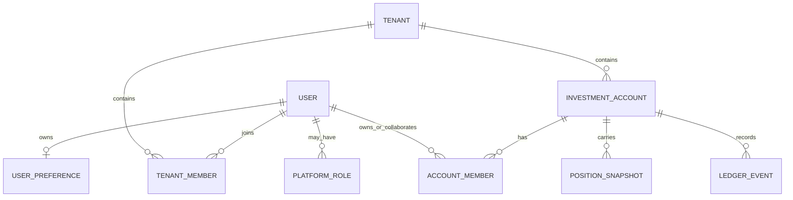

# WealthSail 租户、用户、账户与资产作用域设计

> 文档状态：最终设计方案
>
> 适用范围：MVP 及后续协作版
>
> 更新日期：2026-08-30

## 1. 设计目标

WealthSail 既要服务单个投资者，也要支持家庭、投研小组和受托协作。系统必须同时回答四个不同问题：

1. 谁正在登录和操作系统；
2. 谁可以在同一个协作空间中查看或维护数据；
3. 某个投资账户及其资产在经济上属于谁；
4. 当前页面统计的是“我的资产”、整个租户，还是某位成员的资产。

这些问题不能仅靠一个 `tenant_id` 或 `created_by` 回答。最终模型采用“平台角色、租户成员、投资账户归属、页面资产作用域”四层分离设计，并遵循以下原则：

- 用户默认先看到自己的资产，而不是租户中所有人的资产；
- 租户是协作和数据隔离边界，不等同于资产所有人；
- 持仓、净值和交易通过投资账户继承归属，不在每条持仓上重复维护所有人；
- 数据录入者、审核者与资产所有人是不同概念；
- 平台管理员不因平台权限自动获得任何租户资产访问权；
- 历史数据无法可靠判断归属时必须标记“待认领”，不得按创建人猜测；
- 所有成员、归属和作用域变更必须可审计、可验证，关键访问变更立即使旧会话失效。

## 2. 需要支撑的业务场景

### 2.1 个人投资者

一个自然人拥有独立个人租户，并以 `OWNER` 身份管理自己的股票、场内基金、场外基金及资金账户。登录后 Dashboard 默认展示其个人资产；邀请他人协助时，资产仍归本人，不因协作者录入或审核而改变归属。

### 2.2 家庭协作

夫妻或家庭成员处于同一家庭租户中，可以存在：

- Jelly 的个人证券账户；
- 家庭成员 A 的个人基金账户；
- Jelly 与成员 A 共同拥有的联名账户；
- 家庭公共观察账户或尚未完成归属认领的历史账户。

每个人登录后先看到自己的账户；切换到“租户总览”时共同账户只计算一次；选择某位成员时显示其个人账户和共同账户。

### 2.3 投研小组或受托协作

投顾、研究员或家庭管理员可以获得租户角色及账户协作权限，帮助录入、核对和分析，但不因此成为受益所有人。系统必须明确区分：

- `created_by`：谁创建了事实或命令；
- `confirmed_by`：谁审核或确认；
- `account_members.relationship`：资产在经济上属于谁；
- `account_members.permission_role`：谁可维护该账户。

### 2.4 多租户用户

同一用户可以拥有个人租户，同时加入家庭或投研小组租户。系统保存一个默认租户，登录时优先进入该租户；用户可主动切换其他有效租户。退出、被暂停或默认租户失效后，系统选择另一个有效租户并要求重新签发租户作用域令牌。

### 2.5 平台运营

平台管理员可以创建“个人租户注册邀请”、处理身份和租户治理，但默认不能读取租户资产明细。平台权限与租户权限分别授权、分别审计；需要查看用户数据的支持场景后续采用限时、带原因、可追溯的 break-glass 机制，而不是隐式越权。

## 3. 核心概念及关系

### 3.1 用户（User / Profile）

用户代表可认证的自然人，是登录、会话、操作审计和渠道绑定的主体。一个用户可以加入多个租户，也可以拥有或协作多个投资账户。

### 3.2 租户（Tenant）

租户是协作空间和一级数据隔离边界。所有投资账户、账本事实、研究结果和报告都必须属于一个租户。租户本身不代表某个自然人的资产所有权。

### 3.3 租户成员（Tenant Member）

租户成员关系回答“用户能否进入该协作空间，以及能做什么”。角色保持：

- `OWNER`：租户治理负责人；
- `ADMIN`：成员、配置和业务管理；
- `EDITOR`：业务数据维护；
- `VIEWER`：只读查看。

成员状态保持 `ACTIVE`、`INVITED`、`SUSPENDED`。`SUSPENDED` 不再提供任何有效访问或角色，但保留关系及审计证据；因此成员退出和迁移优先暂停，不直接物理删除。

### 3.4 平台角色（Platform Role）

平台角色是跨租户的平台治理权限，不写入 `tenant_members`，也不放大租户数据 RLS 权限。首期提供：

- `PLATFORM_ADMIN`：平台级用户、注册邀请和租户治理；
- `SUPPORT`：预留的有限支持角色，首期不开放资产访问。

平台角色具有独立的 `ACTIVE`、`SUSPENDED` 状态、授权人和授权时间。

### 3.5 投资账户（Investment Account）

投资账户是资产归属、来源绑定和组合统计的稳定边界，例如某证券账户、天天基金账户或手工账户。持仓、流水、净值均通过 `account_id` 归属账户。

账户归属范围为：

- `PERSONAL`：一个主要受益所有人；
- `SHARED`：两个或以上共同所有人；
- `UNASSIGNED`：历史账户尚未完成人工认领。

新建账户不允许长期停留在 `UNASSIGNED`；历史迁移可以使用该状态，且页面需要明确提示认领。

### 3.6 账户成员（Account Member）

账户成员关系将用户与账户关联，并同时保存“经济关系”和“维护权限”：

- `relationship`
  - `BENEFICIAL_OWNER`：个人账户的受益所有人；
  - `JOINT_OWNER`：共同账户所有人；
  - `COLLABORATOR`：协作者，不计入个人资产；
- `permission_role`
  - `OWNER`：管理归属和账户配置；
  - `EDITOR`：录入、导入和维护；
  - `VIEWER`：只读。

同一账户可有多个账户成员，但必须满足：

- `PERSONAL` 恰有一个有效 `BENEFICIAL_OWNER`；
- `SHARED` 至少有两个有效 `JOINT_OWNER`；
- `UNASSIGNED` 不得伪造所有人；
- 账户成员必须是同一租户的有效成员；
- 账户归属关系采用有效期字段保存历史，不覆盖旧关系。

### 3.7 页面资产作用域（Asset Scope）

作用域是查询参数，不是新的数据所有权层：

- `MINE`：当前登录用户作为 `BENEFICIAL_OWNER` 或 `JOINT_OWNER` 的账户；
- `TENANT`：当前租户全部账户，共同账户只计算一次；
- `MEMBER`：指定租户成员作为受益所有人或共同所有人的账户；
- `UNASSIGNED`：仅供有治理权限的成员处理待认领账户，不作为默认 Dashboard。



## 4. 数据模型

### 4.1 `identity.user_preferences`

| 字段 | 约束与含义 |
|---|---|
| `user_id` | 主键，关联 `profiles.id` |
| `default_tenant_id` | 用户默认进入的租户，可空 |
| `default_asset_scope` | 默认 `MINE`，首期只允许 `MINE` 或 `TENANT` |
| `created_at` / `updated_at` | 审计时间 |

`default_tenant_id` 必须对应用户的有效成员关系。应用层切换租户成功后可更新默认租户；登录仅在默认租户仍有效时采用，否则回退到最早的有效租户并修复偏好。

### 4.2 `identity.platform_roles`

| 字段 | 约束与含义 |
|---|---|
| `user_id` | 被授权用户 |
| `role` | `PLATFORM_ADMIN` 或 `SUPPORT` |
| `status` | `ACTIVE` 或 `SUSPENDED` |
| `granted_by` | 授权人；首次引导允许受控脚本记录自身或系统引导标识 |
| `granted_at` / `suspended_at` | 生命周期时间 |

唯一键为 `(user_id, role)`。平台 API 每次从数据库检查有效角色，不单独信任长期 JWT 声明。

### 4.3 `identity.accounts` 扩展

新增 `ownership_scope`，历史数据迁移为 `UNASSIGNED`。账户仍以 `tenant_id` 作为隔离边界，以 `id` 作为所有账本和快照的归属键。

### 4.4 `identity.account_members`

| 字段 | 约束与含义 |
|---|---|
| `id` | 主键 |
| `tenant_id` / `account_id` | 复合外键，防止跨租户关联 |
| `user_id` | 账户相关用户 |
| `relationship` | `BENEFICIAL_OWNER`、`JOINT_OWNER`、`COLLABORATOR` |
| `permission_role` | `OWNER`、`EDITOR`、`VIEWER` |
| `is_primary` | 页面主要展示人；不改变统计规则 |
| `effective_from` / `effective_to` | 归属有效期，`effective_to` 为空表示当前有效 |
| `created_by` / `created_at` | 变更审计 |

当前有效关系使用部分唯一索引约束 `(account_id, user_id)`。账户归属形状由受控命令在同一事务中校验，不允许先写账户后留下半完成归属。

### 4.5 邀请模型

注册邀请分成两个明确目的：

- `JOIN_TENANT`：加入已有租户，目标租户必填，角色只能是 `ADMIN`、`EDITOR`、`VIEWER`；
- `CREATE_PERSONAL_TENANT`：注册后原子创建个人租户并成为 `OWNER`，目标租户为空，个人租户名称必填，只能由平台管理员创建。

邀请令牌只保存 HMAC 摘要，保持一次性、邮箱绑定、过期和并发消费约束。接受个人租户邀请时，创建用户、租户、OWNER 成员关系和默认租户偏好必须在一个数据库事务内完成。

## 5. 权限与共享边界

### 5.1 读取规则

- 非有效租户成员不能读取任何该租户资产；
- 首期有效租户成员仍可读取租户级资产，以满足家庭和小组协作；
- Dashboard 服务端按资产作用域进一步过滤，前端隐藏不能代替服务端过滤；
- 平台管理员若不是租户成员，不能读取该租户账户、持仓、交易、报告或审计详情；
- `UNASSIGNED` 账户在租户总览中计入一次并标注待认领，在 `MINE`/`MEMBER` 中不计入。

### 5.2 写入规则

- 新建个人账户时，操作者默认成为 `BENEFICIAL_OWNER + OWNER`；
- 新建共享账户必须显式选择至少两个所有人；
- 协作者的录入不会改变受益所有人；
- 修改归属需要租户 `OWNER/ADMIN` 或该账户有效 `OWNER`，并写审计记录；
- 租户成员被暂停后，其账户归属历史保留，但不再具有访问和维护权限；账户需要治理时由其他租户管理员处理。

### 5.3 汇总去重

租户总览以 `account_id` 为统计单位，不能连接多个共同所有人后直接求和。`MEMBER` 作用域按所有人过滤账户后再汇总；共同账户会同时出现在各所有人的成员视图中，但租户总资产只出现一次。任何跨成员合计页面必须说明是否包含共同账户，不能把成员视图简单相加当成租户总资产。

## 6. Dashboard 体验

### 6.1 默认视图

登录后进入默认租户，Dashboard 默认选择“我的资产”。页面顶部提供作用域切换：

1. 我的资产；
2. 租户总览（显示租户名称）；
3. 成员资产（下拉选择成员，而不是为每人固定创建 Tab）。

选择结果写入 URL 查询参数，便于刷新、返回和分享页面状态；用户长期默认值保存为偏好。所有查询缓存键必须包含 `tenantId + scope + memberId`，切换租户或作用域时不能复用旧数据。

### 6.2 展示信息

持仓行需展示账户名称、归属人标签和归属状态。租户总览显示“Jelly”“成员 A”“共同”“待认领”；个人视图无需反复显示本人标签，但共同账户应保留“共同”提示。

空状态必须区分：

- 当前用户确实没有个人资产；
- 租户有资产但当前用户没有归属账户；
- 当前租户完全没有资产；
- 存在待认领历史账户；
- 数据存在但缺少行情或净值，不能误报为空。

### 6.3 成员与账户治理入口

“账号安全/租户管理”提供：

- 当前租户与默认租户；
- 有效及暂停成员；
- 账户归属认领和共享设置；
- 加入现有租户的邀请；
- 平台管理员可见的个人租户注册邀请入口。

租户角色和平台角色必须使用不同文案与徽标，不能都显示为含义不明的 `ADMIN`。

## 7. 后端接口

### 7.1 资产查询

以下接口统一支持 `scope=MINE|TENANT|MEMBER`；`MEMBER` 必须同时提供 `memberId`：

- `GET /api/v1/portfolio/summary`
- `GET /api/v1/portfolio/positions`
- `GET /api/v1/portfolio/nav-trend`

服务端从认证上下文取得当前 `user_id` 和 `tenant_id`，禁止客户端传入任意租户 ID。`memberId` 必须是当前租户有效成员。响应元数据返回实际生效的 `scope`、`memberId` 和 `tenantId`，便于审计和排查缓存串用。

### 7.2 身份与租户

- `GET /api/v1/auth/me` 返回当前租户、所有有效成员关系、默认租户和平台角色摘要；
- `POST /api/v1/auth/switch-tenant` 仅允许切换到有效成员关系，并可原子更新默认租户；
- `POST /api/v1/auth/invitations` 只创建 `JOIN_TENANT` 邀请；
- `POST /api/v1/platform/personal-tenant-invitations` 只允许平台管理员创建 `CREATE_PERSONAL_TENANT` 邀请；
- 注册接口根据邀请目的原子加入已有租户或创建个人租户。

### 7.3 账户归属

- `GET /api/v1/identity/accounts/{accountId}/members`
- `PUT /api/v1/identity/accounts/{accountId}/ownership`
- `GET /api/v1/identity/tenant-members` 用于成员选择器

更新归属使用账户 `version` 或 `If-Match` 做乐观锁，防止两个管理员互相覆盖。

## 8. 登录、切换与会话安全

登录租户选择顺序为：

1. 用户偏好的默认租户仍为有效成员且租户有效；
2. 否则选择最早加入的有效租户，并修复默认偏好；
3. 没有任何有效租户则拒绝签发业务访问令牌，并引导联系管理员。

租户切换后签发新的访问令牌和刷新会话。成员被暂停、平台角色变化或发生用户租户迁移时必须：

- `profiles.auth_version + 1`，立即使旧访问令牌失效；
- 撤销该用户全部有效 refresh session；
- 写入旧租户和新租户的审计事件；
- 要求用户重新登录，避免浏览器仍展示旧租户缓存。

## 9. 历史数据迁移

### 9.1 账户归属回填

现有账户全部先设为 `UNASSIGNED`。以下信息均不能单独作为受益所有权证据：

- 账户或导入批次的 `created_by`；
- 交易的 `confirmed_by`；
- 唯一租户 OWNER；
- 外部来源账号的显示名称。

只有用户明确确认，或外部账户绑定存在经过验证的用户归属信息时，才创建 `account_members` 所有权关系。待认领账户继续在租户总览可见，不进入任何人的“我的资产”。

### 9.2 新数据默认规则

个人租户中由本人新建或导入的新账户，默认归本人；已有租户中自动创建账户时，默认归发起用户，但预览页必须显示目标账户与所有人，确认后才写入。导入已有账户不自动改归属。

## 10. Jelly 迁移方案

Jelly 当前没有自己的持仓，因此采用身份和成员关系迁移，不迁移或删除 so 租户中的任何持仓、账户、导入批次和账本事件。

迁移必须在单个数据库事务中执行，并满足以下前置条件：

- 目标用户邮箱与命令显式参数一致；
- Jelly 当前在预期 so 租户中只有一条有效成员关系；
- 未发现明确归属于 Jelly 的账户；
- 新个人租户尚不存在，或已存在且是同一次幂等操作创建；
- so 租户仍有其他有效 `OWNER`，避免产生无主租户。

事务动作顺序：

1. 创建 Jelly 的个人租户；
2. 创建 Jelly 的 `OWNER + ACTIVE` 成员关系；
3. 设置 Jelly 的默认租户为新个人租户、默认资产作用域为 `MINE`；
4. 授予 Jelly `PLATFORM_ADMIN + ACTIVE`；
5. 将 Jelly 在 so 租户的成员状态改为 `SUSPENDED`，其原角色不再有效；
6. 增加 `auth_version` 并撤销 Jelly 全部刷新会话；
7. 分别写入新旧租户审计事件及平台角色授权记录；
8. 事务提交后回读验证，不触碰 so 租户资产事实。

生产操作通过版本化管理脚本执行，先 `--dry-run` 输出脱敏预检，再要求同时提供用户邮箱、来源租户 ID 和确认开关。脚本必须幂等：重复执行时验证既有结果并安全退出，不创建第二个个人租户。

### 10.1 Jelly 生产迁移命令

以下命令只能在应用 migration 032 后，由迁移/管理员数据库角色在服务器
`/opt/wealthsail` 执行。`DATABASE_URL` 是 API 运行时凭据，权限不足且不得替代
`MIGRATION_DATABASE_URL`。命令默认只预检；正式写入还要求邮箱和脱敏数据库目标双重确认。

```bash
cd /opt/wealthsail

read -rsp "请输入 MIGRATION_DATABASE_URL: " MIGRATION_DATABASE_URL
echo
export MIGRATION_DATABASE_URL

read -rp "请输入 Jelly 的登录邮箱: " JELLY_EMAIL
SOURCE_TENANT_ID='8c1b5af8-772d-4abe-83cc-1eea1519a21a'
PERSONAL_TENANT_NAME='Jelly 个人投资账户'
MIGRATION_TARGET="$(
  .venv/bin/python -c \
  'import os; from scripts.migrate import safe_target_name; print(safe_target_name(os.environ["MIGRATION_DATABASE_URL"]))'
)"
```

第一步只读预检。必须看到 `status: READY`、`explicitOwnedAccountCount: 0`、来源租户名称和
资产事实计数均符合预期，才允许继续：

```bash
.venv/bin/python scripts/migrate_user_to_personal_tenant.py \
  --email "$JELLY_EMAIL" \
  --source-tenant-id "$SOURCE_TENANT_ID" \
  --personal-tenant-name "$PERSONAL_TENANT_NAME" \
  --grant-platform-admin
```

第二步正式执行。全部身份变更在一个数据库事务中完成；任一前置条件或资产事实回读失败都会
回滚，不会产生半个个人租户：

```bash
.venv/bin/python scripts/migrate_user_to_personal_tenant.py \
  --email "$JELLY_EMAIL" \
  --source-tenant-id "$SOURCE_TENANT_ID" \
  --personal-tenant-name "$PERSONAL_TENANT_NAME" \
  --grant-platform-admin \
  --apply \
  --confirm-email "$JELLY_EMAIL" \
  --confirm-target "$MIGRATION_TARGET"
```

第三步只读回读。首次成功应返回 `APPLIED`；随后回读和重复执行应返回
`ALREADY_APPLIED`，且不能出现第二个个人租户：

```bash
.venv/bin/python scripts/migrate_user_to_personal_tenant.py \
  --email "$JELLY_EMAIL" \
  --source-tenant-id "$SOURCE_TENANT_ID" \
  --personal-tenant-name "$PERSONAL_TENANT_NAME" \
  --grant-platform-admin \
  --readback

unset MIGRATION_DATABASE_URL MIGRATION_TARGET JELLY_EMAIL
unset SOURCE_TENANT_ID PERSONAL_TENANT_NAME
```

迁移会撤销 Jelly 的现有刷新会话并轮换 `auth_version`，因此 Jelly 必须重新登录。重新登录后的
验收结果应为：默认租户是“Jelly 个人投资账户”、租户角色是 `OWNER`、平台角色包含
`PLATFORM_ADMIN`，租户列表中不再出现可切换的 so 租户；so 租户的账户、账本、持仓快照、净值
快照和导入批次计数保持不变。

## 11. 分阶段实施

### 阶段 A：身份与数据基础

新增平台角色、默认租户偏好、账户归属表、邀请目的和约束；更新登录默认租户选择；提供 Jelly 受控迁移脚本。完成后先迁移 Jelly，解决错误共享 so 租户资产的问题。

### 阶段 B：服务端资产作用域

资产接口支持 `MINE/TENANT/MEMBER`，响应返回归属标签；所有聚合按账户去重；新增账户必须带合法归属。

### 阶段 C：前端体验与治理

Dashboard 默认“我的资产”，提供租户和成员切换；账户归属认领与平台个人租户邀请界面上线；完善空状态、缓存隔离和权限提示。

### 阶段 D：细粒度隐私与支持机制

在确有业务需求时增加账户级可见范围、限时支持访问和更细的平台角色。该阶段不改变前三阶段的数据所有权语义。

## 12. 验收标准

- Jelly 重新登录后只进入个人租户，角色为租户 `OWNER`，同时具备独立的平台管理员标识；
- Jelly 不再能切换或刷新到 so 租户，so 租户原有持仓不发生任何变化；
- 新用户通过个人租户邀请注册后原子获得独立租户和 OWNER；
- 一个用户加入多个租户时，登录稳定进入默认租户；
- Dashboard 默认只统计当前用户拥有或共同拥有的账户；
- 租户总览对共同账户只计算一次；
- 成员视图不会包含仅为 `COLLABORATOR` 的账户；
- 历史未认领账户不会误归给创建人，并在租户总览明确提示；
- 平台管理员若不是目标租户成员，无法读取该租户资产；
- 角色、归属和迁移变更均有审计记录，旧访问令牌和刷新会话失效；
- 后端作用域、数据库约束、前端切换、异常权限及会话失效均有自动化测试。
