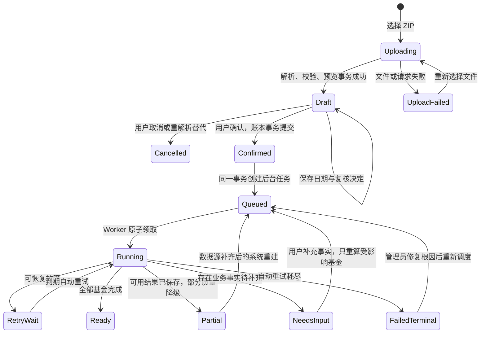

# WealthSail 天天基金导入用户操作与后台处理状态设计

> 文档状态：最终设计方案，待按优先级实施  
> 适用范围：天天基金 ZIP 当前持仓与历史流水导入、导入后的官方净值回填、持有起点确认和持有区间指标计算  
> 最后更新：2026-08-30  
> 关联文档：[14.天天基金数据导入](./14.天天基金数据导入.md)、[17.WealthSail 导入批次状态、幂等与草稿治理设计](./17.WealthSail导入批次状态幂等与草稿治理设计.md)、[10.WealthSail MVP 前后端实现与系统部署规范](./10.WealthSail-MVP前后端实现与系统部署规范.md)

## 1. 结论与核心决策

用户完成预览核对并点击“确认导入”后，本次普通用户操作应当结束。系统必须在后台自动完成净值回填、持有日期处理、区间指标计算、自动重试和页面刷新，不能把技术性的任务重试当成正常业务步骤交给用户。

本设计作出以下决策：

1. **确认导入是普通用户的最后一个必做动作。** 用户可以关闭弹窗或离开页面，后台处理不能依赖浏览器保持打开。
2. **持仓写入成功与衍生指标完成分开表达。** 官方净值暂时不可用不得回滚已经确认的持仓，也不得把整个导入误报为失败。
3. **自动重试由系统负责。** 可恢复的网络、限流、上游暂时不可用等故障进入自动退避重试；自动重试尚未耗尽时不显示“重试区间指标”。
4. **人工操作只处理业务事实不确定性。** 例如系统确实无法推导本轮开始持有日期、份额冲突或来源记录无法安全归类；用户不负责处理 Worker、Provider 或任务队列故障。
5. **每只基金独立处理。** 单只基金的净值源故障不能阻止同批其他基金完成；批次展示完成数量、待补充数量和失败数量。
6. **“彻底成功”必须有明确标准。** 页面需区分“持仓已导入”“后台数据准备完成”“全部数据质量完整”三个层级，避免一个绿色勾同时掩盖未完成任务。

## 2. 当前现象及问题定位

### 2.1 “重试区间指标”当前实际做了什么

当前按钮不会修改持仓、交易流水或持有日期。它只会为已确认批次新建一个 `FUND_NAV_BACKFILL` 任务，再次执行：

1. 读取该来源绑定下的开放式基金持仓；
2. 按持有开始日期或来源快照日期下载官方历史单位净值；
3. 保存净值观测；
4. 计算持有期最高、最低、距最高/最低百分比和区间位置；
5. 写入 `ledger.position_period_metrics`。

因此，如果根因是 Worker 配置错误、上游接口不可访问、限流、某只基金代码不受支持或程序异常，用户重复点击只会重复触发同一条失败路径，并不能修复根因。

### 2.2 为什么点击后短暂“正在后台计算”，又立即变回“重试区间指标”

当前前端在重试接口返回后把状态短暂显示为 `PENDING`，随后轮询批次详情。新任务一旦被 Worker 领取并发生异常，数据库马上写成 `FAILED`，批次详情又把它映射成前端 `FAILED`，按钮因此重新出现。

当前实现还存在两个关键语义问题：

- Worker 将每次失败都保存为 `FAILED`，但只要 `next_retry_at` 非空且未达到最大尝试次数，后台其实仍会自动重试；API 没有区分“等待自动重试”和“最终失败”。
- 一个批次依次处理多只基金，只要任意一只基金抛出异常，整个批次任务失败，已经可以正常处理的其他基金也无法形成完整结果。

所以当前看到的“重试区间指标”不一定表示自动恢复已经结束，甚至可能与后台自动重试同时存在。此时继续点击还可能创建新的批次级重试任务，增加重复请求和上游限流风险。

### 2.3 当前页面为什么同时出现“持有起点待确认”“区间指标计算中”和“质量缺失”

当持仓已经导入、但还没有 `position_period_metrics` 结果时，当前持仓 API 使用一组默认值返回：

- 持有开始日期为空；
- 持有方法为 `INSUFFICIENT_DATA`；
- 区间指标为 `PENDING`；
- 最新净值、市值、收益和质量为空。

这只能证明“衍生结果尚未生成”，不能证明用户真的需要确认持有日期。界面把系统处理状态和用户待办混在了一起，是状态建模问题，而不仅是文案问题。

## 3. 用户到底需要做哪些操作

### 3.1 正常导入的必做步骤

| 步骤 | 用户操作 | 系统责任 | 是否允许离开页面 |
|---|---|---|---|
| 1. 选择数据 | 选择 ZIP 和目标 WealthSail 账户 | 校验文件安全、Manifest、Schema、哈希和权限 | 否，上传尚未完成 |
| 2. 核对预览 | 查看新增、变化、不变、清仓、冲突及来源提示 | 主数据核验、差异计算、持有日期候选推导、重复流水识别 | 可以，预览已保存为草稿 |
| 3. 处理必要异常 | 仅处理阻断性冲突，或补充系统完全无法推导的日期 | 给出原因、推荐值和最小必要输入 | 可以，草稿可恢复 |
| 4. 确认导入 | 勾选已核对并点击“确认导入” | 原子写入来源事实、持仓基线、审计记录并创建后台任务 | **可以；用户操作到此结束** |

### 3.2 不应要求用户执行的操作

普通用户不需要：

- 理解 `FUND_NAV_BACKFILL`、`POSITION_PERIOD_METRICS_REBUILD`、租约或任务队列；
- 判断是网络超时、上游限流还是 Worker 故障；
- 在自动重试过程中反复点击“重试区间指标”；
- 因为衍生指标失败而重新上传同一个 ZIP；
- 为系统已经高可信或中可信推导出的日期逐只点击确认；
- 保持导入弹窗或浏览器一直打开。

### 3.3 允许用户介入的例外

只有业务事实无法由系统安全确定时才要求用户处理：

- 本轮开始持有日期完全没有候选证据；
- 流水回放份额和当前快照超过容差；
- 同一来源流水编号对应不同内容；
- 当前账户存在其他来源的冲突持仓事实；
- 用户认为低可信候选日期不符合实际情况。

系统必须提供推荐值、原因和影响范围。多个基金需要处理时使用批量工作台，不把待办散落在每一行的小标签中。

## 4. 状态必须分层，不能压成一个 `metricsStatus`

导入存在多个相互独立的状态维度。一个批次可以已经正式确认，同时仍在准备净值；也可以持仓成功但一只基金需要补充日期。API 和页面必须分别表达。

### 4.1 导入批次状态 `importStatus`

| 状态 | 含义 | 是否改变正式持仓 |
|---|---|---|
| `DRAFT` | ZIP 已成功解析并保存预览，等待核对 | 否 |
| `CONFIRMED` | 用户确认，正式来源事实和持仓基线已原子写入 | 是 |
| `CANCELLED` | 草稿被用户取消、被重解析替代或过期终止 | 否 |

`CONFIRMED` 是不可逆的导入事实。后续净值或指标失败不能把它改回 `DRAFT` 或 `FAILED`。

### 4.2 后台数据准备状态 `preparationStatus`

| 状态 | 系统含义 | 用户看到的文案 | 用户操作 |
|---|---|---|---|
| `NOT_STARTED` | 批次未确认，不应创建任务 | 尚未确认导入 | 核对并确认 |
| `QUEUED` | 已确认，任务等待 Worker 领取 | 持仓已导入，正在准备数据 | 无 |
| `RUNNING` | 正在下载净值或计算 | 正在更新净值和持有区间 | 无 |
| `RETRY_WAIT` | 可恢复失败，系统等待下一次自动重试 | 暂时未完成，系统会自动重试 | 无 |
| `NEEDS_INPUT` | 技术处理完成，但存在必须由用户确认的业务事实 | 有 N 项信息需要补充 | 一键处理待办 |
| `READY` | 所有基金的目标衍生数据完整 | 数据已准备完成 | 无 |
| `PARTIAL` | 可用结果已生成，少量项目数据不完整且原因明确 | 已完成，N 项数据不完整 | 可选查看详情 |
| `FAILED_TERMINAL` | 自动重试耗尽，仍存在系统故障 | 数据准备未完成，已通知管理员 | 普通用户无需排障 |

当前数据库可继续使用 `workflow.job_runs.status`，但 API 必须结合 `attempt_count`、最大尝试次数和 `next_retry_at` 做正确映射：

```text
PENDING                     -> QUEUED
RUNNING                     -> RUNNING
FAILED + next_retry_at != null
  + attempt_count < max     -> RETRY_WAIT
COMPLETED                   -> 结合逐基金结果映射 READY / PARTIAL / NEEDS_INPUT
FAILED + next_retry_at null -> FAILED_TERMINAL
```

### 4.3 逐基金持有日期状态 `holdingStartStatus`

| 状态 | 处理方式 |
|---|---|
| `AUTO_HIGH` | 逐基金流水调和成功，自动采用，不要求确认 |
| `AUTO_MEDIUM` | 使用较强的组合活动证据，自动采用并允许修改 |
| `AUTO_LOW` | 使用调仓或部分历史估算，自动填入并清楚标注“系统估算” |
| `NEEDS_INPUT` | 完全没有安全候选，用户补充日期后只重算该基金 |
| `USER_CONFIRMED` | 用户新增或修改的日期，保存审计记录 |

`AUTO_LOW` 不是失败。低可信候选仍应自动填入最可信日期，用户不修改就采用；只有 `NEEDS_INPUT` 才形成用户待办。

### 4.4 逐基金区间指标状态 `metricStatus`

| 状态 | 含义 |
|---|---|
| `PENDING` | 任务尚未对该基金产生结果 |
| `READY` | 最高、最低、当前净值和区间位置完整 |
| `PARTIAL` | 有可用结果，但净值历史或持有历史不完整 |
| `CONFLICT` | 同日多来源净值冲突或关键口径冲突，不能输出精确结论 |
| `UNAVAILABLE` | 自动重试结束后仍没有可用净值，保留明确原因 |

### 4.5 估值质量状态 `valuationQuality`

最新价、市值和持仓收益的质量必须与后台任务状态分开：

- 数据准备期间显示“净值准备中”，不能提前显示红色“缺失”；
- 有最近官方净值时按 `FRESH / STALE` 表示时效；
- 只有最终确定无法获得时才显示 `UNAVAILABLE`；
- 区间指标不完整不能反向把已经可用的最新净值标为缺失。

## 5. 完整状态转换



关键约束：

1. `Confirmed` 以后不因为衍生任务失败回滚正式持仓；
2. `RetryWait` 是系统自动恢复状态，不出现普通用户重试按钮；
3. 每个基金分别进入 `READY / PARTIAL / NEEDS_INPUT / UNAVAILABLE`，批次聚合但不相互阻塞；
4. 重新调度必须幂等，同一批次、同一基金、同一算法版本最多存在一个活动任务；
5. 用户修改持有日期只重算对应基金，不重新导入 ZIP、不重放账本。

## 6. 页面如何让用户知道“是否彻底成功”

### 6.1 确认后的主反馈

确认事务成功后立即显示：

> **12 个持仓已成功导入**  
> 后台正在更新官方净值和持有以来的最高、最低数据。你可以关闭此窗口，完成后会自动更新资产看板。

这里的绿色成功只确认“持仓和来源事实已经安全写入”，后台状态使用独立的进度区域，不能把两者合并成一个模糊成功或失败。

### 6.2 批次级完成摘要

批次详情应显示：

```text
持仓导入        已完成 12/12
历史流水保存    已完成 311 条
官方净值更新    已完成 10/12
需要补充信息    1 项
暂时不可用      1 项
```

主操作只根据真实待办出现：

- 无用户待办：显示“关闭”或“查看资产”；
- 存在日期待办：显示“处理 1 项信息”；
- 系统正在自动恢复：不显示重试按钮；
- 系统最终失败：显示“已通知管理员”，管理员角色可进入诊断详情。

### 6.3 “彻底成功”的三个层次

| 层次 | 判断标准 | 推荐页面表达 |
|---|---|---|
| 持仓导入成功 | 批次为 `CONFIRMED`，账本与来源事实事务已提交 | 持仓已成功导入 |
| 数据准备完成 | 没有 `QUEUED / RUNNING / RETRY_WAIT`，所有基金都有终态 | 后台数据准备已完成 |
| 数据质量完整 | 所有当前基金均为 `READY`，最新官方净值可用，没有待补充或冲突 | 全部数据已就绪 |

`PARTIAL` 不是导入失败。页面应显示“持仓已导入，数据准备已完成，2 项历史覆盖不完整”，让用户能正常使用已有事实。

## 7. 自动重试和故障隔离设计

### 7.1 自动重试策略

系统默认对以下故障自动重试：

- 连接超时、连接中断；
- HTTP 429、502、503、504；
- 上游暂时无响应；
- Worker 重启或租约超时。

采用指数退避与抖动，遵守上游 `Retry-After`。当前默认最多 5 次可作为初始值，但页面不暴露次数和技术枚举。自动重试耗尽后进入 `FAILED_TERMINAL`，触发运维告警。

以下故障不应盲目重试：

- 基金代码不存在或主数据不支持；
- 返回结构与 Contract 不兼容；
- 持有日期晚于快照日期；
- 来源事实冲突；
- 权限或配置确定性错误。

它们应进入 `NEEDS_INPUT`、`UNAVAILABLE` 或管理员配置错误，而不是制造无限任务。

### 7.2 从批次任务拆分为逐基金任务

推荐任务唯一键：

```text
tenant_id + account_id + instrument_id + source_binding_id
+ source_as_of + calculation_version
```

每只基金独立下载、持久化和计算。批次只维护聚合进度，不承担全部成功或全部失败的原子性。这样 1 只基金的上游异常不会让另外 11 只基金重新下载。

### 7.3 手工重试的正确定位

资产看板不提供常驻“重试区间指标”，正常导入也不要求用户手工推动后台任务。导入批次详情保留
一个受角色约束的修复入口，用于 Provider、净值数据或计算算法修复后重新生成衍生指标：

1. `PENDING` 表示任务正在执行，不显示按钮，避免重复提交；
2. `FAILED` 显示“重试区间指标”；
3. `READY / PARTIAL / CONFLICT` 显示“重新计算区间指标”，供上游数据或计算代码升级后的受控重算；
4. 只有 `OWNER / ADMIN / EDITOR` 可以看到并调用该入口，`VIEWER` 保持只读；
5. 系统管理员仍可在修复网络、配置或 Provider 后批量重新调度失败项。

该操作从官方净值回填边界重新开始，再覆盖生成区间指标；无论哪种状态，都不能重复持仓账本、
来源流水或账本事件。已保存净值继续按日期幂等复用。

## 8. API 与数据模型改进

批次详情建议返回以下结构，而不是只有一个聚合 `metricsStatus`：

```json
{
  "importStatus": "CONFIRMED",
  "preparation": {
    "status": "RETRY_WAIT",
    "total": 12,
    "ready": 8,
    "partial": 1,
    "needsInput": 1,
    "running": 0,
    "retryWaiting": 2,
    "unavailable": 0,
    "updatedAt": "2026-08-30T14:30:00+08:00",
    "userActionRequired": false
  }
}
```

逐基金持仓 DTO 增加：

- `preparationStatus`：系统处理状态；
- `holdingStartStatus`、候选日期、推导方法、可信度和原因；
- `metricStatus` 和质量原因；
- `valuationQuality` 和官方净值日期；
- `availableActions`：由服务端按状态和角色生成，前端不自行猜测。

需要新增“确认或修改持有日期”命令。该命令必须：

1. 绑定租户、账户、基金和来源；
2. 使用版本号防止覆盖并发更新；
3. 写入 `USER_CONFIRMED / HIGH` 及审计记录；
4. 幂等创建该基金的指标重建任务；
5. 不要求重新上传 ZIP，不修改其他基金和既有账本事实。

## 9. 前端刷新、通知与降低学习成本

1. 导入弹窗在 `QUEUED / RUNNING / RETRY_WAIT` 时自动轮询批次状态；用户关闭弹窗后，资产看板对存在待处理基金的持仓短周期刷新，全部进入终态后停止。
2. Worker 完成后主动使持仓查询缓存失效；如暂时没有推送能力，使用有界轮询兜底。
3. 页面使用业务语言：
   - “区间指标”改为“持有以来最高/最低”；
   - “持有起点”改为“本轮开始持有日期”；
   - “质量缺失”按原因改为“净值准备中”“历史不完整”或“净值暂不可用”。
4. 默认只显示结果和唯一下一步，算法版本、重试次数、错误类和质量原因放在“查看详情”中。
5. 顶部集中展示待办，例如“12 只基金中，10 只已就绪，2 只正在自动更新”，不要在每行重复两个含义不清的小标签。
6. 后台最终失败通过站内通知或企业微信通知管理员；普通用户收到“持仓已经导入，部分补充数据暂不可用”，避免制造资产丢失焦虑。

## 10. 当前故障的运维诊断

2026-08-30 的生产日志已经定位到一次确定性数据源元数据错误：历史净值抓取成功，但任务把
`PUBLIC_API` 误写入 `reference.data_sources.source_type`；该值实际属于 `license_model`，而天天基金的
合法数据类型应为 `FUND_NAV`。修复采用 migration 036 归一已有数据源，并由代码中的集中式数据源
定义保证实时行情刷新和历史净值回填使用相同类型。数据库约束错误现在第一次即进入终止态，不再
进行没有意义的指数退避重试。

部署该修复时必须先迁移、后重启 Worker，不能只更新代码：

```bash
cd /opt/wealthsail
git pull --ff-only

# 按 docs/11 注入 MIGRATION_DATABASE_URL 并计算 MIGRATION_TARGET 后执行：
.venv/bin/python scripts/migrate.py \
  --environment production \
  --confirm-target "$MIGRATION_TARGET"

sudo systemctl restart wealthsail-worker
sudo systemctl status wealthsail-worker --no-pager -l
```

迁移输出必须包含：

```text
APPLIED 036_fund_nav_source_type_alignment.sql
READBACK OK: ...
```

如果 036 已经执行过，则第一行是 `SKIP 036_fund_nav_source_type_alignment.sql (already applied)`。
完成迁移和重启后，只需重新调度一次失败的区间指标任务，不需要重新上传或确认 ZIP。

以下命令用于以后遇到同类故障时抓取结构化日志。出现“点击重试后立即再次出现重试按钮”时不要连续点击，也不要重新导入 ZIP。

然后在一个单独终端持续观察日志，再在页面上**只点击一次**“重试区间指标”：

```bash
sudo journalctl -u wealthsail-worker \
  -f -n 30 \
  -o short-iso-precise \
  | grep --line-buffered -E 'data_task_|fund_nav_backfill_'
```

等待按钮重新出现、页面显示完成，或等待约 60 秒后按 `Ctrl+C`，保留并发送上述命令的完整输出。如果当时没有持续观察，也可以补抓最近 30 分钟：

```bash
sudo journalctl -u wealthsail-worker \
  --since "30 minutes ago" \
  --no-pager \
  -o short-iso-precise \
  | grep -E 'data_task_|fund_nav_backfill_'

sudo systemctl show wealthsail-worker \
  -p ActiveState \
  -p SubState \
  -p MainPID \
  -p ExecMainStatus \
  -p NRestarts
```

结构化日志按照阶段给出定位信息：

- `stage=load_open_fund_positions`：读取待计算持仓失败；
- `stage=fetch_fund_nav_history`：基金净值 Provider、网络、限流或返回 Contract 异常；
- `stage=persist_nav_observations`：官方净值写入数据库失败；
- `stage=load_persisted_nav`：读取已缓存净值失败；
- `stage=materialize_position_metrics`：持有区间指标计算或写入失败；
- `data_task_retry_scheduled`：本次失败后仍会按退避时间自动重试；
- `data_task_failed_terminal`：已达到最大尝试次数，或遇到约束/权限/数据类型等确定性错误，需要管理员修复根因后重新调度；
- `data_task_completed`：该任务已完成。

日志只保留任务/批次标识、公开基金代码、日期范围、阶段、尝试次数、异常类型、脱敏后的错误摘要和不含局部变量的代码路径。不要发送 `.env`、数据库连接串、Cookie、访问令牌或天天基金登录信息；这些内容不是定位所必需的。

还应在“运维监控”中核对最新任务的：

- `job_type`；
- `status`；
- `attempt_count`；
- `next_retry_at`；
- `error_class`；
- 对应 `batchId`。

如果 `FAILED` 但 `next_retry_at` 非空，说明系统尚在自动重试，不应向用户显示手工重试。如果多次均在领取后立刻失败，应优先检查 Worker 对外网络、上游响应和 Provider Contract，而不是重新导入 ZIP。

### 10.2 历史净值只能得到最近 20 条的故障与修复

2026-08-30 在修复数据源类型后，任务日志显示 `data_task_completed`，但 2021 年起持有的多只基金，
区间最高/最低日期仍集中在 2026 年 8 月。数据库结果与天天基金真实接口响应交叉检查后确认：

- 接口把 `PageIndex`、`PageSize`、`TotalCount` 放在响应顶层，`Data` 只包含 `LSJZList` 等业务数据；
- 即使请求 `pageSize=100`，服务端当前仍只返回 20 条，并以顶层 `PageSize=20` 告知实际页大小；
- 旧实现错误地从 `Data` 读取 `TotalCount`，字段不存在时又回退为当前行数 20，因此第一页后立即判定完成；
- `data_task_completed` 只表示任务没有抛出异常，不等于历史覆盖完整。旧实现据此生成的区间最高、
  最低和当前位置只覆盖最近 20 个披露日，不能用于投资判断。

修复后的 Provider Contract 如下：

1. 强制读取响应顶层三项分页元数据，不再用当前页行数猜测总数；
2. 使用服务端实际 `PageSize` 计算总页数，即使服务端限制小于请求值也继续抓取；
3. 页码不匹配、总数或页大小中途变化、元数据缺失、总数未满足前出现空页时失败关闭；
4. 实际所需页数超过 `FUND_NAV_HISTORY_MAX_PAGES` 时明确报错，不生成假完整指标；
5. 默认最大页数从 50 调整为 200，在当前 20 条/页下覆盖约 4,000 个披露日。

该修复不修改 ZIP、正式持仓或账本，也不需要新增数据库 migration。部署时需要检查 Worker 的
显式环境变量；旧环境变量会覆盖代码默认值：

```bash
sudo systemctl cat wealthsail-worker
sudo systemctl show wealthsail-worker -p EnvironmentFiles --no-pager
# 把下方路径替换为上一条命令显示的实际 EnvironmentFile
sudo grep -n '^FUND_NAV_HISTORY_' /实际/worker.env
```

将实际 `EnvironmentFile` 中的配置改为：

```ini
FUND_NAV_HISTORY_PAGE_SIZE=100
FUND_NAV_HISTORY_MAX_PAGES=200
```

拉取并重新构建前端、重启 Worker 后，打开原导入批次，在结果页点击一次“重新计算区间指标”即可，
无需重新上传、解析或确认 ZIP。按钮提交后状态变为 `PENDING` 并暂时隐藏；任务进入终态后才重新
出现。净值按“基金 + 日期 + 字段”幂等写入，先前的 20 条会保留并补齐更早历史。验收时不能只看
`data_task_completed`，还要检查每只长持有基金的 `fund_nav_backfill_fetched observation_count`：
它应明显大于 20，并核对区间最高/最低日期不再无依据地全部集中在最近一个月。

### 10.3 批量净值写入、估值投影与持有起点确认闭环

2026-08-30 的生产回填还暴露出两个独立问题。第一，旧 Worker 对每个净值观察逐条查询最新修订、
逐条插入，长持有基金需要写入上千个披露日时会产生大量数据库往返；日志可能长时间停在某只基金，
用户也无法判断正在处理还是已经卡住。第二，区间指标表已经有最新净值，但完成计算后没有刷新持仓
与账户估值投影，因此资产看板仍把“最新价/净值、市值、占比、持仓收益”显示为缺失。

当前实现采用以下闭环：

1. 同一只基金的观察先按日期去重，一次查询数据库已有的最新修订，再批量写入真正新增或变化的记录；
2. 每只基金写完都输出 `fund_nav_backfill_persisted`，包括批次、基金代码、当前位置/总数、抓取条数、
   新增条数、跳过条数和耗时，运维人员不再依靠沉默时间猜测任务状态；
3. 全部区间指标物化后，Worker 自动刷新相关持仓最新价格和账户 NAV 投影；用户不需要再执行一次
   “刷新行情”，看板读模型与区间指标使用同一批已落库净值；
4. `PARTIAL_HOLDING_HISTORY` 不再显示含义模糊的“数据不完整”，而显示“持有起点为估算”。这表示
   净值区间已经算出，但当前持有轮次的开始日期来自组合/调仓等低可信线索，不表示最新净值缺失；
5. 用户展开该提示后，系统预填当前最可信日期。若用户认可该日期，“确认估算日期”只追加确认决定、
   立即消除该质量提示，不重新抓取净值；只有用户实际修改日期时，“保存并重算该基金”才创建该基金
   的净值回填任务。两种操作必须在文案和返回状态上明确区分。

导入确认后的日期修正不是对已确认 ZIP 或账本事实做原地更新。migration 037 新增
`ledger.position_holding_start_decisions`，以追加式记录保存“谁在何时、针对哪个来源持仓确认了哪个日期”。
表具有租户 RLS、API 最小 INSERT/SELECT 权限和拒绝 UPDATE/DELETE 的不可变触发器；Worker 只读取最新
有效决定。这样既保留完整审计轨迹，也避免修改已确认导入项导致来源快照 checksum、幂等语义或历史
复盘失真。重复的同一确认命令按幂等键返回原决定，不重复创建活动任务；同一幂等键携带不同内容则
明确拒绝。

上线 037 后，已有六条“持有起点为估算”不会因为再次抓取净值而自动变成高可信，因为缺失的是账户
交易事实而不是行情数据。系统仍保留原始推导方法、可信度和历史决定；用户的确认表示“接受该估算
作为本轮业务口径”，不能伪装成新增的交易事实。

### 10.4 批量接受估算、单基金重算与 Worker 权限边界

多数用户并不打算逐只修改系统已经预填的日期。要求用户展开六只基金、重复点击六次确认，既增加
学习成本，也容易让人误以为每次确认都会重新下载多年净值。因此页面在当前作用域存在多个
`PARTIAL_HOLDING_HISTORY` 时提供一个集中操作：

> **确认全部估算日期（N）**
>
> 认可系统推荐日期，可一次确认并消除提示；不会重新抓取净值或重算指标。

该命令提交账户、基金和页面当前显示的推荐日期。服务端在同一个租户事务内逐项校验：持仓仍然有效、
来源绑定仍然活动、提交日期仍等于当前指标日期。任何一项已经变化都以版本冲突整体拒绝，要求刷新后
重新确认；不能悄悄接受陈旧页面中的日期。通过后为每只基金追加不可变决定和审计记录，不创建
`workflow.job_runs`。持仓读模型读取最新决定；当决定日期与区间指标日期一致时，将展示口径覆盖为
`USER_CONFIRMED / HIGH`，只移除 `PARTIAL_HOLDING_HISTORY`。若不存在其他质量原因，指标展示状态从
`PARTIAL` 变为 `READY`；其他原因（例如净值日期缺口）不得随确认一并隐藏。

单基金修改采用不同路径：

1. 前端比较输入日期与当前推荐日期；未变化显示“确认估算日期”，变化后显示“保存并重算该基金”；
2. 服务端把 `previous_started_on` 和 `recalculation_required` 写入追加式决定；
3. 只有 `recalculation_required=true` 才创建 `FUND_NAV_BACKFILL`，任务 payload 必须携带
   `instrumentId`；
4. Worker 按 `tenant_id + source_binding_id + instrument_id` 只加载这一只基金，只为它抓取净值并
   物化区间指标；最后可以确定性重放整个租户的轻量持仓/NAV 投影，以保持市值、占比和账户净值一致；
5. 任务执行期间旧指标仍可读，但最新决定尚未与指标日期匹配，不能提前显示“用户已确认”；完成后
   由日期匹配自动切换为确认口径。

2026-08-30 出现的 `permission denied for table position_snapshots` 发生在净值和区间指标已经生成之后的
估值投影刷新阶段。Worker 角色是 `NOINHERIT BYPASSRLS`，它不会隐式继承 `wealthsail_api` 的表权限；
migration 038 因此显式授予以下最小能力：读取活动账户，向 `position_snapshots` 插入/删除并只更新
估值列，向 `account_nav_snapshots` 插入并只更新 NAV 投影列。它没有获得身份表写权限、投影表任意列
UPDATE，也没有被改成隐式继承 API 角色。迁移同时增加 `previous_started_on` 和
`recalculation_required`，使“接受估算”和“修改后重算”成为可审计、可回读的不同业务事实。

迁移 038 之前因权限确定性失败的任务已经进入终止态，不会自动复活。部署 038 后：接受未改动的估算
无需重试旧任务；确实修改日期时由新命令创建一个新的单基金任务。不得为了消除“估算”提示重新调度
整个导入批次，因为抓取更多行情无法补出缺失的账户交易事实。

## 11. 验收标准与测试覆盖

### 11.1 用户旅程验收

1. 用户确认导入后立即可以关闭页面，后台仍能完成全部处理；
2. 自动重试期间不出现普通用户重试按钮；
3. 页面能区分持仓导入成功和衍生数据准备状态；
4. 高、中、低可信候选日期均自动采用，只有无候选时形成待办；
5. 用户能在导入后修改日期，并只触发对应基金重算；
6. 用户能一次接受当前作用域内全部未变更估算，且不创建任何净值回填任务；
7. 单只基金失败不影响其他基金完成；
8. 后台完成后资产看板自动更新，无需浏览器强制刷新；
9. 相同 ZIP、重复确认和重复任务调度均不产生重复账本或重复活动任务。

### 11.2 异常分支测试

必须覆盖：

- Provider 超时后自动退避并最终成功；
- Provider 请求页大小被限制为 20 时仍按顶层分页元数据抓完全部历史；
- 分页元数据缺失、漂移或总数满足前出现空页时失败关闭，不生成假完整指标；
- 长持有基金所需页数超过旧 50 页但不超过 200 页时能够完成回填；
- 达到最大尝试次数后进入 `FAILED_TERMINAL`；
- `FAILED + next_retry_at` 正确映射为 `RETRY_WAIT`；
- Worker 在任务运行中重启，租约恢复后只执行一次有效完成；
- 12 只基金中 1 只失败，其余 11 只正常就绪；
- 用户修改日期时存在并发更新，旧版本命令被拒绝；
- 批量接受中任一推荐日期已经变化时整批回滚，不产生部分确认或后台任务；
- 接受未修改日期只覆盖对应的历史不完整提示，不隐藏其他质量原因；
- 单基金日期修改任务 payload 带 `instrumentId`，Worker 不抓取同一批次的其他基金；
- Worker 能刷新持仓和账户估值投影，但不能修改身份、账本事件或非估值列；
- 指标重算不修改持仓份额、成本、来源流水和账本事件；
- `READY / PARTIAL / CONFLICT / FAILED` 均能从批次详情重新调度，`PENDING` 和 `VIEWER` 不显示入口；
- `PARTIAL / CONFLICT / UNAVAILABLE` 不伪造 0、最新价或精确百分比；
- 资产看板轮询在全部终态后停止；
- 键盘和读屏能够感知状态变化，但不会被高频轮询重复播报。

## 12. 实施优先级

### P0：先消除错误交互和状态误导

1. API 区分 `RETRY_WAIT` 与 `FAILED_TERMINAL`；
2. 自动重试未耗尽时移除“重试区间指标”；
3. 持仓 API 不再用“没有指标记录”推断“持有日期待确认”；
4. 导入结果明确显示“持仓已导入，后台数据准备中，可关闭窗口”；
5. 资产看板在存在后台任务时自动刷新；
6. 将质量文案拆为准备中、不完整、冲突和不可用。

### P1：完成业务闭环

1. 增加导入后确认/修改持有日期功能（已实现追加式决定、未改日期免重算、改日期单基金重算）；
2. 建立集中待办和批量采用推荐日期（已实现资产看板批量确认入口）；
3. 逐基金拆分净值与指标任务，失败隔离；
4. 批次详情返回进度计数和服务端生成的可用操作。

### P2：提升运营与可观测性

1. 管理员失败项重新调度；
2. 企业微信和站内完成/失败通知；
3. Provider 失败原因、成功率、延迟、限流和熔断监控；
4. 数据源补齐后自动重建 `PARTIAL / UNAVAILABLE` 指标。

## 13. 最终产品原则

天天基金导入不是“上传 ZIP 后让用户继续运维任务”，而是“用户确认外部账户事实后，系统持续把数据加工成可用投资信息”。

用户负责确认自己的投资事实；系统负责运行、重试、计算、刷新和告警。只有事实确实无法判断时，系统才用最少的问题请求用户补充。任何技术状态如果不能直接回答“是否需要我操作、需要做什么”，就不应原样暴露给普通用户。
