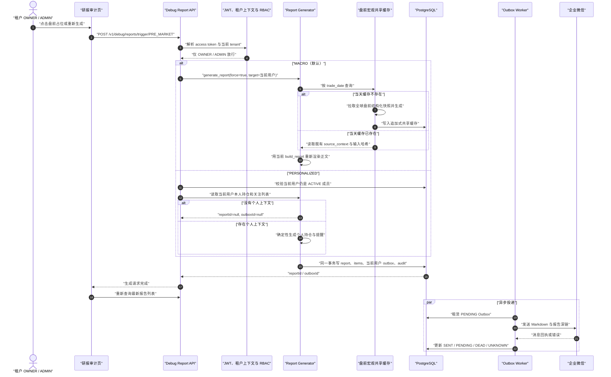
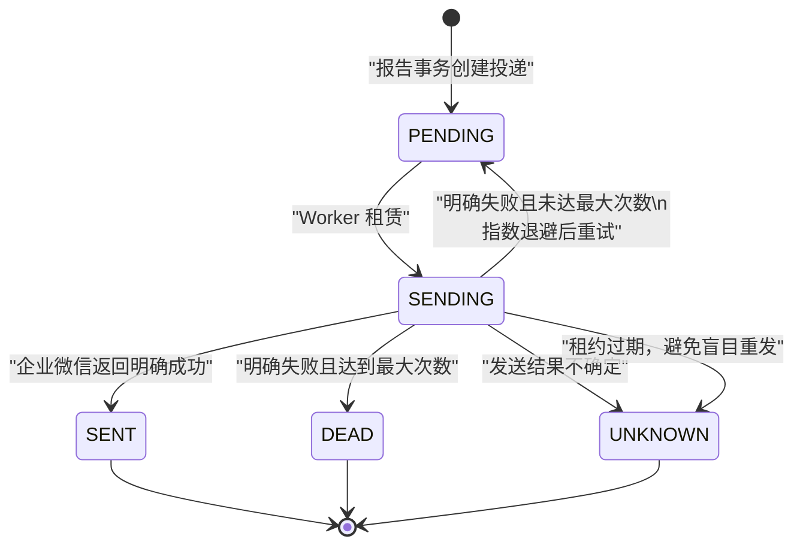

# WealthSail 手动报告触发与可见性实现分析

> 文档版本：v1.1
> 分析日期：2026-09-05  
> 代码基线：`master`（简化调试方案实现后）
> 分析范围：研报审计页的手动触发按钮、四时段报告生成、报告可见性、企业微信投递、定时任务与调试入口的差异

## 1. 结论先行

当前所谓“开发者点按钮触发盘前早报”，并不是独立的开发者控制台能力，而是放在普通产品页面
“研报审计”中的一次性调试触发能力。系统没有 `DEVELOPER` 租户角色；真正能成功调用后端的用户是
当前租户的 `OWNER` 或 `ADMIN`。

当前采用的是刻意简化的低频调试方案，而不是生产级“手动报告运行中心”。主要行为如下：

1. 所有已登录用户都能查看“研报审计”，只有当前租户的 `OWNER`、`ADMIN` 能看到手动触发按钮；
2. 手动按钮统一写成“生成并发给我”或“重新生成并发给我”，收件人只能是当前登录用户，前端和 API 均不能代替其他成员发送；
3. 未选择具体盘前报告变体时，`PRE_MARKET` 默认生成“盘前简报·宏观”，不是个人持仓简报；
4. 选择已有“盘前简报·个性化”后重新生成，会用当前登录用户自己的持仓和关注列表生成；
5. 每次有效手动触发都使用 `force=True` 新增 `reporting.reports` 版本，并通过 `supersedes_report_id` 保留版本链；不另建手动任务表；
6. 宏观盘前报告仍复用当天受治理的结构化源快照，但会用当前代码重新渲染正文，既能验证新模板，又不重复抓取或覆盖共享缓存；
7. 手动调试触发不创建 `workflow.jobs` 或 `workflow.job_runs`，也不执行定时调度前的完整行情刷新；
8. 报告与报告条目在 API 请求事务内落库，当前用户的企业微信通知只写入 Outbox，真正发送由 Worker 异步完成；
9. 成功回执会区分“通知已排队”和“没有可用企微投递”，并自动选中新生成的报告；接口成功仍不等于企微已经送达；
10. `INTRADAY_ALERT` 会保持原变体重新评估并绕过本次调试的 30 分钟冷却；未命中阈值时不生成报告。

## 2. “盘前早报”在系统中的准确含义

公开报告会话仍只有四类：

| 会话 | 中文含义 | 正常自动执行时间（Asia/Shanghai） |
|---|---|---:|
| `PRE_MARKET` | 盘前简报 | 08:30 宏观，08:35 个性化 |
| `INTRADAY` | 盘中跟踪 | 09:30–11:30、13:00–15:00，每 5 分钟评估 |
| `FUND_1430` | 基金 2:30 报告 | 14:30 |
| `POST_MARKET` | 盘后交互复盘 | 15:30 |

`PRE_MARKET` 在内部拆成两个报告变体，但数据库中的标准任务仍只有一条 `PRE_MARKET`：

| 变体 | 受众 | 内容 | 自动触发 |
|---|---|---|---:|
| `PRE_MARKET_MACRO` | 当前租户全体成员可见 | 隔夜市场、全球重点与结构化宏观信息 | 08:30，每租户一次 |
| `PRE_MARKET_PERSONALIZED` | `audience_user_id` 本人可见 | 本人持仓、自选关注与操作提醒 | 08:35，每名活动成员一次 |

因此，“点击触发盘前早报”必须继续区分是宏观版还是个性化版。当前页面在没有明确变体时一律走宏观版。

## 3. 按钮在哪里，谁能看到，谁能真正执行

### 3.1 页面入口

登录后从左侧导航进入：

```text
工作台 → 研报审计
URL: /reports
```

页面有两个手动入口：

1. 当前可见列表中某个时段没有报告时，`OWNER/ADMIN` 的左侧时间线显示“尚未生成，点击生成并发给我”；
2. 选择一条已有报告后，`OWNER/ADMIN` 的页面右上角显示“重新生成并发给我 vN”。

企业微信报告消息末尾的“查看完整报告”也会进入：

```text
/reports?reportId=<report-id>
```

### 3.2 当前权限矩阵

| 用户状态/角色 | 看见“研报审计” | 看见手动按钮 | 查看共享报告 | 查看本人个性化报告 | 手动触发成功 |
|---|---:|---:|---:|---:|---:|
| 未登录 | 否，跳转登录 | 否 | 否 | 否 | 否 |
| `VIEWER` | 是 | 否 | 是 | 是 | 否，后端 403 |
| `EDITOR` | 是 | 否 | 是 | 是 | 否，后端 403 |
| `ADMIN` | 是 | 是 | 是 | 是 | 是 |
| `OWNER` | 是 | 是 | 是 | 是 | 是 |

路由 `/reports` 只要求登录，便于所有成员审计自己有权访问的报告；按钮展示和后端
`ctx.require_roles("OWNER", "ADMIN")` 使用相同角色边界。平台角色 `PLATFORM_ADMIN` 不会自动获得该能力，
仍取决于当前访问令牌中的租户角色是否为 `OWNER` 或 `ADMIN`。提交期间页面所有手动按钮会同时禁用，
避免连续点击制造并发版本和重复通知。

### 3.3 报告内容的可见性

报告读取同时受到应用查询条件和 PostgreSQL RLS 保护：

- `tenant_id` 必须等于当前活动租户；
- `audience_user_id IS NULL` 的共享报告，当前租户活动成员均可读；
- `audience_user_id = 当前用户` 的个性化报告，只有本人可读；
- 其他成员，包括租户 `OWNER/ADMIN`，也不能读取别人的个性化报告；详情接口表现为“报告不存在”。

报告列表只返回每个 `(session, variant, audience)` 身份的最新可见版本。打开详情后，版本历史也只沿
同一个会话、变体和受众查询，不会把宏观版和个性化版混成一条版本链。

## 4. 点击盘前按钮时前端如何决定触发什么

### 4.1 尚无盘前报告时

`ReportTimeline` 发现当前列表没有任何 `session=PRE_MARKET` 的报告，渲染盘前占位按钮。点击后只提交：

```json
{"session":"PRE_MARKET"}
```

前端没有携带 `phase`，后端默认选择 `PRE_MARKET_MACRO`。因此这个入口只能创建宏观版，不能从零创建
某个成员的个性化盘前简报。

只要宏观版或个性化版中任意一种已经存在，页面就认为 `PRE_MARKET` 时段已存在，不再显示盘前占位按钮。

### 4.2 重新生成已有宏观报告

选择 `variant=PRE_MARKET_MACRO` 的报告行后，前端发送：

```http
POST /api/v1/debug/reports/trigger/PRE_MARKET?phase=MACRO
Authorization: Bearer <access-token>
```

后端使用 `force=True` 创建新的租户报告版本。宏观事实仍来源于按交易日期唯一的
`reporting.shared_pre_market_briefs`，但调试触发不直接复用缓存中的旧 `draft`，而是读取缓存的
`source_context` 后调用当前 `build_report()` 重新渲染正文。这样既能验证代码或模板变化，又不会重复采集
外部数据、覆盖旧缓存或引入共享缓存修订表。

### 4.3 重新生成已有个性化报告

选择 `variant=PRE_MARKET_PERSONALIZED` 的报告行后，前端发送：

```http
POST /api/v1/debug/reports/trigger/PRE_MARKET?phase=PERSONALIZED
Authorization: Bearer <access-token>
```

后端只接受 JWT 中的当前用户作为受众和投递目标，并再次确认其仍是当前租户的 `ACTIVE` 成员，然后读取其
本人资产作用域中的持仓与关注列表：

- 有持仓或关注列表：使用 `force=True` 生成新版本，并只为当前用户的有效企微绑定排队；
- 持仓与关注列表都为空：返回 `reportId=null, outboxId=null`，不生成报告；
- 当前用户已不是本租户活动成员：返回 404。

外部即使附带旧版 `user_id` 查询参数也不会改变目标用户；该参数不再属于 API 契约。

## 5. 手动触发的端到端实现



### 5.1 前端层

`ReportsPage` 根据选中行的 `variant` 只组装 `phase`，目标用户完全由服务端的 JWT 上下文确定。接口成功后：

- 失效报告查询缓存并重新读取列表；
- 使用返回的 `reportId` 更新 URL，自动选中新版本；
- `outboxId` 非空时显示“报告已生成，企业微信通知已排队”；
- `outboxId` 为空但报告已生成时，显示“当前没有可用的企业微信投递”；
- `reportId` 为空时，显示“当前没有满足生成条件的内容，未创建新报告”；
- mutation 执行期间禁用右上角和所有时间线占位按钮。

这里故意不显示“已送达”：最终 `SENT/DEAD/UNKNOWN` 仍由 Worker 和运维页面负责观察。

### 5.2 API 与权限层

`POST /api/v1/debug/reports/trigger/{session}` 从 JWT 获得 `user_id`、`tenant_id` 和租户角色，并拒绝非
`OWNER/ADMIN`。服务层只使用当前 `user_id`，不接受可指定其他成员的目标参数；同时穷举校验 session 与 phase
组合，避免错误参数被静默忽略或回退到另一种报告。

该 debug router 在应用启动时无条件注册，没有单独的生产环境开关、开发者白名单或二次确认。它依赖租户 RBAC、
RLS 和审计作为控制边界。

### 5.3 生成层

公共生成服务按当前日期与报告身份读取最新版本并构造新版本：

- `PRE_MARKET_MACRO`：结构化宏观共享缓存，确定性生成；
- `PRE_MARKET_PERSONALIZED`：本人持仓与关注列表，确定性生成；
- `FUND_1430`：持久化基金估值与规则数据，确定性生成；
- `INTRADAY`、`POST_MARKET`：有持仓时可调用模型，模型不可用时使用确定性降级；无持仓时复用共享市场简报；
- 每个新版本写 `supersedes_report_id`，报告细项写入 `reporting.report_items`；
- 确定性生成不伪造 `model_run`，发生模型调用或降级时才记录对应模型运行事实。

### 5.4 报告与 Outbox 同事务落库

生成成功后，同一个数据库事务内完成：

1. 写入 `reporting.reports` 新版本；
2. 写入 `reporting.report_items` 与证据关联；
3. 自动任务根据活动企微绑定和用户订阅展开收件人；手动调试只尝试为当前用户写一条 `workflow.outbox`；
4. 写入 `REPORT_GENERATED` 审计；
5. 部分调试分支再写 `DEBUG_REPORT_TRIGGERED` 审计。

如果事务在提交前失败，上述记录一起回滚，不会留下只有报告、没有报告条目的半成品。

### 5.5 Worker 异步发送

API 返回成功只代表报告事务已经提交，不代表企业微信已送达。Worker 之后轮询 Outbox：



`UNKNOWN` 不会自动重试，因为不确定结果下盲目重发可能造成重复金融通知。

## 6. 谁会在网页看到，谁会收到企业微信

### 6.1 网页与推送是两套边界

| 报告类型 | 网页可见用户 | 自动任务收件人 | 手动调试收件人 |
|---|---|---|---|
| `PRE_MARKET_MACRO` | 当前租户所有活动成员 | 租户内有效绑定且开启 PRE_MARKET 订阅的成员 | 仅触发者本人 |
| `PRE_MARKET_PERSONALIZED` | `audience_user_id` 本人 | 该用户本人 | 仅触发者本人，且受众也是本人 |
| `INTRADAY_ALERT` | `audience_user_id` 本人 | 命中阈值的该用户本人 | 仅触发者本人，且必须仍命中阈值 |
| `STANDARD` 的 `INTRADAY/FUND_1430/POST_MARKET` | 当前租户所有活动成员 | 租户内有效绑定且开启对应订阅的成员 | 仅触发者本人 |

用户在“账号安全 → 研报推送订阅”关闭开关后，报告仍会生成并保留在“研报审计”，只是不会为该用户创建
对应 Outbox。`PRE_MARKET` 一个开关同时控制宏观和个性化两个盘前变体。

### 6.2 手动响应中 `outboxId` 的准确含义

当前接口返回：

```json
{"reportId":"<uuid-or-null>","outboxId":"<uuid-or-null>"}
```

应按当前代码这样解释：

| `reportId` | `outboxId` | 实际含义 |
|---|---|---|
| `null` | `null` | 个性化盘前没有个人上下文，或盘中告警未命中/仍在冷却；没有生成报告 |
| 非空 | 非空 | 当前触发者的一条 Outbox 已经创建；仍只是排队，未必已送达 |
| 非空 | `null` | 报告已生成，但当前用户没有有效企微绑定、未开启该时段订阅或没有可投递内容 |

由于手动调试已经固定为单一触发者，不再存在“实际上为多人展开、却只返回一个 ID”的歧义。自动任务的多人投递
统计仍通过 job run、Outbox 和运维页面观察，不复用这个简化回执。

## 7. 是否能手动触发其它类型报告

可以，但要区分页面入口、调试 API、普通生成 API和运维任务入口。

### 7.1 当前页面按钮能力矩阵

| 目标 | 页面是否支持 | 页面实际参数 | 当前实际语义 |
|---|---:|---|---|
| 盘前宏观 | 是 | `PRE_MARKET + MACRO`，占位入口则不传 phase | 基于当天源快照重新渲染并新增版本，只向触发者排队 |
| 盘前个性化 | 部分支持 | 只有选中已有本人个性化行时传 `PERSONALIZED` | 强制新增本人版本并定向本人；无个人上下文时跳过 |
| 盘中普通报告 | 是 | `INTRADAY`，不传 phase | 生成租户级 `STANDARD` 新版本，但通知只排给触发者 |
| 盘中异动告警 | 是 | 选中已有告警行时传 `phase=ALERT` | 保持告警变体、重评当前阈值并绕过本次冷却；未命中时不生成 |
| 基金 2:30 报告 | 是 | `FUND_1430` | 用已持久化数据立即生成租户级报告，不会先刷新基金估值 |
| 盘后复盘 | 是 | `POST_MARKET` | 立即生成租户级新版本，但通知只排给触发者 |

### 7.2 调试 API 可手动调用的组合

推荐按当前真实枚举使用短 phase 值：

```http
POST /api/v1/debug/reports/trigger/PRE_MARKET?phase=MACRO
POST /api/v1/debug/reports/trigger/PRE_MARKET?phase=PERSONALIZED
POST /api/v1/debug/reports/trigger/INTRADAY?phase=ALERT
POST /api/v1/debug/reports/trigger/FUND_1430
POST /api/v1/debug/reports/trigger/POST_MARKET
```

`phase` 的 FastAPI 输入枚举是 `MACRO | PERSONALIZED | ALERT`，不是内部变体全名
`PRE_MARKET_MACRO | PRE_MARKET_PERSONALIZED | INTRADAY_ALERT`。合法组合已经穷举校验；例如给
`FUND_1430` 携带 `phase=ALERT` 或给 `PRE_MARKET` 携带 `phase=ALERT` 都返回 400。

### 7.3 其它现有手动入口

| 入口 | 权限/运行身份 | 用途与限制 |
|---|---|---|
| `POST /api/v1/reports/generate` | 生成服务允许 `OWNER/ADMIN/EDITOR` | 前端已不使用；`PRE_MARKET` 被明确拒绝；其它时段 `force=false`，60 秒内可能返回旧版本 |
| “运维监控 → 立即计算基金估值” | `OWNER/ADMIN` | 创建持久化 `FUND_1430` job run，由 Worker 先刷新估值再生成报告；只在交易日开放 |
| `scripts/manual_trigger_post_market.py` | 服务器 Worker 数据库身份 | 面向所有启用了 POST_MARKET job 的租户执行 runner；不是单租户网页操作 |

如果目的是验证“最新基金估值 → 14:30 报告”，应使用运维页的基金估值入口，而不是研报审计页直接生成
`FUND_1430`，因为后者只消费已经持久化的数据。

## 8. 手动调试触发与正常自动调度的差异

| 比较项 | 研报审计页 / debug API | Worker 正常调度 |
|---|---|---|
| 时间限制 | 无，任何时间可执行 | 按 08:30、08:35、盘中、14:30、15:30 |
| 交易日限制 | 无 | 查交易日历；缺日历时才回退工作日 |
| 标准任务要求 | 不读取 `workflow.jobs` | 只执行当前租户已启用的标准 job |
| `job_runs` | 不创建 | 创建并使用租约、幂等 key、失败恢复 |
| 触发前行情刷新 | 不走 Worker 的统一刷新编排 | 先刷新行情、市场热点、市场情绪，再生成报告 |
| 幂等 | 有内容时统一 `force=true`，每次新增版本；页面提交期间禁用重复点击 | 固定时段按任务、日期、phase、用户形成稳定 business key |
| 收件人 | 始终只尝试向当前触发者排队 | 按报告变体和每个成员的订阅、绑定展开 |
| 运维可观察性 | 主要看报告、Outbox 和审计 | 还可看 job run、租约、重试和恢复结果 |

因此，debug API 适合受控验证生成与投递，但不等价于“完整模拟下一次自动盘前任务”。尤其是数据刷新、
交易日判断、任务启用状态、租约幂等和恢复机制都没有被覆盖。

## 9. 已修复问题与保留边界

### 9.1 本次已修复

1. 共享与标准报告的手动通知从租户多人扇出改为仅当前触发者，审计 `targetUserId` 与实际收件范围一致；
2. 按钮文案从“生成并推送”改为“生成并发给我”，回执明确区分已排队、无可用投递和未生成；
3. `EDITOR/VIEWER` 不再看到手动按钮，前后端权限一致；
4. 个性化盘前手动触发透传 `force=True`，不再受 60 秒幂等窗口影响；
5. `INTRADAY_ALERT` 保持原变体，不再错误生成 `STANDARD INTRADAY`；
6. 个性化与盘中告警统一记录 `USER` actor 和 `DEBUG_REPORT_TRIGGERED`；
7. 生成成功后自动选中新 `reportId`，并在 mutation 期间禁用所有入口；
8. session 与 phase 组合改为穷举校验，不再静默忽略错误参数；
9. 盘前宏观基于当天受治理源快照重新渲染当前版本正文，不修改共享缓存。

### 9.2 当前刻意保留的边界

1. debug router 仍在生产环境注册，依靠 `OWNER/ADMIN`、RLS 和审计控制，没有新增环境开关或二次确认；
2. 手动触发不刷新行情、热点或情绪，不检查交易日，也不要求标准任务启用；
3. 手动触发不创建 job run，因此没有任务租约、失败恢复和投递完成轮询；
4. 回执只说明 Outbox 是否排队，不跟踪最终 `SENT/DEAD/UNKNOWN`；
5. 页面不提供“选择其他成员代发”能力，也不从零创建其他成员的个性化报告；
6. 盘中告警手动调试会绕过冷却但仍要求当前事实命中阈值；调试后不写入或重置自动告警冷却；
7. 宏观重新生成不会重新采集外部市场数据，文案不能解释为“刷新最新行情”。

### 9.3 文档与代码不一致

已有 [20.WealthSail累计收益与标准报告任务设计及运维.md](./20.WealthSail累计收益与标准报告任务设计及运维.md)
已经同步为当前简化方案：单一触发者投递、无 `user_id` 目标参数、准确的 `outboxId` 语义，以及手动 debug
不刷新行情、不创建 job run、只基于同日宏观源快照重新渲染的边界。

## 10. 最终采用的简化方案

### 10.1 为什么不建设完整手动任务中心

“重新生成”当前主要用于部署后验收和低频调试。若为它新增 `manual_report_runs`、缓存修订表、租约、恢复、
多人收件策略和投递状态轮询，会把一次调试动作扩张成第二套任务平台，开发和维护成本明显超过当前价值。

因此本阶段不新增数据库表，不改变自动调度状态机，也不实现报告缓存的多修订管理。未来只有在出现高频人工重跑、
合规审批、多人代发或需要恢复长任务时，才重新评估完整运行中心。

### 10.2 数据与版本策略

继续使用现有 `reporting.reports` 版本能力：

- 同一 `trade_date + session + variant + audience` 每次有效手动生成都插入新行；
- `version` 单调递增，`supersedes_report_id` 指向上一版本，旧版本和证据不覆盖；
- 个性化盘前显式 `force=True`，绕过 60 秒幂等窗口；
- 宏观盘前复用当日 `source_context` 与 `context_hash`，只用当前代码重新渲染 `draft`；
- 不创建共享缓存修订版，不重新调用外部数据源，也不把调试运行写成 `workflow.job_runs`。

### 10.3 权限、受众与收件策略

- `VIEWER/EDITOR`：能查看有权访问的报告，看不到手动按钮，后端调用仍返回 403；
- `OWNER/ADMIN`：能触发，但只能为自己生成个人变体、只能把通知发给自己；
- 共享报告的数据库 `audience_user_id` 仍为空，租户成员网页可见性不变；
- `delivery_user_id` 固定为当前 JWT 用户，Outbox 最多创建一条；旧 `user_id` 查询参数即使被发送也不会改变目标；
- 当前用户没有有效企微绑定或未订阅对应时段时，报告仍可生成，但 `outboxId=null`。

### 10.4 用户反馈

| 返回结果 | 页面反馈 |
|---|---|
| `reportId=null` | 当前没有满足生成条件的内容，未创建新报告 |
| `reportId!=null, outboxId=null` | 报告已生成；当前没有可用的企业微信投递 |
| `reportId!=null, outboxId!=null` | 报告已生成，企业微信通知已排队 |

页面在生成期间禁用全部手动入口，成功后用 `reportId` 自动选中新版本。这里不宣称“已送达”，因为发送仍是
Worker 异步动作。

### 10.5 已落地的自动化保护

1. 四种租户角色的后端边界，以及 `VIEWER/EDITOR` 不展示按钮；
2. 手动标准报告只传当前用户 `delivery_user_id`；
3. 宏观报告用缓存源快照重新渲染而不是复用旧正文；
4. 个性化盘前强制新增版本并写统一调试审计；
5. 盘中告警保持 `INTRADAY_ALERT` 身份、绕过调试冷却并记录用户 actor；
6. session/phase 不兼容时拒绝请求；
7. mutation 期间全入口禁用、三种回执文案和新报告自动选中。

## 11. 关键代码索引

| 职责 | 当前实现 |
|---|---|
| 页面路由与导航可见性 | `frontend/src/app/router.tsx`、`frontend/src/components/layout/AppShell.tsx` |
| 报告页面与变体选择 | `frontend/src/features/reports/ReportsPage.tsx` |
| 缺失时段占位按钮 | `frontend/src/features/reports/components/ReportTimeline.tsx` |
| 前端 debug API 客户端 | `frontend/src/api/reports.ts`、`frontend/src/api/hooks.ts` |
| 手动触发 API 与 RBAC | `backend/debug/api.py` |
| 手动触发分支编排 | `backend/debug/service.py` |
| 报告读取、生成与落库 | `backend/reports/api.py`、`backend/reports/service.py` |
| 报告可见性与 Outbox 展开 | `backend/reports/repository.py` |
| 盘前宏观共享缓存 | `backend/reports/pre_market_macro.py` |
| 盘前个人简报 | `backend/reports/pre_market_personalized.py` |
| 盘中条件告警 | `backend/reports/intraday.py` |
| 自动时段计划 | `backend/jobs/scheduler.py` |
| 任务租约与每成员扇出 | `backend/jobs/runner.py` |
| Worker 刷新与运行编排 | `backend/worker.py` |
| 企业微信异步投递状态机 | `backend/jobs/outbox.py` |
| 报告变体、受众与 RLS | `migrations/045_split_pre_market_reports.sql`、`migrations/046_intraday_alert_throttle.sql` |
| 用户推送订阅 | `migrations/043_user_report_subscriptions.sql`、`frontend/src/features/settings/components/ReportSubscriptionCard.tsx` |

## 12. 最终判断

当前实现已经打通“页面按钮 → 报告生成 → 版本落库 → 当前用户 Outbox → 企业微信 → 深链回看”的基本闭环，
盘前宏观与个人简报也具有明确的数据隔离。它仍是受控 debug 能力，而不是生产级手动报告运行中心；这是本阶段
基于实际使用频率作出的主动简化，不是遗漏。

在现状下可以安全得出的操作结论是：

- `OWNER/ADMIN` 在研报审计页可见并可触发；其他角色只能查看，直接调用接口会失败；
- 无 phase 的盘前按钮只触发宏观版；个人版必须选择本人已有的个性化报告；
- 无论共享报告还是个人报告，手动调试通知都只尝试发给当前触发者；
- 每次有效触发都新增报告版本，宏观版复用源快照但重新执行当前渲染逻辑；
- 接口成功只表示报告已落库，不能证明企业微信已送达；
- 需要最新行情与完整任务链验证时，应验证 Worker 的正常调度或受治理运维任务，不能只点 debug 按钮；
- 只有当人工重跑变成高频、需要审批/恢复/多人代发时，才值得引入独立手动任务表与完整状态机。
