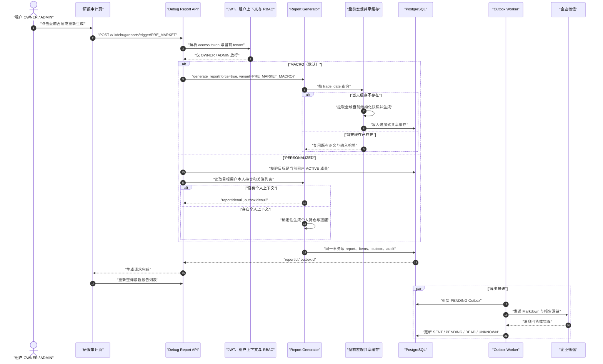
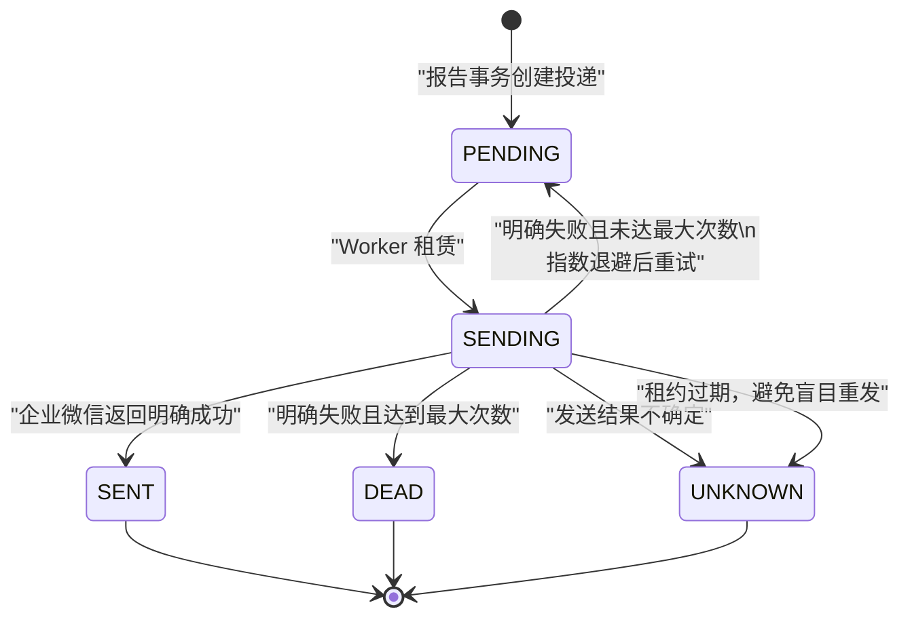

# WealthSail 手动报告触发与可见性实现分析

> 文档版本：v1.0  
> 分析日期：2026-09-05  
> 代码基线：`master` / `bd6ade2`  
> 分析范围：研报审计页的手动触发按钮、四时段报告生成、报告可见性、企业微信投递、定时任务与调试入口的差异

## 1. 结论先行

当前所谓“开发者点按钮触发盘前早报”，并不是独立的开发者控制台能力，而是放在普通产品页面
“研报审计”中的一次性调试触发能力。系统没有 `DEVELOPER` 租户角色；真正能成功调用后端的用户是
当前租户的 `OWNER` 或 `ADMIN`。

当前实现的主要行为如下：

1. 所有已登录用户都能在左侧导航看到“研报审计”，也都能看到“重新生成”和“尚未生成，点击生成并推送”；
2. 后端只允许 `OWNER`、`ADMIN` 触发，`EDITOR`、`VIEWER` 点击后得到 403；
3. 未选择具体盘前报告变体时，`PRE_MARKET` 默认生成“盘前简报·宏观”，不是个人持仓简报；
4. 选中已有“盘前简报·个性化”后重新生成，才会按该行的 `audienceUserId` 生成个人简报；
5. 宏观盘前报告在同一交易日复用全系统唯一共享缓存。重复触发会新增租户报告版本，但正文通常不变；
6. 手动调试触发不创建 `workflow.jobs` 或 `workflow.job_runs`，也不执行定时调度前的完整行情刷新；
7. 报告与报告条目在 API 请求事务内落库，企业微信只是写入 Outbox，真正发送由 Worker 异步完成；
8. 网页报告可见性由租户与 `audience_user_id` 共同控制；推送订阅只控制企业微信投递，不影响网页生成和查看；
9. `INTRADAY`、`FUND_1430`、`POST_MARKET` 也能手动触发，但不同入口的语义并不完全一致；
10. 当前按钮存在权限展示、目标用户、成功反馈、审计一致性和数据新鲜度等问题，不能把“接口返回 200”直接理解为“目标用户已收到最新报告”。

## 2. “盘前早报”在系统中的准确含义

公开报告会话仍只有四类：

| 会话 | 中文含义 | 正常自动执行时间（Asia/Shanghai） |
|---|---|---:|
| `PRE_MARKET` | 盘前简报 | 08:30 宏观，08:35 个性化 |
| `INTRADAY` | 盘中跟踪 | 09:30–11:30、13:00–15:00，每 5 分钟评估 |
| `FUND_1430` | 基金 2:30 报告 | 14:30 |
| `POST_MARKET` | 盘后交互复盘 | 15:30 |

`PRE_MARKET` 在内部拆成两个报告变体，但数据库中的标准任务仍只有一条 `PRE_MARKET`：

| 变体 | 受众 | 内容 | 自动触发 |
|---|---|---|---:|
| `PRE_MARKET_MACRO` | 当前租户全体成员可见 | 隔夜市场、全球重点与结构化宏观信息 | 08:30，每租户一次 |
| `PRE_MARKET_PERSONALIZED` | `audience_user_id` 本人可见 | 本人持仓、自选关注与操作提醒 | 08:35，每名活动成员一次 |

因此，“点击触发盘前早报”必须继续区分是宏观版还是个性化版。当前页面在没有明确变体时一律走宏观版。

## 3. 按钮在哪里，谁能看到，谁能真正执行

### 3.1 页面入口

登录后从左侧导航进入：

```text
工作台 → 研报审计
URL: /reports
```

页面有两个手动入口：

1. 当前可见列表中某个时段没有报告时，左侧时间线显示“尚未生成，点击生成并推送”；
2. 选择一条已有报告后，页面右上角显示“重新生成 vN”。

企业微信报告消息末尾的“查看完整报告”也会进入：

```text
/reports?reportId=<report-id>
```

### 3.2 当前权限矩阵

| 用户状态/角色 | 看见“研报审计” | 看见手动按钮 | 查看共享报告 | 查看本人个性化报告 | 手动触发成功 |
|---|---:|---:|---:|---:|---:|
| 未登录 | 否，跳转登录 | 否 | 否 | 否 | 否 |
| `VIEWER` | 是 | 是 | 是 | 是 | 否，后端 403 |
| `EDITOR` | 是 | 是 | 是 | 是 | 否，后端 403 |
| `ADMIN` | 是 | 是 | 是 | 是 | 是 |
| `OWNER` | 是 | 是 | 是 | 是 | 是 |

这里存在明确的前后端不一致：路由 `/reports` 只要求登录，按钮也没有按角色隐藏或禁用；真正的
`ctx.require_roles("OWNER", "ADMIN")` 在后端执行。平台角色 `PLATFORM_ADMIN` 也不会自动获得该能力，
仍取决于当前访问令牌中的租户角色是否为 `OWNER` 或 `ADMIN`。

### 3.3 报告内容的可见性

报告读取同时受到应用查询条件和 PostgreSQL RLS 保护：

- `tenant_id` 必须等于当前活动租户；
- `audience_user_id IS NULL` 的共享报告，当前租户活动成员均可读；
- `audience_user_id = 当前用户` 的个性化报告，只有本人可读；
- 其他成员，包括租户 `OWNER/ADMIN`，也不能读取别人的个性化报告；详情接口表现为“报告不存在”。

报告列表只返回每个 `(session, variant, audience)` 身份的最新可见版本。打开详情后，版本历史也只沿
同一个会话、变体和受众查询，不会把宏观版和个性化版混成一条版本链。

## 4. 点击盘前按钮时前端如何决定触发什么

### 4.1 尚无盘前报告时

`ReportTimeline` 发现当前列表没有任何 `session=PRE_MARKET` 的报告，渲染盘前占位按钮。点击后只提交：

```json
{"session":"PRE_MARKET"}
```

前端没有携带 `phase`，后端默认选择 `PRE_MARKET_MACRO`。因此这个入口只能创建宏观版，不能从零创建
某个成员的个性化盘前简报。

只要宏观版或个性化版中任意一种已经存在，页面就认为 `PRE_MARKET` 时段已存在，不再显示盘前占位按钮。

### 4.2 重新生成已有宏观报告

选择 `variant=PRE_MARKET_MACRO` 的报告行后，前端发送：

```http
POST /api/v1/debug/reports/trigger/PRE_MARKET?phase=MACRO
Authorization: Bearer <access-token>
```

后端使用 `force=True` 创建新的租户报告版本。不过宏观正文来源于按交易日期唯一的
`reporting.shared_pre_market_briefs`。当天共享缓存已经存在时，新版本仍复用同一份正文、输入哈希和质量状态。

### 4.3 重新生成已有个性化报告

选择 `variant=PRE_MARKET_PERSONALIZED` 的报告行后，前端发送：

```http
POST /api/v1/debug/reports/trigger/PRE_MARKET?phase=PERSONALIZED&user_id=<audience-user-id>
Authorization: Bearer <access-token>
```

后端先确认目标用户是当前租户的 `ACTIVE` 成员，再以该用户自己的资产作用域读取持仓与关注列表：

- 有持仓或关注列表：生成该用户的个性化盘前报告，并只为该用户的有效企微绑定排队；
- 持仓与关注列表都为空：返回 `reportId=null, outboxId=null`，不生成报告；
- 目标不是本租户活动成员：返回 404。

当前个性化调试分支没有把 `force=True` 透传给公共生成服务。60 秒幂等窗口内重复点击可能直接返回旧报告，
不会产生新版本或新的 Outbox；这与按钮“重新生成 vN+1”的字面含义不完全一致。

## 5. 手动触发的端到端实现



### 5.1 前端层

`ReportsPage` 根据选中行的 `variant` 组装 `phase` 与 `user_id`，通过 React Query mutation 调用 debug API。
接口成功后只失效 reports 查询缓存，前端随后重新读取列表。

当前前端没有：

- 使用接口返回的 `reportId` 自动选中新版本；
- 展示 Outbox 是否真正发送成功；
- 区分“报告已生成但未投递”和“已送达企业微信”；
- 对时间线占位按钮应用 `isPending` 防重复点击。

### 5.2 API 与权限层

`POST /api/v1/debug/reports/trigger/{session}` 从 JWT 获得 `user_id`、`tenant_id` 和租户角色，并拒绝非
`OWNER/ADMIN`。如果携带目标 `user_id`，服务层会检查它是否属于当前租户。

该 debug router 在应用启动时无条件注册，没有单独的生产环境开关、开发者白名单或二次确认。它依赖租户 RBAC、
RLS 和审计作为控制边界。

### 5.3 生成层

公共生成服务按当前日期与报告身份读取最新版本并构造新版本：

- `PRE_MARKET_MACRO`：结构化宏观共享缓存，确定性生成；
- `PRE_MARKET_PERSONALIZED`：本人持仓与关注列表，确定性生成；
- `FUND_1430`：持久化基金估值与规则数据，确定性生成；
- `INTRADAY`、`POST_MARKET`：有持仓时可调用模型，模型不可用时使用确定性降级；无持仓时复用共享市场简报；
- 每个新版本写 `supersedes_report_id`，报告细项写入 `reporting.report_items`；
- 确定性生成不伪造 `model_run`，发生模型调用或降级时才记录对应模型运行事实。

### 5.4 报告与 Outbox 同事务落库

生成成功后，同一个数据库事务内完成：

1. 写入 `reporting.reports` 新版本；
2. 写入 `reporting.report_items` 与证据关联；
3. 根据活动企微绑定和用户订阅展开 `workflow.outbox`；
4. 写入 `REPORT_GENERATED` 审计；
5. 部分调试分支再写 `DEBUG_REPORT_TRIGGERED` 审计。

如果事务在提交前失败，上述记录一起回滚，不会留下只有报告、没有报告条目的半成品。

### 5.5 Worker 异步发送

API 返回成功只代表报告事务已经提交，不代表企业微信已送达。Worker 之后轮询 Outbox：



`UNKNOWN` 不会自动重试，因为不确定结果下盲目重发可能造成重复金融通知。

## 6. 谁会在网页看到，谁会收到企业微信

### 6.1 网页与推送是两套边界

| 报告类型 | 网页可见用户 | 企业微信收件人 |
|---|---|---|
| `PRE_MARKET_MACRO` | 当前租户所有活动成员 | 当前租户所有“有效企微绑定 + 开启 PRE_MARKET 订阅”的成员 |
| `PRE_MARKET_PERSONALIZED` | `audience_user_id` 本人 | 该用户本人，且必须有有效企微绑定并开启 PRE_MARKET 订阅 |
| `INTRADAY_ALERT` | `audience_user_id` 本人 | 该用户本人，且开启 INTRADAY 订阅 |
| `STANDARD` 的 `INTRADAY/FUND_1430/POST_MARKET` | 当前租户所有活动成员 | 当前租户所有有有效绑定且开启对应订阅的成员 |

用户在“账号安全 → 研报推送订阅”关闭开关后，报告仍会生成并保留在“研报审计”，只是不会为该用户创建
对应 Outbox。`PRE_MARKET` 一个开关同时控制宏观和个性化两个盘前变体。

### 6.2 当前响应中的 `outboxId` 不能作为统一投递结论

当前接口返回：

```json
{"reportId":"<uuid-or-null>","outboxId":"<uuid-or-null>"}
```

应按当前代码这样解释：

| `reportId` | `outboxId` | 实际含义 |
|---|---|---|
| `null` | `null` | 个性化盘前没有个人上下文，或盘中告警未命中/仍在冷却；没有生成报告 |
| 非空 | 非空 | 定向个性化分支找到了该用户的一条 Outbox；仍只是排队，未必已送达 |
| 非空 | `null` | 报告已经生成；可能没有收件人，也可能已经为多个成员创建 Outbox，只是接口没有返回其中某一条 ID |

宏观和 `STANDARD` 报告使用多收件人展开，服务只在 `delivery_user_id` 非空时回查单条 Outbox ID，所以
它们即使已经为多人排队，响应中的 `outboxId` 仍为 `null`。因此不能再把
“`outboxId=null`”统一解释成“没有活动绑定或关闭了订阅”。

## 7. 是否能手动触发其它类型报告

可以，但要区分页面入口、调试 API、普通生成 API和运维任务入口。

### 7.1 当前页面按钮能力矩阵

| 目标 | 页面是否支持 | 页面实际参数 | 当前实际语义 |
|---|---:|---|---|
| 盘前宏观 | 是 | `PRE_MARKET + MACRO`，占位入口则不传 phase | 强制新增租户报告版本；当天宏观正文复用共享缓存 |
| 盘前个性化 | 部分支持 | 只有选中已有个性化行时传 `PERSONALIZED + audienceUserId` | 定向本人/活动成员；无个人上下文时跳过；60 秒内可能幂等返回旧版 |
| 盘中普通报告 | 是 | `INTRADAY`，不传 phase | 生成租户级 `STANDARD` 报告并向所有符合条件的成员排队，不是阈值告警 |
| 盘中异动告警 | 页面不支持 | 页面不会传 `phase=ALERT` | 只能通过 API 定向评估；未命中阈值或冷却中时不生成 |
| 基金 2:30 报告 | 是 | `FUND_1430` | 用已持久化数据立即生成租户级报告，不会先刷新基金估值 |
| 盘后复盘 | 是 | `POST_MARKET` | 立即生成租户级报告，并向所有符合条件的成员排队 |

如果选中已有 `INTRADAY_ALERT` 后点击“重新生成”，当前 `pickTriggerVariant()` 不识别该变体，最终生成的是
`STANDARD INTRADAY`，而不是重新评估该用户的阈值告警；页面预测的 `vN+1` 也可能与实际新建版本身份不一致。

### 7.2 调试 API 可手动调用的组合

推荐按当前真实枚举使用短 phase 值：

```http
POST /api/v1/debug/reports/trigger/PRE_MARKET?phase=MACRO
POST /api/v1/debug/reports/trigger/PRE_MARKET?phase=PERSONALIZED&user_id=<active-member-uuid>
POST /api/v1/debug/reports/trigger/INTRADAY?phase=ALERT&user_id=<active-member-uuid>
POST /api/v1/debug/reports/trigger/FUND_1430
POST /api/v1/debug/reports/trigger/POST_MARKET
```

`phase` 的 FastAPI 输入枚举是 `MACRO | PERSONALIZED | ALERT`，不是内部变体全名
`PRE_MARKET_MACRO | PRE_MARKET_PERSONALIZED`。当前 `backend/reports/api.py` 的错误提示仍展示内部全名，
与实际 debug API 参数不一致。

当前 API 也没有严格校验 session 与 phase 的合法组合。例如给 `FUND_1430` 携带 `phase=ALERT` 会被忽略，
给 `PRE_MARKET` 携带 `phase=ALERT` 会回落到宏观版。这不利于定位调用错误。

### 7.3 其它现有手动入口

| 入口 | 权限/运行身份 | 用途与限制 |
|---|---|---|
| `POST /api/v1/reports/generate` | 生成服务允许 `OWNER/ADMIN/EDITOR` | 前端已不使用；`PRE_MARKET` 被明确拒绝；其它时段 `force=false`，60 秒内可能返回旧版本 |
| “运维监控 → 立即计算基金估值” | `OWNER/ADMIN` | 创建持久化 `FUND_1430` job run，由 Worker 先刷新估值再生成报告；只在交易日开放 |
| `scripts/manual_trigger_post_market.py` | 服务器 Worker 数据库身份 | 面向所有启用了 POST_MARKET job 的租户执行 runner；不是单租户网页操作 |

如果目的是验证“最新基金估值 → 14:30 报告”，应使用运维页的基金估值入口，而不是研报审计页直接生成
`FUND_1430`，因为后者只消费已经持久化的数据。

## 8. 手动调试触发与正常自动调度的差异

| 比较项 | 研报审计页 / debug API | Worker 正常调度 |
|---|---|---|
| 时间限制 | 无，任何时间可执行 | 按 08:30、08:35、盘中、14:30、15:30 |
| 交易日限制 | 无 | 查交易日历；缺日历时才回退工作日 |
| 标准任务要求 | 不读取 `workflow.jobs` | 只执行当前租户已启用的标准 job |
| `job_runs` | 不创建 | 创建并使用租约、幂等 key、失败恢复 |
| 触发前行情刷新 | 不走 Worker 的统一刷新编排 | 先刷新行情、市场热点、市场情绪，再生成报告 |
| 幂等 | 宏观/普通分支多数 `force=true`；个性化还有 60 秒窗口 | 固定时段按任务、日期、phase、用户形成稳定 business key |
| 收件人 | 宏观/标准扇出多人；个性化定向一人 | 按报告变体和每个成员的订阅、绑定展开 |
| 运维可观察性 | 主要看报告、Outbox 和审计 | 还可看 job run、租约、重试和恢复结果 |

因此，debug API 适合受控验证生成与投递，但不等价于“完整模拟下一次自动盘前任务”。尤其是数据刷新、
交易日判断、任务启用状态、租约幂等和恢复机制都没有被覆盖。

## 9. 当前实现中值得修复的问题

### 9.1 高优先级

1. **目标用户参数对共享报告具有误导性。** `FUND_1430`、`POST_MARKET` 和普通 `INTRADAY` 虽然接受并校验
   `user_id`，但生成时 `delivery_user_id=None`，最终仍向租户内所有符合绑定和订阅条件的成员展开 Outbox。
   审计里的 `targetUserId` 不等于实际收件范围。
2. **页面把排队描述成已经推送。** “生成并推送”只完成报告事务与 Outbox 入队；Worker 停止、企微配置错误、
   最终 `DEAD/UNKNOWN` 都不会反馈到该按钮。
3. **权限 UI 与服务端不一致。** `EDITOR/VIEWER` 能看到并点击按钮，只有提交后才知道无权操作。
4. **调试入口在生产环境无独立治理开关。** debug router 永久注册，`OWNER/ADMIN` 可以绕过交易日、标准任务启用
   和 job-run 幂等反复生成与群发。
5. **手动生成不保证数据最新。** 它没有执行 Worker 的行情、热点、情绪统一刷新；宏观盘前同一天还固定复用
   共享缓存。“重新生成”不能等同于“重新采集最新数据”。

### 9.2 中优先级

1. 个性化盘前与 `INTRADAY ALERT` 的手动路径没有统一写 `DEBUG_REPORT_TRIGGERED`；盘中告警还沿用
   `SYSTEM_WORKER` actor，不能准确表达是谁手动发起。
2. `outboxId` 的响应模型只适合单一收件人，不能表达 0/1/N 个投递及各自状态；前端当前完全忽略该结果。
3. 页面不能从零选择成员生成个性化盘前简报，也不能从页面触发真正的 `INTRADAY ALERT`。
4. 选择 `INTRADAY_ALERT` 后点重新生成会降级为 `STANDARD INTRADAY`，报告变体和版本提示不准确。
5. phase 与 session 缺乏组合校验，错误参数可能被静默忽略或回落到宏观版。
6. 个性化盘前调试触发没有真正 force，短时间重复操作可能不生成新版本、不重新投递。
7. 新版本生成后页面只刷新列表，不自动选中新 `reportId`，用户可能看到详情区域回到“请选择一份报告”。
8. 多次快速点击占位按钮没有禁用保护，可能并发生成多个版本和多批通知。

### 9.3 文档与代码不一致

已有 [20.WealthSail累计收益与标准报告任务设计及运维.md](./20.WealthSail累计收益与标准报告任务设计及运维.md)
中需要后续修正的内容包括：

- §10 把 debug 入口描述成“单一用户投递”，但当前共享/标准报告会向全部合格成员展开；
- §10 把 `outboxId=null` 解释成无绑定或关闭订阅，但当前多人展开成功时同样返回 `null`；
- 自动盘中开始时间写成 09:00，当前 scheduler 实际从 09:30 开始；
- 需要补充“手动 debug 不刷新行情、不创建 job run、同日宏观缓存不重算”的边界。

## 10. 推荐的目标方案

### 10.1 将“查看报告”和“运维触发”分开

- “研报审计”继续向所有租户成员开放，用于查看自己有权访问的报告和证据；
- 手动触发区只向 `OWNER/ADMIN` 渲染；
- 生产环境采用明确配置开关，例如 `MANUAL_REPORT_TRIGGER_ENABLED`，默认关闭；
- 触发前增加确认框，明确报告类型、数据截至时间、收件人数以及“会产生企业微信通知”。

### 10.2 使用显式命令模型

建议把当前宽松 URL 参数收敛为结构化命令：

```json
{
  "session": "PRE_MARKET",
  "variant": "PRE_MARKET_PERSONALIZED",
  "audienceUserId": "<uuid>",
  "refreshPolicy": "USE_PERSISTED | REFRESH_ALLOWED",
  "deliveryPolicy": "NO_PUSH | TARGET_ONLY | ALL_SUBSCRIBERS",
  "reason": "部署后验收"
}
```

后端对 session、variant、audience 和 delivery policy 做穷举校验，禁止忽略不兼容参数；对于
`ALL_SUBSCRIBERS` 必须在确认前返回预计收件人数。

### 10.3 返回可跟踪的运行回执

不要继续把多人投递压缩成单个 `outboxId`。建议返回：

```json
{
  "runId": "<manual-run-id>",
  "reportId": "<uuid-or-null>",
  "reportVersion": 3,
  "generationStatus": "GENERATED | SKIPPED | FAILED",
  "delivery": {
    "policy": "TARGET_ONLY",
    "eligibleRecipients": 1,
    "queued": 1,
    "sent": 0,
    "statusUrl": "/api/v1/manual-report-runs/<run-id>"
  }
}
```

前端显示“报告已生成，1 条通知排队中”，并轮询到 `SENT/DEAD/UNKNOWN`；成功后自动选中新报告版本。

### 10.4 统一自动与手动编排，但保留安全差异

手动触发应创建独立、可恢复的 `MANUAL_REPORT` run，复用 runner 的租约与状态机；是否刷新外部数据由明确策略控制。
宏观共享缓存如果需要“强制刷新”，不能覆盖当天旧行，应创建带修订号的新追加版本并保留旧输入哈希，避免破坏审计。

### 10.5 补齐测试

至少增加以下自动化验收：

1. 四种租户角色的页面按钮可见性与后端 403 一致；
2. 宏观、个性化、盘中告警、14:30、盘后五种触发的报告身份与收件人精确断言；
3. `TARGET_ONLY` 绝不向同租户其他成员创建 Outbox；
4. 关闭订阅、无企微绑定、Worker 停止、企微失败、发送结果未知的 UI 状态；
5. 个性化空上下文和盘中未命中时显示“已检查，无需生成”，而不是模糊的成功；
6. 快速重复点击、并发请求、60 秒内重放与同日宏观缓存的幂等行为；
7. 手动触发审计必须记录操作者、租户、目标受众、收件策略、数据刷新策略、报告版本和最终投递统计；
8. 任意不合法的 session/phase/variant 组合返回 400，不能静默回退。

## 11. 关键代码索引

| 职责 | 当前实现 |
|---|---|
| 页面路由与导航可见性 | `frontend/src/app/router.tsx`、`frontend/src/components/layout/AppShell.tsx` |
| 报告页面与变体选择 | `frontend/src/features/reports/ReportsPage.tsx` |
| 缺失时段占位按钮 | `frontend/src/features/reports/components/ReportTimeline.tsx` |
| 前端 debug API 客户端 | `frontend/src/api/reports.ts`、`frontend/src/api/hooks.ts` |
| 手动触发 API 与 RBAC | `backend/debug/api.py` |
| 手动触发分支编排 | `backend/debug/service.py` |
| 报告读取、生成与落库 | `backend/reports/api.py`、`backend/reports/service.py` |
| 报告可见性与 Outbox 展开 | `backend/reports/repository.py` |
| 盘前宏观共享缓存 | `backend/reports/pre_market_macro.py` |
| 盘前个人简报 | `backend/reports/pre_market_personalized.py` |
| 盘中条件告警 | `backend/reports/intraday.py` |
| 自动时段计划 | `backend/jobs/scheduler.py` |
| 任务租约与每成员扇出 | `backend/jobs/runner.py` |
| Worker 刷新与运行编排 | `backend/worker.py` |
| 企业微信异步投递状态机 | `backend/jobs/outbox.py` |
| 报告变体、受众与 RLS | `migrations/045_split_pre_market_reports.sql`、`migrations/046_intraday_alert_throttle.sql` |
| 用户推送订阅 | `migrations/043_user_report_subscriptions.sql`、`frontend/src/features/settings/components/ReportSubscriptionCard.tsx` |

## 12. 最终判断

当前实现已经打通“页面按钮 → 报告生成 → 版本落库 → Outbox → 企业微信 → 深链回看”的基本闭环，盘前宏观与
个人简报也具有明确的数据隔离。但它仍是“把受控 debug API 暴露到产品页面”的实现，尚未形成完整的生产级
手动报告运行中心。

在现状下可以安全得出的操作结论是：

- `OWNER/ADMIN` 在研报审计页可触发；其他角色只能查看，点击会失败；
- 无 phase 的盘前按钮只触发宏观版；个人版必须选择已有个人报告，或通过 API 显式指定目标成员；
- 宏观版会对租户内所有已订阅且已绑定企微的成员排队，不是单一目标用户；
- 接口成功只表示报告已落库，不能证明企业微信已送达；
- 需要最新行情与完整任务链验证时，应验证 Worker 的正常调度或受治理运维任务，不能只点 debug 按钮；
- 在扩展手动触发能力前，应优先修复目标收件范围、权限展示、运行回执和统一审计四个问题。
