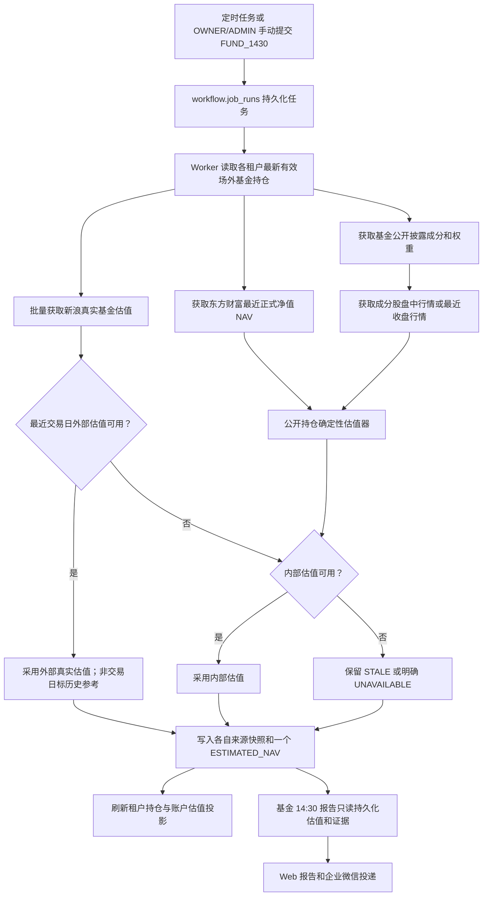

# WealthSail 基金盘中估值真实数据链路与模拟数据治理

## 1. 文档目的

本文面向后续开发者、运维人员和 AI 编程助手，说明 WealthSail 的场外基金盘中估值如何产生、如何
验证，以及如何识别和清理早期开发阶段遗留的模拟或近似数据。

核心原则只有一条：**正式运行和端到端验证必须使用有来源、有时间、有质量状态的真实数据，不得为
了让页面或报告“有内容”而向正式数据库写入模拟行情、固定申赎状态、默认截止时间或手工猜测的基金
成分权重。**

这里需要区分两类测试替身：

- 单元测试可在进程内 mock 外部 Provider 响应，用于稳定验证异常分支，但 mock 不能连接或写入正式
  数据库；
- 集成测试、部署验收和端到端测试必须调用真实 Provider，或者读取此前由真实 Provider 持久化的
  来源快照。非交易时间可以验证最近收盘数据，但不能把它标成当日盘中实时数据。

## 2. 数据语义与能力边界

### 2.1 正式净值与盘中估值不是同一个事实

- `NAV` 是基金公司或销售渠道发布的正式单位净值；
- `ESTIMATED_NAV` 是盘中参考估值，既可以来自标明来源的外部真实估值 Provider，也可以由
  WealthSail 根据最近正式净值、最近公开披露持仓和成分股行情确定性计算；
- `ESTIMATED_NAV` 不能覆盖或冒充正式 `NAV`，也不能作为自动交易价格；
- 基金公开持仓通常按季度披露，并不等于基金经理此刻的真实组合，因此必须展示披露日期、覆盖率、
  估值区间和质量状态。

### 2.2 当前主备估值策略

为了尽快覆盖场外指数基金、ETF 联接基金和主动基金，系统采用以下顺序为每只基金选择且只持久化一个
本轮估值结果：

1. 优先使用新浪基金接口返回的**最近一个上海证券市场交易日真实估值**，方法版本为
   `sina/fund-estimate/v1`；执行日也是该交易日时属于当日估值，非交易日执行时属于历史参考；
2. 外部估值早于最近交易日或不可用时，使用 WealthSail 的公开披露持仓估算结果；
3. 内部估算也不可用时，可保留更早的外部估值，但必须标为 `STALE`，不得作为最近交易日建议；
4. 两条链路均失败时写入 `UNAVAILABLE`，并在日志列出具体基金代码，绝不补造数值。

新浪返回的是第三方盘中参考值，不是基金公司的正式净值，也不公开其完整成分、覆盖率和估值区间。
因此报告会明确显示“外部盘中估值、不提供持仓覆盖率”；不能把外部估值伪装成 WealthSail 已掌握
全部基金持仓。系统另外抓取东方财富最新正式净值，用于核对估值基准和显示最近正式净值日期。

周末或节假日访问 Provider 时通常只能获得最近交易日的最终估值。系统用 SSE 交易日历判定其是否确为
“最近交易日”；日历缺失时才回退到数据库中最近正式 NAV 日期。匹配时质量保持 `ESTIMATED`，同时写入
`valuationDate`、`latestTradingDate`、`valuationDateKind=LATEST_TRADING_DAY` 和
`nonTradingDayReference=true`。报告必须展示估值日期和“非交易日历史参考”，不得称作“今日盘中”；比最近
交易日更旧的数据仍为 `STALE`。

### 2.3 内部估值算法（降级与交叉核对）

对一只持有的场外基金，系统只采用同时具备公开披露权重和可用行情的成分股。设最近正式净值为
`NAV0`，成分股权重为 `wi`，当日收益率为 `ri`，已覆盖权重为 `coverage`：

```text
estimated_return = Σ(wi × ri) + (1 - coverage) × residual_benchmark_return
estimated_nav    = NAV0 × (1 + estimated_return)
```

当前 `residual_benchmark_return` 明确设置为 0，并不是模型预测。只有 `coverage >= 60%` 才发布内部估值；
不足 60% 时返回 `UNAVAILABLE`，不得补猜。估值区间的不确定度为：

```text
uncertainty = 0.3% + (1 - coverage) × 0.5%
```

估值方法版本为 `weighted-disclosed-holdings/v1`。公开披露距估值日超过 90 天时，即使可计算中心值，
质量也降为 `STALE`，报告必须说明参考价值有限。

## 3. 真实数据处理链路



### 3.1 触发层

- 定时任务：租户的标准 `FUND_1430` 作业；
- 手动任务：`POST /api/v1/operations/fund-estimate/run`；
- 单用户调试：`POST /api/v1/debug/reports/trigger/FUND_1430`，随后轮询
  `GET /api/v1/debug/reports/runs/{runId}`；
- 手动入口只允许当前租户的 `OWNER/ADMIN`；
- API 只创建持久化任务，不直接访问行情 Provider；
- 运维手动任务遵守交易日条件；研报审计页的单用户调试允许非交易日执行，但只能生成明确标注日期的最近
  交易日历史参考。标准定时任务仍只在交易日运行。

### 3.2 Worker 采集和计算层

主要实现位于：

- `backend/market/service.py`：任务编排、数据持久化和租户投影刷新；
- `backend/integrations/market_data.py`：基金净值、基金公开披露、A 股行情 Provider 适配；
- `backend/market/fund_estimator.py`：纯 `Decimal`、确定性的估值公式；
- `backend/market/repository.py`：来源、快照、披露、观测和投影数据库操作。

Worker 的处理顺序是：

1. 从最新 `ledger.position_snapshots` 识别真正持有的场外基金；
2. 一次批量请求新浪真实基金估值，同时获取最新正式净值和最近公开披露持仓；
3. 将披露行写入 `market.fund_disclosure_components`，保留披露期和来源；
4. 获取披露成分股的盘中行情；Provider 失败时按既定降级链路处理，不能编造价格；
5. 根据覆盖率门槛计算内部中心值、上下界和解释，并按主备策略为每只基金选择一个结果；
6. 将 Provider 原始输入写入 `market.source_snapshots`，将最终选中的基金估值写入
   `market.market_observations(field_code='ESTIMATED_NAV')`；
7. 在逐租户 RLS 事务内刷新持仓和账户净值投影；单个租户失败不能污染其他租户。

成分股只是估值输入，不要求为了估值而批量写入 `reference.instruments`。即使某成分股不是用户持仓，
也可以从真实披露中取得代码并临时查询行情；未支持的市场会降低覆盖率，而不是被当作零收益。

披露抓取按基金隔离失败。某只基金出现 `NaN` 权重、列结构变化或解析异常时，只跳过该条/该基金，
不会导致其余基金整批失败。Worker 日志会输出请求数、可用数、过期数、不可用代码以及最终选择的方法
分布，方便直接定位覆盖缺口。

### 3.3 报告读取层

`backend/reports/service.py` 只读取当前租户持有基金最新的 `ESTIMATED_NAV`、方法版本、来源快照 ID、
正式净值日期、可用时的披露日期/覆盖率和质量。`backend/reports/fund_1430.py` 基于这些持久化事实生成
确定性报告：外部估值展示 Provider 及“不提供持仓覆盖率”，内部估值展示披露日期和覆盖率。报告不再：

- 读取 `market.fund_lookthrough` 中的早期近似权重；
- 在 HTTP 请求或报告生成阶段调用外部 Provider；
- 根据无来源的截止时间推断基金“正常申赎”；
- 硬编码默认 `15:00`；
- 调用大模型补写缺失的净值、成分或申赎状态。

报告中只有数据库里存在有来源且有效的截止规则才会展示。当前系统尚无完整、受治理的实时申购赎回
状态源，因此无可靠数据时必须显示“暂无，以销售渠道为准”。更完整的报告设计见
[docs/20.WealthSail累计收益与标准报告任务设计及运维.md](20.WealthSail累计收益与标准报告任务设计及运维.md)。

新浪等外部 Provider 只提供点估值时，报告显示“来源不提供区间”，不能误写成“区间暂无”而让用户以为
采集失败。非交易日报告的首节标题为“最近交易日估值概览”，正文和企微摘要都包含真实估值日期。

## 4. 真实数据验证方法

### 4.1 测试环境要求

验证前应具备：

- 一个确实持有场外基金的测试租户和账户；
- API、Worker 和数据库连接正常；
- Worker 可以访问基金和行情 Provider；
- OWNER/ADMIN 的访问令牌；
- 数据库检查使用 migration owner DSN，不能使用受限的 API `DATABASE_URL`。

### 4.2 Provider 只读验证与端到端验证

在 Linux 服务器项目目录执行：

```bash
cd /opt/wealthsail

read -rsp "请输入 MIGRATION_DATABASE_URL: " MIGRATION_DATABASE_URL
echo
export MIGRATION_DATABASE_URL

export API_BASE_URL='http://127.0.0.1:8000/api/v1'
read -rsp "请输入 OWNER/ADMIN Access Token: " ACCESS_TOKEN
echo
export ACCESS_TOKEN

# 替换为当前真实持有的基金代码；这一步只读访问真实 Provider。
export FUND_CODES='012733,161726,001705,002593,070019,000689,004476,005275,008552,001632,008295,011103'

bash tools/verify_fund_1430_e2e.sh

unset MIGRATION_DATABASE_URL ACCESS_TOKEN FUND_CODES
```

脚本会先展示外部估值、真实披露和成分股行情采集结果。交易日可运行时，它会提交后台估值任务；
该脚本的运维接口在非交易日只做真实 Provider 连通性和最近可用行情验证，不提交租户级盘中任务。对于
Jelly 当前 12 只基金，同一交易日的 Provider 只读输出预期为 `estimateUsable=12`；周末 Provider 原始
解析可先显示 `STALE`，但通过研报审计页进入 Worker 后，会按交易日历规范化为带历史参考元数据的
`ESTIMATED`。最终需要确认：

1. `workflow.job_runs.status` 进入 `COMPLETED`；
2. `market.fund_disclosure_components` 有当前基金的真实披露行；
3. `market.market_observations` 有正式 `NAV`；
4. 12 只基金均有最终 `ESTIMATED_NAV`；当日或最近交易日优先方法为 `sina/fund-estimate/v1`；
5. `ESTIMATED_NAV` 有 `snapshot_id`、`method_version`、`as_of` 和质量状态；
6. 基金 14:30 报告中的数值、来源、正式净值日及可用时的披露日期/覆盖率能回溯到这些事实；
7. 最新报告有 `FUND_ESTIMATE` 条目；非交易日不再显示“今日估值”，而显示估值日期和历史参考；企业微信
   只发给研报审计页的当前触发用户。

### 4.3 如何观察执行过程

提交任务后在服务器另一个终端跟踪 Worker：

```bash
sudo journalctl -u wealthsail-worker -f -o cat \
  | grep --line-buffered -E '新浪基金估值|基金持仓披露|14:30基金估值选择|job_run'
```

一次正常的 Jelly 账户执行应看到类似语义：请求 12 只、外部估值可用 12 只、最终可用 12 只，方法分布
包含 `sina/fund-estimate/v1: 12`。若少于 12，只需根据日志中的“不可用代码”排查，不要向数据库补模拟
值。报告在 Web 的“研报审计”中选择最新“基金 2:30 报告”查看；企业微信是否投递成功可在运维页面
及 `workflow.outbox` 回读。

## 5. 什么是模拟数据，什么应当保留

| 数据 | 分类 | 是否清理 | 原因 |
|---|---|---:|---|
| `reference.instruments` 中真实基金和股票实体 | 真实主数据 | 否 | 持仓、行情和披露通过外键引用 |
| `reference.instrument_aliases` 的真实代码映射 | 真实主数据 | 否 | Provider 解析和持仓识别依赖 |
| `market.fund_disclosure_components` | 真实来源事实 | 否 | 来自公开基金披露，有来源和披露日期 |
| `NAV`、`ESTIMATED_NAV` 和 `source_snapshots` | 真实/可解释派生事实 | 否 | 可追溯到 Provider 和算法版本 |
| 053/054 中带“估值近似”警告的 `fund_lookthrough` | 早期近似数据 | 是 | 已退出正式报告链路 |
| 无 `source_id` 的固定 `OPEN/OPEN` 基金状态 | 无来源模拟状态 | 人工确认后清理 | 可能错误影响盘前提醒 |
| 无 `source_id` 的统一默认 `15:00` 截止规则 | 无来源模拟规则 | 人工确认后清理 | 不能代表具体基金和渠道事实 |
| 旧逻辑生成的报告版本 | 历史审计结果 | 不自动删除 | 保留审计链；生成新版本取代当前展示 |
| `wealthsail_schema_migrations` | 迁移审计 | 绝不清理 | 删除会破坏迁移一致性 |

`055_user_otc_fund_reference_data.sql` 已在执行前撤销。迁移 052～054 可能已经在部分环境执行，不能
修改旧文件，否则会造成 checksum 漂移。清理 053/054 的近似业务行不会修改 migration ledger，也不
会导致迁移重新执行。

## 6. 数据库只读盘点

### 6.1 为什么不能直接使用 API DATABASE_URL

API DSN 通常使用 `wealthsail_api_login` 和 RLS 受限角色，不能直接读取 migration ledger、跨租户事实
或系统 schema。API DSN 中的 `statement_cache_size=0` 也是 asyncpg 参数，`psql` 会将其视为非法连接
参数。模拟数据盘点必须临时使用 `MIGRATION_DATABASE_URL`，并在完成后立即 `unset`。

### 6.2 推荐命令

```bash
cd /opt/wealthsail
mkdir -p artifacts

read -rsp "请输入 MIGRATION_DATABASE_URL: " MIGRATION_DATABASE_URL
echo
export MIGRATION_DATABASE_URL

psql "$MIGRATION_DATABASE_URL" \
  -X \
  -v ON_ERROR_STOP=1 \
  -P pager=off \
  -f tools/audit_legacy_fund_mock_data.sql \
  | tee artifacts/fund-mock-audit.txt

unset MIGRATION_DATABASE_URL
```

这两个 SQL 使用了 `psql` 的 `\set`、`\if` 和 `\echo` 元命令，不能整段复制到 Supabase SQL
Editor 执行。SQL Editor 适合逐条运行只读 `SELECT`；完整盘点、双重确认清理和回读应按本文命令通过
`psql` 执行，以免绕过保护条件。

盘点脚本使用 `BEGIN TRANSACTION READ ONLY`，末尾执行 `ROLLBACK`，不会写数据库。重点检查：

- migration ledger 是否只有 051～054，不应存在 055；
- `approximate_rows` 是否大于 0；
- 是否存在无来源的 `OPEN/OPEN` 或默认 15:00 行；
- 真实披露、正式净值和 `ESTIMATED_NAV` 是否存在；
- 是否有旧近似链路生成的历史报告。

仓库当前本地 `.env` 只有受限的 `DATABASE_URL`。使用它实测会得到 migration ledger 或 `market`
schema 权限不足，这是正确的权限边界，不表示数据库损坏。需要按上述方式临时提供 migration owner
连接串后才能完成实际盘点。

## 7. 清理模拟数据

### 7.1 清理前备份

清理是破坏性操作。应先保存只读盘点输出，并备份三个候选表：

```bash
mkdir -p artifacts
BACKUP_FILE="artifacts/fund-mock-candidates-before-cleanup.sql"

pg_dump "$MIGRATION_DATABASE_URL" \
  --data-only \
  --table=market.fund_lookthrough \
  --table=reference.fund_profiles \
  --table=reference.instrument_cutoff_rules \
  --file="$BACKUP_FILE"

test -s "$BACKUP_FILE"
```

### 7.2 正式执行

`tools/cleanup_legacy_fund_mock_data.sql` 默认拒绝执行。只有同时提供布尔开关和完整确认词才会进入事务：

```bash
psql "$MIGRATION_DATABASE_URL" \
  -X \
  -v ON_ERROR_STOP=1 \
  -v apply_cleanup=true \
  -v cleanup_confirmation=DELETE_LEGACY_FUND_MOCK_DATA \
  -f tools/cleanup_legacy_fund_mock_data.sql \
  | tee artifacts/fund-mock-cleanup.txt
```

脚本只删除三类精确候选：

1. 指定 30 个基金/股票组合、报告期为 2026-06-30、权重仍等于早期 seed、`source_id` 为空且带
   “估值近似”警告的 `fund_lookthrough`；
2. 指定基金在 2026-09-03 以后写入、无来源、`OPEN/OPEN`、生效日与创建日一致的状态行；
3. 指定基金在同一时间范围写入、无来源、默认渠道 15:00、版本 1 的截止规则。

脚本设置候选数安全上限，超出 30/13/13 会整笔失败。它不会删除 instruments、aliases、真实披露、
净值、估值、来源快照、报告或 migration ledger。

### 7.3 清理后回读

```bash
psql "$MIGRATION_DATABASE_URL" \
  -X \
  -v ON_ERROR_STOP=1 \
  -P pager=off \
  -f tools/audit_legacy_fund_mock_data.sql \
  | tee artifacts/fund-mock-audit-after-cleanup.txt

unset MIGRATION_DATABASE_URL
```

预期结果：

- 精确匹配的 `approximate_rows` 为 0；
- 目标基金的无来源固定状态和默认规则为 0；
- 真实 `fund_disclosure_components`、`NAV`、`ESTIMATED_NAV` 行数不减少；
- instruments 和 aliases 数量不减少；
- migration ledger 不变化；
- 下一次执行基金估值任务后，报告只展示真实数据链路的新版本；非交易日版本明确标注最近交易日日期。

## 8. 后续开发者和 AI 的强制检查清单

提交基金估值相关修改前必须确认：

- [ ] 没有在 migration、seed、测试脚本中写入某个真实用户的持仓或基金列表；
- [ ] 没有写死 `OPEN`、`15:00`、成分股代码、权重或行情价格来让报告非空；
- [ ] Provider 事实包含来源、来源时间、质量和失败降级语义；
- [ ] 报告 API 不进行 Provider I/O，只读取持久化事实；
- [ ] 非交易日最近交易日估值已标 `LATEST_TRADING_DAY`，正文没有把它称为“今日估值”；
- [ ] 外部点估值明确显示“来源不提供区间”，没有伪造上下界；
- [ ] 正式净值和盘中估值字段没有混用或互相覆盖；
- [ ] 覆盖率不足时明确弃权，而不是猜测；
- [ ] 非交易时段的最近收盘价没有被伪装为当日盘中实时数据；
- [ ] 单元测试替身只存在于测试进程内，不连接正式数据库；
- [ ] 集成和端到端验收至少验证一次真实 Provider 链路；
- [ ] 任何清理脚本都先只读盘点、精确匹配、事务执行并完成回读。
