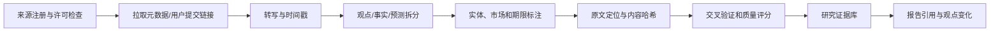

# WealthSail 文档与 React 原型全面重构设计规格

> 日期：2026-08-23
>
> 状态：待用户书面规格确认
>
> 依据：[AI Review 报告](../../../ai-review/01.WealthSail需求设计与测试Review报告.md)与用户确认的方案 A

## 1. 目标

本轮重构要把 WealthSail 从“功能范围过宽、需求与设计和测试互相漂移的 AI 投研概念”收敛为一个可分阶段实施、可验证、可审计的中国市场个人投研助手方案，并使现有 React 原型准确表达新的 MVP 价值链。

最终交付包含：

1. 重写现有 `docs/01` 至 `docs/05`，统一产品目标、阶段边界、架构、实施和验收口径；
2. 新增数据模型与来源治理、安全隐私与合规、需求测试追溯三份设计文档；
3. 修复并重构 `figma/v1-mobile` React 原型，使其覆盖 MVP 的核心用户旅程；
4. 为新增前端领域逻辑和核心交互补充自动化测试；
5. 运行文档一致性、测试、类型检查和生产构建验证；
6. 将设计规格、文档、代码和测试以清晰 Git 提交交付。

## 2. 已确认的产品边界

### 2.1 MVP 市场和资产

MVP 聚焦中国市场，必须包含：

- A 股股票；
- 场内 ETF、LOF 等可交易基金；
- 场外公募基金。

港股、美股、债券、黄金、商品、加密资产不进入核心 MVP 验收，可放入后续级别。这样既保留用户明确要求的股票和基金投资能力，也控制交易日历、币种、税费、许可和公司行动复杂度。

### 2.2 MVP 每日闭环

MVP 必须形成四时段闭环：

1. **盘前简报**：市场日历、隔夜重要变化、持仓相关事件、当日风险和待办；
2. **盘中跟踪**：只跟踪用户持仓、自选和已登记论点的重大偏离，采用事件驱动和提醒降噪；
3. **14:30 基金报告**：对场外基金给出估值区间、数据来源和误差提示，结合用户计划判断是否需要关注，不把估算净值表述成确定实时净值；
4. **盘后交互复盘**：总结组合变化、触发规则、用户决策、执行偏差和待更新论点，由用户确认后写入决策日志。

“保持不动”和“证据不足，暂不判断”是合法的一等结果。系统不得为了显得有用而每日制造买卖动作。

### 2.3 用户和渠道

- 初期支持 2–3 个独立用户；
- Web 和企业微信是 MVP 渠道；
- 每个企业微信身份只能在短期、一次性绑定流程中关联一个 WealthSail 用户；
- 用户资产、研究、对话、报告、提醒、向量索引和审计均按 `tenant_id/user_id` 隔离；
- 企业微信由官方 Hermes WeCom Adapter 或安全后端 SDK 接入，不使用 `shell=True` 拼接命令；
- Agent 不持有数据库 `service_role`，只调用经身份验证、范围收窄的领域 API。

## 3. L0–L4 价值/难度分级

需求不再只使用 P0/P1/P2。每项需求同时记录：

- **Level**：产品演进级别；
- **Priority**：同一级别内的 Must/Should/Could；
- **Value**：用户价值 1–5；
- **Effort**：实现难度 1–5；
- **Risk**：数据、安全、合规或模型风险 1–5；
- **Confidence**：证据置信度 0–1；
- **Score**：`Value × Confidence ÷ (Effort + Risk)`，仅用于排序，不覆盖安全/合规硬门槛。

### L0：可信底座

先完成身份隔离、账户/标的主数据、不可变账本、数据来源与时间语义、幂等、审计、降级和测试基础。L0 不直接产生丰富 AI 功能，但没有 L0，任何收益、持仓和建议都不可信。

### L1：核心 MVP

实现股票、场内/场外基金，四时段报告，Web/企业微信交互，2–3 用户，论点和退出规则，基础组合收益/风险以及盘后确认复盘。

### L2：组合与行为增强

增加多账户、基金穿透、基准与归因、费税、组合暴露、行为金融诊断、更完善的提醒预算和个性化规则。

### L3：多媒体研究知识

引入权威市场分析视频、微博和其他媒体的合规采集、转写、结构化、引用、观点追踪和证据变化。L3 的输出是“观点来源和变化”，不是把媒体观点自动转成交易指令。

### L4：高级研究和执行

包括复杂回测、声明式策略 DSL、多 Agent 研究、Skill 冠军/挑战者、耐久审批工作流、更多市场和券商适配。自动发单仍需单独合规决策和人工确认。

## 4. 权威视频、微博及其他媒体资料治理

### 4.1 来源注册

建立 `source_registry`，每个来源记录：

- 平台、创作者、账号唯一标识和公开主页；
- 来源类型和主题标签；
- 权威性评估依据，不使用“权威”作为无证据标签；
- 获取方式、授权/版权状态、允许的保存和引用范围；
- 更新频率、覆盖市场、历史可靠性和利益冲突披露；
- 启用、暂停、撤销和复核状态。

“兔主席”“苏涵”等只作为待注册的候选创作者示例。系统不预设其所有观点正确，也不将创作者知名度等同于事实准确性。

### 4.2 内容处理管线

规则：

- 优先保存元数据、用户授权材料、必要短摘录和原文定位，不默认永久镜像完整受版权保护内容；
- 每条观点保留说话人、发布时间、视频时间戳/微博 ID、原链接和抓取时间；
- 区分事实陈述、分析判断、预测和情绪表达；
- 预测包含对象、方向、期限、条件和可证伪标准；
- 同一事件尽量与公告、交易所、公司披露或权威数据源交叉验证；
- 来源失效、删除或授权撤销时可停止使用并按策略删除派生内容；
- 外部文本始终视为不可信数据，不能向 Agent 注入工具指令。

### 4.3 产品呈现

报告中展示“某来源提出了什么观点、依据是什么、与其他证据是否冲突、相较上次有何变化”，并清楚区分：

- 已验证事实；
- 来源观点；
- WealthSail 的结构化分析；
- 用户自己的论点和决策。

## 5. 文档重构设计

### 5.1 现有文档

#### `01.WealthSail投研平台需求文档.md`

重写为 v2 PRD，包含产品问题、核心 persona/JTBD、原则、L0–L4、MVP 范围/非目标、四时段旅程、功能与非功能需求 ID、正常/异常场景、指标、风险、发布门槛和术语。移除完整 SQL 和具体框架实现代码。

#### `02.WealthSail投研平台全栈技术选型与架构评估.md`

重写为模块化单体优先的架构和 ADR 汇总。明确确定性金融引擎、Agent Adapter、数据 Provider Adapter、Worker/Outbox、PostgreSQL/Supabase、企业微信 Adapter 的责任边界；保留 Hermes、OpenClaw、LangGraph、Agents SDK、DBOS/Restate 等候选和触发条件，不再宣称单一方案 100% 最优。

#### `03.WealthSail-MVP快速构建与实战指南.md`

重写为可执行但不泄密的实施指南：环境、migration 顺序、服务边界、RLS、API、Worker、Hermes WeCom、安全配置、数据降级、四时段任务、样例数据和故障排查。示例不包含真实密钥，不让 Agent 使用 service role，不使用硬编码市场值伪装生产数据。

#### `04.WealthSail-MVP功能验收与自动化测试规范.md`

重写为 L0/L1 验收，所有初始状态为 `NOT_RUN`。用例覆盖股票、场内/场外基金、四时段、2–3 用户、企业微信、账本、数据异常、安全、崩溃恢复、LLM 弃权和引用。

#### `05.WealthSail-全量系统功能验收与全栈测试规范.md`

重写为 L2–L4 测试策略，覆盖多账户、基金穿透、多媒体知识、回测偏差、多 Agent、Skill 治理和交易审批。删除无执行证据的 `PASS`。

### 5.2 新增文档

#### `06.WealthSail数据模型与数据源治理设计.md`

定义 tenant、账户、instrument master、不可变账本、持仓投影、市场观测、公司行动、研究证据、报告/决策/执行、媒体来源和运维表；给出关键字段、约束、RLS、索引、时间语义、数据质量和迁移原则。

#### `07.WealthSail安全隐私与合规设计.md`

定义信任边界、威胁模型、权限矩阵、密钥、RLS、企业微信绑定、Prompt 注入、数据留存和删除、适当性、投资建议边界、事故响应和发布门槛。

#### `08.WealthSail需求设计测试追溯矩阵.md`

将稳定需求 ID 映射到 Level、设计章节、数据表、正常/异常测试、自动化状态、负责人和证据。作为防止文档再次漂移的单一索引。

## 6. 软件和数据边界

### 6.1 目标软件结构

生产架构采用模块化单体优先：

- Identity & Tenancy；
- Portfolio Ledger；
- Market/Fund Data；
- Research & Evidence；
- Risk & Policy；
- Reports & Conversation；
- Workflow & Notification；
- Evaluation & Governance。

外部副作用通过 Transactional Outbox；所有消费者幂等；所有报告可追溯到数据快照、模型、Prompt/Skill 和证据版本。只有真实性能或组织边界出现时才拆微服务或引入 Go。

### 6.2 核心数据原则

- `ledger_events + ledger_legs` 是资产和现金的唯一事实源；
- `position_lots`、持仓和净值是可重建投影；
- 标的使用全局 `instrument_id`，不以 symbol 单独标识；
- 行情、净值、基金估值和媒体内容记录 `published_at/as_of/observed_at/retrieved_at/revised_at`；
- 所有外部事件带来源和幂等键；
- 所有租户数据带 `tenant_id` 并启用 RLS；
- AI 建议、用户决策和真实执行分表，不把文本建议当成交事实；
- 数据不可用时显式返回 `UNAVAILABLE/STALE/CONFLICT`。

### 6.3 MVP 到全功能版本的可演进性约束

MVP 可以减少功能，但不能采用未来必须推翻的核心身份、账务和数据语义。设计遵循“稳定内核、增量扩展”：

- 从 L0 开始使用稳定的 `tenant_id`、`account_id`、`instrument_id`、`ledger_event_id`、`source_id` 和 `model_run_id`，后续市场和资产类型沿用同一标识体系；
- 股票、场内基金和场外基金共享 instrument master、账户、账本、证据和报告模型，资产差异通过类型化扩展字段、规则和 Provider Adapter 表达，不为每类资产复制整套孤立表；
- 账本事件、数据观测、研究证据和 Outbox 事件均使用带版本号的契约；消费者必须容忍未知可选字段，破坏性变更通过新版本并行迁移；
- 数据库 migration 采用 expand–migrate–contract：先增加兼容结构，再回填和切换读写，最后在确认无旧消费者后删除旧结构；
- 核心事实表只做追加或冲正，报表、持仓、收益、向量索引和媒体观点均作为可重建投影，便于后续增加港美股、债券、黄金、更多账户和新模型；
- 模块化单体的模块接口与未来服务边界一致，跨模块不直接依赖对方私有表；只有性能、部署、组织或隔离证据充分时，才把模块拆成服务；
- Agent Runtime、模型、数据供应商、消息渠道和工作流引擎全部经 Adapter/Port 接入，MVP 的 Hermes、企业微信或数据源可以替换而不改变账本与研究领域模型；
- L2–L4 新功能优先以新增表、投影、策略和消费者实现，禁止通过在核心表堆积大量阶段专属 JSON 来换取表面上的“灵活”。

可演进不等于提前实现全部功能。MVP 只实现 L0/L1 需要的字段和索引，但所有被省略能力都要在文档中说明未来通过哪个扩展点加入，并用 migration/contract test 验证兼容路径。

## 7. React 原型重构设计

### 7.1 原型定位

现有 `figma/v1-mobile` 是交互原型，不模拟真实数据库、行情或企业微信网络调用。本轮代码要证明信息架构和关键交互，而不是伪装生产后端已完成。

### 7.2 必须修复

- 修复现有中文乱码、损坏字符串和潜在构建错误；
- 将 800 行的 `ChatArea.tsx` 拆成按报告/卡片职责组织的组件；
- 删除无效状态和空回调；
- 统一资产、报告、证据和用户类型；
- 页面明确标注模拟数据及数据时点。

### 7.3 核心界面

1. **四时段报告工作台**：盘前、盘中、14:30 基金、盘后复盘四个频道；
2. **组合视图**：股票、场内基金、场外基金分组，展示市值/估值、成本、盈亏和数据状态；
3. **多用户演示**：可切换 3 个模拟用户，切换后报告、持仓和关注清单随租户变化，显式提示这是租户隔离的 UI 演示；
4. **企业微信状态**：展示绑定状态、最近同步和渠道入口，不在浏览器保存真实 secret；
5. **证据与时效**：报告卡显示来源、`as_of`、新鲜/估算/冲突状态和置信度；
6. **盘后确认**：用户可确认、纠正或标记“未执行”，形成模拟决策记录；
7. **移动端导航**：四时段报告、组合、自选和用户状态在小屏可访问。

### 7.4 前端代码组织

计划按职责形成：

- `src/domain/types.ts`：领域类型；
- `src/domain/reporting.ts`：四时段、数据状态和选择逻辑；
- `src/data/mockData.ts`：三个租户的可信模拟数据，标注时间和来源；
- `src/components/reports/*`：各报告卡；
- `src/components/layout/*`：Sidebar、Header、移动导航；
- `src/components/portfolio/*`：组合卡和资产列表；
- `src/App.tsx`：只负责顶层路由状态和租户选择。

现有视觉语言（深色、青绿强调、桌面三栏和移动底栏）保持不变，避免与本轮需求重构无关的视觉重设计。

## 8. 错误和降级设计

- 数据超时、陈旧、冲突或缺失：显示状态、来源和影响，禁止使用示例数字替代；
- 基金 14:30 估值：显示区间、估值误差和持仓披露时点；
- 企业微信离线：Web 可继续使用，消息进入 Outbox 重试并去重；
- 模型失败或无引用：生成任务失败或弃权，不发布半成品建议；
- 绑定码过期/复用：拒绝并审计；
- 定时任务重叠：相同用户、报告类型和交易日的 job key 唯一；
- 切换用户：取消当前详情选择，避免把前一租户的上下文留在界面；
- 盘后复盘未确认：保持草稿，不进入正式决策记录。

## 9. 测试策略

### 9.1 文档验证

- 检查 01–08 文档存在；
- 检查所有核心需求 ID 唯一；
- 检查不存在无证据 `PASS`、`100% 满足`、Agent 使用 service role 或生产硬编码行情；
- 检查所有相对 Markdown 链接有效；
- 检查追溯矩阵覆盖所有 Must 需求。

### 9.2 React TDD

在修改生产代码前先增加 Vitest/React Testing Library，并按红—绿—重构完成：

- 四时段频道均可选择并显示对应报告；
- 三个模拟用户切换后只显示该租户的数据；
- 股票、场内基金、场外基金均出现在组合视图；
- 14:30 报告显示“估算”与时点，不显示确定实时净值；
- 数据缺失/陈旧时显示弃权或风险状态；
- 盘后确认/纠正/未执行三种交互有明确反馈；
- 企业微信显示绑定状态但不渲染 secret；
- 移动/桌面核心导航具备可访问名称。

### 9.3 完成前验证

- `pnpm test`；
- `pnpm exec tsc --noEmit`；
- `pnpm build`；
- 格式检查；
- Git diff、敏感信息模式和文档一致性检查。

只有上述验证产生新鲜的成功证据后，才提交最终变更和声明完成。

## 10. Git 提交策略

1. `docs(spec): define WealthSail restructuring scope`：本设计规格；
2. `docs: restructure product architecture and governance`：01–08 文档及 Review 报告；
3. `test(ui): define MVP report and tenant interactions`：前端测试与测试配置的红灯基线；
4. `feat(ui): align prototype with the restructured MVP`：React 原型实现；
5. 必要时追加 `fix:` 提交处理验证中发现的问题。

每个提交说明写清目的、核心决策、验证方式和遗留边界，不将凭据、构建产物或依赖缓存纳入 Git。

## 11. 本轮非目标

- 不实现真实生产后端、券商交易和自动发单；
- 不保存或使用真实 Supabase、企业微信或数据供应商密钥；
- 不抓取、下载或永久镜像抖音/微博受版权保护的完整媒体内容；
- 不承诺投资收益，不把内容创作者观点直接转成买卖指令；
- 不实现港美股、债券、黄金和商品的生产数据适配；
- 不引入 Go 微服务、多 Agent 常态辩论或自动 Skill 发布；
- 不对现有视觉风格进行与功能无关的全面重设计。

## 12. 完成定义

本轮完成必须同时满足：

1. 01–08 文档互相引用且术语、Level、MVP 边界和状态一致；
2. 用户明确要求的三类资产、四时段、企业微信和 2–3 用户全部具有需求、设计和验收映射；
3. 多媒体来源具有许可、时效、引用、交叉验证和注入防护设计；
4. 现有 React 原型无中文乱码，核心交互与新 PRD 一致；
5. 自动化测试、类型检查和生产构建通过；
6. 没有新增密钥、敏感信息或虚假 PASS；
7. Git 提交清晰、可审计，并记录验证证据与已知非目标。
8. L2–L4 能通过兼容 migration、模块接口或新增投影扩展，核心租户、标的和账本标识无需重建。
