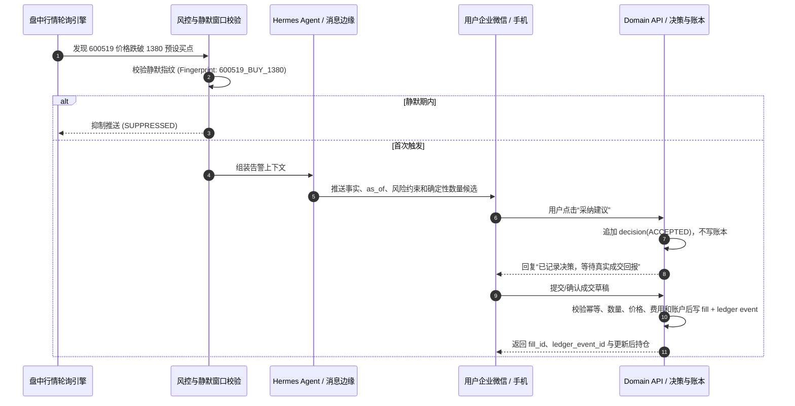

# 盘中触点告警与 HITL 人机协同确认 SOP (09:30 - 15:00)

## 1. 核心原则
1. **决策不等于成交**：系统只提供告警与建议。用户“采纳”写 `reporting.decisions`；真实券商回报、对账导入或用户二次确认的成交草稿才可写账本。L1 严禁自动发单。
2. **防振荡静默窗口 (Anti-Whipsaw)**：同一标的在阈值附近上下波动时，系统在设定的静默窗口（如 60 分钟）内只产生一条告警指纹，杜绝消息轰炸。
3. **出局规则强制闭环**：确认的买入成交关联已有 `research.theses.invalidation_conditions`；规则缺失时成交仍按真实事实入账，但立即产生待补充风险项，不能伪造出局线。
4. **数据失败关闭**：行情陈旧、停牌、涨跌停、时间戳倒退、主备冲突或风险输入不足时，抑制动作建议并说明原因。

---

## 2. 交互流转时序



---

## 3. 企业微信交互告警卡片模板

```markdown
### ⚠️ 盘中点位触达交互告警
> `EXAMPLE / NOT_LIVE` | as_of: `YYYY-MM-DDThh:mm:ss+08:00`
> **标的**：贵州茅台 (600519) | **当前现价**：`1379.50` 元 (跌幅 -1.82%)

#### 📋 触发原由与建议方案
• **触发条件**：现价触及盘前预设的低吸加仓区间 (`1380.00` 元)。
• **数量候选**：确定性风险引擎按已确认策略计算 **100 股示例候选**；展示公式、手数取整、费用和剩余现金。
• **出局条件**：已有 thesis 包含 `1350.00` 元示例失效检查；成交后关联，不由模型临时生成。

---
请回复对应指令记录决策：
👉 回复 **`采纳建议`** ：只记录决策；成交后再上传/确认价格、数量、费用和时间
👉 回复 **`忽略`** ：放弃本次机会，保持现有持仓
```
