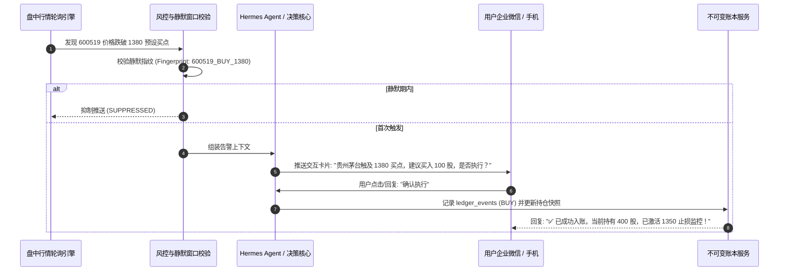

# 盘中触点告警与 HITL 人机协同确认 SOP (09:30 - 15:00)

## 1. 核心原则
1. **严禁全自动私自发单**：系统永远只提供“告警与决策建议”，必须由用户在微信或 Web 端明确点击或回复确认。
2. **防振荡静默窗口 (Anti-Whipsaw)**：同一标的在阈值附近上下波动时，系统在设定的静默窗口（如 60 分钟）内只产生一条告警指纹，杜绝消息轰炸。
3. **出局规则强制闭环**：任何买入建仓指令确认后，必须联动写入 `research.theses` 的 `invalidation_conditions`。

---

## 2. 交互流转时序



---

## 3. 企业微信交互告警卡片模板

```markdown
### ⚠️ 盘中点位触达交互告警
> **标的**：贵州茅台 (600519) | **当前现价**：`1379.50` 元 (跌幅 -1.82%)

#### 📋 触发原由与建议方案
• **触发条件**：现价触及盘前预设的低吸加仓区间 (`1380.00` 元)。
• **建议动作**：加仓 **100 股**（耗费现金约 13.8 万元，账户剩余现金充裕）。
• **出局保障**：买入后自动绑定 `1350.00` 元破位止损线。

---
请回复对应指令完成记账：
👉 回复 **`确认买入`** ：系统自动记录真实交易并更新资产大盘
👉 回复 **`忽略`** ：放弃本次机会，保持现有持仓
```
