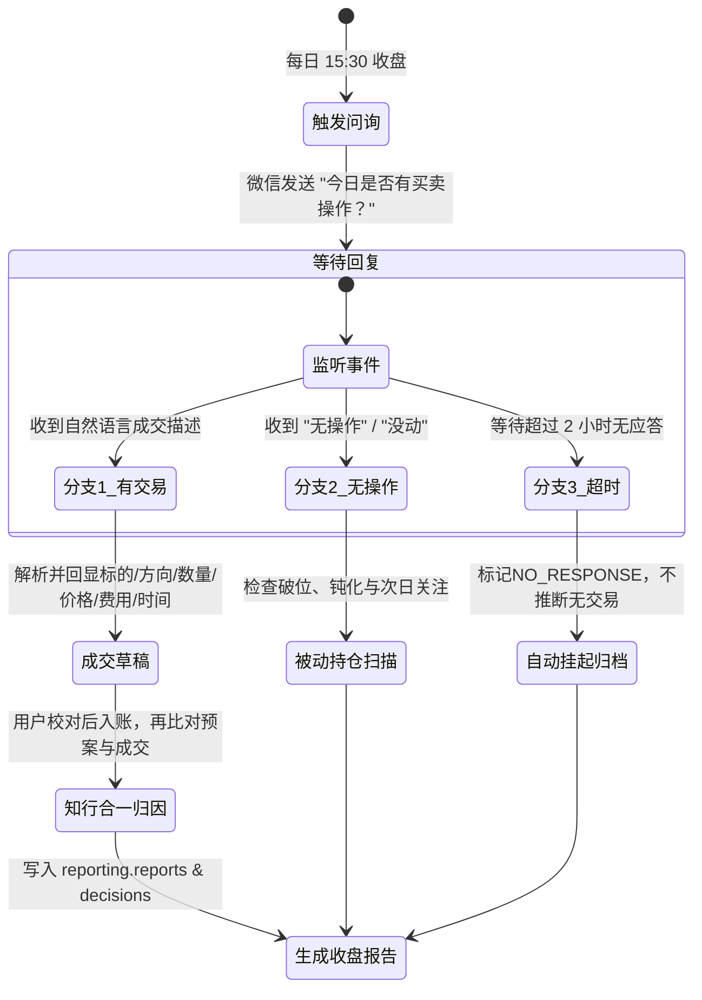

# 盘后交互式复盘与自进化归因 SOP (15:30 - 21:00)

## 1. 核心流程与超时归档机制

---

## 2. 交互实录与归因标准

### 分支 1：用户回复了买卖操作
- **用户回复**：`"今天在 1385 元买入了 100 股茅台"`
- **系统先回显成交草稿**：标的 `600519`、买入 `100 股`、单价 `1385 元`、交易日期/时间待确认、费用待确认。字段缺失时只追问或允许 Web 补充，不能猜测。
- **用户确认后分析**：
  - 早盘预案低吸区间为 `1380 ~ 1390 元`；
  - 实际成交价 `1385 元` 落在预设区间内；
  - 评级：**【知行合一·优秀执行】**，执行滑点仅 +0.36%，成功克服追涨杀跌冲动。
- **系统动作**：在同一事务把 `trade_fills(DRAFT)` 确认为 fill，幂等写入 `ledger_events(BUY)` 并更新投影；若用户否认草稿则标记 `REJECTED`，不入账。

### 分支 2：用户回复“无操作”
- **系统动作**：记录用户明确的“无操作”决策，再按带来源和时点的收盘数据扫描组合；示例点位不得冒充当日真实数据。

### 分支 3：用户超过 2 小时未回复 (17:30)
- **系统动作**：静默结束会话，生成 `PARTIAL / NO_RESPONSE` 归档；该状态仅表示未回复，不能推断当日没有券商交易。默认不发送第二条追问通知。
