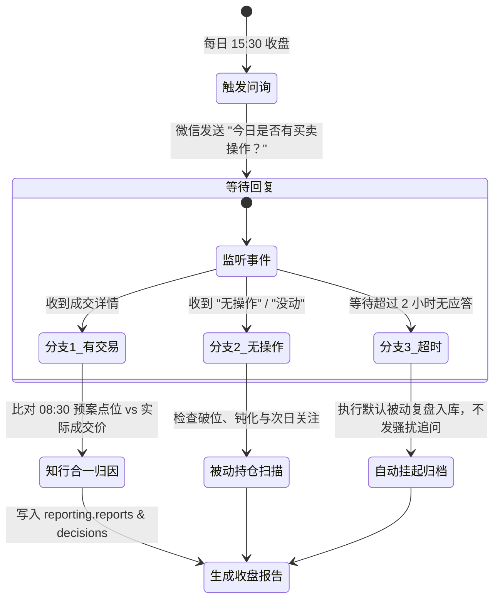

# 盘后交互式复盘与自进化归因 SOP (15:30 - 21:00)

## 1. 核心流程与超时归档机制

---

## 2. 交互实录与归因标准

### 分支 1：用户回复了买卖操作
- **用户回复**：`"今天在 1385 元买入了 100 股茅台"`
- **系统分析**：
  - 早盘预案低吸区间为 `1380 ~ 1390 元`；
  - 实际成交价 `1385 元` 完美落在预设区间内；
  - 评级：**【知行合一·优秀执行】**，执行滑点仅 +0.36%，成功克服追涨杀跌冲动。
- **系统动作**：原子写入 `ledger.ledger_events (BUY)`，更新持仓至 400 股。

### 分支 2：用户回复“无操作”
- **系统动作**：自动扫描全组合。茅台收盘 1425 元（+0.35%），依然运行在 1380 支撑与 1460 阻力之间，输出：“组合运行健康，继续耐心持股待涨”。

### 分支 3：用户超过 2 小时未回复 (17:30)
- **系统动作**：静默结束会话，后台生成《每日收盘被动归档报告》，状态标记为 `PARTIAL_UNCONFIRMED`，绝不发送第二条追问通知。
