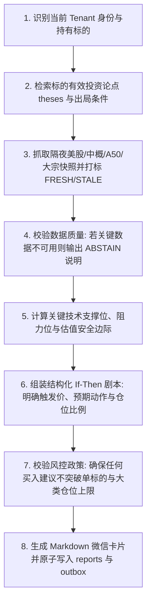

# 盘前推演与 If-Then 操盘剧本生成 SOP (08:30 - 09:15)

## 1. 目标与定位
在交易日早盘 `08:30`，为投资者提供一份**有时态、有来源证据、有严格 If-Then 预案、无虚假脑补**的盘前推演报告，协助投资者在开盘前于券商 App 预设条件单，打破情绪化盘中冲动。

---

## 2. 思考链路 (Chain of Thought - CoT)



---

## 3. 输出 JSON Schema 约束

LLM 生成的结构化输出必须严格符合以下 JSON 契约：

```json
{
  "report_session": "PRE_MARKET",
  "trade_date": "YYYY-MM-DD",
  "data_quality_status": "FRESH",
  "macro_summary": "隔夜美股纳指收涨0.8%，富时A50期指微跌0.15%，国内政策聚焦新质生产力。",
  "items": [
    {
      "item_type": "ACTION_PLAN",
      "symbol": "600519",
      "asset_name": "贵州茅台",
      "support_price": 1380.00,
      "resistance_price": 1460.00,
      "if_then_plan": {
        "if_break_above": "若早盘放量冲高突破 1460 阻力位，持有不动，不追高；",
        "if_pullback_below": "若缩量回调至 1380-1390 支撑区间企稳，可按计划补仓 100 股（消耗可用资金约 20%）；",
        "if_invalidation": "若放量跌破 1350 止损底线，触发论点失效审查，准备逢反弹分批减仓。"
      },
      "severity": "INFO"
    }
  ],
  "policy_check": {
    "passed": true,
    "current_equity_pct": 52.5,
    "equity_limit_pct": 60.0
  }
}
```

---

## 4. 企业微信富文本卡片模板 (Markdown)

```markdown
### 🌅 WealthSail 盘前操盘剧本 | 2026-08-23
> **数据时态**：2026-08-23 08:30:00 (FRESH) | **组合净值**：506,000 元

#### 🌐 隔夜宏观与外盘风向
• 美股纳指 +0.82%，富时中国 A50 期指 -0.12%，离岸人民币汇率 7.2150 运行平稳。
• 大宗商品：Brent 原油 $82.5/桶，上海金现货 568.2 元/克。

#### 🎯 持仓标的 If-Then 操盘预案
• **【贵州茅台 (600519)】**（成本 1400.00 元 | 最新 1420.00 元）
  - **支撑位**：`1380.00` 元 | **阻力位**：`1460.00` 元
  - 🟢 **低吸计划**：若盘次回调至 **1380 ~ 1390 元** 企稳，建议补仓 **100 股**（约占总资金 2.7%）。
  - 🔴 **防守出局**：若有效跌破 **1350.00 元** 止损底线，触发投资论点失效，执行减仓。
  - ⚪ **突破应对**：若直接冲高突破 1460 元，持有不动，严禁盘中追高。

---
💡 *提示：您可依据上述点位提前在券商 App 预埋条件单。盘中触及点位时系统将推送即时告警卡片。*
```
